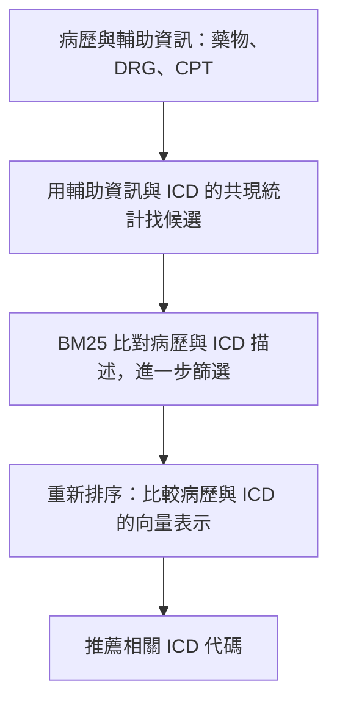

# Multi-stage Retrieve and Re-rank Model for Automatic Medical Coding Recommendation

## 初讀摘要

這篇研究如何讀取病歷，自動推薦對應的 ICD 代碼。核心做法是 **先檢索候選，再用模型重新排序**，減少直接從幾千種代碼中挑選的難度。

- 一份病歷可能對應多個 ICD，因此是多標籤任務。難點是病歷很長、代碼很多，而且常見與罕見代碼的資料量差距很大。
- 先用藥物、DRG、CPT 與 ICD 的統計關係找候選，再用 BM25 比對病歷與代碼描述，縮小範圍。
- 用 Clinical-Longformer 理解病歷，並以 Graphormer 整合 ICD 之間的共同出現關係；透過對比學習訓練病歷與代碼的匹配能力。
- 使用 MIMIC-III 中已附 ICD-9 代碼的出院摘要訓練，重點是自動編碼模型，不是人工標註流程，也不是把檢索結果直接當成正確標籤。

## 核心流程



### 1. 輔助資訊檢索

先從訓練資料統計：出現某種藥物、DRG 或 CPT 時，某個 ICD 出現的機率有多高？

- **DRG**：住院病例的診斷相關分組。
- **CPT**：醫療處置與服務代碼。
- **藥物**：病人的處方資訊。

保留條件機率超過門檻的 ICD，將三種來源的候選取聯集。原文使用門檻 η = 0.005。

這一步提供可能的疾病或處置線索，並不表示某種藥物必然對應某個 ICD。

### 2. BM25 初步篩選

用病歷文字比對候選 ICD 的描述，保留 BM25 分數超過門檻的代碼。原文 §3.2 的公式是在前一步候選集合內篩選，使用 θ = 200，並不是固定取 Top-5。

| 階段 | 平均候選數 |
|---|---:|
| 完整標籤集合 | 8,922 |
| 輔助資訊檢索後 | 約 1,460 |
| BM25 篩選後 | 約 1,299 |

原文 §5 報告，輔助資訊檢索階段涵蓋 99.22% 的正確代碼；這個數字不能直接當成 BM25 篩選後的涵蓋率。

### 3. 對比學習與重新排序

兩邊分別產生可以比較的向量：

| 對象 | 方法 | 用途 |
|---|---|---|
| 病歷 | Clinical-Longformer | 理解較長的臨床文字，實驗最多保留 4,000 tokens |
| ICD | Clinical-Longformer 編碼代碼描述，再用 Graphormer 整合代碼共現圖 | 同時利用代碼語意與代碼間的關係 |

ICD 共現圖從訓練資料的條件機率建立，是有方向的關係；原文設定 λ = 1，因此保留的是條件機率達到 1 的邊，不能只理解成所有「經常一起出現」的代碼都會連線。

訓練時，把病歷與正確 ICD 的表示拉近，與負樣本的表示推遠。實際推薦時，計算病歷與候選代碼的向量相似度，將較相關的代碼排在前面。

## 訓練標籤從哪裡來？

使用 MIMIC-III 既有資料：出院摘要來自 NOTEEVENTS，ICD-9 標籤來自 DIAGNOSES_ICD 與 PROCEDURES_ICD；輔助資訊來自 DRGCODES、CPTEVENTS 與 PRESCRIPTIONS。

- **正樣本**：該份病歷既有的正確 ICD 標籤。
- **負樣本**：原文 §3.3 從同一批資料的其他病歷代碼中隨機抽取，排除該病歷的正確標籤。
- **檢索候選**：用來縮小後續排序的搜尋範圍，不會自動成為正確標籤。

## 實驗結果重點

在 MIMIC-III-full，Table 1 報告 Micro-F1 為 0.603、P@8 為 0.775；對照 KEPTLongformer 分別為 0.599、0.771。P@8 表示前八個推薦代碼中，平均有多少比例是正確代碼。

這篇在多項指標上改善，但不是所有指標都最好，例如 Macro-F1 仍低於 KEPTLongformer。Table 2 移除輔助資訊檢索或 Graphormer 後，Micro-F1 都下降。

## 我的延伸構想：BM25 → SFT／DPO

以下是延伸設計，並非原論文已執行的方法。

我的想法是先用 BM25 搜尋 Top-K 候選，例如前五名，再訓練語言模型判斷哪些 ICD 符合病歷。它與原文共用「先檢索，再精細判斷」的架構，但後半段改成 SFT 或 DPO。

假設既有標註為 ICD-A、ICD-C，BM25 找到 A、B、C、D、E。以下代碼只作示意。

### SFT：直接學習正確輸出

```text
輸入：
病歷：……
候選 ICD 及各自描述：A、B、C、D、E
任務：選出所有符合病歷的候選代碼。

目標輸出：
["ICD-A", "ICD-C"]
```

也可讓目標輸出逐一列出候選的正確／錯誤判斷。即使輸出包含正負判斷，仍可用 SFT；不會因為出現「正例、負例」就變成 DPO。

### DPO：比較兩個回答

同一個輸入，提供一組經確認的偏好回答：

```text
prompt：病歷＋相同候選清單＋選碼任務
chosen：["ICD-A", "ICD-C"]
rejected：["ICD-A", "ICD-B"]
```

DPO 提高較佳回答相對於較差回答的偏好。一般而言 chosen／rejected 表達相對偏好；在此選碼任務中，需用可靠標註確認哪個回答較好，不能只根據 BM25 分數決定。

| 面向 | 原論文 | 我的延伸構想 |
|---|---|---|
| 候選產生 | 輔助資訊統計，再用 BM25 門檻篩選 | BM25 Top-K |
| 模型學習 | 病歷與代碼向量的對比學習 | SFT 學習選碼；可再評估 DPO |
| ICD 關係 | Graphormer 利用代碼共現圖 | 目前尚未加入 |
| 主要輸出 | 候選代碼的相關性排序 | 正確代碼清單或逐項判斷 |

