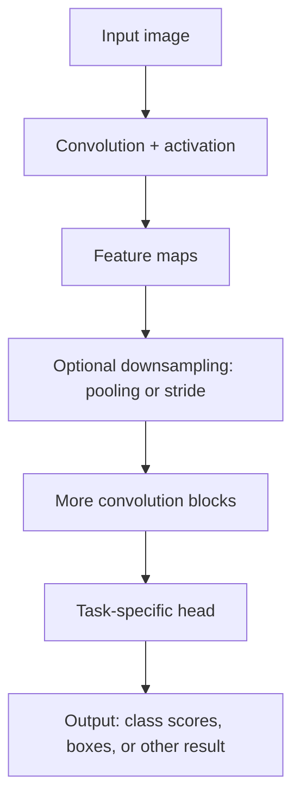
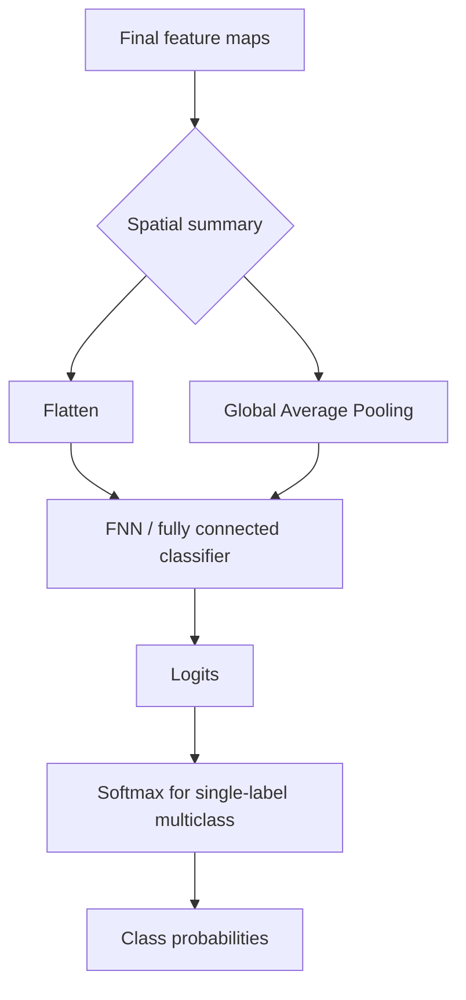

# Convolutional Neural Network (CNN)

CNN 常用於影像等有空間結構的資料。它用 kernel/filter 掃過 input，讓每個 output position 只讀取附近區域；同一組 kernel weights 會在不同位置重複使用。

## Receptive Field and Overlap

![[Assets/Note/Research/Convolutional Neural Network (CNN)/01-局部感受野與重疊視窗.png]]

圖中的每個紅框代表一個 output unit 讀取的 input area，也就是它的 **receptive field**。相鄰位置的 receptive fields 可以重疊，所以附近的 outputs 會共同讀到部分 input values。

圖示 input 有 3 個 channels。每個位置使用 $3 \times 3 \times 3$ kernel：kernel size 是 $3 \times 3$，並涵蓋全部 3 個 input channels。將這 27 個 input values 分別乘上對應 weights 後加總（再加上 bias），經過 activation，得到一個 output value。

kernel 滑到下一個位置時，**weights 保持相同**，只更換它讀取的 input area。若 stride 是 $1$，相鄰的 $3 \times 3$ receptive fields 通常會重疊。這種 weight sharing 讓模型可以在影像不同位置辨識相似的局部模式，也比每個位置各自學一整套 weights 更省參數。

## Parameter Sharing Across Positions

嚴格來說，不是 receptive field 本身共用參數，而是**同一個 filter 的 weights 會套用到不同位置的 receptive fields**。每個位置讀取的 input area 不同，但使用的 weights 相同。

| 對象 | Weights 的關係 |
|---|---|
| 同一個 filter 在不同位置 | 共用同一組 weights |
| `filter 1` 和 `filter 2` | 各自有不同 weights，可以學不同的 patterns |

例如，input 為 $6 \times 6 \times 3$，kernel size 為 $3 \times 3$，stride 為 $1$ 且 padding 為 $0$，單一 filter 會產生 $4 \times 4$ feature map，也就是 $16$ 個 output positions。該 filter 有 $3 \times 3 \times 3=27$ 個 weights，並在這 $16$ 個位置重複使用；若每個位置各有一套 weights，則需要 $16 \times 27=432$ 個 weights（不計 bias）。`filter 2` 會另外學自己的 $27$ 個 weights。

Parameter sharing 的好處是減少 weights 數量，並讓同一個 filter 能在影像不同位置偵測相似的 pattern。CNN 同時使用 local receptive fields 和 parameter sharing：每個 output 只看局部區域，而每個 filter 的 weights 跨位置重用。

每個 filter 都會各自掃過 input 的所有位置，並把各位置的 output 排成自己的 feature map。`filter 1` 和 `filter 2` 使用不同 weights，因此可以學到不同的 patterns。

## Inductive Bias

CNN 的 architecture 內建了對影像的假設，稱為 **inductive bias**：有用的 pattern 通常是局部的，所以每個 unit 只看一小塊 receptive field。同一種 pattern 可能出現在不同位置，所以同一個 filter 會在各位置重用 weights。這些假設符合很多影像特性，能減少參數，也讓模型更容易學到可在不同位置辨識的 pattern。但若任務很依賴絕對位置或全局關係，這些假設就可能不合適。

## Choosing the Receptive Field

一般 CNN 會先由設計者設定 kernel size、stride、padding 和 dilation 等結構參數；training 主要學的是 kernel 裡的 **weight values**，通常不會自行改變視窗的形狀或範圍。因此，receptive field 要配合資料中的 spatial patterns、task、image size 和計算成本來選，再用 validation results 檢查是否合適，不是任意設定。

### Stride as a Hyperparameter

![[Assets/Note/Research/Convolutional Neural Network (CNN)/02-Stride-and-Padding.png]]

`stride` 是一般 CNN 的 hyperparameter：設計時先選定，training 通常不會自行學習或改變它。`kernel size` 決定每次讀取的 input area 大小；`stride` 決定 kernel 每次移動幾格。

圖中 kernel size 為 $3 \times 3$、stride 為 $2$，所以 kernel 每次移動 $2$ 格。若 input 是 $6 \times 6$ 且 padding 為 $0$，每個 filter 的 output size 為：

$$
\left\lfloor\frac{6-3}{2}\right\rfloor+1=2
$$

因此會得到 $2 \times 2$ feature map。相鄰視窗相隔 $2$ 格，而 kernel size 是 $3$ 格，所以它們仍會重疊 $1$ 格。

當 kernel 的視窗移到邊界、部分範圍落在 input 外時，可以在 input 周圍加入 `padding`，讓邊界附近也能被取樣。常見做法是補 $0$；圖中的外框表示補上的區域。

以 $6 \times 6$ input、kernel size 為 $3 \times 3$、stride 為 $2$ 為例，若四邊各補 $1$ 格（padding 為 $1$），輸出尺寸為：

$$
\left\lfloor\frac{6+2(1)-3}{2}\right\rfloor+1=3
$$

因此每個 filter 會得到 $3 \times 3$ feature map；若不補（padding 為 $0$），則只有 $2 \times 2$。這裡的 padding 讓 receptive fields 能涵蓋到 input 的邊緣。

kernel size 不一定是正方形。$K_h$ 和 $K_w$ 可以不同，例如 $3 \times 5$；$1 \times 5$ 或 $5 \times 1$ 也可用來處理長條形的局部範圍。$1 \times 1$ convolution 不讀鄰近 spatial positions，主要在每個 position 混合不同 input channels 的資訊。

堆疊 convolution layers 後，較深層的單一 output 會間接依賴更大塊的原始 input。例如，兩層連續的 $3 \times 3$、stride 為 $1$ 的 convolution，第二層一個 position 在原始 input 上的 receptive field 可達 $5 \times 5$。所以要分清楚「單層 kernel size」和「深層 unit 對原始 input 的整體 receptive field」。

## Kernel and Feature Map

- **kernel / filter**：用來偵測局部模式的一組 weights。
- **kernel size**：kernel 在 spatial dimensions 上的高和寬。單個 $3 \times 3$ kernel 若 input 有 3 個 channels，會有 $27$ 個 weights；若另有 bias，則多一個 parameter。
- **feature map**：同一個 filter 掃過所有位置後產生的 output matrix。
- **output channels**：使用不同 filters 會產生不同 feature maps；filter 的數量決定 output channels 數量。
- **stride**：kernel 每次移動幾格。stride 越大，output 的 spatial size 通常越小。
- **padding**：在 input 邊界外補值，控制邊緣資訊和 output size。
- **dilation**：拉開 kernel 取樣點的間距；可在不增加 weights 數量的情況下擴大有效 receptive field。

若 input height、width 為 $H,W$，kernel size 為 $K_h,K_w$，stride 為 $S$，每側 padding 為 $P$，output size 為：

$$
H_{out}=\left\lfloor\frac{H+2P-K_h}{S}\right\rfloor+1,\qquad
W_{out}=\left\lfloor\frac{W+2P-K_w}{S}\right\rfloor+1
$$

例如 $6 \times 6$ input 使用 $3 \times 3$ kernel、stride 為 $1$、padding 為 $0$，每個 filter 會產生 $4 \times 4$ feature map。

## CNN Model Architecture

第一個 convolution block 接收 input image；後續 blocks 則接收前一層的 feature maps。每個 filter 會產生一張 feature map，多個 filters 形成多個 channels，繼續傳給下一層。

常見流程是先做一個或多個 `convolution + activation` blocks，再視需要做 pooling 或用較大的 stride downsampling。`pool size`、pooling 的 stride 和 pooling type（例如 `Max Pooling` 或 `Average Pooling`）通常是設計時選定的 hyperparameters；標準 pooling operation 沒有 trainable weights。實際順序依 architecture 和 task 而定，不必每個 convolution block 後都交替接 pooling。

Classification head 會先產生 logits；單標籤、多類別分類通常再用 `softmax` 轉成 probabilities。Binary classification 或 multilabel tasks 常改用 `sigmoid`。Object detection head 則可能輸出 bounding boxes 和 class scores。CNN 不只有一種固定 block 數量或 head。

### Image Classification Head Example

最後一層 feature maps 可以先經過 `Flatten`，把 $H \times W \times C$ 攤平成一維向量，再送進 FNN / fully connected classifier。另一種常見做法是用 `Global Average Pooling` 對每個 channel 的 spatial positions 取平均，再交給 classifier；它保留 channel 數量，通常比直接 Flatten 產生更短的向量。

`Flatten` 和 `Global Average Pooling` 是兩種不同的 spatial summary 選擇，不是每個 CNN 都會依序使用兩者。

### Max Pooling Example

`Max Pooling` 會在 `feature map` 的每個 pooling window 中保留最大值。下面用 $2 \times 2$ window、stride $2$ 示範；每個 channel 分開處理，Max Pooling 本身沒有 trainable weights：

$$
\begin{bmatrix}
1 & 3 & 2 & 4 \\
2 & 5 & 0 & 1 \\
6 & 1 & 2 & 8 \\
3 & 4 & 7 & 2
\end{bmatrix}
\xrightarrow{\mathrm{MaxPool}_{2\times2,\;s=2}}
\begin{bmatrix}
5 & 4 \\
6 & 8
\end{bmatrix}
$$

每個 $2 \times 2$ 區塊輸出其中的最大值，因此 `feature map` 的 height 和 width 各縮小一半。Pooling 通常逐個 channel 獨立處理，會縮小 spatial dimensions，但保留 channels 數量。Pooling 是常見的 downsampling 方法，但不是每個 CNN 都必須使用。

## Data Augmentation

`Data Augmentation` 是常見的 image training technique，不是 CNN architecture 裡的一層。Training 時對 images 做隨機變換，增加資料變化，幫助模型 generalize；常見例子包括 random crop、horizontal flip、small rotation、brightness 或 color jitter。

Augmentation 必須保留原本的 label 意義。若是 object detection 或 segmentation，幾何變換也要同步套用到 bounding boxes 或 masks；若左右方向本身有意義，就不應任意 horizontal flip。通常只 augment training data，validation 和 test data 保持固定處理流程。
