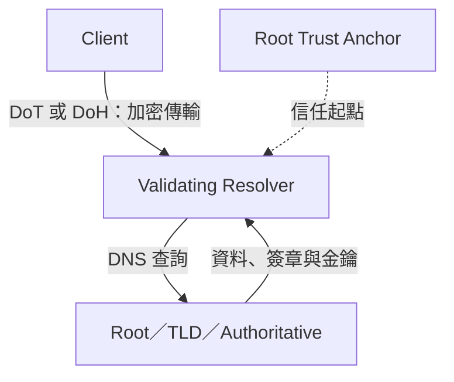
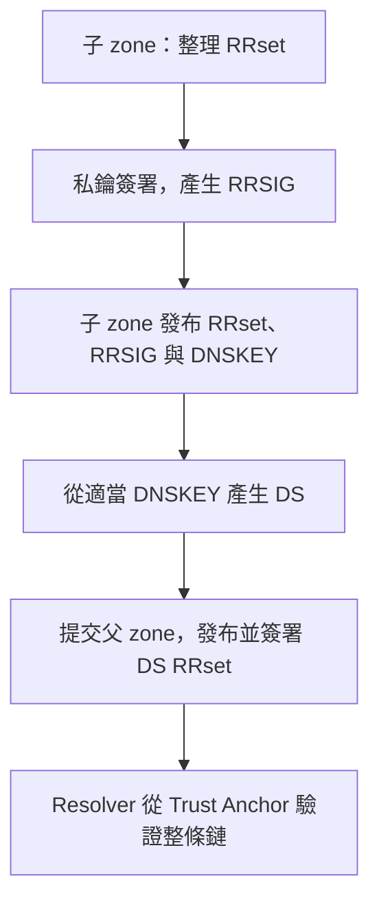

## TL;DR

| 想解決什麼 | 使用什麼 | 要記的差別 |
|---|---|---|
| 名稱轉成 IP | DNS | Resolver 查詢權威資料並快取 |
| 答案是否來自正確 zone、是否被竄改 | DNSSEC | 驗證 RRset 簽章與信任鏈，不加密查詢 |
| Client 到 resolver 的查詢不被沿途窺看 | DoT／DoH | TLS 加密傳輸；resolver 自己仍能讀內容 |
| BIND 替自己的 zone 簽署 | dnssec-policy | 屬於權威 zone 的簽署管理 |
| BIND 驗證外部查詢結果 | dnssec-validation | 屬於 validating resolver 的驗證設定 |
| BIND 接收 DoT／DoH | options 裡的 listen-on | 引用最外層 tls／http 設定；不因啟用 DNSSEC 自動開啟 |

原理放本篇；安裝、簽署與 listener 範例放 [[Linux DNS Bind9 相關設定]]。

## 專業名稱

![[Assets/Note/Research/DNS (Domain Name Service)/01-專業名稱.png]]

---

## DNS Server 伺服器類型說明

- **Primary Server**：
    
    - 在 DNS 上建立區域後，若可以直接新增、刪除、修改該區域內的紀錄，稱為 Primary Server。
        
    - 儲存該區域的 master copy（主副本資料）。
        
- **Secondary Server**：
    
    - 這類伺服器無法直接編輯區域紀錄，而是從其他伺服器複寫紀錄。
        
    - 複寫來的紀錄稱為 replica。
        
- **Master Server**：
    
    - 提供區域資料給 Secondary Server 的伺服器稱為 Master Server。
        
    - 這種將資料從 Master 傳送至 Secondary 的動作稱為 **Zone Transfer**（區域傳輸）。
        
- **Caching-only Server**：
    
    - 不負責任何區域權威，只提供查詢與快取。
        
    - 查詢結果暫時存放於本地端，供下一次快速回覆使用。
        

---

## DNS 查詢流程與類型

![[Assets/Note/Research/DNS (Domain Name Service)/02-DNS 查詢流程與類型.jpg]]

- **DNS 查詢的類型**：
    
    - **遞迴式查詢（Recursive）**：
        
        - Client 向 DNS Server 查詢，若 DNS Server 沒有答案會繼續向其他伺服器查詢並回覆 client。
            
        - 常見於 DNS client 與 DNS Server、Forwarder。
            
    - **反覆式查詢（Iterative）**：
        
        - DNS Server 間互相查詢時多為此模式。
            
        - 若無答案，只回覆下一層 DNS Server 的資訊，讓查詢者自行遞迴下去。
            
- **查詢來源分類**：
    
    - **授權回應（Authoritative Answer）**：
        
        - DNS Server 為該名稱空間的授權伺服器，可提供正確回應或回報查無資料。
            
    - **非授權回應（Non-authoritative Answer）**：
        
        - DNS Server 僅回應來自快取的資料（DNS cache），可能透過轉寄（forward）或向根提示查詢獲得資料。
            

---

## HOSTS File 本機解析優先

系統會優先檢查本機 `C:\Windows\System32\drivers\etc\hosts` 檔案是否有對應的 host 紀錄，若無再查詢 DNS。

![[Assets/Note/Research/DNS (Domain Name Service)/01-HOSTS File 本機解析優先.png|01-HOSTS File 本機解析優先.png]]

---

## DNS Resource Record（資源紀錄）類型

- **SOA（Start of Authority）**：
    
    - 每個 Zone File 中必須且僅能有一筆。
        
    - 放在檔案的最前面，記載該區域的名稱伺服器、版本號（serial）、更新頻率等資訊。
        
    - 用於區域間的同步判斷（例如 Secondary Server 會依 SOA 判斷是否需要更新）。
        
- **NS（Name Server）**：
    
    - 指定此區域使用哪些 DNS 伺服器。
        
    - 可包含多筆，通常會包含 Primary 與多個 Secondary 的位址。
        
- （可擴充：A、AAAA、MX、PTR、CNAME、TXT 等常見記錄類型）

## 遞迴查詢與反覆查詢：誰負責查到底？

**Recursive query 是請對方幫忙查到底；iterative query 則允許對方回覆下一個該問誰。** Recursive resolver 因為替 client 執行遞迴解析而得名，不代表它向 root 也提出遞迴要求。

以沒有可用快取、沒有 forwarder 的典型解析為例：

```text
Client → Recursive Resolver：請幫我查 www.example.com 的 A
Resolver → Root：取得 .com 的 referral
Resolver → .com：取得 example.com 的 referral
Resolver → example.com 權威伺服器：取得 A 答案
Resolver → Client：回覆結果，並依 TTL 快取
```

Root、TLD、權威伺服器都是由 resolver 分別詢問，不是 root 代替 client 一路向下問。快取、forwarder、CNAME 與 QNAME minimization 等機制會影響實際查詢次數和名稱；上面是角色示意。

## DNSSEC、DoT、DoH：保護什麼？

**DNSSEC 驗證 DNS 資料的來源與完整性；DoT／DoH 保護 DNS 傳輸的機密性與完整性。** 可以同時使用，TLS 伺服器身分驗證與 DNSSEC 的 zone 資料驗證是不同層次的信任。

| 技術 | 核心功能 | 是否隱藏查詢內容 | 常見傳輸 |
|---|---|---|---|
| DNSSEC | 以數位簽章驗證 DNS 資料，並驗證不存在的名稱／紀錄類型 | 本身不加密 | 沿用 DNS 傳輸，也能搭配 DoT／DoH |
| DoT | 透過 TLS 保護 DNS 訊息 | 對傳輸路徑上的旁觀者加密；resolver 仍可讀取 | DNS → TLS → TCP，通常 TCP 853 |
| DoH | 把 DNS 訊息放入 HTTPS request／response | 對傳輸路徑上的旁觀者加密；resolver 仍可讀取 | 通常 HTTPS 443；HTTP/2 使用 TCP，HTTP/3 使用 QUIC／UDP |

- DoT 使用獨立的常用埠，比較容易按埠做網路政策；DoH 與一般 HTTPS 同用 443，僅靠埠較難區分，但不代表完全無法管理。
- TLS 的保護成立於憑證及服務名稱驗證正確的連線。加密連到某個 resolver，不代表它回覆的資料已經過 DNSSEC 驗證。
- Client 到 resolver 使用 DoT／DoH，不會自動使 resolver 到各權威伺服器的每一跳都加密。
- DNSSEC 不保證網站內容安全；DoT／DoH 也不提供對 resolver 本身的匿名性。



傳輸規格參考：[RFC 7858：DoT](https://www.rfc-editor.org/rfc/rfc7858)、[RFC 8484：DoH](https://www.rfc-editor.org/rfc/rfc8484)。

## DNSSEC 的紀錄與信任鏈

| 名稱 | 放在哪裡／用途 |
|---|---|
| DNSKEY | 子 zone 公開的金鑰，供驗證簽章使用；私鑰不發布 |
| RRSIG | 對 RRset 的簽章；RRset 是同名、同 class、同 type 的紀錄集合 |
| DS | 放在父 zone，包含子 zone 特定 DNSKEY 的摘要及識別欄位，連接父子信任 |
| Trust anchor | 驗證器預先信任的起點；公開 DNS 通常從 root 開始 |
| NSEC／NSEC3 | 提供經簽署的不存在證明，例如不存在的名稱或紀錄類型 |

傳統 KSK 簽 DNSKEY RRset、ZSK 簽其他 RRset；CSK 則由同一把金鑰負責這兩種用途。這些是金鑰角色，不是額外的 DNS record type。

### 簽署端流程：誰簽誰、DS 交給誰？

**用 zone 的私鑰簽 RRset，產生 RRSIG；公開金鑰放 DNSKEY；從 KSK／CSK 對應 DNSKEY 產生 DS，交給父 zone 發布。** 不是「RRSIG 自己去簽資料」，也不會把私鑰交給父層。

| 步驟 | 動作 | 結果放哪裡 |
|---|---|---|
| 1 | 將同名、同 class、同 type 的紀錄組成 RRset | 子 zone，例如 www.example.com 的 A RRset |
| 2 | 用對應私鑰簽署 RRset，產生 RRSIG | 子 zone，與被簽署資料一起提供 |
| 3 | 發布公開 DNSKEY；DNSKEY RRset 本身也有簽章 | 子 zone |
| 4 | 從適當的 KSK／CSK 公鑰產生 DS，提交註冊商／父 zone 管理者 | 父 zone 的 DS RRset，再由父 zone 簽署 |
| 5 | Resolver 從已信任的 root anchor，依父層 DS 一路接到答案 | Resolver 驗證，不只是看到 RRSIG 就算成功 |



簽署不會替你加密 DNS 傳輸；只開 BIND 的 dnssec-policy，也不代表公開父 zone 已有 DS。

### 用 www.example.com 說明驗證

**收集資料的先後可能不同，但建立信任時，必須從已信任的 anchor 接到答案。** 不能把「先收到 A + RRSIG」誤認為已驗證成功。

假設相關 zone 都已簽署，並有正確的父層 DS：

1. 以本機 root trust anchor 驗證 root 的 DNSKEY RRset。
2. 用可信的 root 金鑰驗證 root 中 `.com DS` RRset 的 RRSIG。
3. 以 `.com DS` 比對 `.com` 的 DNSKEY，並驗證 `.com DNSKEY` RRset。
4. 用可信的 `.com` 金鑰驗證 `example.com DS` RRset。
5. 以此 DS 比對 `example.com` 的 DNSKEY，並驗證該 zone 的 DNSKEY RRset。
6. 用已可信的 zone 金鑰驗證 `www.example.com A` RRset 的 RRSIG。

```text
Root trust anchor
  → root DNSKEY RRset
  → root 簽署的 .com DS
  → .com DNSKEY RRset
  → .com 簽署的 example.com DS
  → example.com DNSKEY RRset
  → www.example.com A RRset 的 RRSIG
```

DS 比對金鑰仍不夠，DS RRset 本身也必須經父層簽章驗證；DNSKEY RRset 的簽章也要成立。Resolver 可以快取這些驗證結果，不必每次都重新從 root 查起。

### 缺少 DS，不一定是驗證失敗

父層已證實沒有 DS 時，通常仍可解析但屬於 insecure；已有 DS 卻與金鑰不匹配，或簽章驗證失敗時，則屬於 bogus，通常回覆 SERVFAIL。

| 狀態 | 意義 | 一般 validating resolver 的行為 |
|---|---|---|
| Secure | 能從 trust anchor 驗證到答案 | 正常回覆，符合條件時標示 AD |
| Insecure | 例如父層可驗證地證明沒有 DS，無法從該鏈驗證子 zone | 仍可正常解析，但不宣稱通過 DNSSEC 驗證 |
| Bogus | 預期應可驗證，卻出現 DS 不匹配、簽章失效／過期或缺少必要資料等問題 | 正常啟用 checking 時通常回 SERVFAIL |

若根本無法取得或判定委派與驗證資料，不能直接當成已證實的 insecure。私有 trust anchor 也可能讓某子 zone 在沒有公開父層 DS 的情況下被本地驗證。

## DoT／DoH 的連線與防火牆：DNS Server 在哪裡？

假設 BIND 主機是 **192.168.1.10**，憑證服務名稱是 **dns.example.com**：IP 是本例 DNS resolver 的監聽位址，不是所有網路預設都用這個 IP。

| Client 選擇 | 連線目的地 | 伺服器處理 |
|---|---|---|
| 一般 DNS | 192.168.1.10 的 UDP／TCP 53 | 接收一般 DNS 訊息 |
| DoT | dns.example.com，通常 TCP 853 | 先 TLS 驗證與加密，再傳 DNS 訊息 |
| DoH | https://dns.example.com/dns-query，通常 443 | 透過 HTTPS endpoint 接收 DNS 訊息並回覆；不是一般網頁 |

支援原生 DoH 的 BIND 可以由 named 本身監聽 HTTPS，**不需要另外自動啟動 Lighttpd、Nginx 或 Apache**；反向代理是另一種可選架構。單純開 TLS 區塊不等於 listener 已啟動，必須在 options 用 listen-on 引用它。

| 易混淆觀念 | 正確記法 |
|---|---|
| DNSSEC DNSKEY／TLS 憑證 | 前者驗證 zone 資料簽章；後者驗證連線的伺服器身分，不能互換 |
| 只填 nameserver 192.168.1.10 | 傳統 resolv.conf 通常表示一般 DNS，不會因此自動改用 DoT／DoH |
| Client 要設定什麼 | 依 OS／瀏覽器明確選擇 DoT hostname 或 DoH URL，並正確信任憑證 |
| 哪個較容易只靠防火牆 port 控制 | DoT 常用獨立 TCP 853，通常較容易辨識；DoH 與一般 HTTPS 共用 443，單靠 port 較難區分 |
| DoH 是否無法控管 | 不是；可結合端點／瀏覽器政策、允許的 resolver 與防火牆能力，不能因為都是 443 就只封鎖全部 HTTPS |
| Client 到 resolver 已加密 | 不代表 resolver 向 root／TLD／權威查詢的每一跳也已加密 |
| 查詢成功／加密／驗證成功 | 分開確認：能解析、傳輸加密、TLS 身分驗證、DNSSEC 資料驗證，各自不同 |

本例的 BIND 設定位置與驗證指令：[[Linux DNS Bind9 相關設定#DoT／DoH：options、tls 與 http 放在哪裡？]]。

## 重點整理

> [!tip] 重點
> DNSSEC 用 DNSKEY、DS、RRSIG 與 trust anchor 建立 DNS 資料的信任鏈，不加密查詢。DoT 在 TLS over TCP 上傳送 DNS，通常使用 853；DoH 把 DNS 放進 HTTPS，通常使用 443。兩者可以保護 client 到 resolver 的傳輸，再由 validating resolver 驗證 DNSSEC，互相補足。

BIND 的簽署、驗證設定與私有 root 實驗，見 [[Linux DNS Bind9 相關設定#BIND9 的 DNSSEC：簽署與驗證是兩件事]]；DoT／DoH 實際入口設定見 [[Linux DNS Bind9 相關設定#DoT／DoH：options、tls 與 http 放在哪裡？]]。

## 參考資料

- [ISC BIND 9.20.16 DNSSEC Guide](https://bind9.readthedocs.io/en/v9.20.16/dnssec-guide.html)：信任鏈、驗證狀態與部署。
