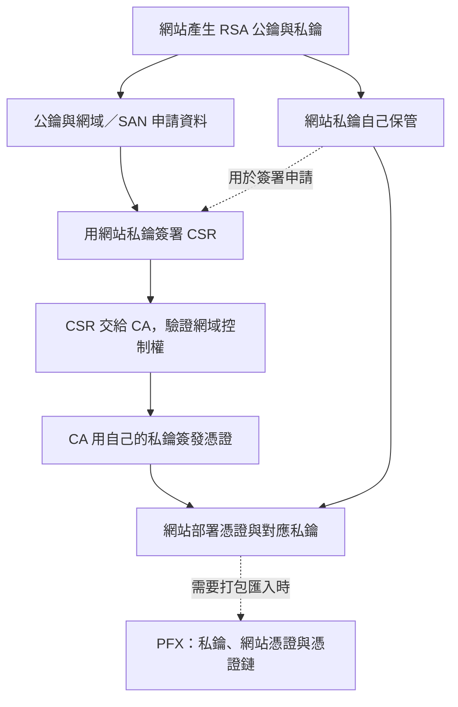
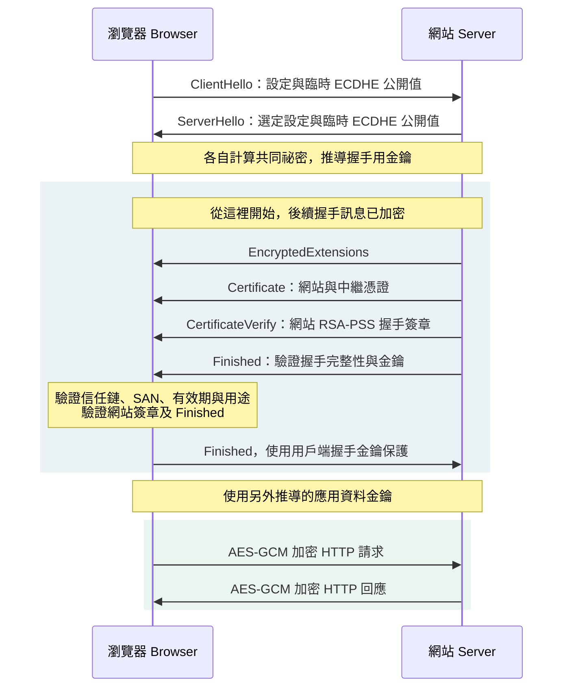
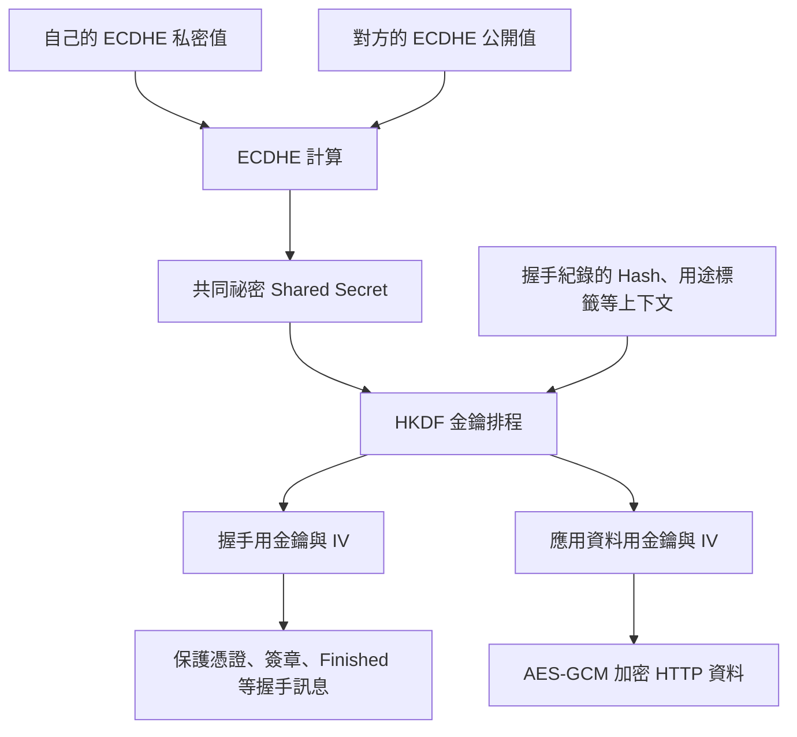

# PKI 公鑰基礎設施與 TLS 流程

> [!tip] 先記住整體流程
> **事前：網站產生金鑰 → CSR 交給 CA → 取得憑證並部署。**
> **連線：ECDHE 建立共同祕密 → HKDF 推導金鑰；憑證與握手簽章驗證身分 → 使用對稱金鑰加密通訊。**
> TLS 1.3 在 ServerHello 之後就開始加密後續握手訊息，並非所有加密都等到憑證驗證完成才開始。

- [[#SSL/TLS 建立過程|完整流程與時序圖]]
- [[#Public／Private：加密與簽章是兩種用途|公私鑰的用途]]
- [[#DH 算法（Diffie-Hellman）|DH 計算範例]]
- [[#HKDF：真正的加密金鑰從哪裡來|HKDF 與資料加密]]
- 實作：[[Linux OpenSSL 憑證管理完整指南]]、[[Linux OpenSSL With Windows Web 憑證設定指南]]。

## 加密技術概述

### 非對稱加密（不是共用同一把密鑰）

公開金鑰密碼技術包含加密、數位簽章與金鑰協商等用途；大量資料通常使用效能較好的對稱加密。並非每種公開金鑰演算法都能同時用於加密和簽章。

> [!important] 主要用途 **通常都使用在身分驗證上面**

#### 優點

- **安全性高**：公私鑰分離，安全性佳
- **公鑰可以公開**：取得公鑰不代表能推算私鑰；但仍要透過憑證等方式驗證公鑰屬於誰，避免被替換。
- **可透過憑證分發公鑰**：信任根仍須由作業系統、瀏覽器或管理者事先建立。

#### 缺點

- **大量資料處理成本較高**：實際差距取決於演算法、金鑰長度、硬體與工作量，不能固定說是 1000 倍。

![[Assets/Note/Research/PKI (Public key infrastructure)公鑰基礎設施/01-缺點.png]]

### Public／Private：加密與簽章是兩種用途

| 目的 | 發送者做什麼 | 接收者做什麼 |
|---|---|---|
| 保密：只有收件者看得懂 | 用**收件者公鑰加密** | 用收件者自己的**私鑰解密** |
| 驗證身分與完整性 | 用**發送者私鑰簽章** | 用發送者的**公鑰驗章** |

**簽章本身不隱藏訊息，也不能一律理解成「私鑰加密、公鑰解密」。** 不同簽章演算法有不同數學運算；驗章確認內容與簽章相符，公鑰對應的身分仍需憑證／信任機制。

> [!example]- 簡化 RSA 簽章：實際怎麼算
> 教學用的小數字：$p=3, q=11, n=pq=33$，$\varphi(n)=20$。
> 選公鑰指數 $e=3$、私鑰指數 $d=7$，因為 $ed=21\equiv1\pmod{20}$。
>
> 假設訊息摘要用數字 $h=4$ 表示：
> - 簽署：$s=h^d\bmod n=4^7\bmod33=16$。
> - 傳送「訊息＋簽章 16」。
> - 驗證：$s^e\bmod n=16^3\bmod33=4$，再與自己計算的訊息摘要比較。
>
> 這只是 textbook RSA 的數學示範，不能當成安全實作。實際 RSA 簽章使用 RSA-PSS 等編碼機制；ECDSA、EdDSA 也不是這套指數運算。

### 對稱加密（共用同一把密鑰）

#### 優點

- **速度快**：加解密效率高
- **安全性佳**：適當的密鑰長度下安全可靠
- **緊湊**：資料傳輸效率高

![[Assets/Note/Research/PKI (Public key infrastructure)公鑰基礎設施/02-優點 - 緊湊 資料傳輸效率高.png]]

### 目前網路使用的加密流程（非對稱加密+對稱加密）

現代網路通訊結合兩種加密技術的優點：

1. 使用非對稱加密進行身分驗證和密鑰交換
2. 使用對稱加密進行實際資料傳輸

![[Assets/Note/Research/PKI (Public key infrastructure)公鑰基礎設施/03-目前網路使用的加密流程(非對稱加密+對稱加密) - 使用對稱加密進行實際.png]] ![[Assets/Note/Research/PKI (Public key infrastructure)公鑰基礎設施/04-目前網路使用的加密流程(非對稱加密+對稱加密) - 使用對稱加密進行實際.png]]

---

## 加密算法種類

### 對稱加密種類

|算法|密鑰長度|安全性|備註|
|---|---|---|---|
|**DES**|56 bit|低|Data Encryption Standard，已不推薦使用|
|**3DES**|三把 DES key，名義 168 bit|已淘汰|不適合新系統，TLS 1.3 不支援|
|**AES**|128/192/256 bit|高|Advanced Encryption Standard|
|**Blowfish**|可變|歷史演算法|64-bit block，不適合新 TLS 設計|

#### AES 變體

- **AES-128／192／256**：金鑰長度分別是 128／192／256 bit；安全性也取決於運作模式與正確實作。
- 本文 TLS 範例使用 **AES-GCM**，同時提供加密與完整性驗證；TLS 1.3 的 AES 套件使用 128 或 256 bit 金鑰。

### 非對稱加密種類

|算法|密鑰長度|主要用途|備註|
|---|---|---|---|
|**RSA**|常見 2048 bit 以上|加密或數位簽章，依機制而定|TLS 1.3 可用於簽章，不能用於 RSA 金鑰交換|
|**DSA**|依參數而定|僅數位簽章|歷史演算法，TLS 1.3 不支援 DSA 簽章|
|**ElGamal**|依參數而定|有加密與簽章相關方案|不能僅依演算法名稱判定授權費用|
|**ECDSA／EdDSA**|依曲線而定|數位簽章|可作為 TLS 身分驗證的選項|

---

## 金鑰交換協定

### DH 算法（Diffie-Hellman）

**DH 是金鑰協商，不是拿來直接加密 HTTP 資料。** 雙方交換公開值，配合各自保留的私密值，算出相同的共同祕密；之後再由 KDF 衍生通訊金鑰。DH 本身不驗證身分，需搭配簽章等機制抵抗中間人攻擊。

![[Assets/Note/Research/PKI (Public key infrastructure)公鑰基礎設施/01-DH 算法(Diffie-Hellman).png]] ![[Assets/Note/Research/PKI (Public key infrastructure)公鑰基礎設施/05-DH 算法(Diffie-Hellman).png]]

#### 運作原理

雙方公開約定質數 $p$ 與底數 $g$，各自保留私密值 $a$、$b$：

| | Alice | Bob |
|---|---|---|
| 私密值，不傳送 | $a$ | $b$ |
| 公開值，互相交換 | $A=g^a\bmod p$ | $B=g^b\bmod p$ |
| 算出共同祕密 | $Z=B^a\bmod p$ | $Z=A^b\bmod p$ |

因為 $(g^b)^a=(g^a)^b=g^{ab}$，兩邊得到相同的 $Z$。安全性仰賴適當群組與參數下的計算困難性，不是只因為私密值沒有傳送。

> [!example]- DH 小數字範例
> 公開：$p=23, g=5$；私密：Alice 選 $a=6$，Bob 選 $b=15$。
> - Alice 公開 $A=5^6\bmod23=8$。
> - Bob 公開 $B=5^{15}\bmod23=19$。
> - Alice 算 $19^6\bmod23=2$；Bob 算 $8^{15}\bmod23=2$。
> - 共同祕密都是 **2**；實際使用大參數，且不直接把這個值當作 AES key。

**ECDHE** 是使用橢圓曲線與臨時金鑰的 Diffie–Hellman；數學上使用曲線點運算，不是直接套用上述模冪公式。網站長期憑證金鑰與這組臨時交換金鑰是不同的金鑰。

### PFS（Perfect Forward Secrecy）

#### 特性

- **意義**：未來長期身分私鑰外洩時，過去錄下的連線仍不應因此被解密。
- 使用適當的臨時 DH／ECDHE 並清除臨時私密值，可提供前向安全性；只換一把對稱金鑰，不一定有 PFS。
- TLS 1.3 的一般憑證式 ECDHE 握手具備此特性，不能概括說「預設不啟用」。PSK-only 或 0-RTT 等情境需另外討論。
- 同一次連線中仍會由祕密衍生多把金鑰；PFS 不代表所有金鑰彼此都沒有衍生關係。

#### Cisco 設定指令

以下保留舊 IPsec Lab 範例；它不是 TLS 設定，`group2` 也不是新部署應照抄的安全參數，實際需依設備支援與現行政策選擇。

```cisco
crypto map WORD 10 set pfs group2
```

---

## 雜湊驗證

## HMAC（Hash Message Authentication Code）

### 用途

**Hash** 是無密鑰的摘要；**HMAC** 結合共享祕密金鑰與 Hash，讓持有金鑰的對方驗證資料完整性與來源。攻擊者可以修改資料後重算一般 Hash，因此單獨 Hash 不足以防止惡意竄改；HMAC 也不是加密或公鑰簽章。

### Hash 特性

|特性|說明|
|---|---|
|**固定輸出大小**|可以將任意大小的資料計算成固定大小的雜湊值|
|**敏感性**|資料若有任何改變，雜湊值都會產生巨大變化|
|**不可逆性**|無法從雜湊值反推原始資料|
|**抗碰撞性**|碰撞在數學上必然存在；安全 Hash 的目標是讓尋找碰撞在計算上不可行|

### Hash 流程

![[Assets/Note/Research/PKI (Public key infrastructure)公鑰基礎設施/06-Hash 流程.png]]

### 流行的 Hash 種類

- **MD5**：已不安全，不建議使用
- **SHA**：安全雜湊算法系列
    - SHA-1：已不安全
    - SHA-256：目前推薦使用
    - SHA-512：更高安全性

> [!info] 術語說明 Hash value 也稱為 **Fingerprint**（指紋）

### 應用場景

#### 1. 路由驗證（只有 Hash 沒有加密）

![[Assets/Note/Research/PKI (Public key infrastructure)公鑰基礎設施/07-1. 路由驗證(只有 Hash 沒有加密).png]]

#### 2. CHAP 驗證（PPP）

用於點對點協定的身分驗證

#### 3. 數位簽章

![[Assets/Note/Research/PKI (Public key infrastructure)公鑰基礎設施/08-3. 數位簽章.png]]

#### 4. IPSec

用於 VPN 通道的完整性驗證

#### Cisco 設定範例

```cisco
Router#verify /md5 system:running-config
```

---

## SSL/TLS 協定

## SSL（Secure Socket Layer）/ TLS（Transport Layer Security）

SSL 起源於 Netscape，TLS 由 IETF 標準化並延續發展。以 HTTPS over TCP 為例，TLS 保護 HTTP 內容；它本身不隱藏 IP／TCP 標頭、封包長度與時間等中繼資料，其他層仍可另用 IPsec 等方式保護。

### 版本演進

|版本|狀態|備註|
|---|---|---|
|SSLv1|已廢棄|從未公開發布|
|SSLv2|已廢棄|有嚴重安全漏洞|
|SSLv3|已廢棄|有 POODLE 攻擊漏洞|
|**TLSv1.0／1.1**|已正式淘汰|見 RFC 8996，不應用於新連線|
|**TLSv1.2**|仍可依安全設定使用|金鑰交換方式需看套件，不能等同於 RSA 交換|
|**TLSv1.3**|較新的 TLS 版本|後續握手加密、HKDF 金鑰排程、移除 RSA 金鑰交換|

![[Assets/Note/Research/PKI (Public key infrastructure)公鑰基礎設施/09-版本演進.png]]

### SSL/TLS 建立過程

**固定一個例子：TLS 1.3＋RSA 網站憑證＋ECDHE＋AES-GCM。** RSA、ECDHE、AES 是不同分工，也可依協商選其他支援的演算法。以下不包含連線恢復、PSK、0-RTT、HelloRetryRequest 或用戶端憑證驗證。

| 項目 | 負責什麼 | 不要混淆 |
|---|---|---|
| CA 憑證 | 將網域身分與網站公鑰綁定 | 憑證內沒有網站私鑰 |
| RSA-PSS 握手簽章 | 網站證明持有憑證對應私鑰，並簽署握手紀錄 | 不負責加密 HTTP 資料 |
| ECDHE | 協商共同祕密 | 使用臨時交換金鑰，不是憑證那組 RSA 金鑰 |
| HKDF | 從祕密與握手上下文衍生不同用途的金鑰 | 是 KDF，不是資料加密演算法 |
| AES-GCM | 使用對稱金鑰保護資料機密性與完整性 | 不是直接使用 RSA 公鑰或原始 DH secret |

#### 事前：CSR 申請與 PFX 部署



**CSR 是申請書，憑證是核發結果，PFX 是可包含私鑰的打包格式。** 一般申請只把 CSR 交給 CA，不把網站私鑰交給 CA。CSR 的簽章證明申請者持有對應私鑰，但不等於已證明網域控制權；CA 還要做自己的驗證。SAN 請求也需經 CA 政策與審核，不保證照單全收。

#### 連線：從 ECDHE 到加密 HTTP



- **加密從 ServerHello 後就開始**；憑證與握手簽章也在加密範圍內。這時還需要驗證身分，否則單靠 ECDHE 不能避免中間人攻擊。
- **CA 簽憑證，網站簽這次握手紀錄**：CA 不參與每次連線的簽署。網站的 CertificateVerify 將本次握手（含交換資料）與網站身分綁在一起。
- 伺服器送出自己的 Finished 後即可送應用資料，不必一律等收到用戶端 Finished；圖中將應用傳輸放在握手結束後，是方便理解的一般流程。
- 握手類似 IPsec IKE 的協商／驗證角色，資料保護類似 ESP；這是用途類比，不表示兩者封包與金鑰排程相同。

#### 瀏覽器驗證憑證時看什麼

| 檢查 | 意義 |
|---|---|
| 信任鏈與 CA 簽章 | 葉憑證透過中繼 CA，連到本機信任的 Root CA；不是只要能驗出自簽就可信 |
| SAN 網域／IP | `example.com` 應符合憑證 SAN；IP 連線需對應 IP SAN，不能只靠 CN |
| 有效期與本機時間 | `notBefore`／`notAfter` 必須涵蓋目前時間 |
| 憑證用途與限制 | 如 Key Usage、Extended Key Usage、CA 約束與演算法政策 |
| 吊銷等額外政策 | 視瀏覽器／平台的 CRL、OCSP、CT 等機制與政策處理 |

**現代服務身分驗證使用 SAN，不以 Common Name（CN）取代 SAN。** Root CA 的信任來自本機信任庫／管理政策，不是因為網站把 Root 憑證傳過來。

#### HKDF：真正的加密金鑰從哪裡來



**是用 HKDF 最後推導出的對稱金鑰加密，不是用 HKDF 本身加密。** TLS 會先推導 traffic secrets，再由它們衍生實際 key 與 IV；上圖省略中間層級。

- 握手與應用資料使用不同金鑰；瀏覽器→網站、網站→瀏覽器也分別使用不同金鑰。
- HKDF 以 HMAC 為基礎，包含 Extract／Expand；它是衍生金鑰，不是「把共同祕密做一次普通 Hash」。
- AES-GCM 輸入包含對稱 key、每筆記錄的 nonce、明文與附加驗證資料（AAD）；輸出密文與驗證標籤。TLS 由 IV 與記錄序號建立 nonce，同一 key 下不可重複。
- 以 AES-128-GCM 為例，實際 AES key 長度是 128 bit；AES-256-GCM 則為 256 bit。金鑰不是兩邊在網路上直接傳送，而是依相同規則各自推導。

#### RSA 公鑰加密祕密的流程去哪裡了

| 情境 | RSA 的角色 | 如何建立通訊祕密 |
|---|---|---|
| TLS 1.2 的舊式 RSA 金鑰交換 | 瀏覽器用網站 RSA 公鑰加密 premaster secret，網站用私鑰解開 | 雙方由 premaster secret 與其他輸入衍生金鑰；不是直接拿它當 AES key |
| TLS 1.2 的 ECDHE_RSA 套件 | RSA 簽章驗證身分 | ECDHE 協商；TLS 1.2 不一定是 RSA 交換 |
| 本文 TLS 1.3 範例 | RSA-PSS 簽章驗證身分 | ECDHE＋HKDF；TLS 1.3 已移除 RSA 金鑰交換 |

CA 簽發憑證使用的演算法與網站金鑰演算法可以不同。**「RSA 憑證」通常指憑證的網站公鑰是 RSA，不表示一定用 RSA 交換祕密，也不保證 CA 使用 RSA 簽署。**

#### 最少必記

**CSR 申請 → CA 簽憑證 → 憑證與網站簽章驗證身分；ECDHE 建立共同祕密 → HKDF 推導金鑰 → AES-GCM 加密。**

參考：[TLS 1.3 握手與金鑰排程（RFC 8446 §2、§7.1）](https://www.rfc-editor.org/rfc/rfc8446.html)、[HKDF（RFC 5869）](https://www.rfc-editor.org/rfc/rfc5869.html)、[SAN 服務身分驗證（RFC 9525）](https://www.rfc-editor.org/rfc/rfc9525.html)。

---

## CA 證書頒發機構

## CA（Certificate Authority）

> [!warning] 重要提醒 時間同步非常重要，必須確保所有系統時間同步

### 第一步驟：CA 建立

![[Assets/Note/Research/PKI (Public key infrastructure)公鑰基礎設施/10-第一步驟 CA 建立.png]]

### 第二步驟：證書產生流程

簡單來說，UserA 以 CSR 申請憑證，CA 驗證申請者身分／網域控制權後簽發：

1. **CA 接收並驗證申請**：CSR 含公鑰、主體資訊、申請擴展與申請者簽章，不含私鑰。
2. **產生簽章**：CA 用自己的私鑰與簽章演算法，簽署待簽憑證內容（TBSCertificate）；不是只簽公鑰與 ID，也不統稱為私鑰加密。
3. **製作證書**：X.509 憑證內容可公開，包含：
    - ID（身分識別）
    - UserA 的 Public Key
    - CA 簽章
    - 有效期限、SAN、用途與其他擴展

![[Assets/Note/Research/PKI (Public key infrastructure)公鑰基礎設施/11-第二步驟 證書產生流程 - 有效期限.png]]

### 第三步驟：證書驗證流程

![[Assets/Note/Research/PKI (Public key infrastructure)公鑰基礎設施/12-第三步驟 證書驗證流程.png]] ![[Assets/Note/Research/PKI (Public key infrastructure)公鑰基礎設施/13-第三步驟 證書驗證流程.png]]

### 多用戶證書交換

假設 UserC 也跟 CA 申請了證書：

1. **安全交換**：可透過不信任網路安全交換被 CA 簽名的公鑰
2. **信任驗證**：驗證憑證簽章、身分與用途，並建立通往本機受信任 Root CA 的鏈；不是所有公鑰或所有 CA 都自動可信。

#### 證書驗證範例

假設在 UserC 上對 UserA 的 Public Key 進行驗證：

![[Assets/Note/Research/PKI (Public key infrastructure)公鑰基礎設施/14-證書驗證範例.png]]

---

## 證書申請標準

### File-based PKCS#10（最常用）

|特性|說明|
|---|---|
|**用途**|憑證申請，可經離線或線上方式提交|
|**定義**|證書請求格式標準|
|**請求內容**|DN（個人資訊）、Public Key、其他屬性|

#### 請求包括內容：

- **DN（Distinguished Name）**：個人資訊
- **Public Key**：申請者的公開金鑰
- **其他屬性**：如 SAN 的擴展申請，以及使用對應私鑰產生的 CSR 簽章；CSR 不含私鑰

### SCEP（Simple Certificate Enrollment Protocol）

|特性|說明|
|---|---|
|**用途**|**線上申請證書**|
|**設計者**|主要由 Cisco 設計|
|**標準地位**|VPN 設備 PKI 證書申請的工業標準|
|**傳輸協定**|**HTTP 傳輸**|
|**優勢**|為 VPN 設備提供簡單的申請方式|

### Web-based（Browser-to-CA）

|特性|說明|
|---|---|
|**常用平台**|Windows Server 常用|
|**介面**|Web 瀏覽器介面|
|**適用場景**|終端使用者證書申請|

---

## 證書吊銷機制

### CRL（Certificate Revocation List）

#### 特性

- **類似通緝公告**：列出已吊銷的證書
- **Time-stamped**：有明確的有效期限
- **CA-signed**：由 CA 簽名確保完整性

#### 運作機制

- **週期性輪詢**：客戶端週期性輪詢 CRL 儲存位置（HTTP/LDAP/FTP）
- **更新機制**：管理員吊銷證書後，新的 CRL 會被頒發
- **更新延遲**：CA 發布與用戶端快取／刷新策略會造成延遲；不代表必須等舊 CRL 過期才能取得新 CRL。

![[Assets/Note/Research/PKI (Public key infrastructure)公鑰基礎設施/15-運作機制.png]]

### OCSP（Online Certificate Status Protocol）

|特性|說明|
|---|---|
|**用途**|線上查詢證書吊銷狀態|
|**即時性**|提供即時證書狀態查詢|
|**支援狀況**|依平台與版本而異，不能概括為所有 IOS CA 均不支援|

---

## 證書格式與檔案類型

### 證書格式

#### X.509

X.509 是最常用的證書格式標準，包含：

|欄位|內容|
|---|---|
|**公鑰及有效期限**|證書持有者的公開金鑰和使用期限|
|**證書的合法擁有者**|身分識別資訊|
|**證書使用方式**|允許的用途和限制|
|**CA 資訊**|頒發機構的詳細資訊|
|**CA 簽章**|確保證書完整性的數位簽章|

#### PKCS#12

- **用途**：個人資訊交換格式
- **內容**：可打包私鑰、網站憑證與憑證鏈，常見副檔名為 `.pfx`／`.p12`；不是 CSR 申請檔
- **安全性**：通常有密碼保護

### 各類檔案副檔名

|副檔名|全名|說明|
|---|---|---|
|**CSR**|Certificate Signing Request|向 CA 遞交的證書申請檔案|
|**CRT**|Certificate|證書檔案|
|**PEM**|Privacy-Enhanced Mail|文字封裝，可裝憑證、CSR 或私鑰；看 BEGIN 標籤判斷內容|
|**DER**|Distinguished Encoding Rules|ASN.1 的二進位編碼，可用於憑證等物件|
|**PFX／P12**|PKCS#12|可打包憑證鏈與私鑰，用於匯入／匯出|

#### 編碼格式比較

|格式|特性|常用平台|
|---|---|---|
|**PEM**|Base64 編碼，文字格式|Linux、Apache|
|**DER**|二進位格式|Windows、Java|

## 總結

現代網路安全架構採用多層次的加密和認證機制：

1. **混合加密**：結合對稱和非對稱加密的優點
2. **完整性驗證**：依情境使用 HMAC、數位簽章或 AEAD；單獨普通 Hash 不足以阻止惡意竄改
3. **身分認證**：透過數位證書和 CA 體系確保通訊對象身分
4. **前向安全性**：透過 PFS 確保長期安全性

選擇適當的加密技術和證書管理策略，是建立安全網路環境的關鍵。

## 參考資料

- [TLS 1.3：RFC 8446](https://www.rfc-editor.org/rfc/rfc8446.html)。
- [TLS 1.0／1.1 淘汰：RFC 8996](https://www.rfc-editor.org/rfc/rfc8996.html)。
- [HKDF：RFC 5869](https://www.rfc-editor.org/rfc/rfc5869.html)。
- [SAN 與服務身分驗證：RFC 9525](https://www.rfc-editor.org/rfc/rfc9525.html)。
- [X.509 憑證與 CRL：RFC 5280](https://www.rfc-editor.org/rfc/rfc5280.html)。
- [OpenSSL：CSR／req](https://docs.openssl.org/3.5/man1/openssl-req/)、[PFX／pkcs12](https://docs.openssl.org/3.5/man1/openssl-pkcs12/)。
