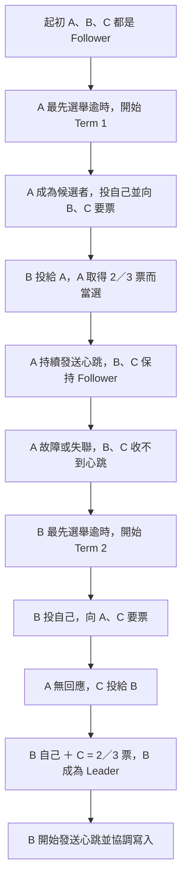

# Consensus Algorithms

## TL;DR

- 共識讓多個節點在部分節點故障、訊息延遲等情況下，仍能對決策或操作順序達成一致，適用於分散式資料庫與區塊鏈等系統。
- Safety 關注不做出互相衝突的已決定結果；Liveness 關注在滿足協議條件時能持續前進。
- 閱讀演算法前，先看它容忍的是節點停止運作，還是包含說謊、傳送矛盾訊息的拜占庭故障。
- Raft 主要處理非拜占庭故障下的複寫日誌；PBFT 則處理拜占庭容錯，兩者採用不同的故障假設。

---

## 共識要解決什麼問題

多個節點各自收到請求，只靠轉送資料，並不能保證最後接受相同的操作順序。共識協議協調的是哪些操作被接受，以及它們的順序；區塊鏈的交易與區塊是其中一種應用情境。

在 Replicated State Machine（複寫狀態機）中，各節點依序執行相同的已決定命令；若初始狀態與執行規則相同，就能得到相同狀態。共識協議可用來維持複寫日誌的一致性。[Raft 原論文 §2](https://raft.github.io/raft.pdf)

### Safety 與 Liveness

| 性質 | 關注的問題 |
| --- | --- |
| Safety（安全性） | 不同正常節點不能對同一個決策位置，接受互相衝突的最終結果。 |
| Liveness（活性） | 當足夠的正常節點能通訊，並滿足協議所需的條件時，系統能繼續接受新的決策。 |

節點暫時持有不同的未提交日誌，不一定代表 Safety 已被破壞；需要區分暫存狀態與協議已經決定的結果。

---

## Quorum：多數決門檻

**在 Raft 這類採用多數決的協議中，Quorum 就是超過一半的 voting members。** 以下以固定成員配置為例；不是所有共識演算法都使用相同門檻。

$$
\mathrm{quorum}=\lfloor N/2\rfloor+1
$$

| Voting members | Quorum | 可容忍同時故障數 |
|---|---|---|
| 1 | 1 | 0 |
| 2 | 2 | 0 |
| 3 | 2 | 1 |
| 4 | 3 | 1 |
| 5 | 3 | 2 |

$N$ 是 voting members 的數量，$\lfloor N/2\rfloor$ 表示除以 2 後向下取整，再加 1。**例如 3 個成員需要 2 個，4 個成員需要 3 個**；不能把一般除法的 `N/2 + 1` 算出小數後直接當人數。

任意兩個過半數集合至少有一個共同成員；配合協議的投票與日誌規則，才能避免互相衝突的提交。**奇數成員能以較少成員取得相同故障容忍能力**，例如 3 個與 4 個成員都只能容忍 1 個同時故障。

Raft 選舉時，候選者投給自己的票也計入多數；Leader 複寫新寫入時，自己的日誌副本也計入多數。兩者是不同階段。

Kubernetes 的具體例子與寫入流程圖見 [[K8s HA、Quorum 與 Split-brain#etcd 寫入：Leader 協調，多數確認後提交|etcd 的 3 成員寫入流程]]。Control-plane Node 數量不能直接等同於 datastore voting members，必須確認實際部署。

參考：[Raft 原論文 §5.2、§5.3](https://raft.github.io/raft.pdf)。

---

## 故障模型：Crash Fault 與 Byzantine Fault

| 模型 | 故障行為 | 演算法例子 |
| --- | --- | --- |
| Crash Fault | 節點停止運作或重啟；正常運行時遵守協議。網路也可能延遲、丟失訊息或分割。 | Raft |
| Byzantine Fault | 節點可能任意偏離協議，例如向不同節點提供矛盾訊息。 | PBFT |

Raft 不以容忍任意惡意節點為目標。固定成員的基本模型中，$2f+1$ 個節點可在至多 $f$ 個節點停止運作時，保留多數決所需的節點數；要持續取得進展，還需要多數節點能穩定通訊。[Raft 原論文](https://raft.github.io/raft.pdf)

---

## 拜占庭將軍問題與 PBFT

**拜占庭將軍問題**討論部分節點說謊、傳送矛盾訊息或不回應時，誠實節點如何達成一致。需要兼顧 Safety（不接受互相衝突的結果）、Liveness（系統能繼續前進）與容錯。

在典型 PBFT 的假設下，容忍 $f$ 個拜占庭節點需要 $n\geq3f+1$。PBFT 的主要階段是 Pre-Prepare、Prepare、Commit，通訊量約為 $O(n^2)$。這不是所有共識模型都適用的通用門檻；開放公鏈還必須處理身份可任意建立的 Sybil 問題。

例如容忍 $f=1$ 個拜占庭節點時，典型 PBFT 至少需要 4 個副本。$3f+1$ 是該模型的副本數條件，不能簡化成「一般過半數投票」；協議還要處理惡意節點向不同人傳送不同訊息的情況。[PBFT 原論文](https://www.usenix.org/conference/osdi-99/practical-byzantine-fault-tolerance)

---

## Raft：待閱讀與整理

Raft 管理 Replicated Log，主要可依 Leader Election、Log Replication 與 Safety 三部分理解。以下先整理選舉流程，其餘細節依閱讀進度補上。

### Leader Election：隨機逾時、投票與心跳

**隨機的是選舉等待時間，不是直接隨機指定 Leader。先成為 Candidate（候選者），取得過半票數，才成為 Leader。**

| 角色／名詞 | 意思 |
|---|---|
| Follower | 平常接收 Leader 的心跳與日誌；選舉逾時後可成為候選者 |
| Candidate | 發起選舉、先投自己，再向其他成員要票 |
| Leader | 取得過半票數後當選，持續發送心跳並協調日誌複寫 |
| Term | 選舉任期編號；候選者發起新一輪選舉時，將自己的 Term 加 1 |

以 3 個 voting members A、B、C 為例，假設第一次選舉成功是 Term 1，下一次選舉成功是 Term 2：

- **每個成員在同一個 Term 最多投給一位候選者**，投給自己也算。因此 B 投自己、C 也投自己時，兩人各只有 1 票，不能算成 B 有 2 票。
- 投票者會檢查候選者的日誌是否至少與自己一樣新；不是最先逾時就保證當選。
- 選舉逾時時間會隨機化，減少同時參選。若分票而無人過半，等待新的逾時後，再開始下一輪選舉。
- **Term 是選舉輪次的編號，不是 Leader 人數或心跳次數**；一個 Term 可能沒有選出 Leader。因此第二位 Leader 不保證一定出現在 Term 2。
- 不必真的死亡才會重選；網路中斷、延遲或程序卡住，也可能造成心跳逾時。

**記法：選舉是「過半投票選 Leader」；寫入是「過半記錄日誌才提交」。** 兩者都包含自己，但確認的是不同事情。

參考：[Raft 原論文 §5.2 Leader Election、§5.4.1 Election Restriction](https://raft.github.io/raft.pdf)。此處整理基本 Raft 流程，實作可另外加入 Pre-Vote 等機制。

### 後續閱讀

- [x] Follower、Candidate、Leader 的角色與 Term。
- [x] Leader Election：投票、Election Timeout 與 Heartbeat。
- [ ] Log Replication：AppendEntries、Log Index 與 Term。
- [ ] Commit 與 Apply 的差別，以及多數副本如何參與確認。
- [ ] Safety：Leader 更替後，如何保留已提交的紀錄。
- [ ] 節點故障、網路分割與復原的具體例子。
- [ ] 後續延伸：Snapshot／Log Compaction 與成員變更。

閱讀入口：[Raft 原論文（Extended Version）](https://raft.github.io/raft.pdf)，先從 §2 Replicated State Machines，再讀 §5 的選舉、日誌複寫與安全性。

Kubernetes 應用情境：[[K8s HA、Quorum 與 Split-brain]]，可對照 etcd quorum、Stacked／External etcd 拓撲，以及 controller-manager 的 Lease 選主；Lease 選主與 etcd 的 Raft 共識是不同層次的機制。
