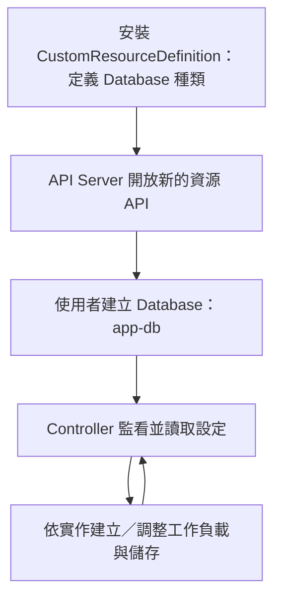
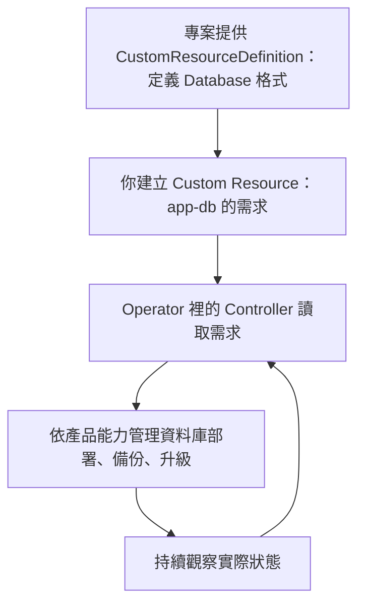
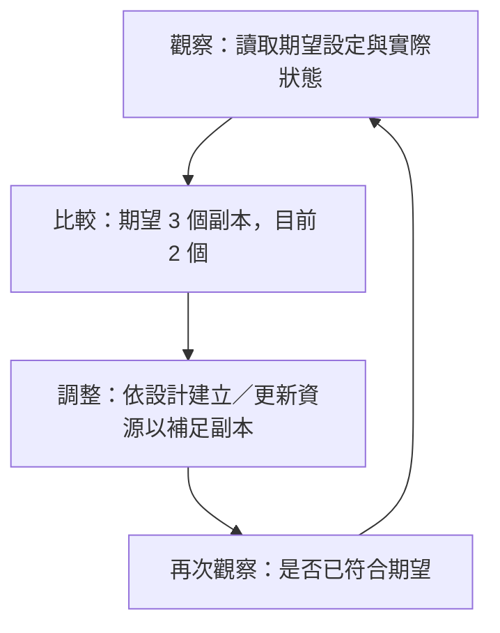
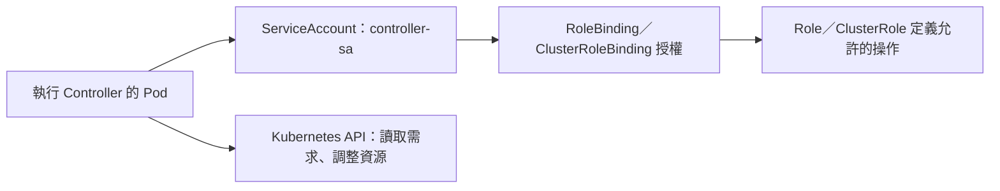

# K8s CustomResourceDefinition、Custom Resource、Controller 與 Operator

## TL;DR

**CustomResourceDefinition 讓 Kubernetes 認識新的資源種類；Custom Resource（自訂資源）是你建立的那個資源物件；Controller 負責依照它的設定做事。**

| 名稱 | 用途 | 範例 |
|---|---|---|
| CustomResourceDefinition（自訂資源定義） | 定義新資源的名稱、API Group、版本、欄位與作用範圍 | 定義 `Database` 這個種類 |
| Custom Resource（自訂資源） | 依新種類建立的實際物件 | 建立名叫 `app-db` 的 Database |
| Controller（控制器） | 監看資源，持續調整實際狀態以符合期望 | 根據 Database 建立工作負載與儲存 |
| Operator（應用維運自動化） | 用 Controller 與自訂資源等機制，自動化特定應用的維運知識 | 資料庫的部署、備份、故障處理 |

**只安裝 CustomResourceDefinition，不會自動部署應用程式。** API Server 能接受並儲存 Custom Resource，不代表已有 Controller 會處理它。



## 實際用途：讓你描述「我要什麼」，由程式處理如何完成

**你不需要為每套軟體都手動管理所有 Pod、Service、儲存與維運步驟；可以安裝現成 Operator，再用它提供的 Custom Resource 宣告需求。** 一般使用者通常使用專案提供的 CustomResourceDefinition，不用自己發明種類或開發 Controller。

以資料庫為例，Kubernetes 內建的 Deployment 知道如何維持 Pod 副本數，卻不會自動知道特定資料庫如何建立主從複製、備份與安全升級。資料庫 Operator 把這些應用維運知識寫進程式，透過 Controller 持續執行。

| 階段 | 資料庫範例 | 誰負責 |
|---|---|---|
| 定義可填的需求 | 新增 `Database` 種類，定義版本、容量等欄位 | CustomResourceDefinition |
| 使用者提出需求 | 建立 `app-db`，填入想要的資料庫規格 | Custom Resource |
| 讓實際狀態符合需求 | 讀取 app-db，建立／調整 Pod、Service、儲存等 | Controller |
| 處理應用維運 | 依產品支援管理複製、備份、升級與故障復原 | Operator 透過 Controller 執行 |

實際操作通常是：

1. **安裝現成資料庫 Operator**：依專案文件安裝 CustomResourceDefinition 與執行 Controller 的工作負載，常可透過 Helm 安裝。
2. **建立 Custom Resource**：用專案提供的 YAML，填資料庫名稱、規格與儲存需求，再 `kubectl apply`。
3. **Operator 的 Controller 開始工作**：讀取你的需求，建立並管理所需元件；同時持續觀察狀態。
4. **後續維運**：依該 Operator 支援的方法修改版本、設定備份或執行復原；不是任意加一個 YAML 欄位就會自動具備新功能。

上面提到的版本、容量、備份欄位都由各專案定義，沒有通用 Database YAML。下方最小範例只定義 `replicas`，不能直接填入未定義的欄位期待它執行。

- [[K8s Ingress 與 Gateway API|Gateway API]]：先安裝 Gateway API CustomResourceDefinitions，才能建立 Gateway／HTTPRoute 等 Custom Resource；還需要對應 Controller 實作。
- [[K8s Calico 安裝與網路判讀小抄|Calico Tigera Operator]]：Installation 等 Custom Resource 描述需求，Operator 依需求管理 Calico 元件。

### Controller 與 Operator 不是二選一

**Controller 是「監看 → 比較期望與現況 → 調整」的控制迴圈；Operator 是把特定應用的維運知識，用 Controller 等機制自動化的做法。**

Operator 通常包含一個或多個 Controller，並搭配 Custom Resource；不是 Kubernetes 另外一個固定的 `kind: Operator`。內建 Deployment Controller 也叫 Controller，但通常不稱為資料庫 Operator。



**CustomResourceDefinition 是格式；Custom Resource 是需求單；Controller 是持續執行工作的程式；Operator 將應用維運知識實作成這些自動化流程。**

### etcd Operator：叢集管理、備份與還原

**整套管理 etcd 的工具叫做 etcd Operator；裡面的 Controller 分別實作叢集管理、備份、還原。** 以下是職責示意，實際程式與 Deployment 的切分依專案而定，不要求一個種類一定對應一個 Controller。

```text
etcd Operator：整套 etcd 自動管理工具
├── 叢集管理 Controller：處理 EtcdCluster，管理成員數與叢集狀態
├── 備份 Controller：處理 EtcdBackup，執行備份
└── 還原 Controller：處理 EtcdRestore，根據備份還原
```

| 自訂資源種類（kind） | CustomResourceDefinition 定義什麼 | 使用者建立的 Custom Resource 表達什麼 |
|---|---|---|
| `EtcdCluster` | 叢集設定的欄位與格式 | 我要一個特定規格的 etcd 叢集 |
| `EtcdBackup` | 備份設定的欄位與格式 | 我要替指定 etcd 做備份 |
| `EtcdRestore` | 還原設定的欄位與格式 | 我要使用指定備份還原 etcd |

**CustomResourceDefinition 定義這三種格式；使用者建立 Custom Resource 填需求；對應 Controller 執行工作；整套應用管理工具稱為 Operator。**

Operator 也可以只包含一個 Controller；數量不是判斷標準。可以把 Operator 理解成整套應用管理工具的抽象概念，不一定有另一支 Operator 程式在上面管理 Controller。

這些種類可見於歷史上的 [CoreOS etcd Operator](https://github.com/coreos/etcd-operator)。該專案已封存，此處用來理解架構，不作為目前的安裝建議；它管理的 etcd 也不代表會自動接管 kubeadm 控制平面的 etcd。

### Operator、Operator Framework 與 OperatorHub

**上面整套叫 etcd Operator，不叫 Operator Framework。**

| 名稱 | 用途 | 好記的方式 |
|---|---|---|
| Operator | 自動管理特定應用的軟體 | etcd Operator 管理 etcd |
| Operator Framework | 協助開發、安裝與管理 Operator 的工具組，例如 Operator SDK、Operator Lifecycle Manager | 製作與管理 Operator 的工具 |
| OperatorHub.io | 尋找現成 Operator 的目錄，查看介紹與安裝資訊 | 到這裡找別人做好的 Operator |

不一定要用 Operator Framework 才能開發 Operator。找到 Operator 後，仍依該專案確認支援版本、安裝方法與維護狀態。

官方連結：[Operator Framework](https://operatorframework.io/)、[OperatorHub.io](https://operatorhub.io/)。

## 自己開發 Controller：Reconciliation（調和）

**可以自己寫 Controller，但日常部署與管理叢集時，通常先使用內建 Controller 或現成 Operator。** 若團隊有需要長期維持的特殊規則、重複維運流程，且現成工具無法滿足，才考慮自行開發。一次性的工作通常用腳本、Job 或部署工具即可，不一定需要持續運作的 Controller。

Controller 可以管理既有 Pod、Deployment 等資源，也可以管理 Custom Resource；不一定要先定義新的種類。

### Reconciliation（調和）：觀察 → 比較 → 調整

以自訂資料庫管理邏輯為例，Custom Resource 要求 3 個副本，但目前只有 2 個：



**Controller 不只通知你有差異，還會採取動作。** 如果它透過 Deployment 管理副本，便更新 Deployment，由內建 Controller 繼續建立所需資源；不代表每個 Controller 都直接建立 Pod。即使反覆執行，也應避免重複建立相同資源。

官方：[Controllers](https://kubernetes.io/docs/concepts/architecture/controller/)。搜尋關鍵詞：`control loop`、`desired state`、`current state`、`reconciliation`。

## 最小範例：先定義種類，再建立物件

### 1. CustomResourceDefinition：定義 Database

儲存為 `database-crd.yaml`：

```yaml
apiVersion: apiextensions.k8s.io/v1
kind: CustomResourceDefinition
metadata:
  name: databases.example.com
spec:
  group: example.com
  scope: Namespaced
  names:
    plural: databases
    singular: database
    kind: Database
  versions:
  - name: v1
    served: true
    storage: true
    schema:
      openAPIV3Schema:
        type: object
        properties:
          spec:
            type: object
            properties:
              replicas:
                type: integer
                minimum: 1
```

| 欄位 | 記法 |
|---|---|
| CustomResourceDefinition 的 `metadata.name` | 必須是 `<plural>.<group>`，此例為 `databases.example.com` |
| `group` ＋版本 `name` | 決定 Custom Resource 的 `apiVersion: example.com/v1` |
| `names.kind` | Custom Resource YAML 使用的 `kind: Database` |
| `names.plural` | kubectl 查詢使用的資源名稱 `databases` |
| `scope` | Custom Resource 是 `Namespaced` 或 `Cluster`；CustomResourceDefinition 物件本身屬叢集層級 |
| `served: true` | 透過 API 提供這個版本 |
| `storage: true` | 以這個版本儲存；只能有一個版本設為 true |
| `schema` | 定義欄位與驗證規則，例如 replicas 必須是至少 1 的整數 |

### 2. Custom Resource：建立 app-db

儲存為 `app-db.yaml`：

```yaml
apiVersion: example.com/v1
kind: Database
metadata:
  name: app-db
  namespace: default
spec:
  replicas: 2
```

**上面的 CustomResourceDefinition 定義格式，下面的 Custom Resource 填入實際需求。** 此例只示範 API 擴充，沒有提供 Controller，所以不會真的產生資料庫 Pod。

## 重要指令

```bash
# 安裝 CustomResourceDefinition，等 API 建立完成，再建立 Custom Resource
kubectl apply -f database-crd.yaml
kubectl wait --for=condition=Established crd/databases.example.com --timeout=60s
kubectl apply -f app-db.yaml

# 查資源種類、定義與實際物件
kubectl get crd
kubectl describe crd databases.example.com
kubectl api-resources --api-group=example.com
kubectl explain databases.spec --api-version=example.com/v1
kubectl get databases.example.com -n default
kubectl get databases.example.com app-db -n default -o yaml
```

`kubectl get crd` 看「有哪些自訂種類」；`kubectl get databases` 看「這種類別有哪些物件」。API Group 與資源名稱判讀見 [[K8s kubectl 常用指令]]。

## Controller 的部署與操作權限

Controller 通常被打包成 image，再以 Deployment 跑在叢集裡。其 Pod 指定專用的 ServiceAccount，以這個身分呼叫 Kubernetes API。



| 元件 | 在此扮演的角色 |
|---|---|
| ServiceAccount | Controller 呼叫 API 時使用的身分，不會因為叫 Controller 就自動取得管理權 |
| Role／ClusterRole | 定義允許讀取或修改哪些資源，例如監看 Database、建立 Deployment |
| RoleBinding／ClusterRoleBinding | 將上述權限授予 Controller 使用的 ServiceAccount |

例如只管理 `default` Namespace，可以透過 RoleBinding 授權；需要跨 Namespace 或管理叢集層級資源時，依需求設計 ClusterRole 與綁定。只授予所需資源與操作，不必直接給 cluster-admin。

範例權限檢查（假設已建立 `default/controller-sa` 並完成綁定）：

```bash
kubectl auth can-i watch databases.example.com --as=system:serviceaccount:default:controller-sa -n default
kubectl auth can-i create deployments.apps --as=system:serviceaccount:default:controller-sa -n default
```

若收到 `Forbidden`，應確認 ServiceAccount 與 RBAC；不是重新安裝 CustomResourceDefinition 就能解決。關係與範例見 [[K8s RBAC 與 ServiceAccount]]。

SealedSecret 自訂資源由 Controller 轉成一般 Secret 的例子，見 [[K8s ConfigMap、Secret 與 Sealed Secrets#Sealed Secrets：把加密設定放進 Git]]。

## 常見問題

- `no matches for kind`：先確認 CustomResourceDefinition 是否安裝，以及 Custom Resource 的 API Group／版本是否正確。
- Custom Resource 建立成功卻沒有預期動作：查 Controller 是否安裝、Running、具有所需 RBAC，以及其 logs／Custom Resource status。
- 刪除 CustomResourceDefinition 會刪除該種類的 Custom Resource，不能把它當成單純移除定義；Controller 管理的外部資源如何清理，則取決於實作。

## 官方文件與搜尋關鍵詞

- [Custom Resources](https://kubernetes.io/docs/concepts/extend-kubernetes/api-extension/custom-resources/)：搜尋 `custom resources`、`custom controllers`。
- [Extend the Kubernetes API with CustomResourceDefinitions](https://kubernetes.io/docs/tasks/extend-kubernetes/custom-resources/custom-resource-definitions/)：搜尋 `custom resource definitions`；頁內找 `Create a CustomResourceDefinition`、`Create custom objects`、`Validation`。
- [Operator pattern](https://kubernetes.io/docs/concepts/extend-kubernetes/operator/)：搜尋 `operator pattern`、`operators in Kubernetes`，理解應用維運與 Controller 的關係。
