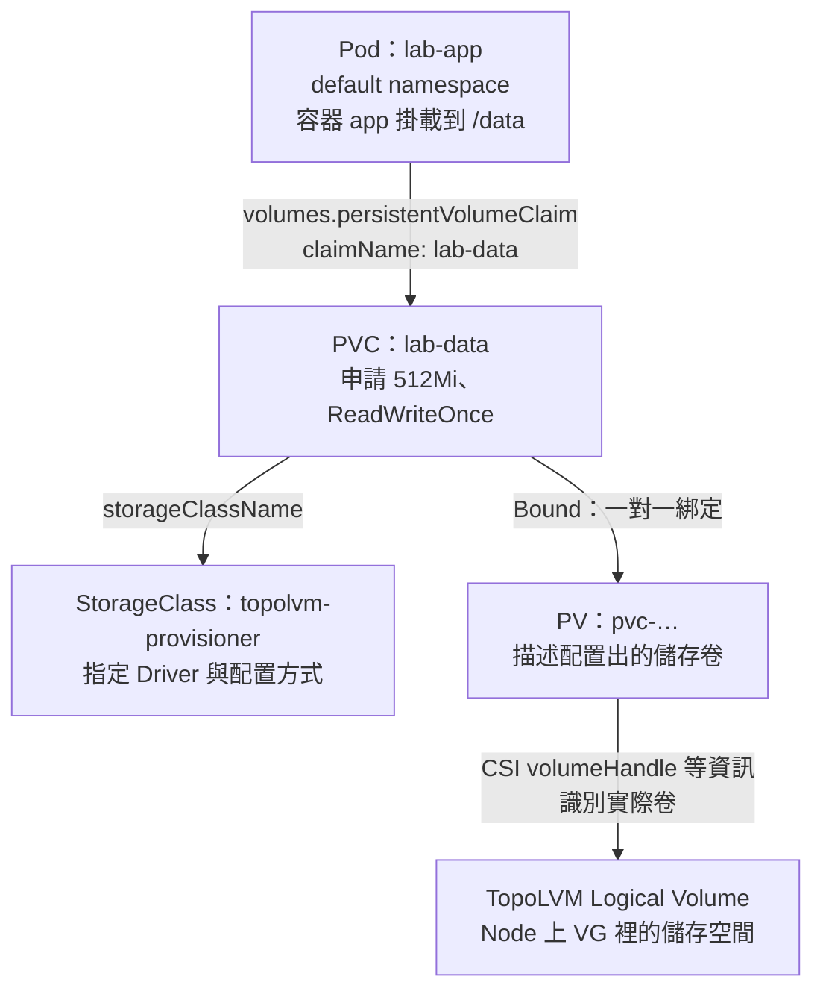
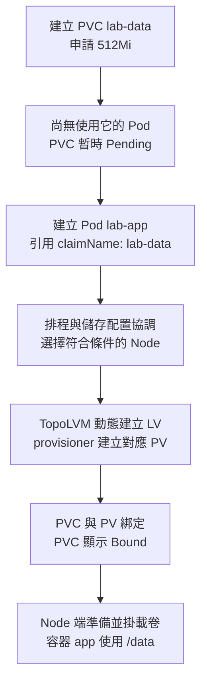
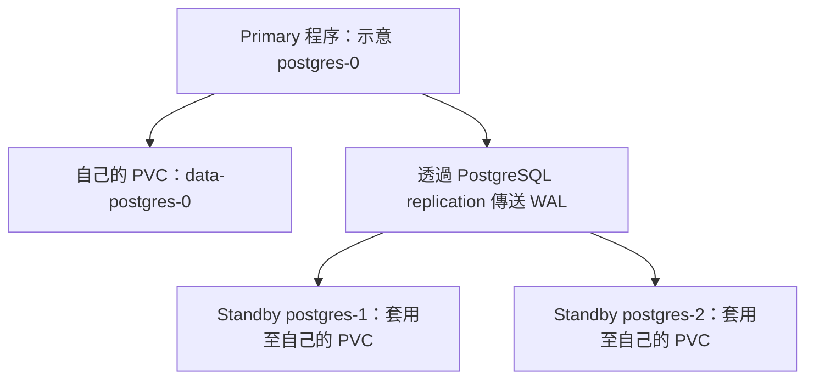
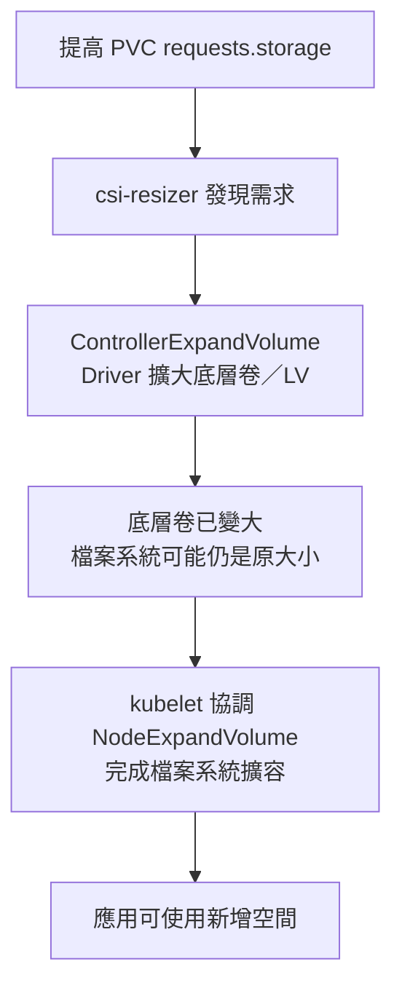

# K8s CSI、PV、PVC 與雲端儲存

> [!tip] 儲存先分清楚三件事
> **PVC 提出容量需求，StorageClass 指定配置方式，CSI Driver 實作儲存操作。** Pod 用 volumes／volumeMounts 使用卷；重建 Pod 不會讓 PVC 縮小。

> [!important] 重要官方範例
> - [PersistentVolumeClaims：PVC 宣告、容量與存取模式](https://kubernetes.io/docs/concepts/storage/persistent-volumes/#persistentvolumeclaims)
> - [Claims as Volumes：Pod 使用 PVC，volumes 與 volumeMounts 的寫法](https://kubernetes.io/docs/concepts/storage/persistent-volumes/#claims-as-volumes)
> - [StorageClass Objects：StorageClass 的 YAML 與配置欄位](https://kubernetes.io/docs/concepts/storage/storage-classes/#storageclass-objects)

### 官方文件查找關鍵詞

**先用資源名稱找到官方頁面，再用頁內搜尋定位章節。** 以下外部搜尋詞已實際測試，能找到相關官方文件；搜尋結果也可能包含舊版頁面，開啟後確認版本。

| 想找的範例 | 外部搜尋關鍵詞（可直接貼上） | 官方頁面內搜尋（Cmd-F／Ctrl-F） |
|---|---|---|
| PVC 宣告：容量、accessModes、StorageClass | `site:kubernetes.io/docs/concepts/storage/persistent-volumes "PersistentVolumeClaims"` | `PersistentVolumeClaims` |
| Pod 掛載 PVC：volumes、volumeMounts、claimName | `site:kubernetes.io/docs/concepts/storage/persistent-volumes "Claims As Volumes"` | `Claims As Volumes` |
| StorageClass 的基本 YAML | `site:kubernetes.io/docs/concepts/storage/storage-classes "StorageClass objects"` | `StorageClass objects` |

如果使用 Kubernetes 官網站內搜尋，可先輸入 **`Persistent Volumes`** 或 **`Storage Classes`**，進入對應概念頁後再搜尋上表章節；`site:` 是外部搜尋引擎的篩選語法，不是 kubectl 指令。

以下指令以 `k` 代表 `kubectl`，使用前先設定 `alias k=kubectl`。

快速入口：[[#PV、PVC、Pod：供給、需求與使用者]]、[[#跨節點使用：CSI／PVC 不代表資料會自動搬家]]、[[#Docker 的 Storage Driver、Volume Driver 與掛載]]、[[#CSI RPC 與 Sidecars：誰通知、誰執行]]、[[#TopoLVM 與 LVM：本機磁碟變成卷]]、[[#PVC 與 Pod：最小使用範例]]、[[#PVC 擴容：底層卷與檔案系統分兩階段]]。

## 元件與宣告的分工

| 元件／資源                    | 角色                                 |
| ------------------------ | ---------------------------------- |
| Storage backend          | 真正提供儲存，例如 Persistent Disk、NFS、Ceph |
| CSI driver               | 依 CSI 介面整合儲存後端                     |
| StorageClass             | 定義 provisioner 與配置參數，本身不是磁碟        |
| PV                       | 叢集範圍的儲存資源描述                        |
| PVC                      | Namespace 內的儲存需求，綁定相符的 PV          |
| Pod volumes／volumeMounts | 指定使用哪個 PVC，以及容器內掛載路徑               |

### StorageClass 分級：Silver、Gold、Platinum

**可以把儲存分級，讓應用選擇需要的等級；不只分硬碟，也能依效能、成本或後端服務分級。**

| 自訂名稱 | 可能代表的設定，僅為示例 |
|---|---|
| silver | 一般磁碟、較低成本 |
| gold | SSD、較高效能 |
| platinum | 較高 IOPS 或其他進階儲存服務 |

PVC 指定哪一級：

```yaml
spec:
  storageClassName: gold
```

意思是「請用 gold 這套設定幫我配置卷」。**Silver／Gold／Platinum 是管理者自訂名稱，Kubernetes 沒有規定它們的能力或高低順序**；實際使用哪個後端、磁碟類型與效能，要看 StorageClass 的 provisioner、parameters 與後端設定。

備份、複寫或高可用能力也要由後端與相應機制提供，不會因為類別取名 platinum 就自動具備。StorageClass 是配置方式的分類，本身不是磁碟，也不是 Kubernetes 自動幫卷評分。

### Dynamic 與 Static：要不要自己建立 PV？

**Dynamic Provisioning：你建立 PVC、指定 StorageClass，接下來系統幫你建立卷與 PV，你不用手動建立 PV。**

**Static Provisioning：管理者已經準備好卷與 PV，PVC 去申請綁定它。**

```text
Dynamic：建立 PVC → 系統配置卷與 PV → PVC 綁定 → Pod 使用
Static：管理者先準備卷與 PV → 建立 PVC 並綁定 → Pod 使用
```

TopoLVM 實驗用的是 Dynamic：先準備 VG 容量池、安裝 Driver 與設定 StorageClass；之後你只需在 PVC 指定 `storageClassName: topolvm-provisioner` 和需要的容量，每次申請的 LV／PV 由系統配置。

細節：provisioning／binding 時機取決於 StorageClass 的 binding mode；`WaitForFirstConsumer` 會等使用 PVC 的 Pod，再配合排程與拓撲配置／綁定。所以不是所有 PVC 一建立就立刻有 PV。不同後端的「配置卷」也不同，例如 TopoLVM 配置 LV，NFS provisioner 可能建立子目錄，不一定新增實體磁碟。

**Provisioning 是準備儲存資源，Binding 是 PV／PVC 配對，Mount 是讓容器使用卷。**

參考：[Persistent Volumes](https://kubernetes.io/docs/concepts/storage/persistent-volumes/)。

## PV、PVC、Pod：供給、需求與使用者

> [!tip] 一句話記住
> **PV 是供給，PVC 是需求，Pod 是使用者。** PV 描述儲存卷，不是磁碟資料本身；PVC 申請並綁定 PV，Pod 用 claimName 指向 PVC。

| 資源 | 完整名稱／角色 | 範圍 |
|---|---|---|
| PV | PersistentVolume：描述實際儲存卷的容量、存取方式與後端識別等 | 叢集層級，不屬於 namespace |
| PVC | PersistentVolumeClaim：申請容量、存取模式與 StorageClass | Namespace 層級 |
| Pod | 透過 volumes／volumeMounts 使用 PVC 對應的卷 | 與所引用的 PVC 同 namespace |

### lab-data 的綁定與使用關係



這是**資源引用關係**，不是應用程式的 I/O 逐站經過 PVC／PV；CSI 在 Node 上準備掛載後，應用透過 `/data` 存取底層檔案系統。

### lab-data 的配置流程

以 `WaitForFirstConsumer` 的 TopoLVM StorageClass 為例：



**一般一個 PVC 綁定一個 PV。** 多個 Pod 可否共用同一個 PVC，要看存取模式、後端與節點限制；ReadWriteOnce 限制單一 Node 讀寫，不等於只能一個 Pod。

PV 可由管理者預先建立（靜態配置），也可由 StorageClass 對應的 provisioner 動態建立，所以不必永遠手動先建 PV。

### StatefulSet：穩定身分與對應的 PVC

StatefulSet 適合需要穩定副本身分、儲存或有序啟停的應用，例如資料庫與部分叢集服務。

```text
使用 volumeClaimTemplates 時：
db-0 → 自己的 PVC
db-1 → 自己的 PVC
```

Pod 重建後，可保持同一個編號身分，並重新使用對應的 PVC；**穩定身分不代表 Pod UID、IP 或所在 Node 永遠不變**。volumeClaimTemplates 可為各副本建立獨立 PVC，不是所有副本自動共用一顆卷。

StatefulSet 不會自動提供資料庫複寫、主從切換，也不會保存記憶體中的快取；PVC 如何保留或回收另看 retention policy 與 PV reclaimPolicy。

參考：[StatefulSet 官方說明](https://kubernetes.io/docs/concepts/workloads/controllers/statefulset/)。

#### Deployment 直接掛 PVC vs StatefulSet 的專屬 PVC

**只有一個 PostgreSQL 時，Deployment 直接掛 PVC 也能保存資料；StatefulSet 額外管理每個副本的固定身分與儲存對應。** 持久化來自 PVC 與底層儲存，不是只有 StatefulSet 才能保存資料。

| 比較 | Deployment 直接引用既有 PVC | StatefulSet 使用 volumeClaimTemplates |
|---|---|---|
| 資料持久化 | 可以 | 可以 |
| Pod 重建 | 新 Pod 名稱通常不同，仍可引用原本的 PVC | 新 Pod 保留編號名稱，接回對應 PVC；UID／IP 可能改變 |
| 增加 replicas | 共用同一份 Pod template，固定 claimName 的副本都引用同一份 PVC | 每個編號可由模板建立自己的 PVC |
| 多個成員 | 專屬 PVC 與身分對應需自行設計，例如不同 Deployment 各引用不同 PVC | 自動維持成員編號與專屬 PVC 的對應 |
| 複寫與選主 | 不會自動提供 | 也不會自動提供，需資料庫或 Operator 管理 |

| Deployment 的 Pod 模板 | 建立出來的副本 |
|---|---|
| 所有副本固定 `claimName: pg-data` | Pod A、Pod B 都引用 pg-data；只改 Pod 名稱不會改 PVC |
| 兩個不同 Deployment 分別引用不同 claimName | 各自使用 pg-data-a、pg-data-b，底層也須是獨立資料目錄 |

StatefulSet 也能直接引用固定 PVC；**每副本各有 PVC 是 volumeClaimTemplates 提供的行為，不是只改 kind 就會自動分開。** 不同 PVC 名稱也不保證後端沒有被人設定成同一個 NFS 目錄等共享位置，仍須核對實際儲存。

#### volumeClaimTemplates：一份 PVC 模板，各成員各一份

以下是名為 postgres 的 StatefulSet `spec` 片段，不是完整 PostgreSQL 複寫設定；my-storage 需換成實際 StorageClass：

```yaml
serviceName: postgres-headless
replicas: 3
template:
  spec:
    containers:
      - name: postgres
        volumeMounts:
          - name: data
            mountPath: /var/lib/postgresql/data
volumeClaimTemplates:
  - metadata:
      name: data
    spec:
      accessModes: ["ReadWriteOnce"]
      storageClassName: my-storage
      resources:
        requests:
          storage: 5Gi
```

此處只展示欄位關係，完整物件仍需 selector、labels、image、初始化參數等；掛載目錄也要符合使用的 PostgreSQL image 大版本。不能直接套用片段。

| 欄位 | 意義 |
|---|---|
| StatefulSet metadata.name: postgres | 決定成員名稱 postgres-0、postgres-1、postgres-2 |
| volumeClaimTemplates[].metadata.name: data | PVC 模板名；PVC 通常為 data-postgres-0、data-postgres-1、data-postgres-2 |
| volumeMounts[].name: data | 對應模板名稱，掛載該成員自己的 PVC，不是寫某顆完整 PVC 名稱 |
| serviceName: postgres-headless | 對應另外建立的 Headless Service，提供穩定網路身分；Service selector 須匹配 Pod labels |

#### PostgreSQL：各自儲存，再透過 replication 同步

**replicas=3 代表三個 Pod，不代表已經完成 PostgreSQL replication。** 如果只是把官方 PostgreSQL image 啟動三次，且沒有複寫設定，會得到三個獨立資料庫。

| 範例成員 | 自己的 PVC | 資料庫角色（由複寫系統設定） |
|---|---|---|
| postgres-0 | data-postgres-0 | Primary，示意角色 |
| postgres-1 | data-postgres-1 | Standby，接收並重播 WAL |
| postgres-2 | data-postgres-2 | Standby，接收並重播 WAL |

角色並非由 StatefulSet 編號決定；postgres-0 不會因為是 0 就自動成為 Primary，故障接手後角色也可能改變。



| 誰負責 | 工作 |
|---|---|
| StatefulSet | 維持副本、固定名稱與專屬 PVC 對應 |
| CSI／儲存後端 | 配置與掛載卷，持久化檔案；跨 Node 能力依後端而定 |
| PostgreSQL | 複寫、WAL 傳送與重播等資料庫行為 |
| 資料庫 Operator／HA 管理工具 | 依實作協助初始化、成員加入、故障接手與備份等流程 |

**多個獨立 PostgreSQL 程序不能同時使用同一個資料目錄，即使卷支援 ReadWriteMany 也一樣。** RWO／RWX 是卷的掛載能力，不會替資料庫協調並行寫入；RWO 也不是限制只給一個 Pod，RWOP 才是單 Pod 使用限制且需實作支援。

postgres-1 重建後使用原 PVC，但 TopoLVM 等本機卷不會因此自動搬到其他 Node；固定身分、資料持久化、跨節點可用性、資料庫複寫是不同層次。單副本可恢復不等於持續可用，replication 也不能取代獨立備份。

參考：[PostgreSQL Streaming Replication](https://www.postgresql.org/docs/current/warm-standby.html#STREAMING-REPLICATION)。搜尋關鍵詞：`volumeClaimTemplates`、`stable storage`、`streaming replication`。


### accessModes 必須滿足需求，不必完全相同

**PV 宣告支援的 accessModes 必須包含 PVC 要求的所有模式**，不是兩邊清單必須完全相同。

| PV 宣告支援 | PVC 要求 | 是否符合 accessModes 匹配條件 |
|---|---|---|
| ReadWriteOnce | ReadWriteMany | 不符合 |
| ReadWriteOnce、ReadWriteMany | ReadWriteOnce | 符合 |

不符合就無法綁定該 PV，PVC 可能維持 Pending；動態配置時也可能因 Driver 不支援所要求的模式而配置失敗。**綁定失敗與已 Bound 後的掛載失敗是不同階段**，用 describe 查原因。

accessModes 符合也不保證一定綁定，還需符合容量、StorageClass、volumeMode、selector 等條件。支援模式要有底層能力，不能只把 YAML 改成 ReadWriteMany，就讓本機磁碟自動變成多節點共享儲存。

### 50Gi PVC 可以綁 100Gi PV，但不是切割磁碟

PVC 申請的是最低容量需求。既有的 100Gi PV 若同時符合 StorageClass、accessModes、volumeMode 等綁定條件，且可供綁定，就能滿足 50Gi PVC。

```text
PVC：申請至少 50Gi
    → 綁定整個 100Gi PV
    → Pod 透過 PVC 使用該卷
```

- 綁定後是**整個 PV 由這個 PVC 占用**；剩下的 50Gi 不能再綁給另一個 PVC。
- **若底層確實是 100Gi 的卷、檔案系統也已擴展到該容量，且沒有更小的 quota，50Gi PVC 綁定後，Pod 通常能使用約 100Gi 的檔案系統空間**；df 的呈現會受檔案系統管理資訊等影響。
- 申請 50Gi 是最低需求，不必然是寫入上限；PV 的 capacity 是容量宣告，也不會單靠這個欄位建立或強制限制空間，實際大小仍看底層卷、檔案系統與 quota。
- 想把 100Gi 儲存池分成兩個 50Gi 卷，應由 TopoLVM 等後端配置兩個卷，對應兩個 PV／PVC。
- **PV／PVC 綁定是配對，磁碟／儲存池切割由後端負責。** 範例使用 Gi，與十進位 GB 不同。

```text
PVC requests.storage：50Gi  → 最低申請需求
PV capacity：100Gi          → 宣告提供的容量
Pod 的 df                  → 實際掛載檔案系統的容量，不是只讀 PVC 的 50Gi
```


### 刪 Pod 與刪 PVC：Retain／Delete 的差別

> [!important] PVC 通常不隨一般 Pod 刪除；主動刪 PVC 則看回收政策
> 一般 Pod 使用的獨立 PVC，其生命週期與 Pod 分開。**刪 Pod 不等於刪 PVC，也不等於刪除資料。** 但主動刪 PVC 後，PV 與底層卷是否保留，要看 PV 的 persistentVolumeReclaimPolicy。

| 操作／政策 | PVC／PV | 底層資料 |
|---|---|---|
| 刪一般 Pod，保留其獨立 PVC | PVC 與綁定 PV 保留 | 通常保留，可供後續 Pod 再使用 |
| 刪 PVC，PV 為 **Retain** | PVC 刪除；PV 保留，通常進入 Released | 保留，由管理者回收、清理或重新配置 |
| 刪 PVC，PV 為 **Delete** | 完成回收流程後，對應 PV 也刪除 | 支援的 provisioner／Driver 刪除對應底層卷，資料隨之移除 |

Retain 的 Released PV 不會自動變回 Available，也不能假設建立同名 PVC 就會自動拿回原資料；需要明確處理重新綁定與舊 claim 資訊。Retain 保留的是卷，不是替資料做備份。

動態建立的 PV 通常繼承**建立當時** StorageClass 的 reclaimPolicy；StorageClass 未指定時預設為 Delete。改 StorageClass 不會自動修改既有 PV，**實際查 PV 的政策**：

```bash
k get pvc lab-data -n default
k get pv
# 用 PVC 的 VOLUME 欄位值替換下方名稱
k get pv <PV名稱> -o yaml
```

`k get pv` 的 RECLAIM POLICY 欄可直接看 Retain／Delete。PVC 還被 Pod 使用時，刪除通常因保護機制暫停在 Terminating；這只是延後刪除，不代表資料永遠保留。StatefulSet 的 PVC retention policy、generic ephemeral volume 等另有生命週期規則，不能把所有 PVC 都視為獨立保留。

### 刪檔案和刪儲存資源是兩件事

例如 Recycler Pod 把卷掛到 `/scrub`，其 `rm -rf /scrub/*` 命令會刪除該路徑下匹配的非隱藏檔案與目錄，通常不涵蓋點開頭的隱藏項目，也不刪除 `/scrub` 目錄本身。它不是刪 PVC／PV，而是**直接修改卷裡的實際資料**。

**即使 reclaimPolicy 是 Retain，容器內的刪檔操作仍會刪掉資料**；回收政策不會攔截應用程式的寫入／刪除。清理卷的 Recycler 範例不是一般應用掛載模板，不要用來測試要保留的 payload。

參考：[PV 回收政策與使用中保護](https://kubernetes.io/docs/concepts/storage/persistent-volumes/#reclaiming)、[StorageClass reclaimPolicy 預設值](https://kubernetes.io/docs/concepts/storage/storage-classes/#reclaim-policy)。

## attach 與 mount 的差別

```text
雲端 block storage
    ↓ Controller 端經 cloud API attach
Node VM 看見 block device
    ↓ kubelet 協調 CSI Node plugin stage／publish
Node 上準備好 volume
    ↓ runtime 將掛載提供給容器
Container /data
```

CSI 的 controller-side attach 常由 external-attacher 與 driver 協作；不是 kubelet 直接負責整套雲端 attach 流程。Node side 執行 stage／publish，實際步驟依 driver 能力與 volume mode 而定。Pod 只宣告需求，不是 Pod 內的程式自行執行 mount。

NFS 通常沒有把 block device attach 到 VM 的步驟，而是透過網路掛載遠端檔案系統。

`ReadWriteOnce` 表示單一 Node 讀寫，不代表只能有一個 Pod；同一 Node 上可能有多個 Pod 使用。若需限制單一 Pod，要另看 `ReadWriteOncePod` 與 driver 支援。

## 跨節點使用：CSI／PVC 不代表資料會自動搬家

> [!important] 持久化、跨節點存取與高可用是不同能力
> **有 CSI 或 PVC，不代表資料會自動搬到另一台 Node，也不代表會自動複寫。** 能否換 Node 繼續使用，取決於儲存後端、拓撲、存取模式與 Driver 支援；Volume 本身不是不建議使用的功能。

| 儲存方式 | 資料在哪裡 | Pod 改排到另一台 Node 時 |
|---|---|---|
| **hostPath（一般本機目錄）** | 指定 Node 的檔案系統 | 相同路徑可能是不同資料、空目錄或不存在；不會自動複製原 Node 的資料 |
| **Local PV／TopoLVM** | 原 Node 的磁碟或 Logical Volume | PV node affinity／儲存拓撲限制 Pod 排到能存取卷的 Node；不會把本機資料自動搬到新 Node |
| **可重新掛接的雲端區塊磁碟** | 雲端儲存系統，與個別工作 Node 分離 | 可在符合可用區、拓撲、存取模式與 Driver 限制時，卸離舊 Node、接到新 Node；不是任意 Node 都能接 |
| **NFS／共享檔案儲存** | 遠端檔案伺服器 | 有網路連通、權限與所需客戶端支援的 Node，可掛載同一份資料；不需要先把資料複製到新 Node |

例如 Pod 原本在 node-a：

```text
hostPath：node-a:/data 與 node-b:/data 通常是兩份不同資料
TopoLVM：LV 在 node-a → Pod 需使用 node-a 的儲存，並非自動移到 node-b
雲端磁碟：符合條件時，同一顆磁碟可從 node-a 卸離、改接 node-b
NFS：node-a、node-b 可經網路存取同一個 export
```

- **容器／Pod 重建後資料還在**，只說明卷的資料生命週期獨立，不代表 Node 故障後別台能接手。
- **TopoLVM 支援擴容，但不因此具有跨節點複寫或自動資料遷移能力**；原 Node 不可用時，重建的 Pod 可能因卷的拓撲限制而 Pending。
- **CSI 是整合介面，PVC 是需求宣告**；兩者不會憑空把本機磁碟變成共享或分散式儲存。
- 需要跨 Node 接手的重要資料，一般避免直接以 hostPath 作為持久化方案；選擇可重新掛接、共享或具複寫能力的後端。NFS 的伺服器本身是否高可用、雲端磁碟是否跨可用區，都要另行確認。

參考：[Kubernetes Volumes：hostPath 與 local](https://kubernetes.io/docs/concepts/storage/volumes/)、[PV Node Affinity](https://kubernetes.io/docs/concepts/storage/persistent-volumes/#node-affinity)、[TopoLVM](https://github.com/topolvm/topolvm)。

## Docker 的 Storage Driver、Volume Driver 與掛載

| 類別 | 負責什麼 | 例子 |
|---|---|---|
| Storage Driver／Snapshotter | Image 唯讀層與每個容器的可寫層 | 傳統 overlay2；新版 containerd snapshotter |
| Volume Driver | Volume 的建立、掛載與生命週期 | 內建 local、外部 volume plugins |
| Bind mount | 把指定主機路徑提供給容器 | `/data/mysql` → `/var/lib/mysql` |

Image 層可共用，容器修改寫進自己的可寫層；修改底層檔案時採 copy-on-write。**刪容器會刪可寫層，但不會因此改掉 image；volume／bind mount 的資料另有生命週期。** Docker Engine 29.0 起的全新安裝預設使用 containerd image store 與 snapshotter，不能一律認定是 overlay2。

| 舊教材中的 driver | 記法 |
|---|---|
| AUFS | 早期的多層合併檔案系統方案，Docker driver 已移除 |
| overlay／overlay2 | 使用 Linux OverlayFS；overlay 是舊 driver，overlay2 是傳統改良方案 |
| Btrfs／ZFS | 利用底層檔案系統的 CoW、快照／clone，需要相應儲存設定 |
| Device Mapper | 在區塊層級管理 thin provisioning／快照，Docker driver 已移除 |

```bash
# 兩種 bind mount 語法；只示範掛載，MySQL 初始化還需相應環境設定
docker run --mount type=bind,source=/data/mysql,target=/var/lib/mysql mysql
docker run -v /data/mysql:/var/lib/mysql mysql
```

容器內的 target 必須是絕對路徑。`--mount type=bind` 的來源不存在時預設報錯，`-v` 會嘗試建立來源目錄。最後的 `mysql` 是 **image 名稱**；容器命名使用 `--name my-db`。

```bash
# mysql-data 是 volume 名稱，local 是 driver
docker volume create --driver local mysql-data
docker volume inspect mysql-data
docker info
```

**Driver、協定、儲存服務不是同一層次。** Docker 的 local driver 可配合選項使用 NFS／SMB；NFS 不一定需要獨立 plugin。Azure Files／AWS EFS 是檔案儲存服務，AWS EBS 是區塊儲存，S3 是物件儲存（通常用 SDK／API）。K8s 常用 CSI 整合這些後端，不直接把 Docker volume driver 名稱填進 StorageClass。

## CSI RPC 與 Sidecars：誰通知、誰執行

RPC 是跨程序的方法呼叫，CSI 使用 gRPC 定義儲存介面；不代表一定跨機器，也可能使用本機 Unix socket。

| CSI RPC | 角色 |
|---|---|
| `CreateVolume`／`DeleteVolume` | 建立／刪除儲存卷；刪卷不是只卸載 |
| `ControllerPublishVolume`／`ControllerUnpublishVolume` | 讓指定 Node 可以／不再使用卷，常對應 attach／detach |
| `NodeStageVolume`／`NodeUnstageVolume` | 在 Node 準備／移除共用 staging 位置，是否需要依能力決定 |
| `NodePublishVolume`／`NodeUnpublishVolume` | 在 Node 的工作負載使用位置提供／移除卷 |
| `ControllerExpandVolume` | Controller 端擴大底層卷 |
| `NodeExpandVolume` | Node 端完成必要的擴容，例如擴大檔案系統 |

**Publish 不等於把服務發布到網路。** ControllerPublish 與 NodePublish 是不同階段，不是每個 Driver 都需要 Attach 或 Stage。

| 容器 | 分工 |
|---|---|
| `topolvm-controller` | TopoLVM 的 CSI Controller 實作，協調實際儲存操作 |
| `csi-provisioner` | 監看 PVC 等需求，呼叫建立／刪卷 RPC |
| `csi-resizer` | 發現 PVC 容量需求增加，呼叫 ControllerExpandVolume |
| `csi-snapshotter` | 配合快照控制器呼叫快照 RPC |
| `liveness-probe` | 探測 Driver 健康，供 kubelet 健康檢查使用 |

Sidecars 是儲存社群維護的共用元件，Driver 提供後端特定實作；不是每套 Driver 都安裝完全相同的版本與容器組合。**Resizer 發起要求，不是它自己直接操作磁碟。**

## TopoLVM 與 LVM：本機磁碟變成卷

TopoLVM 是使用 Linux LVM 的本機儲存 CSI Driver，不是雲端磁碟服務。常見 local-path-provisioner 則配置 Node 上的目錄；兩者都能動態提供 PV，差別不在「能不能動態建立」。

| local-path-provisioner | TopoLVM |
|---|---|
| 以 Node 上的目錄提供儲存 | 從 LVM VG 配置 Logical Volume |
| PVC 容量通常不等於強制目錄 quota | 可配置明確大小的 LV |
| 沒有相同的 CSI 卷擴容流程 | 可依 Driver／StorageClass 能力擴容 |

```text
實驗的閒置磁碟 /dev/vdd
    → LVM Physical Volume（PV）
    → Volume Group（VG）：topolvm-vg 容量池
    → TopoLVM 依 PVC 需求建立 Logical Volume（LV）
    → Pod 使用
```

**LVM 的 PV = Physical Volume；K8s 的 PV = PersistentVolume，兩者不同。** 以下僅適用已確認未使用的實驗磁碟；先查裝置，不要把其他系統磁碟當成目標：

```bash
lsblk -f
sudo pvcreate /dev/vdd
sudo vgcreate topolvm-vg /dev/vdd
sudo pvs
sudo vgs
sudo lvs
```

先準備 VG，後續 LV 由 TopoLVM 建立，不需手動把整個 VG 用 lvcreate 切完。舊操作範例見 [[Linux iSCSI 設定指南]]。

`kubectl get csidrivers` 顯示 `ATTACHREQUIRED=false` 是 Driver 的設定宣告，**不是 Attach 失敗**：本機 LV 已位於該 Node，不需要外部磁碟的 attach／detach 步驟，但仍需 Node 端準備與掛載。

## PVC 與 Pod：最小使用範例

官方範例：[Using Claims as Volumes：在 Pod 中使用 PVC](https://kubernetes.io/docs/concepts/storage/persistent-volumes/#claims-as-volumes)。Deployment／ReplicaSet 則放在 Pod template 的 `spec.template.spec` 下，`volumes` 與 `containers` 同層。


前提：TopoLVM、VG 與名為 topolvm-provisioner 的 StorageClass 已配置好。這是指定環境的名稱，不是所有叢集都內建。

```yaml
apiVersion: v1
kind: PersistentVolumeClaim
metadata:
  name: lab-data
  namespace: default
spec:
  storageClassName: topolvm-provisioner
  accessModes:
    - ReadWriteOnce
  resources:
    requests:
      storage: 512Mi
---
apiVersion: v1
kind: Pod
metadata:
  name: lab-app
  namespace: default
spec:
  containers:
    - name: app
      image: nginx
      volumeMounts:
        - name: data
          mountPath: /data
  volumes:
    - name: data
      persistentVolumeClaim:
        claimName: lab-data
```

`volumeMounts.name` 對上 `volumes.name`；`claimName` 對上同 namespace 的 PVC 名稱。Pod 名稱 lab-app 與容器名稱 app 是不同欄位；`k run` 預設產生的容器名可能需要修改。kubectl 沒有內建 `create pvc` 模板子命令，`run` 也沒有直接指定 PVC 掛載的參數。

```bash
k explain pvc.spec --recursive
k explain pod.spec.volumes.persistentVolumeClaim
k explain pod.spec.containers.volumeMounts
k get sc topolvm-provisioner -o yaml
k get pvc lab-data
k describe pvc lab-data
k describe pod lab-app
```

以下指令使用 `k=kubectl` 的 alias，範例都在 default namespace。一般設定修改用 apply；`replace --force` 會先刪再建，拼錯 `persistentVolumeClaim` 等欄位可能導致新 Pod 建立失敗。

### Pending、Bound 與 WaitForFirstConsumer

- `volumeBindingMode: WaitForFirstConsumer`：等待消費端 Pod，再配合排程、拓撲與資源選擇 Node，配置／綁定儲存；本機儲存特別需要避免選錯 Node。
- 沒有 Pod 時 PVC Pending 可能正常；仍應查 StorageClass、describe 的 Events，不能把所有 Pending 都當成等待消費者。
- `Bound` 表示 PVC 已綁定 PV，不保證 Pod 已 Running 或掛載成功。
- `requests.storage` 是最低容量需求；`status.capacity` 是實際回報容量，可因配置粒度較大而超出申請值，原因仍要查 Driver／後端設定。

## PVC 擴容：底層卷與檔案系統分兩階段

> [!important] 能擴大，不能直接縮小
> 修改 PVC 的 requests.storage 來申請擴容，不直接修改 PV capacity。K8s 不支援用 PVC 把已配置的卷縮小；重建 Pod 不會改變卷容量。

必要條件：StorageClass 的 `allowVolumeExpansion: true`、Driver 支援擴容，底層有足夠空間；線上檔案系統擴容還需相應檔案系統與 Driver 支援。

```bash
# 先確認 StorageClass 與當前申請值／實際容量
k get sc topolvm-provisioner -o yaml
k get pvc lab-data -o yaml

# 申請擴大到 1Gi；不是額外增加 1Gi
k patch pvc lab-data -n default \
  -p '{"spec":{"resources":{"requests":{"storage":"1Gi"}}}}'
k describe pvc lab-data -n default
```



| 事件／條件 | 判讀 |
|---|---|
| ExternalExpanding | 等待外部擴容元件處理 |
| Resizing | Controller 端進行底層卷擴容 |
| FileSystemResizeRequired／FileSystemResizePending | 需要 Node 端擴大檔案系統；底層卷與檔案系統大小可能暫時不同 |
| FileSystemResizeSuccessful | Node 端檔案系統擴容成功 |

事件名稱與條件依實作／版本可能不同；擴容不動還可能是容量不足、Driver 失敗或 Node 端處理問題，不只 allowVolumeExpansion 沒開。

### 驗證容量、資料與原 Pod 未重啟

擴容前先記下 Pod UID、restart count、檔案 checksum；擴容後再比對，**只看檔案存在或目前 Running 不夠**。

```bash
k get pod lab-app -o jsonpath='{.metadata.uid}{"\n"}{.status.containerStatuses[*].restartCount}{"\n"}'
k exec lab-app -c app -- df -h /data
# 擴容前記錄；擴容後用保存的結果驗證
k exec lab-app -c app -- sh -c 'cd /data && md5sum payload > checksum.txt'
# 以下在擴容後執行，不要先覆寫擴容前的 checksum.txt
k exec lab-app -c app -- sh -c 'cd /data && md5sum -c checksum.txt'
sudo lvs --units m -o lv_name,vg_name,lv_size
```

- `df` 看的是檔案系統容量，可能因 metadata／格式化呈現略低於底層卷的大小，例如約 991M；`lvs` 查 LV 本身。
- `Restart Count=0` 表示目前 Pod 中容器沒有重啟；刪掉再建同名 Pod，次數也可能是 0，必須同時比對 UID。
- 修改 container 名稱通常需重建 Pod，無法保留原 Pod 身分。要驗證線上擴容，保持原 Pod，不用 replace --force。

### 想縮小時：新卷搬資料

把容量改成低於 status.capacity，會遇到 `Forbidden: field can not be less than status.capacity`。這是縮容限制，不是 patch 語法錯誤。

1. 建立較小的新 PVC，確保放得下實際資料。
2. 停止或協調應用寫入，用適合該應用的備份／複製方式搬資料並驗證；資料庫需維持一致性。
3. 修改工作負載使用新 PVC，確認正常後才處理舊卷；先確認 PV reclaimPolicy，Delete 可能刪掉底層資料。

**刪 Pod、保留 PVC，資料通常仍在，但容量不會因此縮小；刪 PVC 則可能連帶刪除卷與資料。**

## GKE 與本機叢集使用雲端儲存

| 情境 | 使用方式 |
|---|---|
| GKE + Compute Engine Persistent Disk | 啟用／使用 GKE 管理的 PD CSI driver，provisioner 為 `pd.csi.storage.gke.io` |
| 本機 Node + 雲端 NFS／Filestore | 建立私有網路連通及存取規則，再由 NFS CSI 掛載 |
| 本機 Node + Cloud Storage | 使用 SDK／API 存取 object storage；FUSE 與 POSIX 語意需另外評估 |

Compute Engine Persistent Disk 的 VM attach 模型不能直接套到本機 Mac／OrbStack VM。Helm 只是安裝 driver 的工具，不是執行 mount 的元件；GKE 的管理式 driver 與自行安裝 CSI 是不同管理途徑。參考：[GKE PD CSI driver](https://cloud.google.com/kubernetes-engine/docs/how-to/persistent-volumes/gce-pd-csi-driver)。

### 應用跑 EKS，資料庫可放 RDS／Aurora

```text
Load Balancer／Ingress／Gateway → EKS 應用 Pod → 網路連線 → RDS／Aurora
```

這種架構中，Pod 透過資料庫 endpoint、port 與認證連線，不需要用 PVC 掛載 RDS。RDS 可配置備份、Multi-AZ 等功能，仍需規劃權限、查詢、連線管理與復原策略；不是用了託管服務就自動具備所有高可用能力。

資料庫也能跑在 EKS 裡，但要自行承擔較多儲存、複寫、故障切換、備份與升級工作。**EBS CSI ＋ PVC 提供磁碟使用，不會自動提供資料庫複寫、一致性備份或主從切換。** 有特殊功能或成熟 Operator／維運需求時，再評估叢集內部署。

參考：[Amazon RDS 功能與管理責任](https://docs.aws.amazon.com/AmazonRDS/latest/UserGuide/)。

## 本機 Kubernetes 接遠端 NFS 範例

前提：已安裝 `nfs.csi.k8s.io` driver，所有可能使用 volume 的 Node 以及 provisioning controller 都能存取 NFS server。下列 IP 與 share 為示例，未在實際叢集執行；NFS 版本必須符合伺服器設定。

```yaml
apiVersion: storage.k8s.io/v1
kind: StorageClass
metadata:
  name: remote-nfs
provisioner: nfs.csi.k8s.io
parameters:
  server: 10.10.0.5
  share: /vol1
reclaimPolicy: Retain
volumeBindingMode: Immediate
---
apiVersion: v1
kind: PersistentVolumeClaim
metadata:
  name: cloud-data
spec:
  storageClassName: remote-nfs
  accessModes:
    - ReadWriteMany
  resources:
    requests:
      storage: 10Gi
---
apiVersion: v1
kind: Pod
metadata:
  name: storage-test
spec:
  containers:
    - name: app
      image: nginx:stable
      volumeMounts:
        - name: data
          mountPath: /data
  volumes:
    - name: data
      persistentVolumeClaim:
        claimName: cloud-data
```

此 driver 的動態配置通常是在既有 NFS share 建立子目錄，不是自動建立一台 Filestore，也不保證 `10Gi` 會成為伺服器端強制 quota。參考：[NFS CSI driver parameters](https://github.com/kubernetes-csi/csi-driver-nfs/blob/master/docs/driver-parameters.md)。

```bash
kubectl get csidriver
kubectl get storageclass
kubectl get pvc
kubectl get pv
kubectl describe pvc cloud-data
kubectl describe pod storage-test
```

PVC Pending 先查 provisioner 與 binding；Pod 卡在 mount 則查 driver、路由、防火牆、NFS export、協定版本及權限。TCP 2049 可達只是一項檢查，不能取代實際 mount 與讀寫驗證。

## 參考

- [Docker 分層與 Storage Drivers](https://docs.docker.com/engine/storage/drivers/)
- [Docker Volumes 與 Volume Drivers](https://docs.docker.com/engine/storage/volumes/)
- [Docker Bind Mounts](https://docs.docker.com/engine/storage/bind-mounts/)
- [CSI RPC 與卷生命週期](https://github.com/container-storage-interface/spec/blob/master/spec.md#volume-lifecycle)
- [CSI Sidecars](https://kubernetes-csi.github.io/docs/sidecar-containers.html)
- [CSIDriver 與 attachRequired](https://kubernetes-csi.github.io/docs/csi-driver-object.html)
- [TopoLVM 功能與文件](https://github.com/topolvm/topolvm)
- [Local Path Provisioner 與容量限制](https://github.com/rancher/local-path-provisioner)
- [StorageClass：Binding Mode 與擴容設定](https://kubernetes.io/docs/concepts/storage/storage-classes/)
- [PVC 擴容](https://kubernetes.io/docs/concepts/storage/persistent-volumes/#expanding-persistent-volumes-claims)
