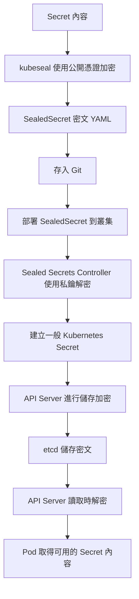
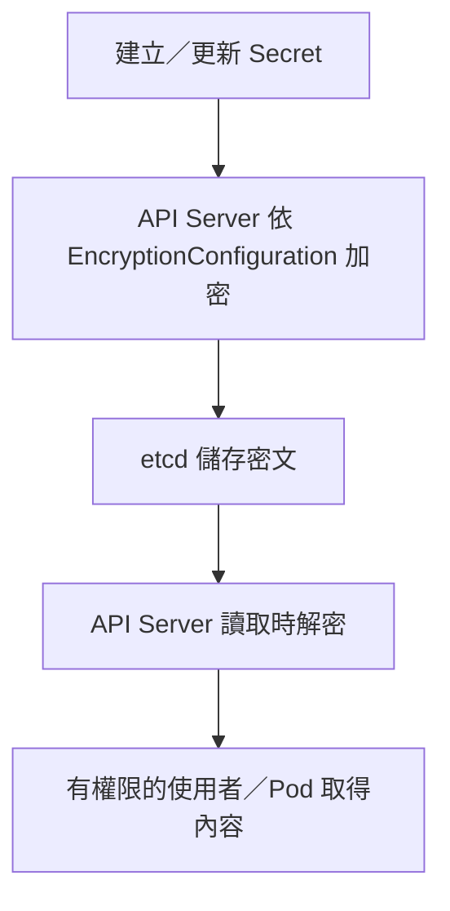
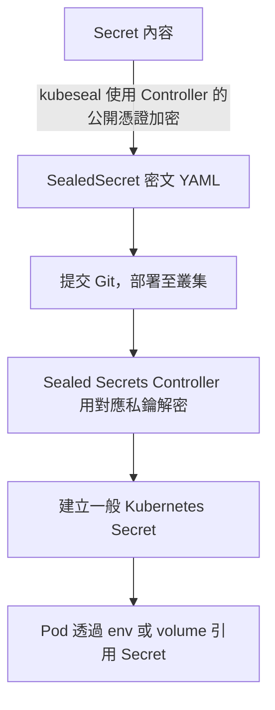

# K8s ConfigMap、Secret 與 Sealed Secrets

## TL;DR

**ConfigMap 放一般設定；Secret 放密碼、Token、私鑰等敏感資料；Sealed Secrets 把 Secret 加密成可放進 Git 的自訂資源，再由叢集內的 Controller 解密成 Secret。**

| 物件 | 常見內容 | 是否加密 |
|---|---|---|
| ConfigMap | 環境名稱、服務位址、應用設定檔 | 不提供機密保護 |
| Secret | 密碼、API Token、TLS 私鑰、Registry credentials | `data` 的 Base64 不是加密；儲存加密需另外配置 |
| SealedSecret | 加密後的 Secret 內容 | 密文，由持有對應私鑰的 Controller 解密 |

ConfigMap、Secret 都是內建 `apiVersion: v1` 資源。Pod 引用時，物件必須與 Pod 位於同一 Namespace。**Secret 是敏感資料的專用物件，不代表任何人都看不到；仍需透過 [[K8s RBAC 與 ServiceAccount|RBAC]] 限制讀取，並配置儲存加密。**

## 建立 ConfigMap 與 Secret

以下是假資料範例，可存為 `app-settings.yaml`：

```yaml
apiVersion: v1
kind: ConfigMap
metadata:
  name: app-config
  namespace: default
data:
  APP_ENV: production
  app.conf: |
    log_level=info
---
apiVersion: v1
kind: Secret
metadata:
  name: db-credentials
  namespace: default
type: Opaque
stringData:
  password: EXAMPLE_PASSWORD
```

- ConfigMap 的 `data` 放字串；設定檔也可以是某個 key 的多行內容。
- Secret 的 `stringData` 可以直接填字串，API Server 會轉成 `data`；**這份 YAML 仍有明文密碼，不能當成加密檔案提交 Git**。
- Secret 的 `data` 值需填 Base64 編碼；`kubectl create secret` 可代為處理，不必手動編碼。

重要建立指令（與上面 YAML 擇一使用）：

```bash
kubectl create configmap app-config --from-literal=APP_ENV=production -n default
kubectl create configmap file-config --from-file=app.conf=./app.conf -n default
kubectl create secret generic db-credentials --from-literal=password=EXAMPLE_PASSWORD -n default
```

正式密碼直接放在命令列可能留在 shell history；可用 `--from-file=password=/secure/path/db-password` 從已備妥的檔案讀取。指令後加 `--dry-run=client -o yaml` 可產生 YAML；Secret 輸出仍包含可還原的資料。

`kubectl apply -f app-settings.yaml` 是讀取資源定義；`--from-file` 是把一般檔案內容裝進物件，兩者不同。既有指令例子見 [[K8s kubectl 常用指令#ConfigMap：-f 和 --from-file 不一樣]]。

## Pod 如何使用：環境變數與檔案掛載

以下 Pod 同時示範兩種方式：

```yaml
apiVersion: v1
kind: Pod
metadata:
  name: settings-demo
  namespace: default
spec:
  containers:
  - name: app
    image: busybox:1.36
    command: ["sleep", "3600"]
    env:
    - name: APP_ENV
      valueFrom:
        configMapKeyRef:
          name: app-config
          key: APP_ENV
    - name: DB_PASSWORD
      valueFrom:
        secretKeyRef:
          name: db-credentials
          key: password
    volumeMounts:
    - name: config
      mountPath: /etc/app-config
      readOnly: true
    - name: credentials
      mountPath: /etc/app-secret
      readOnly: true
  volumes:
  - name: config
    configMap:
      name: app-config
  - name: credentials
    secret:
      secretName: db-credentials
```

| 寫法 | 容器內的結果 |
|---|---|
| `env[].valueFrom.configMapKeyRef` | 某個 ConfigMap key 變成環境變數 |
| `env[].valueFrom.secretKeyRef` | 某個 Secret key 變成環境變數 |
| `volumes[].configMap` | key 變成檔名，例如 `/etc/app-config/app.conf` |
| `volumes[].secret` | key 變成檔名，例如 `/etc/app-secret/password` |

**`env`、`envFrom`、`volumeMounts` 放在 container；`volumes` 放在 Pod spec。** Deployment 中對應 `spec.template.spec` 和它的 `containers[]`。

要把全部 key 注入環境變數，可使用 `envFrom`，放在 container 裡：

```yaml
envFrom:
- configMapRef:
    name: app-config
- secretRef:
    name: db-credentials
```

使用 `envFrom` 時宜選擇適合作為環境變數名稱的 keys；若只需要幾個值，用 `env` 明確指定即可。

### 修改設定後會自動更新嗎？

| 使用方式 | 更新行為 |
|---|---|
| 環境變數 | 已啟動的容器不會自動更新，通常需要重新建立 Pod |
| 一般 volume 掛載 | kubelet 會在稍後更新檔案；應用本身仍需重新讀取 |
| 以 `subPath` 掛載單一檔案 | 不會自動接收 ConfigMap／Secret 更新 |

只修改 ConfigMap／Secret 不會自動觸發 Deployment rollout。若應用需要重啟，可對實際 Deployment 執行 `kubectl rollout restart deployment/<名稱>`。

## Secret 常見類型

| type | 用途 | 建立方式 |
|---|---|---|
| `Opaque` | 自訂密碼、Token 等資料 | `kubectl create secret generic` |
| `kubernetes.io/dockerconfigjson` | 私有 Registry 登入資料 | `kubectl create secret docker-registry` |
| `kubernetes.io/tls` | TLS 憑證與私鑰，keys 為 `tls.crt`、`tls.key` | `kubectl create secret tls` |

```bash
kubectl create secret tls app-tls --cert=server.crt --key=server.key -n default
```

Registry Secret 的建立與 `imagePullSecrets` 見 [[K8s kubectl 常用指令#Secret docker-registry：登入私有 Registry 拉取 image]]；TLS 的引用見 [[K8s Ingress 與 Gateway API]]。

## 兩個層級的加密：Git 與 etcd

**Git 裡的 YAML 用 Sealed Secrets 保護；Secret 存進 etcd 時，用 API Server 的 Encryption at Rest 保護。兩者處理不同位置，可以同時啟用。**

| 比較 | Sealed Secrets | Encryption at Rest |
|---|---|---|
| 保護哪裡 | Git／部署檔裡的敏感設定 | etcd 裡儲存的資源資料 |
| 誰加密 | 本機或 CI 的 `kubeseal` | API Server |
| 誰解密 | Sealed Secrets Controller | API Server |
| 怎麼設定 | 安裝 Controller 與自訂資源定義，使用公開憑證加密 | API Server 載入 `EncryptionConfiguration` |
| 產生什麼 | 可提交 Git 的 SealedSecret 密文 YAML | etcd 中的密文紀錄 |
| 不能取代什麼 | 不會自動開啟一般 Secret 的 etcd 儲存加密 | 不會加密本機／Git 裡原本的 Secret YAML |

兩者一起使用時：



**這些都是儲存或設定檔的保護，不代表應用讀到的密碼仍是密文；誰能取用 Secret，仍靠 RBAC 等權限控管。**

## Encryption at Rest：Secret 加密後存進 etcd

**新增加密設定檔，讓每一台 API Server 掛載並載入後，新建／更新的 Secret 就會加密存進 etcd。** 不需要改應用程式，也不用在每個 Secret YAML 加上加密欄位；但只把檔案放在主機上還不會生效。



### 1. 準備 encryption-config.yaml

以下是自管 kubeadm 叢集的教學範例，使用本機金鑰與 `aescbc`。正式環境可採 KMS v2 整合金鑰管理；`aescbc` 並非目前官方建議的正式環境首選。

先產生隨機 32-byte 金鑰，以 Base64 表示：

```bash
openssl rand -base64 32
```

將輸出填入 `/etc/kubernetes/encryption/encryption-config.yaml` 的 `secret`，不要保留範例佔位文字：

```yaml
apiVersion: apiserver.config.k8s.io/v1
kind: EncryptionConfiguration
resources:
- resources:
  - secrets
  providers:
  - aescbc:
      keys:
      - name: key1
        secret: <貼上剛產生的 Base64 金鑰>
  - identity: {}
```

| 欄位 | 意思 |
|---|---|
| `resources: [secrets]` | 指定 Secret 需要儲存加密；本例不會順便加密 ConfigMap |
| `providers` 第一項 `aescbc` | 寫入使用這個加密 provider，其第一把金鑰 `key1` 用於加密 |
| `keys[].secret` | 真正加密金鑰的 Base64 表示，不是某個 Kubernetes Secret 的名稱 |
| 後面的 `identity: {}` | 讓 API Server 仍能讀取尚未加密的舊資料；放第一項則會變成不加密寫入 |

**Base64 只是金鑰的表示方式；真正加密資料的是加密 provider。** 這份檔案含有金鑰，不能提交 Git，要限制存取並備份。刪掉解密金鑰可能讓舊資料無法讀取。

### secretbox：另一種儲存加密 provider

**`secretbox` 是一種加密方案，在 Kubernetes 中是 provider 的名稱；不是一種 Secret 類型，也不是 Sealed Secrets。** 內部使用 XSalsa20 加密，搭配 Poly1305 驗證完整性，金鑰為 32 bytes。

若採用 secretbox，`EncryptionConfiguration` 的 providers 可寫成：

```yaml
providers:
- secretbox:
    keys:
    - name: key1
      secret: <Base64 編碼的 32-byte 隨機金鑰>
- identity: {}
```

這是 provider 區段示意；同樣由 API Server 在寫入 etcd 前加密。已有 aescbc 密文時，不能直接移除舊 provider／金鑰，必須保留解密能力並規劃遷移。

### 2. 修改 API Server static Pod manifest

在 `/etc/kubernetes/manifests/kube-apiserver.yaml` 的 API Server `command` 加入：

```yaml
- --encryption-provider-config=/etc/kubernetes/encryption/encryption-config.yaml
```

同時合併以下掛載設定，保留原本的其他欄位：

```yaml
# spec.containers[] 裡，API Server container 的 volumeMounts
volumeMounts:
- name: encryption-config
  mountPath: /etc/kubernetes/encryption
  readOnly: true

# spec.volumes
volumes:
- name: encryption-config
  hostPath:
    path: /etc/kubernetes/encryption
    type: Directory
```

這是兩個不同位置的欄位示意，不是一份可直接替換完整 manifest 的 YAML。修改 static Pod manifest 後，kubelet 會重建 API Server Pod；確認 API Server 恢復正常再繼續。多台 API Server 都必須能用一致的設定與金鑰讀寫資料。

**EncryptionConfiguration 是 API Server 啟動時讀取的設定檔，不是拿來 `kubectl apply` 的一般資源。** 設定檔也不要放進 `/etc/kubernetes/manifests/`，該目錄留給 static Pod manifest。

### 3. 新資料加密；舊資料需要重新寫入

API Server 載入上述設定後：

- 新建或更新的 Secret：寫進 etcd 時加密。
- 已經存在且未更新的 Secret：不會自動轉成密文，需要重新寫入。
- `kubectl get secret -o yaml`：API Server 已解密，仍看到一般 Secret 的 Base64 data，不能用它判定 etcd 裡是否加密。
- 驗證儲存格式：直接讀 etcd 中的對應紀錄；此範例的密文前綴為 `k8s:enc:aescbc:v1:key1:`。`etcdctl` 是直接操作 etcd 的工具，不是加密工具。

例如要讓既有 `default/db-credentials` 重新寫入，可在所有 API Server 設定生效後執行：

```bash
kubectl get secret db-credentials -n default -o json | kubectl replace -f -
```

這是更新同一個 Secret，**不要加 `--force`**。本例只處理一個物件，並不代表全叢集的舊 Secret 都完成加密。

**Sealed Secrets 保護提交 Git 的設定；Encryption at Rest 保護存進 etcd 的資料。兩者可以同時使用。** 有權讀取 Secret 的使用者仍能透過 API 取得內容，因此 RBAC 仍然需要。

官方：[Encrypting Confidential Data at Rest](https://kubernetes.io/docs/tasks/administer-cluster/encrypt-data/)。搜尋關鍵詞：`encrypt data at rest`、`EncryptionConfiguration`、`encryption-provider-config`；頁內找 `providers`、`Ensure all relevant data are encrypted`。

## Sealed Secrets：把加密設定放進 Git

**Sealed Secrets 是額外安裝的工具，不是 Kubernetes 內建的 Secret 類型。** 它包含 `kubeseal` 用戶端工具、`SealedSecret` 的 CustomResourceDefinition，以及叢集內的 Controller。



**Pod 使用的是解密後的 Secret，不是直接引用 SealedSecret。** 這也就是 [[K8s CRD、Custom Resource 與 Controller|自訂資源與 Controller]] 的實際用途：`SealedSecret` 描述加密內容，Controller 負責產生可用的 Secret。

### kubeseal 流程：取公開憑證 → 加密 → 提交 → 部署

1. 叢集先安裝 Sealed Secrets Controller 與自訂資源定義；本機安裝 `kubeseal`。
2. 取得目標叢集 Controller 的公開憑證，用來加密；不需要拿到它的私鑰。
3. 把 Secret 內容交給 `kubeseal`，產生 SealedSecret 密文 YAML。
4. 將密文 YAML 提交 Git，再由你或 GitOps 工具部署。
5. Controller 用私鑰解密並建立一般 Secret；Pod 照原本的 Secret 名稱引用，不必改成引用 SealedSecret。

先取得公開憑證。以下假設 Controller 名稱為 `sealed-secrets-controller`，位於 `kube-system`；依實際安裝值調整：

```bash
kubeseal --fetch-cert \
  --controller-name sealed-secrets-controller \
  --controller-namespace kube-system > controller-public.pem
```

Helm 安裝的 Controller 名稱可能是 `sealed-secrets`，需使用對應的 `--controller-name`。公開憑證不是解密私鑰，可供團隊使用，但必須確認來源與目標叢集正確。

再從已準備的密碼檔產生密文（`--dry-run=client` 不會先在叢集建立 Secret）：

```bash
kubectl create secret generic db-credentials \
  --from-file=password=/secure/path/db-password \
  -n default --dry-run=client -o yaml | \
  kubeseal --cert controller-public.pem --format yaml > db-credentials-sealed.yaml

kubectl apply -f db-credentials-sealed.yaml
kubectl get sealedsecrets -n default
kubectl get secret db-credentials -n default
```

可提交的是 `db-credentials-sealed.yaml`，不是原始密碼檔。公開憑證可供加密，解密私鑰應由 Controller 保管並妥善備份。

預設 strict scope 會把密文綁定 Secret 名稱與 Namespace，不能任意改名或搬到另一個 Namespace。Sealed Secrets 保護 Git 裡的設定；解密後仍是一般 Secret，仍需 RBAC 與叢集儲存保護。

## 查詢與排錯

```bash
kubectl get configmaps,secrets -n default
kubectl describe configmap app-config -n default
kubectl describe secret db-credentials -n default
kubectl describe pod settings-demo -n default
kubectl explain pod.spec.containers.env.valueFrom
kubectl explain pod.spec.volumes.secret
```

`describe secret` 可檢查 keys 與資料大小，不直接列出內容。Pod 出現設定錯誤時，先確認物件名稱、Namespace、key 是否存在；`FailedMount` 可從 Pod Events 找到缺少的物件或掛載問題。

## 官方文件與搜尋關鍵詞

- [ConfigMaps](https://kubernetes.io/docs/concepts/configuration/configmap/)：`configmap`、`configMapKeyRef`、`configMapRef`。
- [Secrets](https://kubernetes.io/docs/concepts/configuration/secret/)：`secret`、`stringData`、`secretKeyRef`、`secret volume`。
- [Pull an Image from a Private Registry](https://kubernetes.io/docs/tasks/configure-pod-container/pull-image-private-registry/)：`imagePullSecrets`、`docker-registry`。
- [Sealed Secrets 官方專案](https://github.com/bitnami/sealed-secrets)：`kubeseal`、`SealedSecret`、`Scopes`、`sealing key`。
