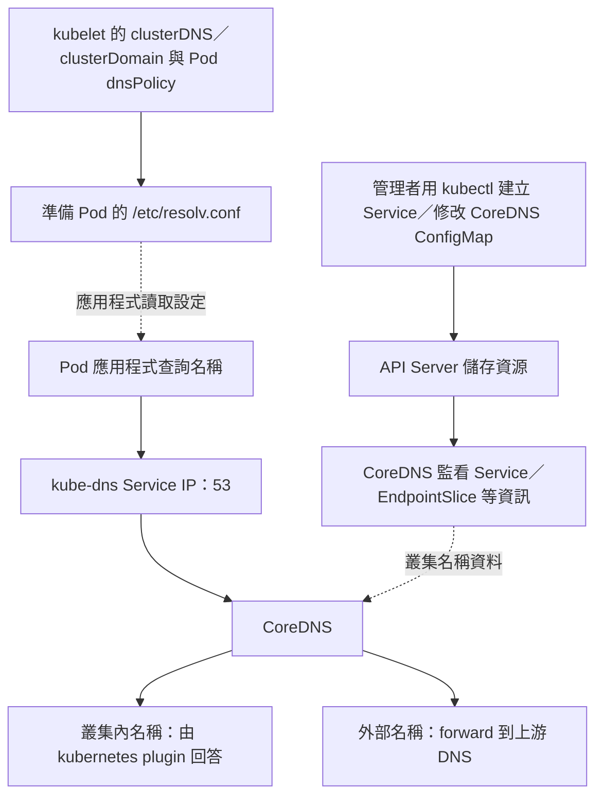

# K8s CoreDNS、kubelet 與 resolv.conf

> [!tip] 先背角色
> **kubectl 管設定、kubelet 準備 Pod 的 DNS 設定、resolv.conf 告訴程式問誰、CoreDNS 回答查詢。** 應用程式查 DNS 不會經過 kubectl。

## kube-dns 到 CoreDNS

早期常見的叢集 DNS 實作是 **kube-dns**；**Kubernetes 1.11 起，CoreDNS 已 GA，且 kubeadm 預設安裝 CoreDNS**。這是實作的替換，不只是改名，也不是以 1.2 為分界。

為了相容，CoreDNS 對外的 Service 通常仍叫 `kube-dns`；看到這個 Service 名稱，不代表後端還在跑舊 kube-dns。

## 它們怎麼合作

以一般 `dnsPolicy: ClusterFirst` 的 Pod 為例：



kubectl 是 API Server 的操作工具，不是 DNS server。建立 Service 後，CoreDNS 透過 Kubernetes API 取得資訊，不需要逐筆手寫 DNS 紀錄。一般 ClusterIP Service 名稱解析到 Service IP；**實際 Service 封包轉送**則由 kube-proxy 或替代實作處理。

## resolv.conf：不是 DNS 紀錄表

Pod 內常見的 `/etc/resolv.conf` 類似：

```text
nameserver 10.96.0.10
search default.svc.cluster.local svc.cluster.local cluster.local
options ndots:5
```

| 欄位 | 意義 |
|---|---|
| `nameserver` | DNS 查詢要送給誰；此例是 kube-dns Service IP，實際值依叢集設定 |
| `search` | 短名稱查詢可嘗試補上的後綴；此例 Pod 位於 default namespace |
| `ndots:5` | 少於 5 個點的名稱通常先嘗試 search 後綴；實際順序依 resolver 實作 |

### 同 namespace 與跨 namespace：web-service 範例

以下假設使用一般 `ClusterFirst` DNS 設定、標準 search 後綴，叢集網域為 `cluster.local`。Service 的完整名稱格式是：

```text
服務名稱.namespace.svc.叢集網域
web-service.payroll.svc.cluster.local
```

**例一：App 在 default，web-service 也在 default。**

| App 使用的名稱 | 能否解析到目標 Service |
|---|---|
| `web-service` | 可以，同 namespace 可省略後綴 |
| `web-service.default` | 可以，明確指定 namespace |
| `web-service.default.svc` | 可以，透過 search 補上 cluster.local |
| `web-service.default.svc.cluster.local` | 可以，已寫出完整名稱 |

**例二：App 在 default，web-service 在 payroll。**

| App 使用的名稱 | 能否解析到 payroll 的目標 Service |
|---|---|
| `web-service` | 不行，會先找 default 裡的同名 Service |
| `web-service.payroll` | 可以，跨 namespace 最常用的簡寫 |
| `web-service.payroll.svc` | 可以，透過 search 補上 cluster.local |
| `web-service.payroll.svc.cluster.local` | 可以，已寫出完整名稱 |

如果 default 剛好也有 `web-service`，只寫 `web-service` 就會解析到 default 的那個，**不會因為它找得到，就表示連到 payroll 的服務**。若 App 與 Service 都在 payroll，一樣能直接寫 `web-service`；重點是兩者是否在同一個 namespace，default 沒有特例。

### 短名稱是怎麼補完整的？

以上面 default Pod 的 search 設定為例，resolver 會嘗試補上不同後綴。以下只列出能對應到目標的組合，不代表所有查詢的完整順序：

```text
web-service
  + default.svc.cluster.local
  → web-service.default.svc.cluster.local

web-service.payroll
  + svc.cluster.local
  → web-service.payroll.svc.cluster.local

web-service.payroll.svc
  + cluster.local
  → web-service.payroll.svc.cluster.local
```

**補後綴的是 App 使用的 DNS resolver，依據 Pod 的 resolv.conf；CoreDNS 收到查詢後，按名稱回答。** CoreDNS 不會自動猜測你想找哪個 namespace，也不會遍歷所有 namespaces 尋找同名 Service。

以 `.` 結尾，例如 `web-service.payroll.svc.cluster.local.`，表示絕對名稱，不再補 search 後綴。DNS 解析成功只是取得位址；實際連線仍要使用正確的 Service port，並符合網路政策等條件。

> [!tip] 考前記法
> **同 namespace：服務名；跨 namespace：服務名.namespace；完整名稱：服務名.namespace.svc.cluster.local。** 題目問哪個名稱不能用，先確認呼叫端 App 的 namespace。

**kubelet** 依 `clusterDNS`、`clusterDomain`、Pod 的 `dnsPolicy`／`dnsConfig` 等設定準備容器的 resolver 設定；kubectl 不會替應用程式逐次解析名稱。`dnsPolicy: Default` 主要沿用 Node 的 DNS 設定，與 `ClusterFirst` 不同；hostNetwork Pod 要使用叢集 DNS 時，通常指定 `ClusterFirstWithHostNet`。

## Corefile：CoreDNS 收到查詢後怎麼處理

```bash
# 在實際有掛載此檔案的環境中執行；通常是 CoreDNS 容器內
cat /etc/coredns/Corefile
```

Linux 路徑區分大小寫，檔名通常是 **Corefile**。這不是每台 Node 都必然存在的檔案；CoreDNS image 也未必有 shell 或 cat。從叢集外查看設定，直接讀 ConfigMap：

```bash
kubectl get cm coredns -n kube-system -o yaml
```

### ConfigMap 名稱、Corefile 與 DNS Service 的區別

一般 kubeadm 叢集使用名為 **`coredns`** 的 ConfigMap 儲存 CoreDNS 設定，位於 `kube-system` namespace；設定內容放在 `data.Corefile`。實際名稱以叢集中的物件為準：

```yaml
# 查詢結果的關鍵結構，不是完整 manifest
metadata:
  name: coredns       # ConfigMap 物件名稱
  namespace: kube-system
data:
  Corefile: |        # ConfigMap 裡面的 key，內容可掛載成檔案
    .:53 {
      # DNS 設定內容
    }
```

記成：**ConfigMap 叫 coredns → 裡面有 data.Corefile → 掛載為 /etc/coredns/Corefile**；對外 DNS Service 則通常仍叫 `kube-dns`。

常見關鍵設定可縮成以下片段；它不是完整預設 Corefile：

```text
.:53 {
    kubernetes cluster.local in-addr.arpa ip6.arpa
    forward . /etc/resolv.conf
    cache 30
    reload
}
```

- `.:53`：接收 DNS 查詢。
- `kubernetes cluster.local ...`：處理叢集內 DNS 區域，cluster domain 可自訂。
- `forward . /etc/resolv.conf`：把需要轉送的查詢交給該檔中的上游 DNS。
- `cache`：快取結果；`reload`：偵測 Corefile 變動後重新載入。

> [!warning] 這裡有兩份 resolv.conf
> **應用 Pod 的** resolv.conf 指向叢集 DNS；Corefile 裡的 `/etc/resolv.conf` 則是 **CoreDNS 容器看到的檔案**，用來找上游 DNS，通常源自 Node 的 resolver 設定。不能把兩者當成同一份，更不能讓 CoreDNS 把查詢轉送回自己造成迴圈。

## 必要查詢與排錯順序

```bash
kubectl get svc kube-dns -n kube-system
kubectl get pods -n kube-system -l k8s-app=kube-dns
# app 是範例 Pod；需有 cat／nslookup 才能執行
kubectl exec app -- cat /etc/resolv.conf
kubectl exec app -- nslookup kubernetes.default.svc.cluster.local
```

先看應用 Pod 問哪個 DNS，再看 DNS Service／Pod 是否可用，最後看 Corefile 與上游。叢集名稱正常、外部名稱失敗時，優先查 forward 與上游連線。使用多容器 Pod 時，exec 加 `-c` 選對容器。

相關：[[K8s Calico 安裝與網路判讀小抄]]、[[K8s 各 Component 說明]]。

## 參考

- [Kubernetes：DNS 與 CoreDNS 版本說明](https://kubernetes.io/docs/tasks/access-application-cluster/configure-dns-cluster/)
- [Pod／Service DNS、dnsPolicy 與 resolv.conf](https://kubernetes.io/docs/concepts/services-networking/dns-pod-service/)
- [CoreDNS ConfigMap 與 Corefile](https://kubernetes.io/docs/tasks/administer-cluster/dns-custom-nameservers/)
