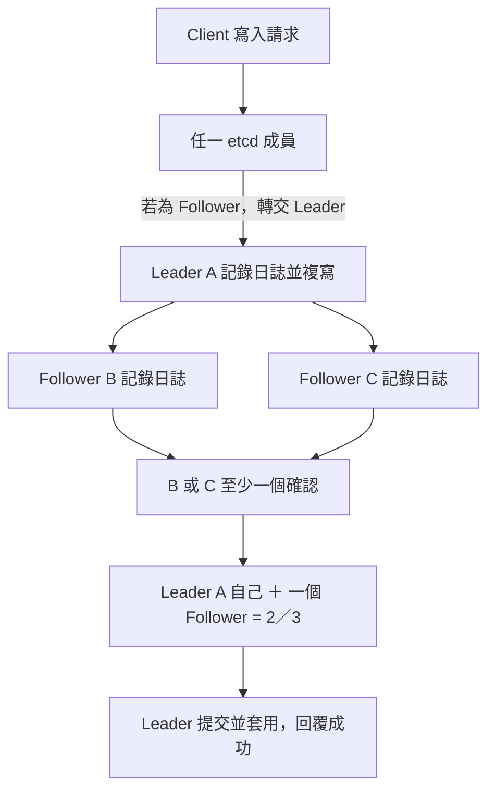

# K8s HA、Quorum 與 Split-brain

Split-brain 是分散式系統因網路分割而出現互相衝突的 active side，不專指 Kubernetes master。對使用 Raft 的 datastore，提交新寫入需要多數 voting members，少數派不能自行形成合法的提交多數。

Quorum 的公式、成員數與容錯表見 [[Consensus Algorithms#Quorum：多數決門檻|Quorum：多數決門檻]]。在 3 個 etcd voting members 的例子中，至少需要 2 個確認；Control-plane Node 數量不一定等於 etcd 成員數。

共識原理見 [[Consensus Algorithms#Raft：待閱讀與整理|Raft]]；與另一種共識演算法的對照見 [[Consensus Algorithms#故障模型：Crash Fault 與 Byzantine Fault|Raft 與 PBFT 的故障模型]]。Raft 主要處理非拜占庭故障，PBFT 則考慮節點任意偏離協議的情況，兩者不能直接套用同一個容錯門檻。

MicroK8s 的 HA datastore 使用 dqlite；worker-only 節點不會增加 control-plane HA 能力。不要把 dqlite 的操作方式寫成 etcd 的操作方式。參考：[MicroK8s High Availability](https://microk8s.io/docs/high-availability/)。

原對話決定先練 CNI 網路，因此這裡保留概念，不把故障注入列為目前網路 Lab 的必要步驟。未來驗證時可觀察正常、失去一個 voter、失去 quorum，以及 1／2 網路分割的寫入行為。控制平面失去 quorum 不表示現有容器立即消失，但排程與需要 datastore 的控制操作會受影響。

## etcd 寫入：Leader 協調，多數確認後提交

**寫入由 Raft Leader 協調；3 個 voting members 只要 2 個確認即可提交，而且這 2 個包含 Leader 自己。** 不是另外需要 2 個 Follower 確認。

Client 可以連到任一成員；需要共識的寫入若先到 Follower，會轉交 Leader。Leader 排定日誌順序、記錄日誌，再複寫給 Followers。



- **A＋B 或 A＋C 都足夠**，不必等待三個成員全部確認；落後的成員之後補齊日誌。
- 「確認」指日誌已記錄，並非只是收到網路請求。Leader 不是唯一保存資料的成員。
- 無法取得多數確認時，就無法繼續提交新寫入；只有一個成員存活也不夠。
- **選 Leader 的投票**與**每次寫入的日誌複寫確認**是不同事情，兩者都需要多數。

參考：[etcd FAQ：Leader、Follower 與共識請求](https://etcd.io/docs/v3.4/faq/)、[Raft 原始論文](https://raft.github.io/raft.pdf)。

## kube-controller-manager：Leader Election

**多個 controller-manager 副本先選一個 Leader，由它執行主要控制工作，其餘待命；Leader 故障或無法續租後，其他副本可接手。** 這是高可用，不是各副本平分工作。

```text
kube-controller-manager --leader-elect=true
```

此參數預設為 true。一般透過 API Server 中的 Lease 協調領導權，Leader 持續續租；它與 etcd／datastore 的 quorum 是不同機制。

| 參數 | 預設 | 意義 |
|---|---|---|
| `--leader-elect-lease-duration` | **15s** | 候選者觀察到租約不再更新後，等待租約期限再嘗試取得領導權 |
| `--leader-elect-renew-deadline` | **10s** | Leader 無法成功續租達此期限，就放棄領導權 |
| `--leader-elect-retry-period` | **2s** | 取得／續租的重試間隔 |

**記法：10 秒是 Leader 自己的放手期限，15 秒是候選者判斷能否接手的租約期限，2 秒是重試節奏。不是 15＋10＝25 秒，也不保證固定第 15 秒完成接手**；實際時間受重試、API 連線與設定影響。

查看預設選主租約：

```bash
kubectl get lease kube-controller-manager -n kube-system -o yaml
```

看 `spec.holderIdentity` 確認目前持有者。若更改過選主租約名稱／namespace，需查對應物件。

參考：[kube-controller-manager 官方參數與預設值](https://kubernetes.io/docs/reference/command-line-tools-reference/kube-controller-manager/)。

## Stacked 與 External etcd Topology

**Stacked：etcd 和控制平面元件放同一批機器；External：etcd 放獨立機器，與控制平面分開。** External 的意思是外部，不是 eternal（永恆）。

| 拓撲 | 典型部署例子（不含 worker 與 LB） | 取捨 |
|---|---|---|
| Stacked etcd | 3 台控制平面，各自運行一個 etcd member | 機器較少、架構較簡單；壞一台同時失去控制平面副本與 etcd member |
| External etcd | 3 台控制平面 ＋ 3 台獨立 etcd | 分離故障與資源競爭；機器與維運成本較高，需另外建立管理 etcd 叢集 |

```text
Stacked：
CP-1 [API Server + etcd-1]
CP-2 [API Server + etcd-2]
CP-3 [API Server + etcd-3]

External：
CP-1／CP-2／CP-3 的 API Servers
    → 獨立的 etcd 叢集 [etcd-1、etcd-2、etcd-3]
```

兩者的 etcd 都需 quorum，**External 不代表 etcd 不用選主，也不代表自動具有更高故障容忍數**；3 個 voting members 仍需至少 2 個才能提交寫入。API Server 可多副本提供服務；controller-manager 的 Lease 選主與 etcd 的 Raft leader 是不同機制。

參考：[Kubernetes HA Topology 官方對照圖](https://kubernetes.io/docs/setup/production-environment/tools/kubeadm/ha-topology/)。
