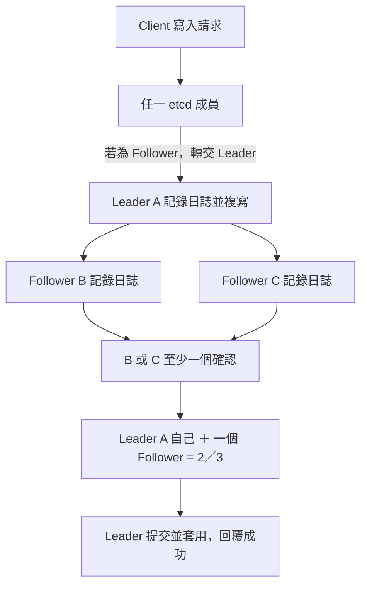

# K8s HA、Quorum 與 Split-brain

Split-brain 是分散式系統因網路分割而出現互相衝突的 active side，不專指 Kubernetes master。對使用 Raft 的 datastore，提交新寫入需要多數 voting members，少數派不能自行形成合法的提交多數。

Quorum 的公式、成員數與容錯表見 [[Consensus Algorithms#Quorum：多數決門檻|Quorum：多數決門檻]]。在 3 個 etcd voting members 的例子中，至少需要 2 個確認；Control-plane Node 數量不一定等於 etcd 成員數。

共識原理見 [[Consensus Algorithms#Raft：待閱讀與整理|Raft]]；與另一種共識演算法的對照見 [[Consensus Algorithms#故障模型：Crash Fault 與 Byzantine Fault|Raft 與 PBFT 的故障模型]]。Raft 主要處理非拜占庭故障，PBFT 則考慮節點任意偏離協議的情況，兩者不能直接套用同一個容錯門檻。

MicroK8s 的 HA datastore 使用 dqlite；worker-only 節點不會增加 control-plane HA 能力。不要把 dqlite 的操作方式寫成 etcd 的操作方式。參考：[MicroK8s High Availability](https://microk8s.io/docs/high-availability/)。

原對話決定先練 CNI 網路，因此這裡保留概念，不把故障注入列為目前網路 Lab 的必要步驟。未來驗證時可觀察正常、失去一個 voter、失去 quorum，以及 1／2 網路分割的寫入行為。控制平面失去 quorum 不表示現有容器立即消失，但排程與需要 datastore 的控制操作會受影響。

## etcd 寫入：Leader 協調，多數確認後提交

**寫入由 Raft Leader 協調；3 個 voting members 只要 2 個確認即可提交，而且這 2 個包含 Leader 自己。** 不是另外需要 2 個 Follower 確認。

Client 可以連到任一成員；需要共識的寫入若先到 Follower，會轉交 Leader。Leader 排定日誌順序、記錄日誌，再複寫給 Followers。



- **A＋B 或 A＋C 都足夠**，不必等待三個成員全部確認；落後的成員之後補齊日誌。
- 「確認」指日誌已記錄，並非只是收到網路請求。Leader 不是唯一保存資料的成員。
- 無法取得多數確認時，就無法繼續提交新寫入；只有一個成員存活也不夠。
- **選 Leader 的投票**與**每次寫入的日誌複寫確認**是不同事情，兩者都需要多數。

參考：[etcd FAQ：Leader、Follower 與共識請求](https://etcd.io/docs/v3.4/faq/)、[Raft 原始論文](https://raft.github.io/raft.pdf)。

## kube-controller-manager：Leader Election

**多個 controller-manager 副本先選一個 Leader，由它執行主要控制工作，其餘待命；Leader 故障或無法續租後，其他副本可接手。** 這是高可用，不是各副本平分工作。

```text
kube-controller-manager --leader-elect=true
```

此參數預設為 true。一般透過 API Server 中的 Lease 協調領導權，Leader 持續續租；它與 etcd／datastore 的 quorum 是不同機制。

| 參數 | 預設 | 意義 |
|---|---|---|
| `--leader-elect-lease-duration` | **15s** | 候選者觀察到租約不再更新後，等待租約期限再嘗試取得領導權 |
| `--leader-elect-renew-deadline` | **10s** | Leader 無法成功續租達此期限，就放棄領導權 |
| `--leader-elect-retry-period` | **2s** | 取得／續租的重試間隔 |

**記法：10 秒是 Leader 自己的放手期限，15 秒是候選者判斷能否接手的租約期限，2 秒是重試節奏。不是 15＋10＝25 秒，也不保證固定第 15 秒完成接手**；實際時間受重試、API 連線與設定影響。

查看預設選主租約：

```bash
kubectl get lease kube-controller-manager -n kube-system -o yaml
```

看 `spec.holderIdentity` 確認目前持有者。若更改過選主租約名稱／namespace，需查對應物件。

參考：[kube-controller-manager 官方參數與預設值](https://kubernetes.io/docs/reference/command-line-tools-reference/kube-controller-manager/)。

## Stacked 與 External etcd Topology

**Stacked：etcd 和控制平面元件放同一批機器；External：etcd 放獨立機器，與控制平面分開。** External 的意思是外部，不是 eternal（永恆）。

| 拓撲 | 典型部署例子（不含 worker 與 LB） | 取捨 |
|---|---|---|
| Stacked etcd | 3 台控制平面，各自運行一個 etcd member | 機器較少、架構較簡單；壞一台同時失去控制平面副本與 etcd member |
| External etcd | 3 台控制平面 ＋ 3 台獨立 etcd | 分離故障與資源競爭；機器與維運成本較高，需另外建立管理 etcd 叢集 |

```text
Stacked：
CP-1 [API Server + etcd-1]
CP-2 [API Server + etcd-2]
CP-3 [API Server + etcd-3]

External：
CP-1／CP-2／CP-3 的 API Servers
    → 獨立的 etcd 叢集 [etcd-1、etcd-2、etcd-3]
```

兩者的 etcd 都需 quorum，**External 不代表 etcd 不用選主，也不代表自動具有更高故障容忍數**；3 個 voting members 仍需至少 2 個才能提交寫入。API Server 可多副本提供服務；controller-manager 的 Lease 選主與 etcd 的 Raft leader 是不同機制。

參考：[Kubernetes HA Topology 官方對照圖](https://kubernetes.io/docs/setup/production-environment/tools/kubeadm/ha-topology/)。

## etcd 備份與還原：etcdctl、etcdutl

**備份用 `etcdctl snapshot save`；檢查與還原用 `etcdutl snapshot status／restore`。備份完成後不需要立即還原，只有需要回復資料時才 restore。**

| 操作 | 工具與指令 | 是否連線到 etcd |
|---|---|---|
| 匯出部分 Resource 設定 | `kubectl get all -A -o yaml > all.yml` | 透過 API Server 讀取資源 |
| 備份 etcd 資料庫 | `etcdctl snapshot save snapshot.db` | 是，從運作中的 etcd 取得快照 |
| 檢查快照 metadata | `etcdutl snapshot status snapshot.db -w table` | 否，讀取本機檔案 |
| 還原到新資料目錄 | `etcdutl snapshot restore snapshot.db --data-dir=/var/lib/etcd-restored` | 否，讀取本機檔案並建立資料目錄 |

- `kubectl get all` 的 `all` 不是所有資源，不包含 Secret、ConfigMap、PVC、Ingress、RBAC 等；匯出 YAML 不是完整 etcd 備份。
- etcd snapshot 保存叢集狀態，包括 PV／PVC 物件設定，**不包含儲存卷內的檔案或資料庫內容**。
- `etcdctl` 是網路用戶端；`etcdutl` 直接處理本機資料檔。**官方 etcdutl 3.5／3.6 沒有 `etcdutl backup` 指令**，不要記成能自動複製 data directory 與 WAL。
- `etcdctl snapshot status` 在 3.5 已棄用、3.6 移除；統一記 `etcdutl snapshot status`。

### 備份：連線、驗證，再儲存快照

先確認工具版本：

```bash
etcdctl version
etcdutl version
```

官方簡化範例（`$ENDPOINT` 須先設為實際位址）：

```bash
ETCDCTL_API=3 etcdctl --endpoints=$ENDPOINT snapshot save snapshot.db
```

**省略 TLS 參數不代表不用驗證。** kubeadm 常見環境啟用 HTTPS 與用戶端憑證驗證，使用下列完整範例；工具需已安裝，路徑與位址須符合實際環境：

```bash
sudo etcdctl \
  --endpoints=https://127.0.0.1:2379 \
  --cacert=/etc/kubernetes/pki/etcd/ca.crt \
  --cert=/etc/kubernetes/pki/etcd/healthcheck-client.crt \
  --key=/etc/kubernetes/pki/etcd/healthcheck-client.key \
  snapshot save /opt/etcd-backup.db
```

| 參數 | 用途 |
|---|---|
| `--endpoints` | etcd 的位址，常見 client port 為 2379 |
| `--cacert` | etcdctl 用來驗證 etcd Server 的 CA 憑證 |
| `--cert`、`--key` | etcd Server 用來驗證用戶端身分的憑證與私鑰 |
| `snapshot save` | 將快照寫入指定檔案 |

課程範例有時用 `server.crt／server.key`；是否可當 client 使用，取決於憑證用途與伺服器驗證設定。這裡使用 kubeadm 常見的 `healthcheck-client` 憑證組；不能只憑檔名假設任意 Server 憑證都能當 Client 憑證。

### 檢查與還原

```bash
sudo etcdutl snapshot status /opt/etcd-backup.db --write-out=table
```

查看 hash、revision、total keys、size 等 metadata；這不等於已驗證整個叢集能成功還原。

建立還原資料目錄的基本語法：

```bash
sudo etcdutl snapshot restore /opt/etcd-backup.db \
  --data-dir=/var/lib/etcd-restored
```

**這只建立還原資料目錄，不會自動切換正在運作的 etcd。** 實際恢復叢集還需要：

1. 停止所有 API Server 的寫入與要替換的 etcd instance。
2. 依成員名稱、peer URL 與叢集拓撲還原；多成員使用同一份快照並設定各自 membership。
3. 讓 etcd 使用還原後的目錄。kubeadm Static Pod 常見要調整 `etcd.yaml` 中 `etcd-data` 的 `hostPath.path`，對齊容器內的 `--data-dir` 與掛載位置。
4. 啟動 etcd，確認健康後恢復 API Server 與其他控制元件並驗證資源。

Kubernetes 還原也要處理舊 revision 對 informer cache 的影響：官方建議搭配 `--bump-revision` 與 `--mark-compacted`，數值與完整參數依對應版本的 recovery 文件決定。

還原從本機快照讀取資料，不需要備份時的 TLS 連線參數。快照包含敏感叢集資料，需妥善保存；CA 私鑰、節點設定、Secret 儲存加密金鑰與卷內資料也要另外備份。

### 官方文件與查詢關鍵詞

| 連結 | 重點／關鍵詞 |
|---|---|
| [Kubernetes：Backing up an etcd cluster](https://kubernetes.io/docs/tasks/administer-cluster/configure-upgrade-etcd/#backing-up-an-etcd-cluster) | `backing up etcd`、`snapshot save`、TLS 憑證參數 |
| [etcd v3.5：Disaster recovery 原始文件](https://github.com/etcd-io/website/blob/main/content/en/docs/v3.5/op-guide/recovery.md) | `snapshot status`、`snapshot restore`、`revision bump`、`data-dir` |
| [etcd v3.6：Disaster recovery](https://etcd.io/docs/v3.6/op-guide/recovery/) | 依實際 etcd 版本查還原流程 |
| [etcdutl v3.6 指令說明](https://github.com/etcd-io/etcd/blob/v3.6.0/etcdutl/README.md) | 本機檔案操作與支援的子指令 |
| [補充影片](https://www.youtube.com/watch?v=qRPNuT080Hk) | 保留影片連結供複習；指令版本以官方文件為準 |
