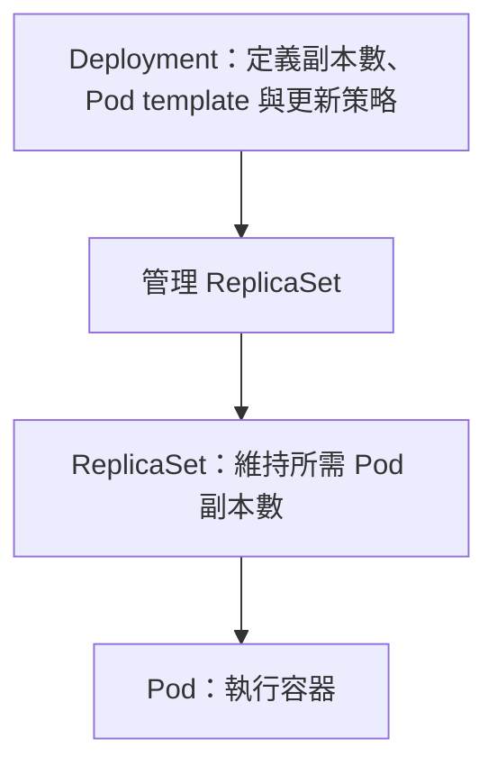

# K8s HPA 與水平、垂直擴縮

## TL;DR

**Out／In 改數量；Up／Down 改單個實例的資源。Scale out 與 Scale in 都屬於水平擴縮。**

| 名稱 | 方向 | 意思 | Pod 範例 |
|---|---|---|---|
| Scale out | 水平擴展 | 增加實例數量 | 2 個 Pod → 5 個 Pod |
| Scale in | 水平縮減 | 減少實例數量 | 5 個 Pod → 2 個 Pod |
| Scale up | 垂直擴展 | 增加單一實例的資源配置 | 每個 Pod 從 1 CPU／1 GiB 改成 2 CPU／2 GiB |
| Scale down | 垂直縮減 | 減少單一實例的資源配置 | 每個 Pod 從 2 CPU／2 GiB 改成 1 CPU／1 GiB |

這裡的垂直擴縮是調整 CPU／Memory 等資源配置，不是把 Pod 移往另一個 Node，也不是直接修改它當下的實際用量。

## 手動擴縮：水平改 replicas，垂直改 resources

### 水平擴縮：scale 改 Pod 數量

```bash
# Scale out：增加到 5 個副本
kubectl scale deployment web-app --replicas=5 -n default

# Scale in：減少到 2 個副本
kubectl scale deployment web-app --replicas=2 -n default
```

兩條是不同操作範例，不需要連續執行。修改的是 Deployment 的 `spec.replicas`，不是每個 Pod 的 CPU／Memory。

### Deployment → ReplicaSet → Pod



**Deployment 管理 ReplicaSet，ReplicaSet 維持 Pod 數量。** 純粹修改 replicas 不會因而建立新版本的 ReplicaSet；修改 Pod template 才會觸發 rollout，建立或選用對應 template 的 ReplicaSet。

獨立建立、沒有 Deployment 管理的 ReplicaSet，也能直接調整：

```bash
kubectl scale replicaset standalone-rs --replicas=3 -n default
```

若 ReplicaSet 是 Deployment 管理的，通常直接修改 Deployment；不要手動改底下 ReplicaSet，避免被控制器調回。

### 垂直擴縮：edit 改每個 Pod 的資源配置

```bash
kubectl edit deployment web-app -n default
```

修改 `spec.template.spec.containers[]` 中對應容器的 `resources`，保留既有 name、image 等欄位。例如：

```yaml
spec:
  template:
    spec:
      containers:
      - name: app
        resources:
          requests:
            cpu: "500m"
            memory: "512Mi"
          limits:
            cpu: "1"
            memory: "1Gi"
```

這是欄位位置示意，`app` 要換成既有容器名稱。`requests` 影響排程需求與資源分配，`limits` 設定使用上限；`500m` 是 0.5 CPU。增加原本配置是 Scale up，減少是 Scale down；**不是把 CPU 設成某個值就會讓程式固定消耗那麼多 CPU**。

這裡透過 Deployment 修改 Pod template，會觸發 rollout，以新設定建立 Pod；不是直接對既有 Pod 做原地資源調整。若 Node 沒有足夠容量，新 Pod 可能 Pending。

```bash
kubectl rollout status deployment/web-app -n default
kubectl get deployment,replicaset,pods -n default
```

`edit` 也能改 replicas，所以「水平用 scale、垂直用 edit」是常見操作方式，真正的差別仍是 **改 replicas 或 resources**。使用 YAML／Git 管理時，也要更新來源，避免下次 apply 把設定改回去。

若同一 Deployment 已由 HPA 管理，HPA 可能依指標再次調整副本數；手動 scale 不是永久覆蓋 HPA 的設定。

官方：[Deployments](https://kubernetes.io/docs/concepts/workloads/controllers/deployment/)。搜尋關鍵詞：`scaling a deployment`、`updating a deployment`、`replicaset`。

## HPA 對應哪一種？

**Horizontal Pod Autoscaler（HPA）依指標自動調整工作負載的 Pod 副本數，對應 Scale out／Scale in。**

- HPA：調整數量，例如 Deployment 從 2 個副本變 5 個。
- Vertical Pod Autoscaler（VPA）：針對 Pod 的 CPU／Memory requests 提供建議或自動調整，對應垂直擴縮；實際套用方式依安裝版本與更新模式而定。
- Node 擴縮是另一層：增加 Pod 不代表節點數量會自動增加。

HPA 使用的資源指標來源可見 [[K8s Metrics Server、Prometheus 與 Heapster]]；CPU／Memory requests 與 limits 見 [[K8s 中的 Pod 是什麼#Requests 與 Limits：排程需求和執行上限]]。

## HPA、Metrics Server 與 VPA：哪些需要安裝？

**HPA 是 Kubernetes 內建功能；Metrics Server 與 VPA 是額外元件，若叢集尚未提供，就要另外安裝。** 建立 HPA 物件是設定擴縮規則，不是安裝 HPA Controller。

| 元件 | 是否內建 | 安裝／使用方式 | 負責什麼 |
|---|---|---|---|
| Horizontal Pod Autoscaler（HPA） | 是 | 建立 HPA 物件，通常不需要 Helm 安裝 HPA 本身 | 依指標調整工作負載的副本數 |
| Metrics Server | 不是核心內建元件 | 可透過官方 manifest 或 Helm 安裝；部分發行版／託管服務已提供 | 提供近期 CPU／Memory Metrics API，供 kubectl top 與資源型 HPA 使用 |
| Vertical Pod Autoscaler（VPA） | 不是核心內建元件 | 安裝對應自訂資源定義與控制元件，依專案／平台提供的方式部署 | 對資源 requests 提供建議或依更新模式調整 |

### v1.23：autoscaling/v2 成為穩定版

**Kubernetes v1.23 不是首次內建 HPA，而是 `autoscaling/v2` 成為穩定版的版本分界。** HPA 在更早版本就存在；v2 支援多指標與較完整的擴縮行為設定。

```yaml
apiVersion: autoscaling/v2
kind: HorizontalPodAutoscaler
```

這只是 HPA 資源的 API 版本與種類，不是完整可套用的物件。

### 先確認指標服務，再建立擴縮規則

```bash
kubectl api-resources --api-group=autoscaling
kubectl top pods
kubectl get hpa
```

- `api-resources`：確認叢集提供 HPA 資源 API；不代表已有 HPA 規則或指標。
- `top pods` 能顯示數值：表示當下資源 Metrics API 可用；不代表 HPA 已設定或一定能擴縮。
- 自動擴縮仍需建立 HPA 物件，並確保目標工作負載、指標與資源 requests 等設定正確。
- 若 HPA 用自訂／外部指標，還需對應的 metrics adapter／提供者，不能只裝 Metrics Server 就取得所有指標。

官方：[Metrics Server](https://github.com/kubernetes-sigs/metrics-server)、[Vertical Pod Autoscaling](https://kubernetes.io/docs/concepts/workloads/autoscaling/vertical-pod-autoscale/)。

官方：[Horizontal Pod Autoscaling](https://kubernetes.io/docs/concepts/workloads/autoscaling/horizontal-pod-autoscale/)。搜尋關鍵詞：`horizontal pod autoscaling`、`replicas`。
