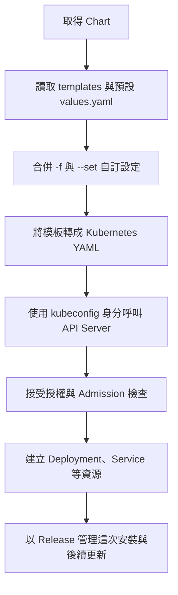

---
tags:
  - Kubernetes
  - Helm
blog: true
blog_title: 'K8s Helm：Chart、Template、Values 與 Release'
blog_date: '2026-10-29'
blog_url: https://blog.walle4561.com/articles/posts/k8s-helm-chart-template-values-release/
blog_tag: OS & Networking
blog_topic: K8s
---

# K8s Helm：Chart、Template、Values 與 Release

## TL;DR

**Chart 是套件，Template 是套件裡的 YAML 模板，Values 是填入的設定，Release 是安裝出來的一份實例。**

| 名稱 | 用途 | 例子 |
|---|---|---|
| Repository／OCI Registry | 取得 Chart 的來源，也可以使用本機 Chart | 第三方套件庫、OCI Registry |
| Chart | 包裝 Kubernetes 資源模板、預設值與套件資訊 | `repo/chart`、`./my-app`、`.tgz` |
| Template | 帶有變數與邏輯的 YAML 模板 | `templates/deployment.yaml` |
| Values | 填入模板的設定 | `replicaCount: 3` |
| Release | 一次安裝的實例，具有名稱、設定與 revision 紀錄 | `my-site` |

Helm 管理部署；應用實際由 Kubernetes 運行。Helm CLI 是本機工具，安裝 Helm 本身不等於已經安裝某個 Chart。

## 整體流程



Helm 會記錄 Release 資訊；即使安裝失敗，也可能留下狀態為 failed 的 Release，可用 `helm list --all`、`helm status` 檢查。

## install 的兩個名稱不要混淆

```bash
helm install my-site repo/chart -n webapp --create-namespace -f my-values.yaml
```

| 部分 | 意思 |
|---|---|
| `my-site` | 自己取的 Release 名稱 |
| `repo/chart` | Repository 別名／Chart 名稱 |
| `-n webapp` | Release 所在 namespace |
| `--create-namespace` | namespace 不存在時建立 |
| `-f my-values.yaml` | 讀取自訂 Values 設定，不是直接套用 Kubernetes manifest |
| `--version 1.2.3` | 指定 Chart 版本，不一定是應用版本 |

- 同一個 Chart 可以安裝成不同 Release，例如 `site-dev` 與 `site-prod`；實際能否並存仍取決於 Chart 的資源命名與設定。
- Deployment、Service 的名稱由模板決定，不一定剛好等於 Release 名稱。
- 同一 namespace 的 Release 名稱不能重複；跨 namespace 可以同名。
- `helm install my-site` 還少了 Chart 來源。

## Chart 的內容與 Template 範例

| 檔案／目錄 | 用途 |
|---|---|
| `Chart.yaml` | Chart 名稱、`version`、`appVersion` 等資訊 |
| `values.yaml` | 預設 Values |
| `templates/` | Kubernetes 資源模板 |
| `charts/` | 相依的子 Chart |

模板片段 `templates/deployment.yaml`：

```yaml
spec:
  replicas: {{ .Values.replicaCount }}
```

這是 Helm 模板片段，尚未渲染，不能直接交給 `kubectl apply`。

`values.yaml`：

```yaml
replicaCount: 1
```

安裝時覆寫：

```bash
helm install my-site ./my-app --set replicaCount=3
```

渲染後就會變成 `replicas: 3`。**設定名稱由 Chart 決定**，不是所有 Chart 都使用 `replicaCount`。

| 設定來源 | 優先順序（一般用法） |
|---|---|
| Chart 的 `values.yaml` | 預設值 |
| `-f my-values.yaml` | 覆寫預設值；多個 `-f` 時右邊優先 |
| `--set key=value` | 覆寫檔案中的同名值；多個同名設定時右邊優先 |

### Values 要有模板讀取才會生效

**Chart 已提供設定選項時，改 Values 很方便；但 Values 不是任意 Kubernetes 欄位都能直接加。** 模板必須讀取該 key 並把它放到正確欄位，才會改變產出的資源。

values-prod.yaml 短例：

```yaml
resources:
  requests:
    memory: 512Mi
```

容器模板必須有對應讀取，例如下面只是 containers[] 內的片段：

```yaml
resources:
  requests:
    memory: {{ .Values.resources.requests.memory | quote }}
```

Chart 也可能透過 toYaml 等方式輸出整個 resources 結構；實際 key 路徑以 Chart 文件與模板為準。

| 情況 | 結果 |
|---|---|
| 模板讀取該 Values key | 更新 Values 可以改變產出 |
| 模板沒有使用該 key | 不會自動修改 Kubernetes 欄位；若 Chart schema 禁止額外欄位，也可能直接驗證失敗 |
| 只改 prod | 用 `-f values-prod.yaml`，不用改所有環境共用的預設值 |
| 想確認是否生效 | `helm template my-app repo/chart -f values-prod.yaml` 查看產出 |

套用更新：`helm upgrade my-app repo/chart -f values-prod.yaml`，其中 repo/chart、Release 與 key 路徑都需換成實際設定。

對照 [[K8s Kustomize：Base 與 Overlay#Patches：直接寫在環境 Overlay 裡做局部修改]]：Helm 透過模板公開的設定介面；Kustomize Patch 直接指定既有資源欄位。

## 常用指令

下表的 `repo/chart` 是示意名稱，須換成實際來源。Release 相關查詢預設只看目前 namespace，其他 namespace 加 `-n`。

### 找 Chart 與檢查預設值

| 用途 | 指令 |
|---|---|
| 確認工具版本 | `helm version --short` |
| 加入套件庫 | `helm repo add repo REPOSITORY_URL` |
| 更新本機套件索引 | `helm repo update` |
| 列出套件庫 | `helm repo list` |
| 搜尋已加入套件庫的 Chart | `helm search repo keyword` |
| 搜尋 Artifact Hub 上的 Chart | `helm search hub keyword` |
| 列出 Chart 的版本 | `helm search repo repo/chart --versions` |
| 看 Chart 資訊與版本 | `helm show chart repo/chart` |
| 看預設 Values | `helm show values repo/chart` |
| 將預設 Values 存成檔案 | `helm show values repo/chart > my-values.yaml` |

**`helm search` 找的是 Chart，不是叢集裡已安裝的 Release。** `search repo` 查已加入套件庫的本機索引，先 `helm repo update` 可更新索引；`search hub` 查 Artifact Hub，找到後仍需取得實際 Chart 安裝來源。已安裝的 Release 用 `helm list`。

### repo list、pull、list：查詢對象不同

| 想做什麼 | 指令 | 對象／結果 |
|---|---|---|
| 看本機加入幾個 Repository | `helm repo list` | 數資料列，不算標題列；這是目前使用者的本機設定 |
| 搜尋可用 Chart | `helm search repo nginx` | 已加入 Repository 的本機索引 |
| 下載 Chart | `helm pull bitnami/nginx` | 下載 `.tgz`，不安裝 |
| 下載並解壓縮 | `helm pull bitnami/nginx --untar` | 取得 Chart 目錄，可查看 Values 與模板 |
| 指定下載版本 | `helm pull bitnami/nginx --version 19.0.0` | 指定 Chart 版本，須確認來源仍提供該版本 |
| 查所有 namespace 的 Releases | `helm list -A` | 已安裝的實例；看 NAME、NAMESPACE、CHART |

`pull` 不會自動把下載的 Chart 加入自己的 Chart。要作為相依套件，需在自己的 `Chart.yaml` 設定 `dependencies`，再管理依賴。

下載後從本機安裝的例子（假設 Repository 已加入且 Chart 可取得）：

```bash
helm pull bitnami/nginx --untar
helm install my-site ./nginx -f my-values.yaml
```

`my-values.yaml` 需自行準備；只想用預設設定時可省略 `-f`。

**計算 nginx Chart 的 Releases 時，看 `CHART` 欄位，不是 Release 的 `NAME`。** 以下是 lab 輸出的簡化範例：

| NAME（Release） | NAMESPACE | CHART | 是否計入 nginx Releases |
|---|---|---|---|
| amaze-surf | default | apache（版本略） | 否 |
| crazy-web | default | nginx-19.0.0 | 是 |
| happy-browse | default | nginx-19.0.0 | 是 |

這裡有 **2 個 nginx Releases**，整體共 3 個 Releases。`helm list -A` 的 `-A` 是所有 namespace，不是所有狀態；要包含所有狀態加 `--all`。

### 預覽、安裝與管理 Release

| 用途 | 指令 |
|---|---|
| 本機渲染 YAML，不部署 | `helm template my-site repo/chart -f my-values.yaml` |
| 模擬安裝並顯示除錯資訊 | `helm install my-site repo/chart -f my-values.yaml --dry-run --debug` |
| 安裝 | `helm install my-site repo/chart -f my-values.yaml` |
| 列出目前 namespace 的 Releases | `helm list` |
| 跨 namespace 列出 | `helm list -A` |
| 包含 failed 等狀態 | `helm list --all` |
| 查 Release 狀態 | `helm status my-site` |
| 更新 | `helm upgrade my-site repo/chart -f my-values.yaml` |
| 存在就更新，不存在就安裝 | `helm upgrade --install my-site repo/chart -f my-values.yaml` |
| 看 revision 歷史 | `helm history my-site` |
| 回到 revision 1 | `helm rollback my-site 1` |
| 移除 Release | `helm uninstall my-site` |

- `--debug` 只增加除錯輸出，**不會阻止部署**；要模擬才加 `--dry-run`。
- `helm template` 主要是本機渲染，不代表已通過 API Server 的驗證、RBAC 或 Admission。
- `helm upgrade` 可同時改 Chart 版本與 Values；實務上明確指定 `--version`，避免意外使用新版本。
- rollback 的數字是 **Release revision**，不是 Chart 版本；回滾也會產生新的 revision。
- uninstall 不保證刪除所有相關資料：CRD、標示保留的資源、儲存卷與外部資料等需依 Chart 與資源設定確認。

### history 與 rollback：數字是 Release revision

| 用途 | 指令 |
|---|---|
| 看修訂歷史 | `helm history nginx-release` |
| 回到 revision 1 | `helm rollback nginx-release 1` |
| Release 在 webapp namespace | `helm rollback nginx-release 1 -n webapp` |

**`1` 代表 Release revision，不是 nginx 應用版本，也不是 Chart 版本。** 回滾會依指定 revision 的 Chart 與設定更新資源，並新增一筆 revision，不會讓編號倒退。

| Revision | Chart（示意） | 動作 |
|---|---|---|
| 1 | nginx-18.0.0 | 初次安裝 |
| 2 | nginx-19.0.0 | 更新到新的 Chart |
| 3 | nginx-18.0.0 | 執行 `helm rollback nginx-release 1`，新增回滾紀錄 |

回滾後 revision 3 成為目前版本，先前紀錄保留，可再用 `helm history` 查看。**Helm rollback 不等於資料庫或 PVC 內容也會回到過去**，應用資料需另外規劃備份與還原。

### helm get：輸出已安裝 Release 的資訊

| 想看什麼 | 指令 |
|---|---|
| 自訂 Values | `helm get values my-site` |
| 包含預設值的完整計算結果 | `helm get values my-site --all` |
| Helm 記錄的資源 YAML | `helm get manifest my-site` |
| 使用提示 | `helm get notes my-site` |
| 綜合資訊 | `helm get all my-site` |
| 將資源 YAML 存成檔案 | `helm get manifest my-site > my-site.yaml` |

**`show` 查 Chart，`get` 查 Release，`kubectl get` 查叢集當下的實際狀態。** Helm 記錄的 manifest 可能與人為修改後的現況不同。

例如 Release 在其他 namespace：

```bash
helm get values topolvm -n topolvm-system
```

### 自己製作並分享 Chart

| 用途 | 指令 |
|---|---|
| 建立 Chart 骨架 | `helm create my-app` |
| 檢查 Chart 常見問題 | `helm lint ./my-app` |
| 預覽產生的 YAML | `helm template demo ./my-app` |
| 安裝本機 Chart | `helm install demo ./my-app` |
| 打包成 `.tgz` | `helm package ./my-app` |
| 安裝打包檔（版本依 Chart.yaml） | `helm install demo ./my-app-0.1.0.tgz` |

打包後可提供給別人安裝，也能發佈到 Chart Repository 或 OCI Registry。第三方 Chart 一樣要有建立其資源所需的權限。

## Helm 2、3、4 與 RBAC

| 版本 | 架構與重點 |
|---|---|
| Helm 2 | Helm CLI → 叢集內的 Tiller → API Server；使用 Tiller 的執行身分與權限 |
| Helm 3 | 移除 Tiller；直接使用 kubeconfig 的身分與 Kubernetes 授權機制 |
| Helm 4 | 延續無 Tiller 架構，調整插件機制與部分 CLI 行為；Chart 與主要管理觀念延續 |

Helm 3／4 不需要 `helm init`。Helm 不會自動給你管理員權限；在使用 RBAC 的叢集中，能否建立 Deployment、Secret、ClusterRole 等資源，取決於執行身分的 RBAC 授權。CI/CD 也可以使用 ServiceAccount 作為執行身分。

Helm 4 已發布，課程或 lab 仍可能使用 Helm 3；先用 `helm version --short` 確認，再查看對應版本文件與 `helm COMMAND --help`。

相關：[[K8s RBAC 與 ServiceAccount]]、[[K8s kubeconfig、Context 與多叢集管理]]。

## 官方文件與查詢關鍵詞

| 文件 | 關鍵詞 |
|---|---|
| [Using Helm](https://helm.sh/docs/intro/using_helm/) | `helm install`、`helm upgrade`、`helm rollback` |
| [Chart Template Guide：Getting Started](https://helm.sh/docs/chart_template_guide/getting_started/) | `Chart.yaml`、`templates`、`values.yaml` |
| [helm get values](https://helm.sh/docs/helm/helm_get_values/) | `computed values`、`--all` |
| [Helm 2 → 3 架構變化](https://docs.helm.sh/docs/v3/faq/changes_since_helm2/) | `Removal of Tiller` |
| [Helm 4 Overview](https://docs.helm.sh/docs/overview/) | `Helm 4`、`breaking changes` |
