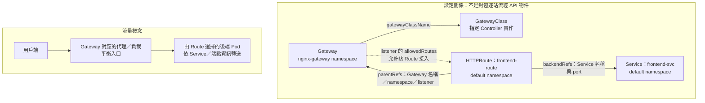

# K8s Ingress 與 Gateway API

## 先記住的觀念

- **Ingress**：描述 HTTP／HTTPS 的網域、路徑要轉到哪個 Service。
- **Ingress Controller**：讓 Ingress 規則生效的實作，例如 Traefik、HAProxy Kubernetes Ingress Controller；只有 Ingress 資源還不夠。
- **Gateway API**：比 Ingress 更新一代的流量管理 API，同樣需要對應的 Controller。Ingress API 已凍結新增功能，官方建議使用 Gateway API；Ingress 仍可使用。
- **API Gateway** 是產品／架構類別，與 Kubernetes 的 **Gateway API** 名稱不同。

## L4 與 L7：先分清楚處理哪一層

| 層級 | 看什麼資訊 | 路由例子 |
|---|---|---|
| **Layer 4：Transport** | TCP／UDP、IP 與 port | 把某個 TCP port 的流量送到資料庫 Service，或轉送 UDP DNS 流量 |
| **Layer 7：Application** | HTTP host、path、headers 等應用資訊 | `app.example.com/pay` 送到付款服務；依 header 分流 |

**Ingress 標準 API 主要處理 L7 的 HTTP／HTTPS 入口，不提供任意 TCP／UDP 路由欄位。Gateway API 涵蓋多種協定，可用不同 Route 描述 L4／L7 需求。** 這裡比較的是 Layer 4 與 Layer 7；Layer 5 是 Session 層，不是這組對照的重點。

HTTPS 可在入口終止 TLS 後按 HTTP 路由；TLS passthrough 則不在入口解密 HTTP，可依 SNI 等資訊選後端。兩種情境不能混成同一種處理方式。

## Ingress 到 Gateway API：主要差別

> [!important] 標準 API 的限制，不等於 Controller 完全做不到
> Ingress 沒有標準欄位的功能，Controller 仍可能透過 annotations、CRDs 或其他設定提供。Gateway API 把更多流量管理能力納入共同 API，但不代表所有 Controller／版本都支援所有功能。

| 功能 | Ingress 標準 API／Controller 擴充 | Gateway API 的表達方式與注意事項 |
|---|---|---|
| HTTP／HTTPS host、path 路由 | 標準 Ingress 的核心用途 | Gateway listeners ＋ HTTPRoute |
| TCP／UDP routing | Ingress 資源沒有通用欄位；部分 Controller 可另行設定 | TCPRoute／UDPRoute；確認所需 CRDs、release channel 與實作支援 |
| Traffic splitting／weighting | 無標準權重欄位；可用 Controller 的 canary 等擴充 | HTTPRoute 的 `backendRefs[].weight` 可描述比例，如 90／10 |
| Header manipulation | 常透過 annotations／擴充設定 | `RequestHeaderModifier`／`ResponseHeaderModifier` filters |
| Authentication 認證 | 常透過 Controller 的 basic／external auth 等功能 | 依採用的 API 版本、認證機制與實作，使用 filter、policy 或擴充；不是自動具備所有認證功能 |
| Rate limiting 限流 | 常透過 annotations 或 Controller 設定 | 通常仍需實作提供的 policy／擴充或外部服務 |
| Redirects 重新導向 | 常由 Controller annotations 等提供 | `RequestRedirect` filter；讓用戶端改向另一個 URL |
| Rewriting 路徑改寫 | 例如 ingress-nginx 的 rewrite-target | `URLRewrite` filter；改送往後端的 URL，不等於瀏覽器跳轉 |
| Middleware 中介處理 | 例如 Traefik 的 Middleware CRD，不是 Ingress 的通用資源 | 以 filters、policies 與 extension references 等表達；沒有通用的 Middleware 資源可直接取代所有產品擴充 |
| WebSocket support | 許多 Controller 已支援，需配合代理、逾時等設定；不能因 Ingress 處理 HTTP 就認定不支援 | 需確認實作、後端協定與版本；不是遷移 Gateway API 後才首次能使用 |
| Custom error pages 自訂錯誤頁 | 可由部分 Controller 的錯誤攔截／後端設定提供 | 視實作與版本，可能仍需擴充或由應用處理 |
| Session affinity 工作階段黏著 | 例如 Controller 的 cookie affinity；不等同 Service 的 ClientIP affinity | 依 API 版本與實作的 session persistence／policy 支援確認 |
| CORS 跨來源資源共用 | 可由 Controller annotations 或應用提供 | 依版本與實作使用 CORS filter／policy 或其他設定；需確認支援程度 |

**採用 Gateway API 的理由是多協定、較豐富的標準化設定與角色分工，不是「Ingress Controller 完全做不到上述功能」。** 遷移時仍要檢查功能支援與既有 annotations 的對應方式，不能只換 kind 就期待行為相同。

## Gateway API：Class、入口與路由分開管理

| 資源 | 責任 | 對照 Ingress |
|---|---|---|
| GatewayClass | 指定 Controller 實作與共用行為，屬於 cluster scope | 類似 IngressClass |
| Gateway | 宣告入口 listeners、port、protocol 與 TLS 等設定 | 把入口設定獨立成資源 |
| Route（依協定選擇種類） | 宣告匹配條件、處理方式與後端 Service | 承接並擴充 Ingress rules 的角色 |

### Gateway 與 Route 綁定：入口與規則是獨立資源

**Gateway 建立入口，Route 用 `parentRefs` 指向入口，再用 `backendRefs` 指向後端。** 兩者可分開管理，建立順序不硬性限制；要正常工作，資源必須存在、引用正確，且 Controller 接受設定。



| 欄位 | 寫在哪裡 | 負責什麼 |
|---|---|---|
| `parentRefs` | Route 的 spec | 我要掛到哪個 Gateway；`sectionName` 可指定 listener 名稱 |
| `backendRefs` | Route 的 rules | 匹配後送到哪個 Service 與 Service port |
| `allowedRoutes` | Gateway 的 listener | 我允許哪些 namespace、哪些種類的 Route 接入 |

**`parentRefs` 是 Route 提出連接；`allowedRoutes` 是 Gateway 允許接入，兩邊要配合。** 不是只寫其中一邊，就會自動替另一邊建立規則。

### 範例：default 的 HTTPRoute 掛到 nginx-gateway 的入口

Gateway 在 `nginx-gateway` namespace，開放所有 namespace 的 HTTPRoute 使用 http listener：

```yaml
apiVersion: gateway.networking.k8s.io/v1
kind: Gateway
metadata:
  name: nginx-gateway
  namespace: nginx-gateway
spec:
  gatewayClassName: nginx
  listeners:
    - name: http
      protocol: HTTP
      port: 80
      allowedRoutes:
        namespaces:
          from: All
        kinds:
          - group: gateway.networking.k8s.io
            kind: HTTPRoute
```

應用的 Route 在 `default` namespace，把 `/` 路徑送到同 namespace 的 frontend-svc。此例假設 Service port 為 80，使用時先確認實際值：

```yaml
apiVersion: gateway.networking.k8s.io/v1
kind: HTTPRoute
metadata:
  name: frontend-route
  namespace: default
spec:
  parentRefs:
    - name: nginx-gateway
      namespace: nginx-gateway
      sectionName: http
  rules:
    - matches:
        - path:
            type: PathPrefix
            value: /
      backendRefs:
        - name: frontend-svc
          port: 80
```

- `parentRefs.namespace` 是 **Gateway 所在的 namespace**；省略時預設找 Route 自己的 namespace。
- `sectionName: http` 對應 listener 的 `name: http`，不是 protocol、Service 或 Deployment 名稱。
- `backendRefs` 未寫 namespace 時，預設找 **Route 同 namespace** 的 Service；這裡是 default/frontend-svc。
- `allowedRoutes.namespaces.from` 預設為 `Same`；`All` 允許跨 namespace，`Selector` 可依 namespace labels 篩選。欄位是 **namespaces**，不是 namespace。
- `allowedRoutes.kinds` 限定 Route 種類；Route 仍須與 listener 的協定相容，例如 HTTP listener 不能因設定 All 就接 TCPRoute。這裡 All 指 namespace，不是所有協定。
- `allowedRoutes` 管 Route 能否掛到入口，不是網站使用者的存取權限。跨 namespace 的 Route → Gateway 由它控制；跨 namespace 的 backend Service 引用則通常還需後端 namespace 的 `ReferenceGrant`，兩種授權不要混淆。

### 查欄位與確認綁定

```bash
k explain httproute.spec.parentRefs --recursive
k explain httproute.spec.rules.backendRefs --recursive
k explain gateway.spec.listeners.allowedRoutes --recursive

k get gateway -n nginx-gateway
k describe gateway nginx-gateway -n nginx-gateway
k describe httproute frontend-route -n default
```

查看 HTTPRoute 的 `status.parents`，確認對應 parent 的 `Accepted=True`、`ResolvedRefs=True`；再看 Gateway 的 listener／Programmed 狀態並實際測試。Schema 驗證成功，只代表結構等檢查通過，不保證 Controller 已接手或服務可用。

官方範例：[跨 namespace 的 Route Attachment](https://gateway-api.sigs.k8s.io/guides/user-guides/multiple-ns/#route-attachment)、[Routes 與 Gateways 的綁定關係](https://gateway-api.sigs.k8s.io/docs/concepts/api-overview/#attaching-routes-to-gateways)。

Controller 依這些 API 設定實際資料平面；API 物件本身不是處理封包的程式。Gateway API 通常需安裝對應 CRDs 與支援的 Controller，並檢查 route 是否被接受；只建立資源不代表入口已能連通。

Gateway 與 Route 可以分工管理；跨 namespace 連接不是任意開放，還要符合 route attachment 與 reference 的授權規則。**Gateway API 是 Kubernetes API 規格；API Gateway 是產品／架構類別，兩者不是同義詞。**

### 五種 Route：依協定與匹配條件選擇

| 資源 | 用途 | 例子 |
|---|---|---|
| **HTTPRoute** | HTTP／HTTPS 的 host、path、header 路由，屬於 L7 | `/pay` → 付款服務 |
| **GRPCRoute** | 依 gRPC service／method 等條件路由，屬於 L7 | 某個 RPC 方法 → 指定服務 |
| **TCPRoute** | TCP 流量轉送，屬於 L4 | 資料庫連線 |
| **UDPRoute** | UDP 流量轉送，屬於 L4 | DNS 查詢 |
| **TLSRoute** | 依 SNI 等 TLS 資訊路由，不需要檢查 HTTP 內容 | 不在入口解密 HTTP，直接轉送 TLS 連線 |

**HTTPS 不一定使用 TLSRoute**：Gateway 終止 HTTPS、解密後依 `/pay` 等 HTTP 路徑路由，通常用 HTTPRoute；需要依 SNI 路由、讓後端解密的 TLS passthrough，則可使用 TLSRoute。

實際可用哪些 Route，取決於 **已安裝的 CRDs、Gateway API 版本／release channel 與 Controller 支援**，不是每套實作都支援全部五種。

官方：[Gateway API Route 類型對照表](https://gateway-api.sigs.k8s.io/docs/concepts/api-overview/#route-summary-table)。

### 更結構化：減少 Controller 專屬 annotations

**Gateway API 把更多行為寫成有明確型別與 schema 的資源／欄位，減少對 NGINX 等 Controller 專屬 annotations 的依賴。**

| 需求 | Ingress 常見擴充寫法 | Gateway API |
|---|---|---|
| 改寫送往後端的 URL | `nginx.ingress.kubernetes.io/rewrite-target` | HTTPRoute 的 `URLRewrite` filter |
| 重新導向用戶端 | Controller 的 redirect annotations | `RequestRedirect` filter |
| 修改 HTTP headers | Controller 的 annotations 或其他設定 | `RequestHeaderModifier`／`ResponseHeaderModifier` filters |
| 按比例分流 | Controller 的 canary／weight annotations 等 | `backendRefs[].weight` |

這讓設定較容易閱讀、依 schema 驗證，也能用 `kubectl explain` 查已安裝版本的標準欄位；不同實作之間的可攜性更好。**並不是完全不需要擴充**：認證、限流或產品特有能力，仍可能使用 policy、自訂資源或 extension filters。遷移時要確認支援程度，舊 annotation 也不會自動轉換成 Gateway API 欄位。

## ingressClassName：交給哪個 Controller

```text
Ingress 的 spec.ingressClassName
  → 同名 IngressClass
  → IngressClass 的 spec.controller 識別對應實作
  → Controller 接手規則
```

**Class 名稱、Controller 識別值、Deployment 名稱、Pod 名稱是不同東西。** `ingressClassName: nginx` 是選名為 nginx 的 IngressClass，不會自動安裝 NGINX。

```bash
alias k=kubectl
k get ingressclass
k get ingressclass nginx -o yaml
# 找 Controller 的 Deployment；namespace 不一定與應用相同
k get deploy -A
```

| 寫在哪裡 | 正確名稱 |
|---|---|
| YAML 的 spec 下 | `ingressClassName: nginx` |
| `k create ingress` 參數 | `--class=nginx`，不是 `--ingressClassName=nginx` |

先確認實際 class 再指定。省略時，可能由預設 IngressClass 補上，或由設定為接手無 class Ingress 的 Controller 處理；不是所有環境都能省略。

**Traefik 不一定要配 `ingressClassName: traefik`。** 例如啟用 `kubernetesingressnginx` 相容 provider，且設有 `watchingresswithoutclass=true` 的環境，可接手沒有 class 的 Ingress；錯填 class 反而可能讓規則沒被接手。要一起看 IngressClass 與 Controller 的 provider／啟動參數。

### HAProxy Ingress Controller 可用 Helm 安裝

HAProxy Technologies 提供 Kubernetes Ingress Controller 的 Helm chart，以下為安裝示例，沒有對實際叢集執行：

```bash
helm repo add haproxytech https://haproxytech.github.io/helm-charts
helm repo update
helm install haproxy-ingress haproxytech/kubernetes-ingress \
  -n haproxy --create-namespace
```

`haproxy-ingress` 是 release 名稱，`haproxytech/kubernetes-ingress` 是 repo／chart。實際環境先確認 chart 版本、values、IngressClass 與對外 Service 設定；Helm 安裝 Controller 不會自動建立應用的所有 Ingress 規則。

**HAProxy 也能當控制平面前方的 TCP load balancer，轉送 kube-apiserver 的 6443 流量；這與 HTTP Ingress Controller 是不同用途。** kubeadm HA 的入口通常需獨立於所管理叢集運作，不要因為 HAProxy 有 Helm chart 就把兩種部署視為同一件事。

參考：[HAProxy Kubernetes Ingress Controller：Helm 安裝](https://www.haproxy.com/documentation/kubernetes-ingress/community/installation/on-prem/)。

## --rule：左邊匹配請求，右邊指定 Service

```text
--rule='host/path=Service名稱:Service埠'
--rule='app.kodekloud.local/*=web-app:80'
```

| 部分 | 意義 |
|---|---|
| `app.kodekloud.local` | 請求的 host |
| `/*` | kubectl 產生 `path: /`、`pathType: Prefix` 的簡寫 |
| `web-app:80` | 同 namespace 的 web-app Service，使用它的 port 80 |

因此 `/`、`/login`、`/products/123` 都能匹配。`*` 是產生 Prefix 的指令語法，不會原樣寫成 YAML 的 path；Prefix 按路徑片段匹配，例如 `/pay` 可匹配 `/pay/order`，不會因前綴文字相同就匹配 `/payment`。

```bash
# 先產生 YAML，再編輯；若需明確 class，另加 --class=<實際名稱>
k create ingress web-app-ingress -n webapp \
  --rule='app.kodekloud.local/*=web-app:80' \
  --dry-run=client -o yaml > web-app-ingress.yml
```

這條不會建立資源。它只設定路由，不會建立網域的 DNS 紀錄，也不會自動改寫 `/login` 等路徑。Service 的 port 不一定等於容器的 targetPort。

## TLS：入口解密，再轉送後端

使用既有 `app-tls` Secret 的完整基本範例；`tls`、`rules` 與選用的 `ingressClassName` 都放在 **spec 下同一層**：

```yaml
apiVersion: networking.k8s.io/v1
kind: Ingress
metadata:
  name: web-app-ingress
  namespace: webapp
spec:
  # 若環境要求指定 class，再加入 ingressClassName: <實際名稱>
  tls:
    - hosts:
        - app.kodekloud.local
      secretName: app-tls
  rules:
    - host: app.kodekloud.local
      http:
        paths:
          - path: /
            pathType: Prefix
            backend:
              service:
                name: web-app
                port:
                  number: 80
```

- `app-tls` 必須與 Ingress 同在 webapp namespace；TLS Secret 通常為 `kubernetes.io/tls`，含 `tls.crt`、`tls.key`，憑證需涵蓋該 host。
- TLS termination：用戶端 HTTPS → 入口代理解密 → 後端 Service；不會因加了 TLS 就自動把後端 80 改成 443，也不等於入口到後端已加密。
- HTTP 是否自動轉 HTTPS 由 Controller 設定決定，不是 `spec.tls` 的通用保證。

若從頭產生同一份含 TLS 的模板，可把 rule 寫成以下形式，作為前面產生指令的替代選擇：

```bash
k create ingress web-app-ingress -n webapp \
  --rule='app.kodekloud.local/*=web-app:80,tls=app-tls' \
  --dry-run=client -o yaml > web-app-ingress.yml
```

## explain 查欄位，Controller 文件查 annotation

```bash
# 忘記 YAML 欄位：逐層查
k explain ingress.spec
k explain ingress.spec.tls
k explain ingress.spec.tls --recursive
k explain ingress.spec.ingressClassName
k explain ingress.metadata.annotations

# 忘記建立指令的參數
k create ingress --help
```

`tls.hosts` 是字串清單，`tls.secretName` 是字串。`explain` 的路徑格式為 **資源.欄位.子欄位**，依 API schema 說明欄位。

`nginx.ingress.kubernetes.io/rewrite-target` 則是 `metadata.annotations` 這張鍵值表中的 key，由 Controller 解讀，不是 schema 裡的固定子欄位。

| 想查的內容 | 查法 |
|---|---|
| Ingress 的 TLS 結構 | `k explain ingress.spec.tls` |
| annotations 本身的用途／型別 | `k explain ingress.metadata.annotations` |
| rewrite-target 的功能與支援條件 | 查 ingress-nginx／相容 provider 的文件 |

`k explain nginx.ingress.kubernetes.io` 會把第一段 `nginx` 當成資源類型，因此報「沒有 nginx 這種資源」。搜尋 annotation 文件可用 `ingress nginx rewrite-target`，或 `site:kubernetes.github.io/ingress-nginx rewrite`。

## Annotations 與 rewrite-target

**路由決定送到哪個 Service；rewrite 決定後端收到什麼路徑。** Annotations 是 Controller 的額外設定，`nginx.ingress.kubernetes.io/*` 是社群 ingress-nginx 的設定；其他 Controller 需明確支援才會生效。例如 Traefik 可啟用 NGINX 相容 provider，不能只憑軟體名稱判定是否支援。此處記錄既有實驗用法；ingress-nginx 已於 2026 年 3 月退役。

### 後端只提供根路徑時

假設 watch 與 wear 是兩個應用，兩者都只提供 `/`，外部用 `/watch`、`/wear` 區分：

| 外部請求 | 選擇的 Service | 沒有 rewrite，後端收到 | rewrite-target 為 `/` 時 |
|---|---|---|---|
| `/watch` | watch-service | `/watch`，後端沒有此路徑會回 404 | `/` |
| `/wear` | wear-service | `/wear`，後端沒有此路徑會回 404 | `/` |

在 Ingress 的 `metadata.annotations` 加上：

```yaml
nginx.ingress.kubernetes.io/rewrite-target: /
```

例如 `path: /pay`、`pathType: Prefix` 選到 pay-service 後，匹配請求的路徑會改成 `/`。**不要把它理解成只刪掉前綴、其餘自動保留**；要保留後面的子路徑，需使用 capture groups。

### 去掉前綴，但保留子路徑

```yaml
apiVersion: networking.k8s.io/v1
kind: Ingress
metadata:
  name: rewrite
  namespace: default
  annotations:
    nginx.ingress.kubernetes.io/use-regex: "true"
    nginx.ingress.kubernetes.io/rewrite-target: /$2
spec:
  ingressClassName: nginx
  rules:
    - host: rewrite.bar.com
      http:
        paths:
          - path: /something(/|$)(.*)
            pathType: ImplementationSpecific
            backend:
              service:
                name: http-svc
                port:
                  number: 80
```

前提是對應 Controller／IngressClass 已存在，http-svc 位於同一 namespace，且 Service port 是 80。

- `(/|$)` 是第一組 `$1`：匹配斜線或路徑結尾，避免把 `/somethingelse` 也當成前綴命中。
- `(.*)` 是第二組 `$2`：保存前綴後面的內容；`/$2` 再組成後端路徑。
- 正規表示式範例使用 **`use-regex: "true"` 與 `pathType: ImplementationSpecific`**，不要照舊範例寫成 Prefix。

| 外部請求路徑 | `$2` | 後端收到的路徑 |
|---|---|---|
| `/something` | 空字串 | `/` |
| `/something/` | 空字串 | `/` |
| `/something/new` | `new` | `/new` |
| `/something/images/logo.png` | `images/logo.png` | `/images/logo.png` |

> [!tip] 記法
> `rewrite-target: /`：匹配後改成根路徑；`rewrite-target: /$2`：用第二組捕獲內容重組路徑。這是代理內部的改寫，不是要求瀏覽器跳轉，網址列通常不變。

## 套用與檢查：必要指令

以下延用 webapp 範例；確認 YAML 後 apply，通常不必 `replace --force`：

```bash
k apply -f web-app-ingress.yml
k get ingress -n webapp
k describe ingress web-app-ingress -n webapp
k get svc web-app -n webapp
k get endpointslices -n webapp -l kubernetes.io/service-name=web-app
k get secret app-tls -n webapp
```

`replace --force` 會先刪再建；若把 `path` 拼成 `paht`，可能出現舊物件已刪除、新物件建立失敗。修正後用 apply 建立／更新即可。

測試有 host 的規則時，單純 curl IP 不一定匹配；可用 `--resolve` 在不修改 DNS 的情況下，同時帶入正確 host 與 HTTPS SNI：

```bash
# <入口IP>、<HTTPS入口port> 換成實際值；不是後端 Service 的 port 80
curl -v --resolve app.kodekloud.local:<HTTPS入口port>:<入口IP> \
  https://app.kodekloud.local:<HTTPS入口port>/
```

預設會驗證憑證。若實驗使用未受信任的憑證，可另用 `-k` 暫時測試路由，但通過不代表憑證驗證正常。

先核對 class 是否被接手，再核對 host／path、Service port／endpoints；404 也可能來自後端或預設後端，不能只憑狀態碼認定 rewrite 失敗。

## 待補

Gateway API 進階 filters 的完整 YAML 與操作，後續學習時再補。

相關：[[K8s kubectl 常用指令#Service]]、[[K8s CoreDNS、kubelet 與 resolv.conf]]。

## 參考

- [Kubernetes Ingress](https://kubernetes.io/docs/concepts/services-networking/ingress/)
- [Gateway API 概觀](https://gateway-api.sigs.k8s.io/docs/concepts/api-overview/)
- [ingress-nginx Rewrite：annotations 與 capture groups](https://kubernetes.github.io/ingress-nginx/examples/rewrite/)
- [ingress-nginx 退役公告](https://kubernetes.io/blog/2025/11/11/ingress-nginx-retirement/)
- [kubectl create ingress：rule、class 與 TLS 範例](https://kubernetes.io/docs/reference/kubectl/generated/kubectl_create/kubectl_create_ingress/)
- [kubectl explain](https://kubernetes.io/docs/reference/kubectl/generated/kubectl_explain/)
- [Traefik NGINX 相容 provider](https://doc.traefik.io/traefik/reference/install-configuration/providers/kubernetes/kubernetes-ingress-nginx/)
- [Gateway API：Header 修改](https://gateway-api.sigs.k8s.io/guides/user-guides/http-header-modifier/)
- [Gateway API：Redirect 與 Rewrite](https://gateway-api.sigs.k8s.io/guides/user-guides/http-redirect-rewrite/)
- [ingress-nginx annotations：認證、限流、CORS、黏著與錯誤頁等擴充](https://kubernetes.github.io/ingress-nginx/user-guide/nginx-configuration/annotations/)
