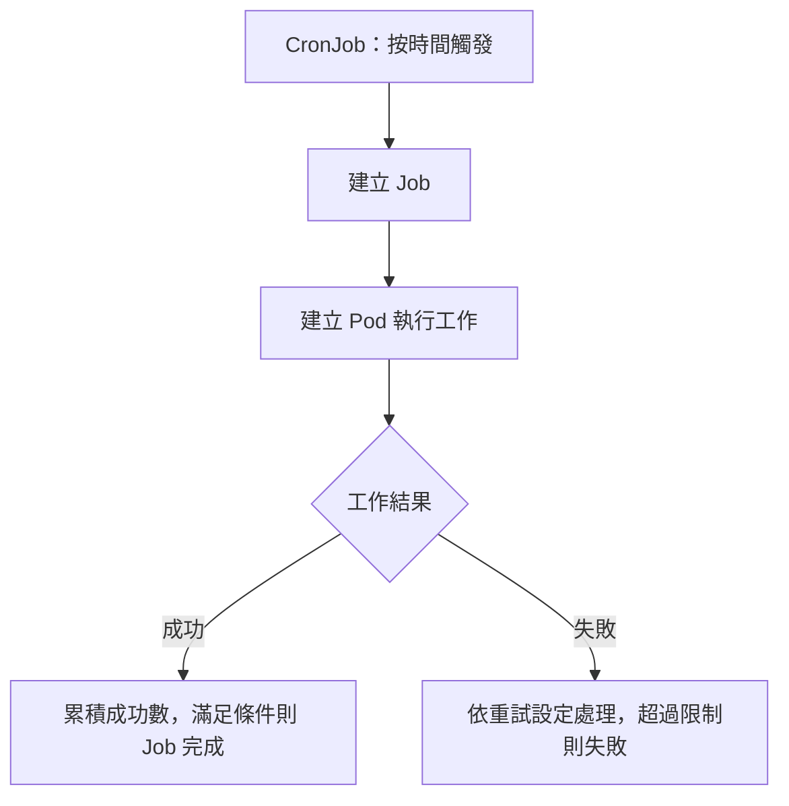

# K8s Job 與 CronJob：批次工作、排程與 YAML 層級

## TL;DR

**Job 確保工作成功完成；CronJob 按時間建立 Job；Job 再建立 Pod 執行。** 適合批次處理、報表與資料庫 migration 等工作，不是只能用在少數特殊情境。

| 資源 | 目的 | 例子 |
|---|---|---|
| Deployment | 維持應用持續運行 | 網站、API |
| Job | 達到指定成功完成條件後結束 | 資料處理、migration |
| CronJob | 按排程建立新的 Job | 每天晚上產生報表 |



Job 不保證程式只執行一次；任務需考慮重試、重複執行與並行，避免重複扣款或重複寫入等副作用。

## Job：完成數、並行與失敗重試

以下先看一般固定完成數、非 Indexed 的 Job：

| 欄位（Job spec 下） | 意義 | 例子 |
|---|---|---|
| completions | 需要成功完成的 Pod 數量；失敗不算成功 | `5`：累積 5 個成功 |
| parallelism | 希望同時執行的 Pod 數量，實際數量受剩餘工作與叢集狀態影響 | `2`：通常同時跑 2 個 |
| backoffLimit | 判定 Job 失敗的重試限制，不是成功目標，也不是總 Pod 數 | `3`：有限次重試 |
| activeDeadlineSeconds | Job 執行時間上限；不是 CronJob 的排程遲到期限 | 超時可使 Job 失敗 |
| ttlSecondsAfterFinished | Job 成功或失敗結束後多久可自動清理 | `60`：結束後等待 60 秒清理 Job 及其 Pod |

- completions 與 parallelism 都不指定的一般 Job，兩者預設為 1。
- 一般 backoffLimit 預設為 6；進階 per-index 設定有不同預設與計數方式。
- backoffLimit 是 Job 的整體重試限制，不是 completions 中每個成功名額各有一份額度。
- 重試計數會看失敗 Pod；使用 OnFailure 時，執行中 Pod 的容器重啟次數也參與判斷。**不要把 `backoffLimit: 3` 直接換算成一定建立 3 個 Pod。**
- 失敗後會退避等待再重試，不是沒有間隔地一直重跑；更進階的 podFailurePolicy 可改變失敗處理。

| Pod template 的 restartPolicy | 行為 |
|---|---|
| Never | kubelet 不在原 Pod 重啟失敗容器；Job 可在限制內建立替代 Pod |
| OnFailure | kubelet 可在原 Pod 重啟失敗容器；重啟次數也可能觸及 Job 失敗限制 |
| Always | Job 不允許使用 |

## Job YAML：把 Pod spec 放進 template.spec

```yaml
apiVersion: batch/v1
kind: Job
metadata:
  name: hello
spec:
  completions: 5
  parallelism: 2
  backoffLimit: 3
  template:
    spec:
      containers:
        - name: worker
          image: busybox:1.36
          command: ["sh", "-c", "echo done"]
      restartPolicy: Never
```

這個範例會重複執行相同命令以累積 5 個成功；不會自動把輸入資料拆成 5 份不同任務。

| 原 Pod 位置 | Job 位置 |
|---|---|
| spec.containers | spec.template.spec.containers |
| spec.volumes | spec.template.spec.volumes |
| spec.restartPolicy | spec.template.spec.restartPolicy，須用 Never／OnFailure |
| metadata.labels | 可放到 spec.template.metadata.labels，作為建立出來的 Pod labels |

不是只改 kind：還要改成 `apiVersion: batch/v1`，並增加 template 層。

## CronJob YAML：CronJob 包 Job，Job 包 Pod

```yaml
apiVersion: batch/v1
kind: CronJob
metadata:
  name: throw-dice-cron-job
spec:
  schedule: "30 21 * * *"
  timeZone: Asia/Taipei
  concurrencyPolicy: Forbid
  jobTemplate:
    spec:
      completions: 1
      backoffLimit: 3
      template:
        spec:
          containers:
            - name: worker
              image: busybox:1.36
              command: ["sh", "-c", "echo done"]
          restartPolicy: Never
```

此範例每天台北時間 21:30 執行；name 只是物件名稱，命令是簡單示意。要改成擲骰任務，替換實際 image／command。

| 層級 | 放什麼 |
|---|---|
| spec | CronJob 的 schedule、timeZone、concurrencyPolicy 等 |
| spec.jobTemplate.spec | 原本 Job 的 spec，例如 completions、parallelism、backoffLimit、ttlSecondsAfterFinished |
| spec.jobTemplate.spec.template.spec | 原本 Pod 的 spec，例如 containers、volumes、restartPolicy |

**沿用 Job 的 spec 時放進 jobTemplate.spec；不要把 Job 的 apiVersion、kind 一起塞進去。**

### 排程：分鐘、小時、日期、月份、星期

| 欄位 | 範圍 |
|---|---|
| 分鐘 | 0～59 |
| 小時 | 0～23 |
| 日期（每月幾號） | 1～31 |
| 月份 | 1～12 |
| 星期 | 0～6：星期日～星期六 |

| schedule | 意義 |
|---|---|
| `"* * * * *"` | 每分鐘 |
| `"*/5 * * * *"` | 每 5 分鐘 |
| `"30 21 * * *"` | 每天 21:30 |
| `"30 21 * * 0"` | 每週日 21:30 |
| `"30 21 1 * *"` | 每月 1 日 21:30 |

時間依 spec.timeZone 解讀，例如 Asia/Taipei；未指定則依 kube-controller-manager 的本機時區，不會自動沿用你操作電腦的時區。名稱是 cron／CronJob，不是 corn。

| CronJob 欄位 | 意義 |
|---|---|
| concurrencyPolicy: Allow | 預設；同一 CronJob 的前後 Job 可同時執行 |
| concurrencyPolicy: Forbid | 上次尚未結束時，不啟動重疊的新一輪；是否可稍後補啟動還受 deadline 等規則影響 |
| concurrencyPolicy: Replace | 到下一輪時，替換尚未結束的舊 Job |
| suspend: true | 暫停後續排程，不終止已開始的 Job |
| successfulJobsHistoryLimit／failedJobsHistoryLimit | 保留成功／失敗歷史 Job 的數量，預設為 3／1 |

## 完成不等於刪除

| 情況 | 結果 |
|---|---|
| 一般 Job 完成、沒設自動清理 | 容器停止；Job 與已完成 Pod 通常保留供查詢與看 logs |
| 設 ttlSecondsAfterFinished | 成功或失敗結束後，等待 TTL 再清理 Job 與其 Pod |
| 刪除 Job | 一般連帶刪除管理的 Pod；特殊刪除傳播設定另論 |
| CronJob 的歷史保留上限 | 清理超過保留數量的歷史 Jobs，與單一 Job 的 TTL 是不同設定 |

## 常用指令與排錯

| 用途 | 指令 |
|---|---|
| 建立 Job | `kubectl create job hello --image=busybox:1.36 -- echo Hello` |
| 產生 Job YAML | `kubectl create job hello --image=busybox:1.36 --dry-run=client -o yaml -- echo Hello` |
| 產生 CronJob YAML | `kubectl create cronjob hello --image=busybox:1.36 --schedule='30 21 * * *' --dry-run=client -o yaml -- echo Hello` |
| 查狀態 | `kubectl get jobs,cronjobs,pods` |
| 找 Job 的 Pod | `kubectl get pods -l batch.kubernetes.io/job-name=hello` |
| 看輸出／事件 | `kubectl logs job/hello`／`kubectl describe job hello` |
| 等待成功 | `kubectl wait --for=condition=complete job/hello --timeout=120s`；失敗不會符合 Complete |
| 手動觸發某個 CronJob | `kubectl create job manual-run --from=cronjob/throw-dice-cron-job` |
| 刪除 Job | `kubectl delete job hello` |
| 驗證／套用檔案 | `kubectl apply --dry-run=server -f file.yaml` → `kubectl apply -f file.yaml` |

上表是不同情境，擇一操作；例如同名 hello 不能同時是建立後又再次 create 的新 Job。平行多 Pod 時 logs 查詢只取某個 Pod，需完整查看時逐一指定 Pod／容器。

| 錯誤 | 修正方式 |
|---|---|
| no matches for kind cronjobs | kind 要寫 `CronJob`，不是命令列資源複數；不需要安裝 CRD |
| unknown field spec.jobtemplate | 改為 `jobTemplate`，T 大寫 |
| unknown field ...template.containers | template 下少了 spec；containers 放在 template.spec 下 |
| unknown field ...template.restartPolicy | 同樣放回 template.spec.restartPolicy |

當場查欄位：`kubectl explain job.spec`、`kubectl explain cronjob.spec.jobTemplate.spec.template.spec`。忘記層級時查 explain，不要只改 kind 或靠猜縮排。

## 官方文件與關鍵詞

- [Jobs](https://kubernetes.io/docs/concepts/workloads/controllers/job/)：`completions`、`parallelism`、`pod backoff failure policy`、`ttlSecondsAfterFinished`。
- [CronJob](https://kubernetes.io/docs/concepts/workloads/controllers/cron-jobs/)：`jobTemplate`、`schedule syntax`、`timeZone`、`concurrencyPolicy`。
- 相關：[[K8s 中的 Pod 是什麼]]、[[K8s kubectl 常用指令]]。
