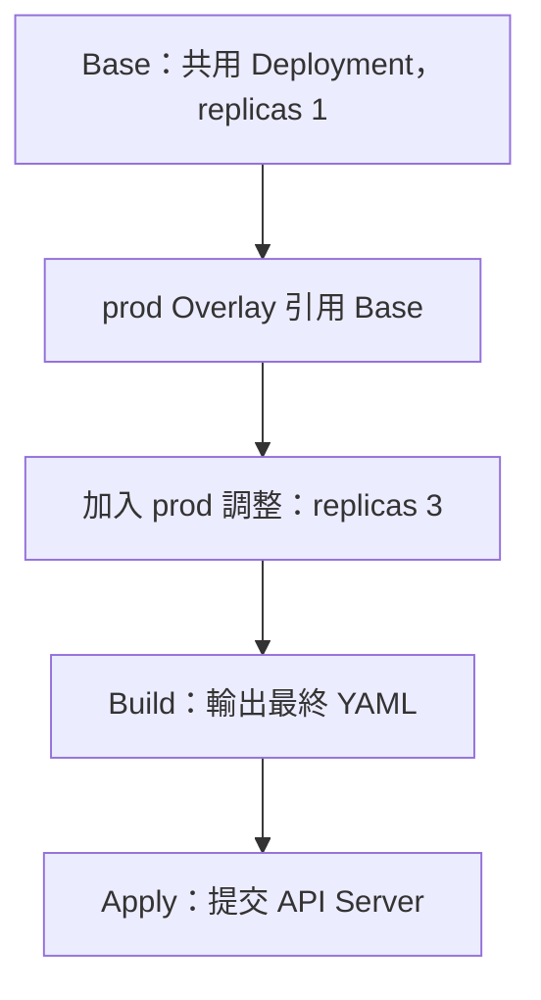

# K8s Kustomize：Base 與 Overlay

## TL;DR

**Base 放共用 Kubernetes YAML，Overlay 引用 Base，再加上該環境的差異設定，產生最後要部署的 YAML。** 不必為 dev／prod 複製整份設定。

| 名稱 | 用途 | 例子 |
|---|---|---|
| Base | 不綁定特定環境的共用資源 | Deployment 預設 1 個副本 |
| Overlay | 引用 Base，再透過 patch、replicas、images 等方式調整 | prod 改成 3 個副本 |
| kustomization.yaml | 宣告引用哪些資源、套用哪些調整 | resources、patches、replicas |
| Build | 合成最後的 Kubernetes manifests | `kubectl kustomize overlays/prod` |

**不是「Overlay 的整份檔案取代 Base」**；同名欄位如何修改取決於 patch 類型、目標與合併規則，尤其清單不一定全部追加或全部取代。建置不會改寫磁碟上的 Base 檔案。

## 常見專案結構

```text
my-app/
├── base/
│   ├── deployment.yaml
│   └── kustomization.yaml
└── overlays/
    ├── dev/
    │   └── kustomization.yaml
    └── prod/
        └── kustomization.yaml
```

`base/`、`overlays/`、`dev/`、`prod/` 是常見命名慣例，不是固定保留字；依各層 kustomization.yaml 的引用關係決定建置內容。



## 分層組合：子目錄管資源，上層引用資料夾

**子目錄的 kustomization.yaml 列出自己的資源；上層透過 resources 引用子目錄，不必重複列出每個檔案。** 不必每一個 resource 都獨佔一個資料夾，可依應用或元件分組。

```text
my-app/
├── kustomization.yaml
├── backend/
│   ├── kustomization.yaml
│   ├── deployment.yaml
│   └── service.yaml
└── frontend/
    ├── kustomization.yaml
    ├── deployment.yaml
    └── service.yaml
```

backend/kustomization.yaml（frontend 目錄亦可用同樣清單，各讀自己的檔案）：

```yaml
apiVersion: kustomize.config.k8s.io/v1beta1
kind: Kustomization
resources:
  - deployment.yaml
  - service.yaml
```

最上層 my-app/kustomization.yaml：

```yaml
apiVersion: kustomize.config.k8s.io/v1beta1
kind: Kustomization
resources:
  - backend
  - frontend
```

| 重點 | 意義 |
|---|---|
| 引用資源檔 | resources 列出 deployment.yaml 等實際檔案 |
| 引用子目錄 | 該目錄須有 Kustomization 設定檔；慣用 kustomization.yaml，不是 kustomize.yml |
| 路徑基準 | 相對於該份 kustomization.yaml 所在目錄，不是終端機目前目錄 |
| 不會自動掃描 | 必須在 resources 明確列出要包含的檔案或子目錄 |
| 資源名稱 | frontend／backend 的同 Namespace、同種類資源仍需避免同名衝突 |
| 預覽／部署 | 在 my-app 下執行 `kubectl kustomize .`／`kubectl apply -k .` |

這是「如何組合元件」的分層，Base／Overlay 是「如何調整不同環境」的分層，兩者可以一起使用。例如環境 Overlay 引用一個已組合 frontend／backend 的 Base。

## Component：多個環境可選用的共用配件

**Base 是共用基本款，Overlay 是環境版本，Component 是可以選擇加入的功能設定。** 例如 staging、prod 都要 logging 設定，dev 不需要，就把那一組設定抽成 Component，不必在兩個 Overlay 複製同一份 Patch。

| 比較 | Base | Overlay | Component |
|---|---|---|---|
| 用途 | 共用基本資源 | 某環境的組合與差異 | 可選、可重用的一組資源與修改 |
| kind | Kustomization | Kustomization | Component |
| 常見 apiVersion | kustomize.config.k8s.io/v1beta1 | kustomize.config.k8s.io/v1beta1 | kustomize.config.k8s.io/v1alpha1 |
| 如何引用 | 上層 resources 引用 | 對該 Overlay build／apply -k | 上層 components 引用 |
| 可否帶 Patch | 可以，作用於自身累積的資源 | 可以，調整引用的 Base 等資源 | 可以，調整父層已載入的資源，不必再重複引用 Base |

Base／Overlay 是使用方式的角色，不是不同 kind；Component 才有不同的 kind。Component 是本機建置功能，不是叢集內的 Controller 或要安裝的 CRD。

### 目錄與短例

```text
my-app/
├── base/
│   ├── deployment.yaml
│   └── kustomization.yaml
├── components/
│   └── logging/
│       └── kustomization.yaml
└── overlays/
    ├── dev/
    │   └── kustomization.yaml
    └── prod/
        └── kustomization.yaml
```

components/logging/kustomization.yaml：

```yaml
apiVersion: kustomize.config.k8s.io/v1alpha1
kind: Component
commonAnnotations:
  logging-enabled: "true"
```

overlays/prod/kustomization.yaml：

```yaml
apiVersion: kustomize.config.k8s.io/v1beta1
kind: Kustomization
resources:
  - ../../base
components:
  - ../../components/logging
```

dev 的 kustomization.yaml 只引用 `../../base`，不寫 logging 的 components；共用 Base 的設定則沿用前面範例，resources 列出 deployment.yaml。

| 建置 | 結果 |
|---|---|
| `kubectl kustomize overlays/dev` | 使用 Base，不加 logging-enabled 註記 |
| `kubectl kustomize overlays/prod` | 使用同一份 Base，再套 Component 的 logging-enabled 註記 |

這個短例**只加入 annotation，不會真的安裝或啟用 logging 系統**；實際功能需要相應元件或應用讀取設定。Component 也能包含新增資源、Patch 等，不限於 annotation。

| 易錯點 | 正確記法 |
|---|---|
| 引用 Component | 放 components，不是 resources |
| 引用一般 Base／Kustomization | 放 resources，不是 components |
| 是否必須使用 | 不必；單一環境的小修改直接放 Overlay 即可，跨環境共用可選功能再抽 Component |
| API 版本 | Component 目前使用 v1alpha1，與一般 Kustomization 的 v1beta1 不同；依內嵌／獨立 Kustomize 版本確認支援 |

官方：[Components 範例](https://github.com/kubernetes-sigs/kustomize/blob/master/examples/components.md)、[Kustomize Components 設計說明](https://www.kubernetes.dev/resources/keps/1802/)。關鍵詞：`kind Component`、`components`、`optional features`。

## Common transformations：對一組資源套用共同調整

**一次設定共同欄位，建置時套到這層 Kustomization 收集的資源，不用逐一修改原始 YAML。** 不是自動掃描整個專案，也不是把不適用的欄位硬加到所有資源。

| 設定 | 功能 | 例子 |
|---|---|---|
| namePrefix | 名稱加前綴 | backend → prod-backend |
| nameSuffix | 名稱加後綴 | backend → backend-v1 |
| namespace | 設定 namespaced 資源的 Namespace | prod；不會把 ClusterRole 變成 namespaced 資源 |
| labels | 加共同標籤；用 includeSelectors／includeTemplates 控制是否也改 selector／Pod template | environment=prod |
| commonAnnotations | 加共同 annotations，依內建欄位規則套用 | owner=platform |
| images／replicas | 對指定映像／工作負載做結構化調整 | 換 image tag、調整副本數；不是每個物件都加 replicas |

### 短例：共同設定都和 resources 同層

以下整段就是一份簡短的 kustomization.yaml；前提是 deployment.yaml 已存在：

```yaml
resources:
  - deployment.yaml
namespace: prod
namePrefix: prod-
nameSuffix: -v1
commonLabels:
  environment: prod
```

假設 Deployment 原名 web-app，建置後會叫 **prod-web-app-v1**、Namespace 為 prod，並加上 environment=prod；commonLabels 也會套到已知的 selector 與 Pod template label 欄位。

**這些欄位直接寫在最外層，不放進 spec，也沒有 commonTransformations 這個包住它們的欄位。** `namePrefix` 的拼法不是 namepPrefix。

先用 `kubectl kustomize .` 看結果，再用 `kubectl apply -k .` 部署。Namespace 要另外準備；commonLabels 是舊寫法，新版工具可能提示改用 labels，尤其需注意既有 selector 不可隨意修改。

### labels：需要控制套用範圍時

延續上面的根目錄範例，可把共同設定放在最上層 kustomization.yaml：

```yaml
apiVersion: kustomize.config.k8s.io/v1beta1
kind: Kustomization
resources:
  - backend
  - frontend
namespace: prod
namePrefix: prod-
labels:
  - pairs:
      environment: prod
    includeSelectors: false
    includeTemplates: true
commonAnnotations:
  owner: platform
```

| 假設原始資源 | 建置後的效果 |
|---|---|
| Deployment backend | 名稱 prod-backend、Namespace prod，物件與 Pod template 加 environment=prod |
| Service backend | 名稱 prod-backend、Namespace prod，物件加 environment=prod |
| 原本用 app=backend 匹配的 selector | 上例不把 environment 加進 selector，原本匹配關係保留 |

- namespace 設定**不會自動建立 Namespace 物件**；需事先建立或在 resources 包含 Namespace manifest。
- 舊教材常見 commonLabels；它也會影響 selectors。可使用 labels 明確控制範圍，避免變更已建立 Deployment 的不可變 selector。
- 名稱變更會依 Kustomize 認得的引用欄位更新相關引用；不會自動替任意字串或應用程式設定做全文替換。
- 只想改某個資源的個別欄位時用 patches；共同設定與局部 patch 的結果都先用 `kubectl kustomize` 查看。

## 最小範例：prod 改副本數

`base/deployment.yaml`：

```yaml
apiVersion: apps/v1
kind: Deployment
metadata:
  name: web-app
spec:
  replicas: 1
  selector:
    matchLabels:
      app: web-app
  template:
    metadata:
      labels:
        app: web-app
    spec:
      containers:
        - name: web
          image: nginx:stable
```

`base/kustomization.yaml`：

```yaml
apiVersion: kustomize.config.k8s.io/v1beta1
kind: Kustomization
resources:
  - deployment.yaml
```

`overlays/prod/kustomization.yaml`：

```yaml
apiVersion: kustomize.config.k8s.io/v1beta1
kind: Kustomization
resources:
  - ../../base
replicas:
  - name: web-app
    count: 3
```

在 `my-app/` 目錄執行 `kubectl kustomize overlays/prod`，結果的 Deployment 是 3 個副本，Base 檔案仍是 1。上例的 `dev/` 是其他環境的預留位置，需自行準備其 kustomization.yaml 才能建置。

## Images transformation：換映像名稱、tag 或 digest

**images 寫在 kustomization.yaml 最外層，和 resources 同層；不必為改 image 另外寫 patch。**

| 欄位 | 用途 | 例子 |
|---|---|---|
| name | 匹配原本的映像名稱，不是 container name；通常不含 tag／digest，Registry 路徑需匹配 | nginx |
| newName | 替換映像名稱或 Registry 路徑；只改此欄位時保留原 tag | registry.example.com/team/nginx |
| newTag | 替換 tag，建議加引號當字串 | "1.27" |
| digest | 指定映像內容識別，使用真正的 sha256 digest | sha256:後接完整雜湊值 |

短例（deployment.yaml 的原始 image 為 nginx:stable）：

```yaml
resources:
  - deployment.yaml
images:
  - name: nginx
    newName: registry.example.com/team/nginx
    newTag: "1.27"
```

產生 `image: registry.example.com/team/nginx:1.27`；Registry 與 tag 是示意值，部署前確認實際存在。只改 tag 時，可省略 newName。

若要固定映像內容，把上例 newTag 改成 digest，例如 `digest: sha256:實際完整雜湊值`，輸出會使用 `映像名稱@sha256:…`。此值是占位說明，不能直接拿來拉取 image；digest 不是 tag，也不是 Kustomize 幫你查 Registry 算出的值。

name 比對的是原始 image，而不是 Deployment 名稱、容器名稱或 newName；符合條件的已知 image 欄位都可能被修改，不是只修改第一個容器。先用 `kubectl kustomize .` 確認輸出；建置成功只代表能產生 YAML，不代表映像存在或有拉取權限。

參考：[Kustomize Images 官方欄位與範例](https://github.com/kubernetes-sigs/kustomize/blob/master/site/content/en/docs/Reference/API/Kustomization%20File/images.md)。搜尋關鍵詞：`images`、`newName`、`newTag`、`digest`。

## Patches：直接寫在環境 Overlay 裡做局部修改

**Overlay 是環境設定放的位置；patches 是其中一種修改方法。** 可以直接寫在 overlays/dev 或 overlays/prod 的 kustomization.yaml，不一定要另建 patch 檔案。

短例：overlays/prod/kustomization.yaml，假設 Base 的 web-app Deployment 第一個容器已經有 resources.requests.memory：

```yaml
resources:
  - ../../base
patches:
  - target:
      kind: Deployment
      name: web-app
    patch: |-
      - op: replace
        path: /spec/template/spec/containers/0/resources/requests/memory
        value: 512Mi
```

| 部分 | 意思 |
|---|---|
| target | 指定修改 Deployment web-app |
| patch | 上例為 JSON Patch；replace 替換既有值，目標路徑必須存在 |
| path | 精確的 YAML 欄位位置，containers/0 是第一個容器 |
| value | 新值 512Mi；Base 檔案不變，只改合成結果 |

不能直接在 kustomization.yaml 最外層寫 `memory: 512Mi`：這不是支援欄位，也沒指出要改哪個資源或容器。容器順序改變時，索引式路徑也要重新確認。

| 需求 | 常用方式 |
|---|---|
| 改副本數／映像 | 優先用 replicas／images 這些專門欄位 |
| 共同前綴／Namespace | namePrefix／namespace |
| 改其他個別欄位 | patches；可內嵌，也可用 path 引用外部 patch 檔 |
| 所有環境共用設定都要改 | 直接改 Base |
| 只改 prod | 在 prod Overlay 調整，避免改 Base 影響 dev |

patches 也支援 strategic merge 的 YAML 片段；上例只是其中一種寫法。先 `kubectl kustomize overlays/prod` 看結果，再 apply -k。只有一個環境時也可以直接維護原始 YAML，不必為使用 Patch 而拆分。

### Strategic Merge Patch：辨識目標的欄位不是重新命名

**沒有另寫 target 的 Strategic Merge Patch，用身分欄位辨識資源，再套用其他欄位的修改。欄位名稱固定，值要對應目標資源。**

| 欄位 | 此種寫法的用途 |
|---|---|
| apiVersion | 辨識 API 群組與版本，例如 apps/v1 |
| kind | 辨識資源種類，例如 Deployment |
| metadata.name | 辨識資源名稱，例如 web-app，不是要求重新命名 |
| metadata.namespace | 需要時區分同名的 namespaced 資源 |
| spec 等其他內容 | 依資源合併規則修改，例如 replicas: 3 |

把 Patch 的 metadata.name 從 web-app 改成 web-app-1，就是改找 web-app-1；若 Base 沒有匹配目標，通常建置失敗，不會自動幫 web-app 改名。這裡討論的是按 Patch 身分辨識目標的方式；另外設定 target 的情況需依該設定判斷。

### Separate file：Patch 可以放在獨立檔案

以 prod Overlay 為例：

```text
overlays/prod/
├── kustomization.yaml
└── replicas-patch.yaml
```

replicas-patch.yaml（Strategic Merge Patch）：

```yaml
apiVersion: apps/v1
kind: Deployment
metadata:
  name: web-app
spec:
  replicas: 3
```

kustomization.yaml：

```yaml
resources:
  - ../../base
patches:
  - path: replicas-patch.yaml
```

**path 是相對於這份 kustomization.yaml 的檔案路徑，不是 JSON Patch 裡指定欄位位置的 path。** Base 中需有可匹配的 Deployment web-app。

| 寫法 | 放在哪裡 | 適用情況 |
|---|---|---|
| Inline：patch | Patch 內容直接寫在 kustomization.yaml 的區塊字串 | 修改短，想放同一檔案看 |
| Separate file：path | Patch 放外部檔案，kustomization.yaml 引用路徑 | 修改較長，或想分開管理各個修改 |
| JSON 6902 Patch | op／path／value 操作清單；可 inline 或獨立檔案，另用 target 選資源 | 精確指定路徑；replace 需既有路徑 |
| Strategic Merge Patch | 資源 YAML 片段；可 inline 或獨立檔案 | 依 schema 合併；containers 等欄位可按 name 匹配，不是所有清單都相同 |

兩種檔案安排都是先 `kubectl kustomize overlays/prod` 建置預覽，再 `kubectl apply -k overlays/prod`；不是直接把不完整的 Patch 當完整 Deployment apply。

### 兩種 Patch × 兩種存放方式

| 修改方式 | Inline：直接放 patches[].patch | Separate file：patches[].path 引用 |
|---|---|---|
| JSON 6902 Patch | 可以；另用 target 選資源 | 可以；檔案是 op 操作清單，另用 target 選資源 |
| Strategic Merge Patch | 可以；內容是資源 YAML 片段 | 可以；檔案是資源 YAML 片段 |

**修改語法和存放位置是兩個獨立選擇，並非只有 Strategic Merge 可以分開檔案。** JSON 6902 的名稱來自 RFC 6902；即使用 YAML 寫操作清單，仍是 JSON Patch 語意。

| 名稱 | 用途／例子 |
|---|---|
| JSON Pointer | JSON Patch 的欄位路徑，例如 `/spec/replicas`、`/spec/template/spec/containers/0/image` |
| JSONPath | 查詢／擷取資料的表達式，例如 kubectl 的 `-o jsonpath='{.spec.replicas}'`；不是上面的 Patch 路徑 |

### 兩種 replace：路徑替換 vs 合併指示

| 寫法 | 意義 |
|---|---|
| JSON 6902 的 `op: replace` | 替換 path 指到的既有值；可指向單一數值，也可替換整個 map／list |
| Strategic Merge 的 `$patch: replace` | 在指定 map／list 加指示，要求整塊取代，不沿用該塊的一般合併規則 |
| Strategic Merge 沒寫 $patch | 一般依資源 schema 的合併規則處理；scalar 可換值，map／list 不一定整塊取代 |

例如 Base 的 ConfigMap app-config 已有 `data: {APP_ENV: dev, OLD_KEY: old}`。以下兩個獨立範例都放在 kustomization.yaml 的 patches 下，擇一使用；結果的 data 只剩 APP_ENV=prod。

JSON 6902：明確替換整個既有 data map：

```yaml
patches:
  - target:
      kind: ConfigMap
      name: app-config
    patch: |-
      - op: replace
        path: /data
        value:
          APP_ENV: prod
```

Strategic Merge：在 data 這一塊指定取代：

```yaml
patches:
  - patch: |-
      apiVersion: v1
      kind: ConfigMap
      metadata:
        name: app-config
      data:
        $patch: replace
        APP_ENV: prod
```

若第二例拿掉 `$patch: replace`，一般 map 合併會保留 Base 的 OLD_KEY。`$patch` 是給建置工具的指示，最終產出的 ConfigMap 不包含這個指示。

### JSON Patch 的六種 op

| op | 用途 | 除 op、path 外要填什麼／限制 |
|---|---|---|
| add | 新增物件欄位，或在陣列插入項目 | value；父路徑必須存在；物件欄位若已存在會被替換 |
| replace | 替換既有路徑的值 | value；目標路徑必須存在 |
| remove | 刪除既有欄位或陣列項目 | 不需 value；目標必須存在 |
| copy | 複製來源值到目的位置 | from 是來源、path 是目的；來源仍保留 |
| move | 移動來源值到目的位置 | from 是來源、path 是目的；來源被移除 |
| test | 確認指定位置等於預期值，不修改資料 | value；不符合就使操作失敗 |

常用先記 add／replace／remove。操作按清單順序執行；刪除陣列項目後，後面的索引會變。陣列 `/-` 可搭配 add 表示追加最後；Pointer 中的 key 若含 `/` 寫成 `~1`，含 `~` 寫成 `~0`。

參考：[RFC 6902：六種操作](https://www.rfc-editor.org/rfc/rfc6902)、[Kustomize 官方 Patch 範例](https://kubernetes.io/docs/tasks/manage-kubernetes-objects/kustomization/#customizing)。

### 刪欄位與新增 list：null、remove、/- 與依 name 合併

| 需求 | Strategic Merge Patch | JSON 6902 Patch |
|---|---|---|
| 刪除一般欄位 | 欄位設為 null | op: remove，指定既有 path，不填 value |
| 新增容器 | 寫 containers 清單，Deployment 依 name 合併；不同名新增，同名修改 | op: add，path 尾端 /- 追加到既有陣列尾端 |
| 其他 list | 依 schema 的合併規則，有些整份取代，不保證依 name 合併 | 指定索引或 /-；不會因容器同名就自動合併 |
| 把值改成 null | 在此合併語意中，通常是刪欄位 | replace 搭配 value: null 是設為 null，不是 remove；最終仍須符合 API schema |

假設 Base 的 Deployment web-app 已有 nodeSelector 與名為 app 的容器。以下兩例都放在 kustomization.yaml，搭配原本的 resources，**擇一使用**；效果是移除 nodeSelector，並新增 logger 容器。

Strategic Merge：

```yaml
patches:
  - patch: |-
      apiVersion: apps/v1
      kind: Deployment
      metadata:
        name: web-app
      spec:
        template:
          spec:
            nodeSelector: null
            containers:
              - name: logger
                image: busybox:1.36
                command: ["sh", "-c", "sleep 3600"]
```

JSON 6902：

```yaml
patches:
  - target:
      kind: Deployment
      name: web-app
    patch: |-
      - op: remove
        path: /spec/template/spec/nodeSelector
      - op: add
        path: /spec/template/spec/containers/-
        value:
          name: logger
          image: busybox:1.36
          command: ["sh", "-c", "sleep 3600"]
```

| 易錯點 | 正確記法 |
|---|---|
| YAML 的 `-` | 表示一個清單項目，不代表自動追加到 Base |
| JSON Pointer 的 `/-` | 用於 add，表示追加到陣列末尾；父陣列必須已存在 |
| Strategic Merge 的容器 name | 用於內建 Deployment containers 的匹配，不是所有 list 都用 name |
| JSON Patch 追加同名容器 | 不會自動更新原容器，可能產生重複名稱並被 API 拒絕 |
| 刪除清單中的指定成員 | Strategic Merge 可用匹配 key 搭配 `$patch: delete`；JSON Patch 用 remove 指定陣列索引，刪除後索引會變 |

### 陣列 index 與刪除操作：不要混用 remove／delete

| 索引／符號 | 意義 |
|---|---|
| `/spec/template/spec/containers/0` | 第一個容器，index 從 0 開始 |
| `/spec/template/spec/containers/1` | 第二個容器 |
| `/spec/template/spec/containers/-` | JSON Patch 搭配 add，追加到既有陣列尾端；不是數字索引 |
| 刪除 index 0 之後 | 原本 index 1 變成 0；同一份 Patch 的後續操作需按變動後索引處理 |
| YAML 行首的 `-` | 表示清單項目，和 remove／delete 操作無關 |

| 刪除方式 | 寫法 | 如何選中 |
|---|---|---|
| JSON 6902 | `op: remove` | 用 path 指定欄位或陣列索引，不用 value |
| Strategic Merge | `$patch: delete` | 以資源片段與支援的合併 key 辨識，例如 containers 的 name |
| Strategic Merge 刪一般欄位 | `nodeSelector: null` | 直接指出要刪的欄位 |

假設 Base Deployment web-app 的第一個容器是 app，第二個是 logger。以下僅是 Patch 內容片段，不是完整資源；JSON 6902 仍需在 kustomization.yaml 的 patches 設 target，Strategic Merge 仍需帶目標資源的 apiVersion、kind、metadata.name。

JSON 6902：依 index 刪除第二個容器：

```yaml
- op: remove
  path: /spec/template/spec/containers/1
```

Strategic Merge：以容器名稱刪除，不依賴它排第幾個：

```yaml
spec:
  template:
    spec:
      containers:
        - name: logger
          $patch: delete
```

如果刪的是整個 map，就不加清單符號：

```yaml
spec:
  template:
    spec:
      nodeSelector:
        $patch: delete
```

**JSON Patch 用 remove，不是 op: delete；Strategic Merge 用 `$patch: delete`，不是 `$patch: remove`。** `$patch` 在 map 裡直接寫；在 list 裡則放在對應清單項目，並帶必要的匹配 key。不要把 `$patch` 的位置一律記成 `- $patch`。

上述是 Kustomize 建置時的 Patch 語意，不代表直接 apply 一份寫了 null 的一般 manifest 就有完全相同的刪除行為。

## 常用欄位與指令

| 欄位 | 用途 |
|---|---|
| resources | 引用資源 YAML 或其他 Kustomization 目錄，例如 Base |
| replicas | 調整指定工作負載的副本數 |
| images | 調整映像名稱、tag 或 digest |
| patches | 對指定資源套用局部修改，例如 resources、env |
| namespace／namePrefix／nameSuffix | 調整輸出資源的 Namespace 或名稱 |

| 動作 | 指令 |
|---|---|
| 預覽，不部署 | `kubectl kustomize overlays/prod` |
| 輸出成檔案 | `kubectl kustomize overlays/prod > rendered.yaml` |
| 與叢集現況比較 | `kubectl diff -k overlays/prod` |
| 交 API Server 驗證但不儲存 | `kubectl apply --dry-run=server -k overlays/prod` |
| 部署合成後的資源 | `kubectl apply -k overlays/prod` |
| 若另裝獨立 CLI | `kustomize build overlays/prod` |

**`-f` 讀資源檔，`-k` 讀 Kustomization 目錄並先建置。** 不要用 `kubectl apply -f kustomization.yaml` 當作一般資源部署；Kustomization 是本機建置設定，不是要求叢集認識的新 kind。此處也不同於 GitOps 工具可能提供的同名 Custom Resource。

## Helm 與 Kustomize

| 比較 | Helm | Kustomize |
|---|---|---|
| 核心方式 | Chart 模板 ＋ Values | 現有 YAML ＋ Base／Overlay 調整 |
| 常見預覽 | `helm template` | `kubectl kustomize` |
| 部署 | `helm install`／`helm upgrade` | `kubectl apply -k` |
| Release／History／Rollback | Helm 管理 Release 與修訂歷史 | 單獨 Kustomize 不提供 Helm Release 歷史；通常由 Git 保存設定版本 |

相關：[[K8s Helm：Chart、Template、Values 與 Release]]、[[K8s kubectl 常用指令]]。

## 官方文件與關鍵詞

- [Kubernetes：Declarative Management Using Kustomize](https://kubernetes.io/docs/tasks/manage-kubernetes-objects/kustomization/)：`bases and overlays`、`kustomization.yaml`、`patches`、`kubectl apply -k`、`setting cross-cutting fields`、`labels includeSelectors`。
