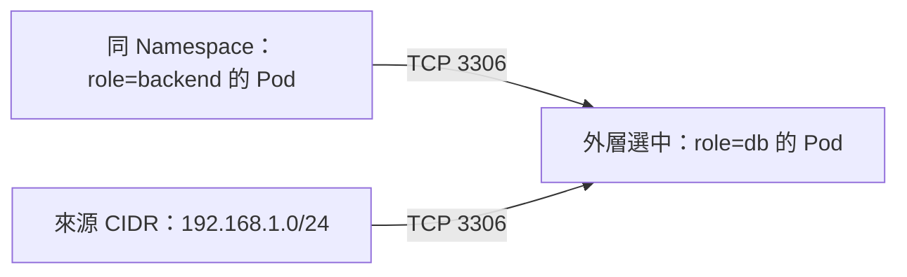

# K8s NetworkPolicy 網路存取控制

## TL;DR

**NetworkPolicy 決定哪些連線可以進入或離開指定的 Pod。** 例如：資料庫只接受 backend Pod 連入 TCP 3306。

| 機制 | 管什麼 |
|---|---|
| [[K8s RBAC 與 ServiceAccount|RBAC]] | 哪個身分可以操作 Kubernetes API |
| [[K8s 中的 Pod 是什麼#SecurityContext：執行身分與 Linux 權限|securityContext]] | 容器執行身分與 Linux 權限 |
| NetworkPolicy | Pod 的網路連線，常見是 IP、TCP／UDP port |
| [[K8s Ingress 與 Gateway API|Ingress／Gateway API]] | 將外部請求路由到後端服務 |

**NetworkPolicy 需要支援政策執行的網路元件才會生效。物件建立成功，不代表流量已受限制。** 見 [[K8s CNI 比較：Cilium、Calico 與 Flannel]]。

## Flannel：提供網路連通，本身不執行 NetworkPolicy

**單獨使用 Flannel（`flanneld`）時，不會執行 NetworkPolicy 的封包限制。** 即使 `kubectl apply` 成功，沒有政策執行元件，流量也不會因此被阻擋。

| 方案 | NetworkPolicy 執行能力 |
|---|---|
| 單獨 Flannel | 本身不執行，主要提供跨 Node 的 Pod 網路連通 |
| Calico／Cilium | 提供 NetworkPolicy 執行能力，仍需正確安裝與配置 |
| Flannel ＋政策控制器 | Flannel 負責連通，額外元件負責執行政策 |

考前記法：**Flannel 接通網路；NetworkPolicy 還需要有人執行。** 不能只看到 Flannel 就斷定整個叢集一定沒有政策功能，因為可能另裝了控制器。

目前官方 Flannel Helm chart 提供 `netpol.enabled` 選項，可一起部署政策控制器；也能搭配其他政策方案。確認實際部署元件並測試允許／拒絕流量，才能判定政策是否生效。

來源：[Flannel 官方 Network Policy 說明](https://github.com/flannel-io/flannel#network-policy)。

## Ingress 與 Egress：以被選中的 Pod 為視角


此處的 `Ingress` 是流量方向，與 `kind: Ingress` 路由物件不同。

| 欄位 | 意思 |
|---|---|
| `metadata.namespace` | 這份政策所在的 Namespace |
| `spec.podSelector` | 政策管哪些 Pod，只選本 Namespace |
| `policyTypes` | 管 `Ingress`、`Egress`，或兩者；建議明寫 |
| `ingress[].from` | 允許哪些來源連入 |
| `egress[].to` | 允許連往哪些目的地 |
| `ports` | 允許的目的 port 與協定 |

## 範例：資料庫只允許同 Namespace 的 backend 連入

假設 `default` 內資料庫 Pod 有 `app: db`，後端 Pod 有 `app: backend`，資料庫監聽 TCP 3306。

```yaml
apiVersion: networking.k8s.io/v1
kind: NetworkPolicy
metadata:
  name: db-allow-backend
  namespace: default
spec:
  podSelector:
    matchLabels:
      app: db
  policyTypes:
  - Ingress
  ingress:
  - from:
    - podSelector:
        matchLabels:
          app: backend
    ports:
    - protocol: TCP
      port: 3306
```

**選中 db → 限制進入流量 → 允許 backend 連入 3306。** 這份政策不限制 db 的 Egress，也不會限制未選中的其他 Pod。若有其他政策也選中 db，允許範圍會合併。

## 外層選「管誰」，內層選「允許誰」：不是覆蓋

**外層 `spec.podSelector` 選中被管理的 Pod；內層 `ingress[].from` 列出允許連入的來源。內層不會覆蓋外層，這與 Pod／container 的 `securityContext` 覆蓋規則不同。**

以下完整範例允許 backend Pod **或（OR）** 指定來源 CIDR 連入 db 的 TCP 3306：

```yaml
apiVersion: networking.k8s.io/v1
kind: NetworkPolicy
metadata:
  name: db-allow-backend-or-cidr
  namespace: default
spec:
  podSelector:
    matchLabels:
      role: db
  policyTypes:
  - Ingress
  ingress:
  - from:
    - podSelector:
        matchLabels:
          role: backend
    - ipBlock:
        cidr: 192.168.1.0/24
    ports:
    - protocol: TCP
      port: 3306
```

| 位置 | 讀法 |
|---|---|
| 外層 `spec.podSelector` | **管誰？** default Namespace 裡 `role: db` 的 Pod |
| `policyTypes: [Ingress]` | **管哪個方向？** 進入 db 的流量 |
| 第一個 `from` 項目的 `podSelector` | **允許誰？** 同 Namespace 裡 `role: backend` 的 Pod |
| 第二個 `from` 項目的 `ipBlock` | **也允許誰？** 來源 IP 在 `192.168.1.0/24` 的流量 |
| 同一條 ingress 規則的 `ports` | 上述任一來源都只能連入 TCP 3306 |



**兩個來源各有一個 `-`，所以是 OR：`（backend Pod OR 來源 CIDR）AND TCP 3306`。** 來源只需符合其中一項；不需要同時具有 backend label 且位於該 CIDR。db 仍是被管的目標，不會被內層改成 backend。

`ipBlock` 比對的是來源 IP，不是 Pod label。若路徑上有 NAT／負載均衡，實際比對到的來源 IP 可能受網路實作與轉換順序影響。

## 預設行為與常考規則

- 沒有政策選中某 Pod 的某個方向時，該方向預設不隔離；Namespace 本身不會自動隔離網路。
- 一旦政策選中 Pod 並隔離某方向，該方向只允許符合規則的流量。
- 多份政策的允許規則是聯集，沒有先後順序；default-deny 不會覆蓋另一份政策的 allow。
- A 連到 B 時，A 的 Egress 與 B 的 Ingress 都必須允許；未隔離的方向視為允許。已允許連線的回應流量會隱含放行。
- 一般 NetworkPolicy 主要控制 L3／L4，不用來依 HTTP URL、使用者登入身分做授權。

### 全部 Pod 拒絕進入：default-deny ingress

```yaml
apiVersion: networking.k8s.io/v1
kind: NetworkPolicy
metadata:
  name: default-deny-ingress
  namespace: default
spec:
  podSelector: {}
  policyTypes:
  - Ingress
```

`podSelector: {}` 選中本 Namespace 全部 Pod；沒有任何 ingress allow 規則，所以隔離進入流量。若要同時隔離出去的流量，把 `Egress` 也加入 `policyTypes`，且不加 egress allow 規則。

**限制 Egress 後，DNS 查詢也需要放行**，通常涉及 UDP／TCP 53；目的地依叢集 DNS 架構配置。DNS 被擋時，使用 Service 名稱的連線也會失敗。

## matchLabels：裡面的條件必須全部符合（AND）

Selector 常用 `matchLabels` 比對 labels，拼字是 **`matchLabels`**。也能用 `matchExpressions` 表達 `In`、`NotIn`、`Exists` 等條件。

**同一個 `matchLabels` 裡，每一個 label 條件都必須同時符合，才會選中該物件；不是符合其中一個就可以。**

```yaml
podSelector:
  matchLabels:
    app: backend
    env: production
```

意思是：**`app = backend` AND `env = production`**。

| Pod 的 labels | 是否選中 | 原因 |
|---|---|---|
| `app: backend`、`env: production` | ✅ | 兩個條件都符合 |
| `app: backend`、`env: dev` | ❌ | env 不符合 |
| 只有 `app: backend` | ❌ | 缺少 env |
| `app: frontend`、`env: production` | ❌ | app 不符合 |
| `app: backend`、`env: production`、`team: payment` | ✅ | 要求的條件全部符合，額外的 labels 不影響 |

這個 AND 規則也適用於 `namespaceSelector.matchLabels`，只是比對的物件變成 Namespace。

## 跨 Namespace：selector 的 AND／OR

同一個 `from` 項目內，同時放兩種 selector 是 **AND**：只允許 `payroll` Namespace 裡的 backend。

```yaml
from:
- namespaceSelector:
    matchLabels:
      kubernetes.io/metadata.name: payroll
  podSelector:
    matchLabels:
      app: backend
```

分成兩個 `-` 項目則是 **OR**：允許 payroll 的所有 Pod，或政策所在 Namespace 的 backend。

```yaml
from:
- namespaceSelector:
    matchLabels:
      kubernetes.io/metadata.name: payroll
- podSelector:
    matchLabels:
      app: backend
```

`namespaceSelector` 比對 Namespace 的 labels；`podSelector` 比對 Pod 的 labels。單獨的 `podSelector` 只選政策所在 Namespace 的 Pod。

## 重要指令與官方關鍵詞

```bash
kubectl get networkpolicy -A
kubectl describe networkpolicy db-allow-backend -n default
kubectl get pods -n default --show-labels
kubectl get namespaces --show-labels
kubectl explain networkpolicy.spec
kubectl explain networkpolicy.spec.ingress
kubectl apply --dry-run=server -f networkpolicy.yaml
kubectl apply -f networkpolicy.yaml
```

套用後，要從「允許的來源」與「不允許的來源」各測一次真正的應用連線；不要只看 YAML，也不要只用 ping 判斷 TCP／UDP 規則。

官方：[Network Policies](https://kubernetes.io/docs/concepts/services-networking/network-policies/)。搜尋關鍵詞：`network policies`；頁內找 `The NetworkPolicy resource`、`Behavior of to and from selectors`、`Default deny all ingress traffic`。
