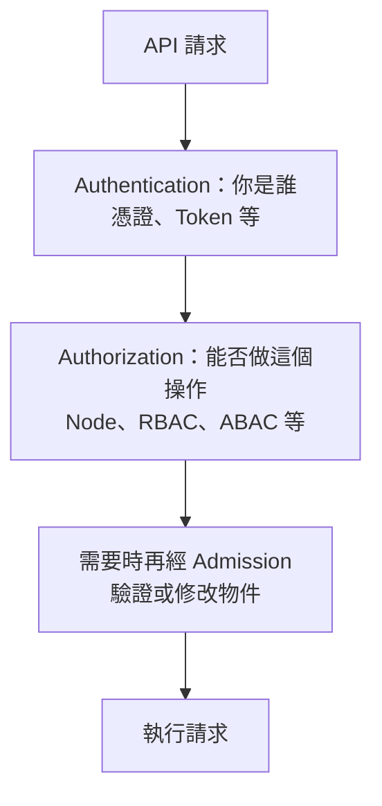
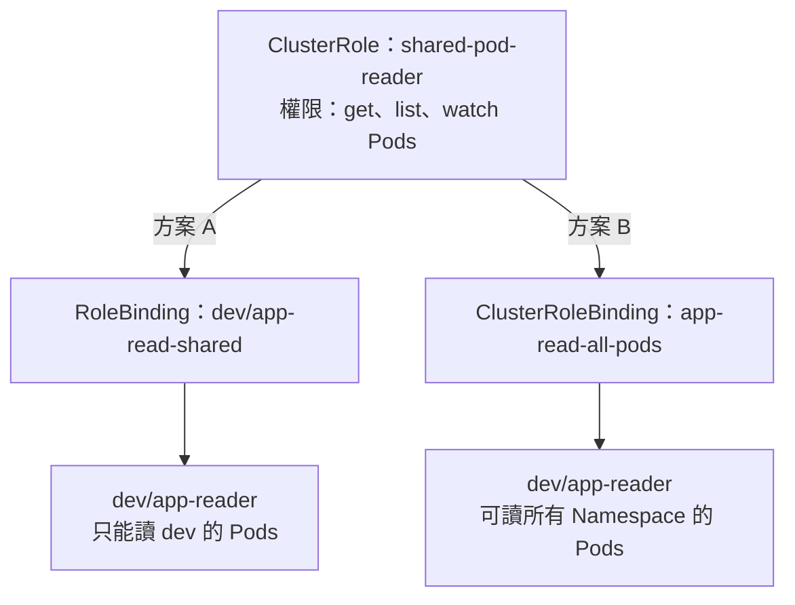
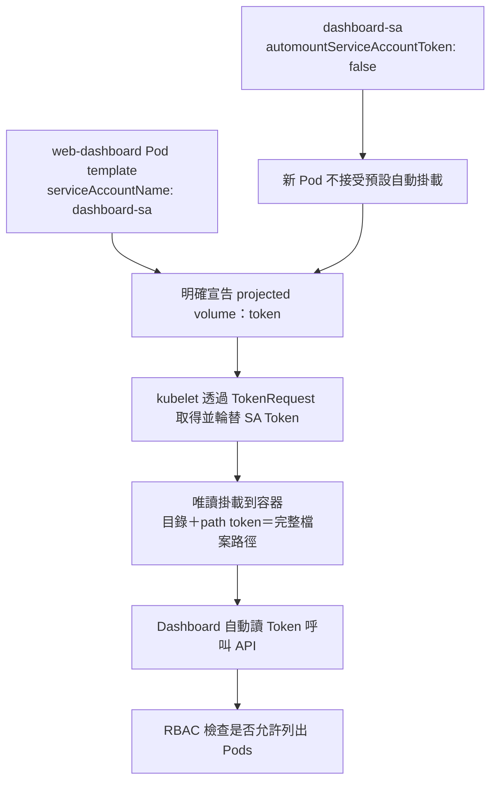
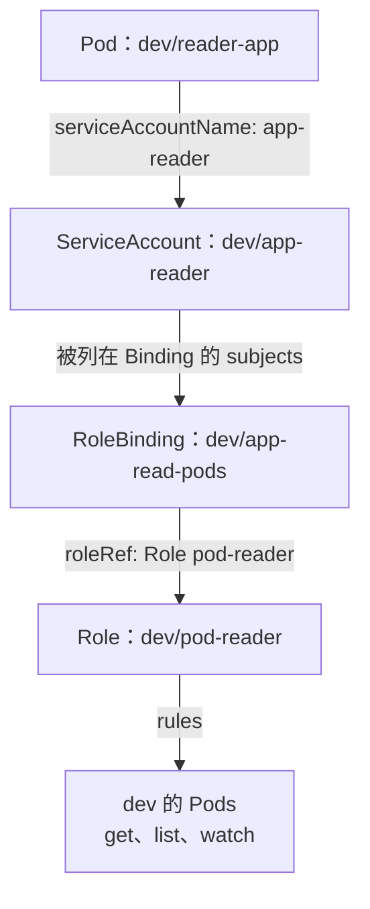

# K8s RBAC 與 ServiceAccount

**ServiceAccount 是「程式用誰的身分」；Role／ClusterRole 定義「能做什麼」；Binding 把權限交給身分。** 建立 ServiceAccount 不等於取得管理權限。

身分來源見 [[K8s 的 Certificate]]；選擇叢集與使用者見 [[K8s kubeconfig、Context 與多叢集管理]]；API Group 見 [[K8s kubectl 常用指令#API Group 與 apiVersion：資源屬於哪一組]]。

## 先記住關係：Pod → ServiceAccount → RoleBinding → Role

**Pod 指定使用 SA；RoleBinding 將 Role 的權限授予 SA。** 這是一條理解設定關係的記憶順序，不是程式向四個元件依序發送網路請求。

| 連結 | 寫在哪裡 | 意思 |
|---|---|---|
| Pod → ServiceAccount | Pod 的 `spec.serviceAccountName` | 這個 Pod 使用誰的身分 |
| ServiceAccount → RoleBinding | RoleBinding 的 `subjects` 列出該 SA | 這份授權給誰；不是在 SA 裡寫 Role |
| RoleBinding → Role | RoleBinding 的 `roleRef` | 使用哪份權限清單 |
| Role → 可做的操作 | Role 的 `rules` | 可以對哪些資源執行哪些動作 |

例如：**`reader-app` Pod 使用 `dev/app-reader`，RoleBinding `app-read-pods` 將 `pod-reader` 的權限授予它，因此 Pod 內程式用該 SA 的有效 Token 呼叫 API 時，可以讀取 dev 的 Pods。** 完整 YAML 與流程圖見 [完整範例：dev 的 app-reader 只能讀取 dev 的 Pods](#完整範例dev-的-app-reader-只能讀取-dev-的-pods)。

Role 與 SA 誰先建立都可以；**只有 Role、沒有相關 Binding，SA 不會因此取得這份權限。** Deployment 則在 `spec.template.spec.serviceAccountName` 指定 SA，讓建立的 Pod 使用它；不是把 Role 直接綁在 Deployment 或 Pod 上。

## 先定位：Authentication 與 Authorization



**憑證／Token 驗證成功，不代表有權讀 Pod 或建立 Deployment。** 授權還會考慮動作、資源、API Group、Namespace 等。讀取通常不經 Admission；寫入請求依適用規則處理。

## 授權模式：RBAC、ABAC、Node、AlwaysAllow／AlwaysDeny

| 模式 | 全名／用途 | 怎麼判斷 |
|---|---|---|
| **RBAC** | Role-Based Access Control | Role 定義權限，再用 Binding 指派給身分；透過 API 管理 |
| **ABAC** | Attribute-Based Access Control | 使用者、群組、Namespace、資源等屬性符合政策檔規則即可授權；不是 Access-Based |
| **Node Authorization** | kubelet 專用授權 | 根據 Node 與指派給它的 Pod 等關係授權 |
| **AlwaysAllow** | 直接給出 Allow | 不按角色限制，主要理解／測試用；不代表跳過 Authentication 或 Admission |
| **AlwaysDeny** | 直接給出 Deny | 授權器直接拒絕，主要測試用 |
| **Webhook** | 外部授權判斷 | 呼叫外部服務取得授權決定 |

常見 kubeadm API Server 參數：

```yaml
- --authorization-mode=Node,RBAC
```

**多個 Authorizer 是依序詢問，不是全部都必須同意。** 第一個明確 Allow／Deny 就結束；只有 NoOpinion（沒有決定）才交給下一個，全部 NoOpinion 才拒絕。RBAC 沒有 explicit deny 規則，沒有符合的授權通常是 NoOpinion。

- `AlwaysAllow,RBAC`：第一個就 Allow，RBAC 不會再限制這個請求。
- `RBAC,AlwaysAllow`：RBAC 沒授權的請求也會落到 Allow，失去 RBAC 預設不授權的效果。
- Node Authorizer 與 **NodeRestriction Admission** 是不同階段，不是同一個設定。
- 這裡講授權器鏈；`system:masters` 另有超級使用者的特殊繞過行為，不宜用來測一般 RBAC 規則。

## RBAC 四種資源：Role、ClusterRole 與 Binding

**Role／ClusterRole 是權限清單；RoleBinding／ClusterRoleBinding 是「授予誰」的連結。**

| 資源 | 資源本身是否屬於 Namespace | 作用 |
|---|---|---|
| **Role** | 是 | 定義同一 Namespace 內的資源權限 |
| **ClusterRole** | 否 | 可定義叢集資源權限，也可定義供多個 Namespace 重用的權限 |
| **RoleBinding** | 是 | 在自己的 Namespace 內授權，可引用同 Namespace 的 Role 或全域 ClusterRole |
| **ClusterRoleBinding** | 否 | 將 ClusterRole 授權到叢集範圍；不能引用 Role |

### ClusterRole 不等於一定授權整個叢集

| 組合 | 得到什麼 |
|---|---|
| Role ＋ RoleBinding（dev） | dev 的權限 |
| ClusterRole ＋ RoleBinding（dev） | 該 ClusterRole 對 dev 的 namespaced 資源權限 |
| ClusterRole ＋ ClusterRoleBinding | 叢集範圍權限；對 namespaced 資源可跨所有 Namespace |

例如 ClusterRole 只定義讀取 Pods：用 dev 的 RoleBinding 就只授權 dev；用 ClusterRoleBinding 才可讀所有 Namespace 的 Pods。**不是只要有 ClusterRole 就能做所有事情，仍以 rules 為準。**

Nodes、PersistentVolumes、Namespaces 等是 cluster-scoped 資源；要授權它們，使用 ClusterRole＋ClusterRoleBinding。RoleBinding 即使引用可讀 Nodes 的 ClusterRole，也不會授予 Node 的叢集權限。

### namespaced=true／false：查資源種類的歸屬

**true＝物件屬於某個 Namespace；false＝物件屬於整個 Cluster。** 是 `true`，不是 `ture`。

```bash
kubectl api-resources --namespaced=true
kubectl api-resources --namespaced=false
```

| 查詢 | 常見資源種類 | 例子 |
|---|---|---|
| `--namespaced=true` | Pod、Service、Deployment、PVC、ServiceAccount、Role、RoleBinding | `dev/nginx` 與 `prod/nginx` 可以同名 |
| `--namespaced=false` | Node、PV、Namespace、ClusterRole、ClusterRoleBinding、CSR | `node-1` 不屬於 dev 或 prod |

**Namespace 物件本身也屬於 Cluster，不屬於另一個 Namespace。** `api-resources` 列資源種類，不是已建立的物件；查實際物件要用：

```bash
kubectl get roles,rolebindings -n dev
kubectl get clusterroles,clusterrolebindings
```

### 範例比較：同一個 ClusterRole，兩種 Binding

**ClusterRole 是叢集層級、可重用的權限清單；它不是 cluster-admin 的同義詞。** 以下只定義「讀取 Pods」，沒有建立／刪除 Pods、讀 Nodes 或修改叢集的權限。

假設 dev／prod 都已存在，使用 `dev/app-reader` SA；除了範例中的授權外沒有其他授權器或 Binding 額外放行。若 SA 尚未建立，先建立它：

```bash
kubectl create serviceaccount app-reader -n dev
kubectl create clusterrole shared-pod-reader --verb=get,list,watch --resource=pods
```

**A. 只想讀 dev 的 Pods：使用 dev 的 RoleBinding。**

```bash
kubectl create rolebinding app-read-shared \
  --clusterrole=shared-pod-reader \
  --serviceaccount=dev:app-reader -n dev
```

`-n dev` 決定這個 RoleBinding 授權的範圍；`--serviceaccount=dev:app-reader` 決定授權給哪個身分，兩者用途不同。

**B. 想讀所有 Namespace 的 Pods：改用或另外授予 ClusterRoleBinding。**

```bash
kubectl create clusterrolebinding app-read-all-pods \
  --clusterrole=shared-pod-reader \
  --serviceaccount=dev:app-reader
```

| 此 SA 可以執行什麼 | 只有 A：dev RoleBinding | 有 B：ClusterRoleBinding |
|---|---|---|
| 讀 dev 的 Pods | 可以 | 可以 |
| 讀 prod 的 Pods | 不可以 | 可以 |
| 一次列出所有 Namespace 的 Pods（`-A`） | 不可以 | 可以 |
| 讀 Nodes | 不可以 | 不可以，Role 沒有 nodes 規則 |
| 刪除 Pods | 不可以 | 不可以，Role 沒有 delete 規則 |

**權限清單一樣，Binding 決定授權範圍。** SA 雖然建立在 dev，仍可經 ClusterRoleBinding 取得跨 Namespace 的權限；身分所屬 Namespace 不等於權限邊界。



圖中兩個方案分開比較；**如果 A、B 都存在，權限累加，結果會是 B 的範圍**，不是 A 將 B 限制回 dev。若之後移除 B，也要查是否還有其他 Binding 提供相同權限。

驗證方式（執行者需具備 impersonate 權限）：

```bash
kubectl auth can-i list pods -n dev --as=system:serviceaccount:dev:app-reader
kubectl auth can-i list pods -n prod --as=system:serviceaccount:dev:app-reader
kubectl auth can-i list pods --all-namespaces --as=system:serviceaccount:dev:app-reader
kubectl auth can-i get nodes --as=system:serviceaccount:dev:app-reader
```

只用 A 時預期 `yes／no／no／no`；授予 B 後預期 `yes／yes／yes／no`。這是依範例規則推導的結果，未對實際叢集執行。

## ServiceAccount：Pod 使用的身分

- ServiceAccount（縮寫 `sa`）是 K8s 內建的 namespaced 資源；普通 User 不是可用 `kubectl create user` 建立的內建 User 物件。
- Pod 用 `spec.serviceAccountName` 選擇**同 Namespace** 的 ServiceAccount。沒填時，預設使用該 Namespace 的 `default` SA。
- 身分格式：`system:serviceaccount:<namespace>:<name>`。例如 `dev` 裡的 `app-reader` 是 `system:serviceaccount:dev:app-reader`。
- **ServiceAccount 身分與 Token 是兩回事**：SA 定義身分，Token 用來向 API Server 證明這個身分，RBAC 再決定權限。
- 現代叢集通常透過 TokenRequest／projected volume 提供有期限、可輪替的 Token；不能假設建立 SA 就會自動產生永久 Token Secret。

### describe sa default：兩個 default 不要搞混

**`kubectl describe sa default` 查的是「目前 Namespace 裡，名稱叫 default 的 ServiceAccount」。** `sa` 是 ServiceAccount 的縮寫；拼字是 `default`，不是 `defulat`。

```bash
kubectl describe sa default                 # 目前 Namespace 的 default SA
kubectl describe sa default -n blue         # blue 裡的 default SA
kubectl describe sa default -n default      # default Namespace 裡的 default SA
kubectl describe namespace default          # 查看 Namespace 本身，是另一個資源
```

在 `describe sa default -n default` 中，第一個 default 是 **SA 名稱**，`-n` 後面的 default 才是 **Namespace 名稱**。沒加 `-n` 時使用 Context 設定的 Namespace；Context 沒設定時才使用 default。

每個 Namespace 都有自己的 default SA，例如 `blue/default` 與 `default/default` 是不同物件。SA 叫 default 並不代表是管理員；現代叢集中 `describe sa` 沒列出永久 Token Secret，也不代表 SA 無法使用，Token 可由 projected volume 提供。

### Dashboard：從 Forbidden 到指定 ServiceAccount

例如錯誤：

```text
pods is forbidden: User "system:serviceaccount:default:default"
cannot list resource "pods" in API group "" in the namespace "default"
```

讀成：**default Namespace 裡的 default SA，沒有列出 default Pods 的權限。** `api group ""` 是 Core 群組。這不是 Token 檔案不見，也不是憑證驗證失敗，而是授權不足。

先讓 `dashboard-sa` 經 RoleBinding 取得所需的 `list pods` 等權限，再指定 Deployment 的 Pod 使用它；若 Lab 已準備好 RBAC，就不必重建。

```bash
kubectl set serviceaccount deployment web-dashboard dashboard-sa -n default
kubectl rollout status deployment/web-dashboard -n default
kubectl auth can-i list pods -n default --as=system:serviceaccount:default:dashboard-sa
```

設定對應 `spec.template.spec.serviceAccountName: dashboard-sa`，不是 `serviceAccounts`。Deployment 修改 Pod template 後會替換 Pod；原 Pod 的身分不是原地改名。

### Pod 裡的 credentials 放在哪

標準自動掛載位置通常是：

```text
/var/run/secrets/kubernetes.io/serviceaccount/
├── token       # SA 的登入 Token
├── ca.crt      # 驗證 API Server 的 CA 憑證
└── namespace   # Pod 所在 Namespace
```

**路徑叫 secrets，不表示一定由 Secret 物件提供。** 現代預設掛載通常是 projected volume，整合 TokenRequest 取得的 Token、ConfigMap 的 CA 資料與 Downward API 的 Namespace。程式需實作讀取 Token；掛載本身不會替應用發出 API 請求。

```bash
kubectl describe pod <pod名稱> -n default
kubectl exec <pod名稱> -n default -- ls -l /var/run/secrets/kubernetes.io/serviceaccount
```

`describe` 看 `Mounts` 的路徑、來源 volume 與 `(ro)`；`exec` 確認檔案存在，不必把 Token 印出來。多容器 Pod 可加 `-c <容器名稱>`。

### 關閉自動掛載，再明確投射 Token

**`automountServiceAccountToken: false` 關閉預設自動注入；手動宣告 `projected.serviceAccountToken` 仍可掛載 Token。** 不會移除 SA 的 RBAC 權限，也不是完全禁止該 SA 使用 Token。



**第一步：修改 SA，與 Deployment 是兩個不同物件，不能只改 Deployment 就以為 SA 也改好了。**

```bash
kubectl patch serviceaccount dashboard-sa -n default \
  -p '{"automountServiceAccountToken":false}'
```

SA YAML 中，此欄位在最上層：

```yaml
apiVersion: v1
kind: ServiceAccount
metadata:
  name: dashboard-sa
  namespace: default
automountServiceAccountToken: false
```

**第二步：修改既有 `~/web-dashboard/deployment.yaml` 的 Pod template。** 以下是層級示意，需合併到原設定；保留原本的容器名稱、image、ports、selector、其他 volumes 與 volumeMounts，不是用這段取代整份檔案。

```yaml
spec:
  template:
    spec:
      serviceAccountName: dashboard-sa
      automountServiceAccountToken: false
      containers:
        - name: web-dashboard # 示意名稱，以原本容器名稱為準
          # 原本的 image、ports 等設定保留
          volumeMounts:
            - name: token
              mountPath: /var/run/secrets/kubernetes.io/serviceaccount
              readOnly: true
      volumes:
        - name: token
          projected:
            sources:
              - serviceAccountToken:
                  path: token
                  expirationSeconds: 3600
```

| 設定 | 作用 |
|---|---|
| SA 的 `automountServiceAccountToken: false` | 該 SA 的預設不自動掛載設定 |
| Pod 的 `automountServiceAccountToken: false` | 明確讓這個 Pod 不自動掛載；若沒寫，繼承 SA，Pod 設定優先 |
| `serviceAccountName: dashboard-sa` | 決定投射的是哪個 SA 身分的 Token |
| `volumes[].name: token` | Pod 內的 volume 名稱，與掛載名稱對應 |
| `serviceAccountToken.path: token` | 寫入 volume 內名叫 token 的檔案，不是完整絕對路徑 |
| `mountPath` | 把整個 volume 掛到哪個目錄 |
| `readOnly: true` | 容器只能讀這個掛載，不代表 kubelet 無法輪替內容 |
| `expirationSeconds: 3600` | 請求期限為 1 小時，實際由 API Server 政策決定 |

最終檔案：`mountPath` 目錄＋`path: token`＝`/var/run/secrets/kubernetes.io/serviceaccount/token`。**不要將整個 volume 的 mountPath 寫成 token 檔案路徑，也不必手動複製 Token 或建立 Secret。** 避免用 `subPath` 掛載輪替 Token，因為 subPath 掛載不會收到投射內容更新。

這個最小範例只投射 Token；若程式同時需要 `ca.crt`／`namespace`，需另外將 `kube-root-ca.crt` ConfigMap 與 Downward API 加入 sources，不能假設關閉自動掛載後那些檔案仍存在。

**第三步：套用、等 rollout，再分別驗證 SA 與 Pod。**

```bash
kubectl apply -f ~/web-dashboard/deployment.yaml
kubectl rollout status deployment/web-dashboard -n default
kubectl get sa dashboard-sa -n default -o jsonpath='{.automountServiceAccountToken}{"\n"}'
kubectl get pods -n default
kubectl describe pod <新的-dashboard-pod名稱> -n default
kubectl exec <新的-dashboard-pod名稱> -n default -- ls -l /var/run/secrets/kubernetes.io/serviceaccount/token
```

SA 應輸出 `false`，Pod 的 Mounts 應看到 `/var/run/secrets/kubernetes.io/serviceaccount from token (ro)`。**Deployment Ready 不代表 SA 的欄位一定已修改**，兩個都要查。

### 拉私有 image：imagePullSecrets 與 API Token 不同

SA 也可設定 `imagePullSecrets`，讓新 Pod 帶入 Registry 登入 Secret 的引用；它與 API 存取 Token 是不同用途。建立指令、Pod／Deployment 設定與排錯見 [[K8s kubectl 常用指令#Secret docker-registry：登入私有 Registry 拉取 image]]。

### 這個範例常見的排錯

- **只修改 SA 不會回寫既有 Pod 的掛載**。本例修改 Deployment template 會自動 rollout；若只有 SA 改變、需要現有工作負載套用新設定，可在確認 template 後執行 `kubectl rollout restart deployment/web-dashboard -n default`。
- YAML 的 `volumes` 與 `containers` 同層；`volumeMounts` 在容器裡，與容器的 `name`／`image` 同層；`readOnly` 與 `mountPath` 同層。清單使用 `-`，縮排不用 Tab。
- `did not find expected key`：先用 `nl -ba ~/web-dashboard/deployment.yaml | sed -n '10,45p'` 看行號，原因也可能在錯誤行之前。
- `missing last-applied-configuration` 但最後顯示 `configured`：kubectl apply 補上設定紀錄的 Warning，不等於部署失敗。
- rollout 成功但仍 Forbidden：查新 Pod 的 SA 名稱及 RoleBinding；掛載 Token 不會自動增加 RBAC 權限。

參考：[Configure Service Accounts for Pods](https://kubernetes.io/docs/tasks/configure-pod-container/configure-service-account/)、[ServiceAccount Token Projected Volumes](https://kubernetes.io/docs/concepts/storage/projected-volumes/#serviceaccounttoken-projected-volumes)。搜尋詞：`automountServiceAccountToken false`、`projected serviceAccountToken volume`。

## 用 api-resources 填 RBAC：NAME → resources，APIVERSION → apiGroups

**Core 也是 API Group，只是群組名稱是空字串。** 不是 Core 與 API Group 二選一。

```bash
kubectl api-resources
# 想只看這三種資源時
kubectl api-resources | grep -E 'NAME|persistentvolumes|storageclasses|deployments'
```

從輸出找 `NAME` 與 `APIVERSION`，再拆成規則：

| NAME | APIVERSION | RBAC 的 apiGroups | RBAC 的 resources |
|---|---|---|---|
| `persistentvolumes` | `v1` | `[""]`，Core | `["persistentvolumes"]` |
| `storageclasses` | `storage.k8s.io/v1` | `["storage.k8s.io"]` | `["storageclasses"]` |
| `deployments` | `apps/v1` | `["apps"]` | `["deployments"]` |

**記法：`NAME` 原樣放入 `resources`；`APIVERSION` 有 `/` 就取前面的群組，只有 `v1` 就填 `""`。RBAC 的 `apiGroups` 不放版本，也不是填 Kind。**

例如要讀取 PV 與 StorageClass，ClusterRole 的 `rules` 可寫成：

```yaml
rules:
  - apiGroups: [""]
    resources: ["persistentvolumes"]
    verbs: ["get", "list", "watch"]
  - apiGroups: ["storage.k8s.io"]
    resources: ["storageclasses"]
    verbs: ["get", "list", "watch"]
```

以上只示範讀取；若需求包含建立／刪除等操作，依需求增加 verbs。**群組與資源必須配對正確**；不要把 PV 放進 `storage.k8s.io`，也不要將 Deployment 拼成 `developments`。

注意最上層的 `apiVersion: rbac.authorization.k8s.io/v1` 是 **Role／ClusterRole 物件自己的 API**；`rules[].apiGroups` 則是**它要授權操作的目標資源群組**，兩者不一定相同。API Group 與 apiVersion 的完整對照見 [[K8s kubectl 常用指令#API Group 與 apiVersion：資源屬於哪一組]]。

## 完整範例：dev 的 app-reader 只能讀取 dev 的 Pods

以下假設 `dev` Namespace 已存在，且沒有其他 Binding 額外授權此 SA。三個資源放在同一個 `app-reader-rbac.yaml`：

```yaml
apiVersion: v1
kind: ServiceAccount
metadata:
  name: app-reader
  namespace: dev
---
apiVersion: rbac.authorization.k8s.io/v1
kind: Role
metadata:
  name: pod-reader
  namespace: dev
rules:
  - apiGroups: [""]
    resources: ["pods"]
    verbs: ["get", "list", "watch"]
---
apiVersion: rbac.authorization.k8s.io/v1
kind: RoleBinding
metadata:
  name: app-read-pods
  namespace: dev
subjects:
  - kind: ServiceAccount
    name: app-reader
    namespace: dev
roleRef:
  apiGroup: rbac.authorization.k8s.io
  kind: Role
  name: pod-reader
```



欄位記法：

| 欄位 | 怎麼記 |
|---|---|
| `apiGroups: [""]` | Core 群組；不是 `v1`、不是 `core`，也不含版本 |
| `resources: ["pods"]` | API 資源名，通常小寫複數；不是 Kind 的 `Pod` |
| `verbs` | 可以執行的動作；get 讀單一物件、list 列清單、watch 追蹤變化 |
| `subjects` | 授予誰，可用 User、Group、ServiceAccount |
| `roleRef` | 引用哪個 Role／ClusterRole；既有 Binding 的 roleRef 不能直接改成另一個角色 |

若改成 Deployment 權限，常見是 `apiGroups: ["apps"]`、`resources: ["deployments"]`。讀取 Pod 日誌另需 `pods/log` 的 `get`，只有 `pods` 的 `get` 不等於能看 logs。

Pod 選擇 SA 的位置：

```yaml
apiVersion: v1
kind: Pod
metadata:
  name: reader-app
  namespace: dev
spec:
  serviceAccountName: app-reader
  containers:
    - name: app
      image: nginx
```

這只是指定身分，不會讓 nginx 自動去查 API。Deployment 則寫在 `spec.template.spec.serviceAccountName`。若程式不需要掛載 API Token，可設定 Pod 的 `automountServiceAccountToken: false`；它不等於刪除 SA 或 RBAC 權限。

## 重要指令：建立、產生 YAML、驗證權限

以下是和上面 YAML 等價的建立方式，擇一操作；假設 dev 已存在：

```bash
kubectl create serviceaccount app-reader -n dev
kubectl create role pod-reader --verb=get,list,watch --resource=pods -n dev
kubectl create rolebinding app-read-pods --role=pod-reader --serviceaccount=dev:app-reader -n dev
```

每個 `create` 指令可加 `--dry-run=client -o yaml` 先產生 YAML；套用完整範例則用 `kubectl apply -f app-reader-rbac.yaml`。

ClusterRole 與兩種 Binding 的建立、範圍比較及 `can-i` 驗證，見 [範例比較：同一個 ClusterRole，兩種 Binding](#範例比較同一個-clusterrole兩種-binding)。

```bash
kubectl get sa,roles,rolebindings -n dev
kubectl get clusterroles,clusterrolebindings
kubectl describe role pod-reader -n dev
kubectl describe rolebinding app-read-pods -n dev

# 查目前身分能否執行
kubectl auth can-i list pods -n dev

# 模擬 SA 的個別身分；執行者需要 impersonate 權限
kubectl auth can-i list pods -n dev --as=system:serviceaccount:dev:app-reader
kubectl auth can-i list pods -n prod --as=system:serviceaccount:dev:app-reader

# 模擬普通使用者時，名稱要對應實際驗證身分
kubectl auth can-i create deployments -n dev --as=alice
```

`--as` 不會自動複製該身分的所有群組。若規則綁在 Group，需有相應權限並用 `--as-group` 指定，否則測試與真實登入可能不同。

需要短期 Token 時才申請：

```bash
kubectl create token app-reader -n dev --duration=10m
```

`10m` 是要求期限，實際期限由 API Server 決定。Token 不是建立 Role 的替代品，也不是永久憑證。

## 排錯先看哪裡

| 現象 | 先檢查 |
|---|---|
| Unauthorized | 憑證／Token 是否有效，是否送出正確身分 |
| Forbidden | 錯誤中的 user、動作、資源、Namespace；再查 Role 與 Binding |
| Role 有建立卻沒有權限 | 是否有 Binding、subjects 是否正確、roleRef 是否指對 |
| dev 能讀、prod 不能讀 | RoleBinding 是否只在 dev；這可能就是預期範圍 |
| 換 SA 後 Pod 仍用舊身分 | 是否改到 Pod template 的 serviceAccountName，並讓新 Pod 使用設定 |

## 官方文件與關鍵詞

- [Using RBAC Authorization](https://kubernetes.io/docs/reference/access-authn-authz/rbac/)：`Kubernetes RBAC Role ClusterRole RoleBinding`；頁內找 `RoleBinding and ClusterRoleBinding`、`Referring to resources`。
- [Service Accounts](https://kubernetes.io/docs/concepts/security/service-accounts/)：`Kubernetes ServiceAccount token projected`。
- [Authorization](https://kubernetes.io/docs/reference/access-authn-authz/authorization/)：`Kubernetes authorization modes AlwaysAllow AlwaysDeny`；頁內找 `Authorization verdicts`。
- [Using ABAC Authorization](https://kubernetes.io/docs/reference/access-authn-authz/abac/)：`Kubernetes ABAC attribute based`。
- [Namespaces](https://kubernetes.io/docs/concepts/overview/working-with-objects/namespaces/)：`kubectl api-resources --namespaced`，查看哪些資源屬於 Namespace。
- [Using Node Authorization](https://kubernetes.io/docs/reference/access-authn-authz/node/)：`Kubernetes Node authorizer`。
