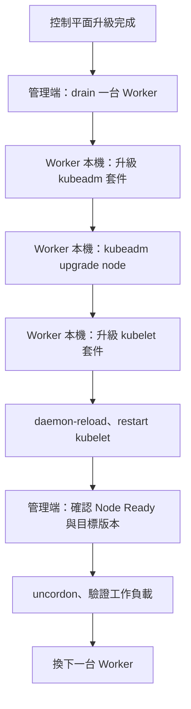

# K8s kubeadm 叢集升級：Control Plane 與 Worker

> [!important] 升級時優先開這兩份官方文件
> - [Changing The Kubernetes Package Repository](https://kubernetes.io/docs/tasks/administer-cluster/kubeadm/change-package-repository/)：**先切換目標 minor 的套件來源**。搜尋 `Switching to another`、`kubernetes.list`；依實際檔案編輯 URL，不一定要用 echo 重寫。
> - [Upgrading kubeadm clusters](https://kubernetes.io/docs/tasks/administer-cluster/kubeadm/kubeadm-upgrade/)：**再依完整流程升級**。搜尋 `Determine which version`、`madison`、`upgrade plan`、`upgrade apply`、`Upgrade kubelet and kubectl`。

## TL;DR

**先升級 kubeadm 工具，再用它升級控制平面／節點設定；drain 該節點後更新 kubelet，重啟並驗證，最後 uncordon。控制平面完成後再逐台處理 Worker。**

| 所在節點 | 使用的 kubeadm 指令 |
|---|---|
| 第一台 Control Plane | `kubeadm upgrade plan`，確認後 `kubeadm upgrade apply v1.xx.y` |
| 其他 Control Plane | `kubeadm upgrade node` |
| Worker | `kubeadm upgrade node`，不是再次執行 apply／join |

**APT 更新 kubeadm＝更新工具；kubeadm upgrade＝用工具更新控制平面／設定；APT 更新 kubelet＝更新 Node agent。三件事要分清楚。**

## 三種常見升級方式

| 方式 | 做法 | 需要留意 |
|---|---|---|
| 集中停機升級 | 安排維護時段，集中處理節點 | 可能整體停機；仍需遵守版本與元件升級順序 |
| 逐台原地升級 | drain 一台、更新、恢復，再換下一台 | 確保剩餘容量、副本數、PDB 與儲存允許撤離 |
| 新增節點替換 | 加入相容版本的新節點，再 drain 舊節點並移除 | 需要額外容量；不等於可以跳過控制平面升級 |

以下整理 **Debian／Ubuntu、自管 kubeadm 叢集的逐台原地升級**。不是 Deployment 的 RollingUpdate／Recreate 設定。

## 升級前：版本、備份與執行位置

| 檢查 | 記法 |
|---|---|
| minor version | 一次升一個 minor，例如 1.34 → 1.35，不直接跳到 1.36 |
| Version Skew Policy | kubelet 不可比會連到的 API Server 新；HA 混合版本要取相容範圍交集 |
| 套件庫 | pkgs.k8s.io 每個 minor 有獨立 repository；跨 minor 先換來源 |
| 備份與相容性 | 備份必要的 etcd／控制平面設定，確認 CNI、runtime 與其他外掛支援目標版本 |
| 管理端 | 有 kubeconfig 的終端，執行 kubectl drain／uncordon／get nodes |
| 被升級的 Node | 登入該 Node，執行 APT、kubeadm、systemctl |

```bash
kubectl get nodes -o wide
kubectl get pods -A -o wide
kubectl get pdb -A
```

版本範圍表見 [[K8s 考前快速總覽：易混淆觀念與重要指令#Version Skew Policy：元件可以差幾個版本？]]。

## 所有待升級節點共用：切換來源、更新 kubeadm

**在每台準備處理的 Node 上執行，不是只在管理端更新一次，就自動更新所有機器。**

**以下以目前 1.34.x、目標精確版本 `v1.35.0` 為例。** 先找實際套件來源；不能只更新 APT 索引，就期待 v1.34 的 repository 提供 v1.35 套件。

```bash
grep -R 'pkgs.k8s.io' /etc/apt/sources.list.d/
```

找到指向 `v1.34` 的檔案後，把來源 URL 改為 `v1.35`，其餘簽章設定保留。以下是傳統 `.list` 格式的例子；若實際是其他檔名或 `.sources` 格式，應修改查到的檔案。

```bash
sudo vi /etc/apt/sources.list.d/kubernetes.list
```

目標為 v1.35 的來源範例（signed-by 路徑以原設定為準）：

```text
deb [signed-by=/etc/apt/keyrings/kubernetes-apt-keyring.gpg] https://pkgs.k8s.io/core:/stable:/v1.35/deb/ /
```

重新取得套件索引、列出版本，確認存在 **1.35.0** 的完整套件版本；題目要求 exact version 時，不可任意改裝 1.35 的其他 patch：

```bash
sudo apt-get update
apt-cache madison kubeadm
apt-cache madison kubelet
apt-cache madison kubectl
```

再更新 kubeadm 工具：

```bash
sudo apt-mark unhold kubeadm &&
sudo apt-get install -y kubeadm='<目標完整套件版本>' &&
sudo apt-mark hold kubeadm &&
kubeadm version -o short
```

- `<目標完整套件版本>`：換成查到的 **1.35.0** 完整字串，包含套件後綴，不是直接貼佔位文字。例如查到 `1.35.0-1.1` 才使用 `kubeadm='1.35.0-1.1'`；實際後綴依套件庫輸出。
- 安裝後 `kubeadm version -o short` 應為 **v1.35.0**，再進行 plan／apply；`&&` 讓前一步失敗時停止後面的指令。
- `kubeadm upgrade apply` 的版本則寫 Kubernetes 版本，本例寫 `v1.35.0`，不含 Debian 套件後綴。
- `apt-get install` 可升級已安裝套件，這裡用它明確指定版本；不要直接整批 apt upgrade 就認為升級流程完成。
- 套件安裝失敗時先處理錯誤，不要繼續後面步驟。

官方：[Changing The Kubernetes Package Repository](https://kubernetes.io/docs/tasks/administer-cluster/kubeadm/change-package-repository/)。

## 第一台 Control Plane

### 1. 升級 kubeadm 後，先 plan 再 apply

在第一台 Control Plane（具 `/etc/kubernetes/admin.conf`）執行：

```bash
sudo kubeadm upgrade plan
sudo kubeadm upgrade apply v1.35.0
```

先閱讀 plan 並確認計畫，再執行 apply；本例明確指定 `v1.35.0`。如果題目版本不同，套件來源、完整套件版本與 apply 目標都要一起調整。

| 指令 | 作用 |
|---|---|
| `upgrade plan` | 檢查健康、可升級版本與元件設定，不執行實際升級 |
| `upgrade apply` | 升級 kubeadm 管理的控制平面元件及相關設定，不會替所有 Node 升級 kubelet 套件 |

CNI 的版本與升級依網路方案文件處理，不能假設 kubeadm 會代為升級 Cilium／Calico。

### 2. drain，再更新這台的 kubelet

**管理端**（controlplane 換成實際 Node 名稱）：

```bash
kubectl drain controlplane --ignore-daemonsets
```

確認 drain 成功後，在 **Control Plane 本機**：

```bash
sudo apt-mark unhold kubelet kubectl
sudo apt-get install -y kubelet='<目標完整套件版本>' kubectl='<目標完整套件版本>'
sudo apt-mark hold kubelet kubectl
sudo systemctl daemon-reload
sudo systemctl restart kubelet
systemctl is-active kubelet
```

`kubectl` 套件在此一併更新；Worker 若未安裝 kubectl，不必為此特別安裝。此處是官方流程中先完成控制平面升級，再於 kubelet 升級前 drain；不是把所有主機一次排空。

### 3. 驗證與恢復排程

**管理端**：

```bash
kubectl get nodes -o wide
kubectl get pods -n kube-system -o wide
kubectl uncordon controlplane
kubectl get nodes
```

先確認 kubelet 恢復、Node Ready、VERSION 為目標 **v1.35.0**，以及控制平面正常，再 uncordon。若只有單一 Control Plane，升級期間 API 可能短暫不可用，不等於執行中的應用容器必然立即停止。

## 其他 Control Plane

| 順序 | 在哪裡 | 操作 |
|---|---|---|
| 1 | 該 Control Plane 本機 | 切換來源、更新 kubeadm 工具 |
| 2 | 該 Control Plane 本機 | `sudo kubeadm upgrade node`，取代第一台的 plan／apply |
| 3 | 管理端 | drain 這台 Control Plane |
| 4 | 該 Control Plane 本機 | 更新 kubelet／kubectl，daemon-reload、restart kubelet |
| 5 | 管理端 | 確認 Ready 與元件正常，uncordon |

Control Plane 逐台完成，維持控制平面與 etcd 所需可用性；不能為了「更快」同時重啟所有成員。HA 與 quorum 見 [[K8s HA、Quorum 與 Split-brain]]。

## Worker：逐台處理，以 worker-node-1 為例

| 順序 | 執行位置 | 操作 |
|---|---|---|
| 1 | 管理端 | drain worker-node-1，撤離可驅逐的工作負載 |
| 2 | worker-node-1 | 依共用段落切換來源、更新 kubeadm 工具 |
| 3 | worker-node-1 | `sudo kubeadm upgrade node`，更新本機 kubelet 設定 |
| 4 | worker-node-1 | 更新 kubelet 套件、重新載入服務設定並重啟 |
| 5 | 管理端 | 驗證 Ready、版本、工作負載，再 uncordon |

先在 **管理端**：

```bash
kubectl drain worker-node-1 --ignore-daemonsets
```

登入 **worker-node-1**，完成前面的 kubeadm 套件更新，再執行：

```bash
sudo kubeadm upgrade node

sudo apt-mark unhold kubelet
sudo apt-get install -y kubelet='<目標完整套件版本>'
sudo apt-mark hold kubelet

sudo systemctl daemon-reload
sudo systemctl restart kubelet
systemctl is-active kubelet
```

回到 **管理端**：

```bash
kubectl get nodes -o wide
kubectl uncordon worker-node-1
kubectl get nodes -o wide
kubectl get pods -A -o wide
```

確認完成，再處理下一台 Worker；不需要重新執行 `kubeadm join`。



## 驗證與常見混淆

| 現象／指令 | 解讀 |
|---|---|
| `kubeadm version` | 本機 kubeadm 工具版本，不是整個叢集版本 |
| `kubectl get nodes` 的 VERSION | 該 Node 的 kubelet 版本，不代表所有控制平面元件都已升級 |
| `Ready,SchedulingDisabled` | Node 健康但仍被 cordon；完成維護後 uncordon |
| `systemctl restart kubelet` | 啟動目前已安裝的 kubelet；未更新套件不會憑空變新版 |
| drain 遇到 DaemonSet | `--ignore-daemonsets` 略過保留；不是刪除它們 |
| drain 被 PDB／獨立 Pod／emptyDir 阻擋 | 查明原因；不要直接把 force、delete-emptydir-data 當通用解法 |
| 升級後替代 Pod Pending | 可能是剩餘資源、排程或儲存條件不符，不一定是套件升級失敗 |

- 驗證每台 Node Ready、版本符合計畫、控制平面／CNI／CoreDNS 正常，以及應用流量與資料。
- `cordon＝封住`、`drain＝排空`、`uncordon＝解封`；完整維護行為見 [[K8s kubectl 常用指令#Node 維護：cordon、drain、uncordon]]。
- 安裝新叢集與加入新節點，另見 [[K8s kubeadm 安裝：containerd、init 與 join]]。

## 官方文件與查找關鍵詞

| 官方連結 | 查什麼／關鍵詞 |
|---|---|
| [Upgrading kubeadm clusters](https://kubernetes.io/docs/tasks/administer-cluster/kubeadm/kubeadm-upgrade/) | Control Plane 升級；`upgrade plan`、`upgrade apply`、`Upgrade kubelet and kubectl` |
| [Upgrading Linux nodes](https://kubernetes.io/docs/tasks/administer-cluster/kubeadm/upgrading-linux-nodes/) | Worker 流程；`upgrade node`、`drain`、`restart kubelet` |
| [Changing The Kubernetes Package Repository](https://kubernetes.io/docs/tasks/administer-cluster/kubeadm/change-package-repository/) | 切換 minor 套件庫；`pkgs.k8s.io`、`kubernetes.list` |
| [Version Skew Policy](https://kubernetes.io/releases/version-skew-policy/) | 元件版本差距、升級順序；`supported component upgrade order` |
| [Safely Drain a Node](https://kubernetes.io/docs/tasks/administer-cluster/safely-drain-node/) | 維護與撤離；`drain`、`uncordon` |
