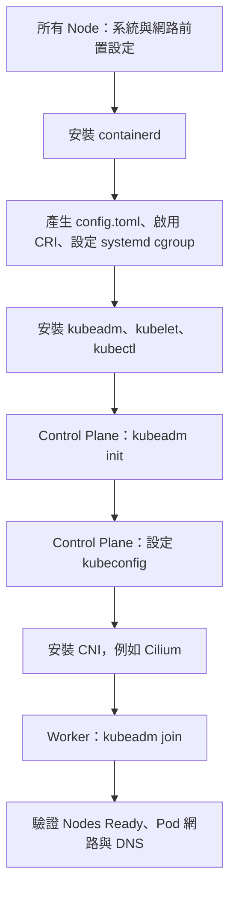

# K8s kubeadm 安裝：containerd、init 與 join

## TL;DR

**每台 Node 先準備 Linux、containerd、kubelet／kubeadm；Control Plane 執行 `kubeadm init`；安裝 CNI；Worker 執行 `kubeadm join`。**



| 元件 | 工作 |
|---|---|
| containerd | 容器 runtime，負責映像與容器生命週期 |
| kubelet | 每個 Node 的 agent，透過 CRI 請 runtime 執行 Pod |
| kubeadm | 初始化叢集、加入節點 |
| kubectl | 透過 API Server 管理叢集；Worker 不一定需要安裝 |
| CNI | 建立 Pod 網路；kubeadm 不會替你安裝完整的網路方案 |

以下是 **Debian／Ubuntu、systemd、新建雙節點 lab** 的操作範例，不是已執行成功的部署紀錄。Control Plane 與 Worker 要有不同 hostname、唯一的 MAC／product UUID，IP 互通且能取得所需套件與映像。Control Plane 至少 2 CPU，主機至少 2 GiB RAM，實際需求隨工作負載增加。

版本範例選 Kubernetes **v1.36**、Cilium **1.20.4**；這組 Kubernetes minor 列在 Cilium 1.20 的測試相容範圍內，不表示它是唯一或永遠最新的版本。安裝前確認目標版本與 containerd／CNI 相容，兩台新節點使用一致的 Kubernetes 套件版本。IP、版本與網段都要依環境調整。

## 1. 所有 Node：Linux 前置設定

分別設定 hostname，例如 Control Plane 用 `k8s-master`，Worker 用 `k8s-worker1`：

```bash
sudo hostnamectl set-hostname k8s-master
```

Worker 要換成自己的名稱，不要兩台都貼同一個。查看 IP、kernel 與 swap：

```bash
ip -br addr
uname -r
swapon --show
```

本 lab 採最簡單的停用 swap 配置：

```bash
sudo swapoff -a
sudoedit /etc/fstab
```

在 `/etc/fstab` 註解對應 swap 項目，若使用 zram／其他服務建立 swap，也要處理其開機設定。**只執行 swapoff 是暫時停用。** Kubernetes 可以明確配置 swap 支援，但不是本流程的範圍。

載入常見網路與容器所需模組：

```bash
cat <<'EOF' | sudo tee /etc/modules-load.d/k8s.conf
overlay
br_netfilter
EOF
sudo modprobe overlay
sudo modprobe br_netfilter

cat <<'EOF' | sudo tee /etc/sysctl.d/k8s.conf
net.ipv4.ip_forward = 1
net.bridge.bridge-nf-call-iptables = 1
net.bridge.bridge-nf-call-ip6tables = 1
EOF
sudo sysctl --system
```

Bridge 相關設定依網路方案需求決定，不是所有 CNI 都走 Linux bridge。確認防火牆依官方需求放行，例如 Node 能到 API Server TCP 6443、Control Plane 能到 kubelet TCP 10250，以及 CNI 使用的節點間流量；不要只開 6443 就認定網路完整。etcd 2379／2380 不應為了 Worker join 任意對外開放。

## 2. 所有 Node：安裝並設定 containerd

使用發行版套件的基本方式：

```bash
sudo apt-get update
sudo apt-get install -y containerd
containerd --version
```

套件名稱／版本依 Debian／Ubuntu release 而異；若套件庫提供的版本不符合目標 Kubernetes，應改依 [containerd 官方安裝方式](https://github.com/containerd/containerd/blob/main/docs/getting-started.md) 安裝相容版本，不要把 apt 可安裝等同於相容。不要在既有 Docker／runtime 主機上混裝衝突套件。

### 產生 /etc/containerd/config.toml

**你要記的指令就是 `containerd config default`：輸出預設設定，再寫入檔案。它不是 `containerd init`。**

```bash
sudo mkdir -p /etc/containerd
containerd config default | sudo tee /etc/containerd/config.toml > /dev/null
```

官方常見寫法是 `containerd config default > /etc/containerd/config.toml`，這需要 shell 本身有寫入權限；一般使用者用上面的 `sudo tee`。**會覆寫既有設定**，已配置 registry mirror 等內容時先備份、合併，不要直接重置。

### 啟用 CRI、設定 SystemdCgroup

編輯剛產生的設定：

```bash
sudoedit /etc/containerd/config.toml
```

確認 `disabled_plugins` **沒有包含 `cri`**。`.deb` 等套件提供的設定可能停用 CRI；Kubernetes 需要它才能使用 containerd。

將 runc options 的 `SystemdCgroup` 設為 `true`，plugin 路徑依 containerd 主版本不同：

```toml
# containerd 1.x
[plugins."io.containerd.grpc.v1.cri".containerd.runtimes.runc.options]
  SystemdCgroup = true
```

```toml
# containerd 2.x
[plugins.'io.containerd.cri.v1.runtime'.containerd.runtimes.runc.options]
  SystemdCgroup = true
```

只改自己版本對應的設定，不要把兩套都貼進去。systemd 主機讓 kubelet 與 runtime 採一致的 systemd cgroup driver，避免衝突。

```bash
sudo systemctl enable --now containerd
sudo systemctl restart containerd
systemctl is-active containerd
sudo containerd config dump | grep -E 'SystemdCgroup|disabled_plugins'
```

這套 **產生設定 → 確認 CRI → 設定 cgroup → restart** 的程序，適用於相關 Linux 安裝情境，不是 Debian 才有的特殊 init 指令。

## 3. 所有 Node：安裝 kubeadm、kubelet、kubectl

使用 `pkgs.k8s.io`；每個 Kubernetes minor 有自己的套件庫。本例設定 v1.36，若要換版本，先確認相容性，再同步更改套件庫與 init 目標。

```bash
sudo apt-get update
sudo apt-get install -y apt-transport-https ca-certificates curl gpg
sudo mkdir -p -m 755 /etc/apt/keyrings

curl -fsSL https://pkgs.k8s.io/core:/stable:/v1.36/deb/Release.key \
  | sudo gpg --dearmor -o /etc/apt/keyrings/kubernetes-apt-keyring.gpg

echo 'deb [signed-by=/etc/apt/keyrings/kubernetes-apt-keyring.gpg] https://pkgs.k8s.io/core:/stable:/v1.36/deb/ /' \
  | sudo tee /etc/apt/sources.list.d/kubernetes.list

sudo apt-get update
sudo apt-get install -y kubelet kubeadm kubectl
sudo apt-mark hold kubelet kubeadm kubectl
sudo systemctl enable --now kubelet

kubeadm version -o short
kubelet --version
kubectl version --client
```

舊版 Debian／Ubuntu 可能沒有 `/etc/apt/keyrings`，所以先建立。套件庫的 Release.key 是 **APT 套件簽章驗證用公鑰，不是 Kubernetes 叢集 CA**。`apt-mark hold` 避免一般套件更新時意外升級 Kubernetes；叢集升級需走專用流程。

init／join 前，kubelet 可能因尚未取得設定而反覆重啟；先確認 runtime 正常，再繼續初始化。

## 4. 只在 Control Plane：kubeadm init

以下 `192.168.64.10` 是範例，要換成 Worker 可以連到的 Control Plane IP。使用已安裝 kubeadm 的完整版本初始化：

```bash
sudo kubeadm init \
  --kubernetes-version="$(kubeadm version -o short)" \
  --apiserver-advertise-address=192.168.64.10 \
  --cri-socket=unix:///run/containerd/containerd.sock
```

本例保留 kube-proxy，Cilium 使用一般 kubeadm 安裝流程。若網路方案需要 `--pod-network-cidr`，須在 init 前決定；Pod、Service 網段不能與主機／VPN 等網段重疊。不要把 Flannel／Calico 的 CIDR 範例直接混進不同 Cilium IPAM 模式。

成功後保留輸出的 `kubeadm join ...` 指令。kubeadm 會準備控制平面設定與憑證，細節見 [[K8s 的 Certificate]]。

設定目前使用者的 kubeconfig（若已有檔案先備份／合併）：

```bash
mkdir -p "$HOME/.kube"
sudo cp -i /etc/kubernetes/admin.conf "$HOME/.kube/config"
sudo chown "$(id -u):$(id -g)" "$HOME/.kube/config"
chmod 600 "$HOME/.kube/config"
kubectl get nodes
```

如果已設定 `KUBECONFIG` 指向其他檔案，要確認 kubectl 實際讀取的設定。此時 `NotReady` 可能是 CNI 尚未安裝，仍要用 Events 確認。

## 5. Control Plane：安裝 Cilium CNI

Linux 上安裝 Cilium CLI（含 amd64／arm64 判斷與下載校驗）：

```bash
CILIUM_CLI_VERSION=$(curl -fsSL https://raw.githubusercontent.com/cilium/cilium-cli/main/stable.txt)
CLI_ARCH=amd64
if [ "$(uname -m)" = "aarch64" ]; then CLI_ARCH=arm64; fi
curl -L --fail --remote-name-all \
  "https://github.com/cilium/cilium-cli/releases/download/${CILIUM_CLI_VERSION}/cilium-linux-${CLI_ARCH}.tar.gz" \
  "https://github.com/cilium/cilium-cli/releases/download/${CILIUM_CLI_VERSION}/cilium-linux-${CLI_ARCH}.tar.gz.sha256sum"
sha256sum --check "cilium-linux-${CLI_ARCH}.tar.gz.sha256sum"
sudo tar -xzf "cilium-linux-${CLI_ARCH}.tar.gz" -C /usr/local/bin cilium
```

校驗通過再解壓；安裝與核對版本以所用 Cilium CLI 的 `cilium install --help` 為準。依目前官方快速安裝範例：

```bash
cilium install 1.20.4
```

Cilium 的 cluster-pool Pod CIDR 也需要避開既有網段；若需自訂，依該版本 IPAM 文件在安裝時設定。一般使用不需要同時安裝 Flannel、Calico 等另一套 CNI。

## 6. 只在 Worker：kubeadm join

Worker 完成步驟 1～3 後，執行 init 輸出的指令，例如：

```bash
sudo kubeadm join 192.168.64.10:6443 \
  --token <TOKEN> \
  --discovery-token-ca-cert-hash sha256:<CA_PUBLIC_KEY_HASH> \
  --cri-socket=unix:///run/containerd/containerd.sock
```

`<TOKEN>` 等是佔位文字，要換成實際輸出，不可原樣貼上。

| 參數 | 作用 |
|---|---|
| API Server 位址 | Worker 要加入哪個叢集 |
| `--token` | bootstrap 驗證，讓新節點開始加入程序 |
| `--discovery-token-ca-cert-hash` | 驗證所信任 CA 的公鑰雜湊，防止連錯控制平面 |
| `--cri-socket` | 選擇此節點上的 runtime endpoint |

不需要把 `admin.conf` 複製給 Worker 才能 join。一般 Worker join 不帶 `--control-plane`；加入另一台 Control Plane 是不同流程。

join 指令不見或 token 過期時，回 **Control Plane** 重新產生：

```bash
sudo kubeadm token create --print-join-command
```

Bootstrap token 預設有效期為 24 小時，並非重新 join 失敗就要重建叢集。

## 7. 驗證與排錯

回 Control Plane：

```bash
kubectl get nodes -o wide
kubectl get pods -A -o wide
cilium status --wait
```

先確認 Nodes Ready、Cilium／CoreDNS 正常，再測 Pod 互通、Service 與 DNS；可執行 `cilium connectivity test`，它會建立測試資源。Worker 的 ROLES 顯示 `<none>` 不代表 join 失敗，應看 Node Ready 與實際工作負載。

| 現象 | 先檢查 |
|---|---|
| init／join 提示 swap | swap 是否真的停用、重開機設定是否持久 |
| runtime／CRI 錯誤 | containerd 狀態、CRI plugin、socket、版本相容性 |
| cgroup 相關錯誤 | kubelet 與 containerd driver 是否一致、設定是否改對版本區段 |
| join timeout | API Server 位址、路由、防火牆與 TCP 6443 |
| Node NotReady、Pod sandbox 失敗 | CNI 狀態、Pod CIDR、節點間連通與 Events |

在出問題的 Node 查本機服務：

```bash
sudo journalctl -u kubelet -n 80 --no-pager
sudo journalctl -u containerd -n 80 --no-pager
sudo crictl --runtime-endpoint unix:///run/containerd/containerd.sock info
```

Node 端診斷與 API Server 啟動流程見 [[K8s kubelet 與 Pod 執行流程]]；runtime 角色見 [[K8s Container Runtime 與 dockershim 遷移]]。

## 官方文件與搜尋關鍵詞

- [Installing kubeadm](https://kubernetes.io/docs/setup/production-environment/tools/kubeadm/install-kubeadm/)：`install kubeadm`、`Debian-based distributions`、`pkgs.k8s.io`。
- [Container Runtimes](https://kubernetes.io/docs/setup/production-environment/container-runtimes/)：`containerd config default`、`disabled_plugins`、`SystemdCgroup`。你記得的重設 config.toml 說明在這頁的 containerd 區段。
- [Creating a cluster with kubeadm](https://kubernetes.io/docs/setup/production-environment/tools/kubeadm/create-cluster-kubeadm/)：`kubeadm init`、`pod network`、`join nodes`。
- [Cilium kubeadm 安裝](https://docs.cilium.io/en/stable/installation/k8s-install-kubeadm/)、[Cilium 快速安裝](https://docs.cilium.io/en/stable/gettingstarted/k8s-install-default/)、[Kubernetes 相容性](https://docs.cilium.io/en/stable/network/kubernetes/compatibility/)。
