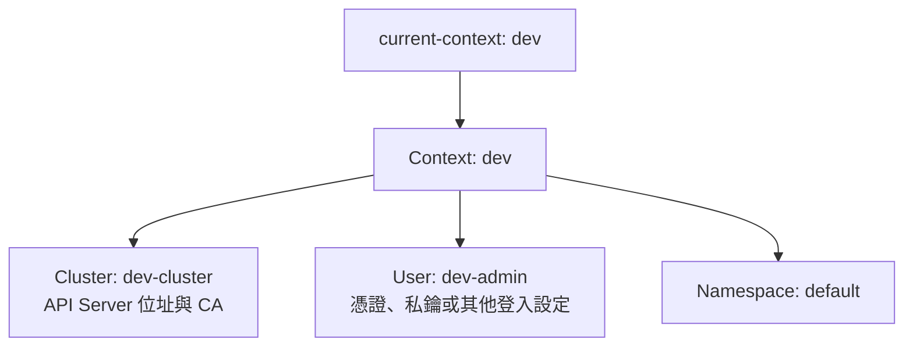

# K8s kubeconfig、Context 與多叢集管理

**kubeconfig 記錄「連哪個叢集、用誰的身分、預設哪個 Namespace」；Context 把這三件事組合起來。** 同一份設定可以管理 dev／prod 多個叢集，也能讓同一叢集有多個 Context。

憑證與私鑰的用途見 [[K8s 的 Certificate]]；其他操作見 [[K8s kubectl 常用指令]]。

## 四個重要欄位

| 欄位 | 用途 |
|---|---|
| `clusters` | API Server 位址與信任 CA |
| `users` | 身分驗證設定，例如 Client 憑證＋私鑰、Token、exec 外部登入 |
| `contexts` | 組合 Cluster、User 與預設 Namespace |
| `current-context` | 預設使用哪個 Context |



**`users[].name` 是 kubeconfig 裡的參照名稱，不會直接變成 K8s 身分，也不會因為叫 admin 就有管理權限。** 憑證式登入的身分由受信任憑證內容決定，能做什麼再看授權。

## dev／prod：同一個 kubeconfig 的範例

常見檔案是 `~/.kube/config`。以下 IP、名稱與路徑皆為示意值：

```yaml
apiVersion: v1
kind: Config
clusters:
  - name: dev-cluster
    cluster:
      server: https://10.10.0.10:6443
      certificate-authority: /home/user/.kube/dev-ca.crt
  - name: prod-cluster
    cluster:
      server: https://10.20.0.10:6443
      certificate-authority: /home/user/.kube/prod-ca.crt
users:
  - name: dev-admin
    user:
      client-certificate: /home/user/.kube/dev-admin.crt
      client-key: /home/user/.kube/dev-admin.key
  - name: prod-admin
    user:
      client-certificate: /home/user/.kube/prod-admin.crt
      client-key: /home/user/.kube/prod-admin.key
contexts:
  - name: dev
    context:
      cluster: dev-cluster
      user: dev-admin
      namespace: default
  - name: prod
    context:
      cluster: prod-cluster
      user: prod-admin
      namespace: default
current-context: dev
```

`certificate-authority` 是用來驗證 API Server 的 CA；`client-certificate`／`client-key` 是你用來證明身分的那一組。也能用 `certificate-authority-data`／`client-certificate-data`／`client-key-data` 將資料嵌在 kubeconfig 裡，見 [[K8s 的 Certificate#手動建立與 kubeadm：身分相同，建立方式不同|kubeadm 的憑證存法]]。

## 切換 Context 與 Namespace：重要指令

```bash
kubectl config get-contexts                 # 列出 Context，* 是目前選擇
kubectl config current-context              # 顯示目前 Context
kubectl config use-context prod             # 修改預設 Context
kubectl config use-context dev

kubectl --context dev get nodes             # 單次指定 Context，不修改預設
kubectl --context prod get nodes
kubectl --context dev -n ntub-secumanage get pods

kubectl config view --minify                # 查看目前 Context 的設定組合
```

**`--context` 指定的是 Context，不是 Cluster 名稱。** `kubectl get pods -A` 是目前目標叢集的所有 Namespace，不是所有叢集。

### 同一個 Cluster 也能有多個 Context

兩個 Context 指向同一個 `dev-cluster` 與 `dev-admin`，只改預設 Namespace：

```bash
kubectl config set-context dev-default --cluster=dev-cluster --user=dev-admin --namespace=default
kubectl config set-context dev-isms --cluster=dev-cluster --user=dev-admin --namespace=ntub-secumanage
kubectl config use-context dev-isms
kubectl get pods                            # dev-cluster 的 ntub-secumanage
```

修改目前 Context 的預設 Namespace：

```bash
kubectl config set-context --current --namespace=ntub-secumanage
```

`-n` 可覆蓋這個預設值；Context 的 Namespace 設定不是權限限制，也不會替你建立 Namespace。

## 指定 kubeconfig：--kubeconfig、KUBECONFIG、預設路徑

**讀取順序：`--kubeconfig` → 非空的 `KUBECONFIG` → `~/.kube/config`。**

| 方式 | 效果 |
|---|---|
| `kubectl --kubeconfig=/root/my-kube-config ...` | 這次只讀指定檔案，不合併其他 kubeconfig |
| `export KUBECONFIG=/root/my-kube-config` | 目前 Shell 與繼承此環境的程序改讀此檔案 |
| 不指定以上兩者 | 使用目前使用者的 `~/.kube/config` |

`KUBECONFIG` 是更改讀取位置，不是搬移或覆寫原本的 `~/.kube/config`。

### 跨 Shell Session 保存：Bash

假設檔案確實是 `/root/my-kube-config`，在 root 使用者的 Bash 執行一次：

```bash
echo 'export KUBECONFIG=/root/my-kube-config' >> ~/.bashrc
source ~/.bashrc

printf '%s\n' "$KUBECONFIG"
kubectl config get-contexts
kubectl cluster-info                        # 同時確認 API Server 可連線
```

**Bash 的互動式非登入 Shell 會讀 `.bashrc`；登入 Shell 不保證自動讀它。** 登入時會讀 `/etc/profile`，再讀 `~/.bash_profile`、`~/.bash_login`、`~/.profile` 中第一個存在且可讀的檔案。要確保重新登入也生效，檢查實際使用的登入設定檔是否載入 `.bashrc`；若沒有，可在該檔加入：

```bash
if [ -f "$HOME/.bashrc" ]; then
    . "$HOME/.bashrc"
fi
```

不要只因寫進 `.bashrc` 就保證所有登入方式、sudo、排程或系統服務都會繼承。持久保存的是設定檔內容；每次新程序啟動仍需載入設定。以上是記錄用指令，不代表已修改本機 Shell。

### Zsh，例如 macOS

改用實際檔案路徑，加入目前使用者的 `.zshrc`：

```bash
echo 'export KUBECONFIG="$HOME/my-kube-config"' >> ~/.zshrc
source ~/.zshrc
```

這是互動式 Zsh 的設定；非互動式程序仍需另行配置環境。重複追加會產生重複設定，已有相同設定時直接修改原行即可。

## 兩份 kubeconfig：合併讀取，不必手動重寫 YAML

保留 `~/.kube/config-dev` 與 `~/.kube/config-prod`：

```bash
export KUBECONFIG="$HOME/.kube/config-dev:$HOME/.kube/config-prod"
kubectl config get-contexts
kubectl --context dev get nodes
kubectl --context prod get nodes
```

macOS／Linux 用 `:` 分隔；Windows 用 `;`。**這只是合併讀取，不是產生一份新的合併檔。** 要跨 Session 保留，同樣將這行 export 放入適當 Shell 設定檔。

合併時同名 Cluster／User／Context 可能衝突，通常是**先出現的檔案所定義的鍵值優先**，不是把同名欄位任意拼成完整資料；應先使用可區分環境的名稱。`use-context`、`set-context` 等修改指令可能寫回來源設定檔，不是全部都只在記憶體切換。

MicroK8s 可用 `microk8s config` 匯出各叢集設定；整合前確認匯出的名稱、API Server 位址可達性，以及憑證信任，而不是兩份都保留相同名稱。

## kubectx／kubens：快速切換工具

它們操作的仍是 kubeconfig，不是另外一套 Cluster 或 Namespace。

```bash
brew install kubectx                        # 提供 kubectx 與 kubens
brew install fzf                            # 選用：互動式模糊搜尋
```

| 指令 | 功能 |
|---|---|
| `kubectx` | 列出 Context；有 fzf 且符合互動條件時提供選單 |
| `kubectx dev`／`kubectx prod` | 切換 Context |
| `kubectx -` | 切回前一個 Context |
| `kubectx -c` | 顯示目前 Context |
| `kubectx new=old` | 將 Context 從 old 改名為 new |
| `kubens` | 列出 Namespace；有 fzf 時可互動選擇 |
| `kubens ntub-secumanage` | 修改目前 Context 的預設 Namespace |
| `kubens default`／`kubens -` | 切到 default／前一個 Namespace |

例如 `kubectx dev` → `kubens ntub-secumanage` → `kubectl get pods`，就是查 dev Context 所指向叢集中的 ntub-secumanage。終端提示字元也可顯示 Context／Namespace，方便確認目標。

## 官方參考與查找關鍵詞

- [Organizing Cluster Access Using kubeconfig Files](https://kubernetes.io/docs/concepts/configuration/organize-cluster-access-kubeconfig/)：讀取順序、合併規則；搜尋 `Kubernetes kubeconfig context KUBECONFIG`。
- [Configure Access to Multiple Clusters](https://kubernetes.io/docs/tasks/access-application-cluster/configure-access-multiple-clusters/)：多叢集設定範例；搜尋 `configure access multiple clusters`。
- [kubectx／kubens 專案](https://github.com/ahmetb/kubectx)：指令與 fzf 整合；搜尋 `kubectx kubens fzf`。
- [Bash Startup Files](https://www.gnu.org/software/bash/manual/html_node/Bash-Startup-Files)：登入與非登入 Shell 的設定檔差異。
