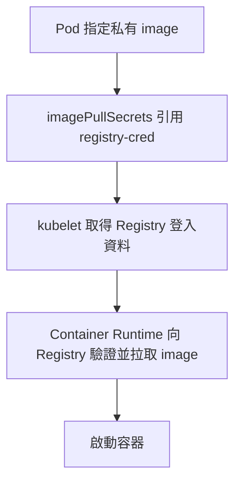

# K8s kubectl 常用指令

以現場能記住、直接打出來為原則：優先使用內建縮寫，每個情境先記一個主要寫法。

## 先設定 k 與常用縮寫

```bash
alias k=kubectl
```

以下用 `k` 代表 `kubectl`。alias 只對目前 shell 生效；換到新環境時先設定，或直接改打 `kubectl`。

| 寫法 | 意義 |
|---|---|
| `po` | pods |
| `deploy` | deployments |
| `svc` | services |
| `ns` | namespaces |
| `pc` | priorityclasses |
| `cm` | configmaps |
| `sa` | serviceaccounts |
| `-n lab` | 指定 namespace 為 lab |
| `-A` | 所有 namespaces |
| `-o yaml` | 輸出 YAML |
| `-o wide` | 顯示 IP、Node 等額外資訊 |

資源縮寫不一定能套到每個子命令；例如建立 Service 使用 `k create service`。

## kubeconfig 與操作目標

**Context＝Cluster＋User＋預設 Namespace。** `kubectl config get-contexts` 查看、`kubectl config use-context <名稱>` 切換；單次指定用 `kubectl --context <名稱> ...`。完整 YAML、KUBECONFIG 持久設定與 kubectx／kubens 見 [[K8s kubeconfig、Context 與多叢集管理]]。

## API Group 與 apiVersion：資源屬於哪一組

**API Group 是資源種類的分組；`apiVersion` 通常寫成「群組／版本」，`kind` 再指定這一組裡的資源種類。** 不是使用者群組，也不是 Namespace。

```yaml
apiVersion: certificates.k8s.io/v1
kind: CertificateSigningRequest
```

上例表示使用 `certificates.k8s.io` 群組、`v1` 版本中的 CSR。**Core 核心群組是特例，`apiVersion` 直接寫 `v1`，不是 `core/v1`。**

### 常見資源對照

| 資源 kind | API Group | apiVersion |
|---|---|---|
| Pod、Service、Secret、ConfigMap、Namespace、Node | Core（群組名稱為空） | `v1` |
| PersistentVolume、PersistentVolumeClaim | Core（群組名稱為空） | `v1` |
| Deployment、ReplicaSet、StatefulSet、DaemonSet | `apps` | `apps/v1` |
| Job、CronJob | `batch` | `batch/v1` |
| Ingress、NetworkPolicy | `networking.k8s.io` | `networking.k8s.io/v1` |
| CertificateSigningRequest | `certificates.k8s.io` | `certificates.k8s.io/v1` |
| Role、ClusterRole、RoleBinding、ClusterRoleBinding | `rbac.authorization.k8s.io` | `rbac.authorization.k8s.io/v1` |
| StorageClass、CSIDriver | `storage.k8s.io` | `storage.k8s.io/v1` |
| PriorityClass | `scheduling.k8s.io` | `scheduling.k8s.io/v1` |
| Gateway、HTTPRoute | `gateway.networking.k8s.io` | 常見 `gateway.networking.k8s.io/v1`；需先安裝對應 API 資源與 Controller |

表格是常用版本，**以目前叢集實際提供的版本為準**；有些資源可同時提供多個版本。API 版本的 `v1` 也不是指 Kubernetes 叢集版本。

### 查詢：api-resources 與 api-versions

```bash
k api-resources                             # 查資源、縮寫、版本、是否有 Namespace
k api-resources --api-group=certificates.k8s.io
k api-resources --api-group=apps
k api-resources --api-group=''               # Core 核心群組
k api-versions                              # 列出支援的群組／版本
```

**`api-resources` 查「有哪些資源」；`api-versions` 查「有哪些群組／版本」。** 查到資源後再用 `k explain` 查欄位。命令是複數 `api-resources`，不是 `api-resource`。

### curl 連 API Server 6443：/api 與 /apis

API Server 常見 HTTPS port 是 **6443**，但實際也可能透過其他 port 的 LB／Endpoint 連線。以下 `127.0.0.1` 是在控制平面本機的示例；其他主機改成可達的 API Server 位址。

```bash
curl -k https://127.0.0.1:6443/               # 根路徑，權限允許時可列 API 路徑
curl -k https://127.0.0.1:6443/api            # Core 群組的版本
curl -k https://127.0.0.1:6443/api/v1         # Core v1 的資源清單
curl -k https://127.0.0.1:6443/apis           # Named API Groups
curl -k https://127.0.0.1:6443/apis/apps/v1   # apps/v1 的資源清單
```

| API 類型 | URL 結構 | 例子 |
|---|---|---|
| Core | `/api/<版本>` | `/api/v1` |
| Named Group | `/apis/<群組>/<版本>` | `/apis/certificates.k8s.io/v1` |
| 取得資源物件 | 在版本路徑後指定資源／Namespace | `/api/v1/namespaces/default/pods` |

**`-k`（`--insecure`）只跳過伺服器憑證的信任鏈／名稱驗證，HTTPS 仍加密；它不會跳過身分驗證與授權。** 若出現 `401 Unauthorized` 或 `403 Forbidden`，不代表 `-k` 沒作用。匿名能否讀取 discovery 端點取決於叢集設定，不能保證只打 `curl -k` 就能列出內容。

有 Client 憑證與私鑰時，可以明確帶入；下列檔案路徑皆為示意：

```bash
curl --cacert /path/to/ca.crt \
  --cert /path/to/client.crt \
  --key /path/to/client.key \
  https://API_SERVER_IP:6443/apis
```

`--cacert` 用來驗證 Server；`--cert`／`--key` 是自己的 Client 身分。URL 的名稱／IP 仍需符合 Server 憑證 SAN。**curl 不會自動讀 kubeconfig 的登入設定。** 憑證角色見 [[K8s 的 Certificate]]。

若已有可用 kubeconfig，更直接用目前身分查看原始 API 回應：

```bash
k get --raw /api
k get --raw /apis
k get --raw /apis/apps/v1
```

參考：[API Groups](https://kubernetes.io/docs/reference/using-api/#api-groups)、[API Resource URI](https://kubernetes.io/docs/reference/using-api/api-concepts/#resource-uris)、[直接存取 Kubernetes API](https://kubernetes.io/docs/tasks/administer-cluster/access-cluster-api/)、[curl 憑證驗證與 -k](https://curl.se/docs/sslcerts.html)。搜尋詞：`Kubernetes API groups apiVersion`、`access cluster API curl`。

## explain：忘記 YAML 欄位時查什麼

```bash
# 查看 Pod 的欄位說明
k explain po

# 展開欄位結構：-R 是大寫，等同 --recursive
k explain po -R

# 逐層查，通常比展開整棵結構更容易讀
k explain po.spec
k explain po.spec.containers
k explain po.spec.containers.resources

# 只展開 containers 底下的結構
k explain po.spec.containers -R
```

`explain` 查資源的欄位定義；`describe` 查某個現有資源的狀態與事件。`explain` 需要從 API Server 取得 OpenAPI schema。

參數忘記時先查 `k explain -h`。本機 kubectl v1.37.1 支援 `-R`；其他環境若沒有這個短參數，就用 `--recursive`。

## JSONPath 與 custom-columns：大量資源只取需要的欄位

**先用 YAML 找欄位，再用 custom-columns 做表格；需要精確輸出、迴圈或陣列條件時才用 JSONPath。** 不必一次背完所有語法。

### 入門三步：先看一台，再處理多台

```bash
kubectl get node node01 -o yaml
```

找到 YAML 中的 status → nodeInfo → kubeletVersion，就把層級用點串起來：

```bash
kubectl get node node01 -o jsonpath='{.status.nodeInfo.kubeletVersion}{"\n"}'
```

node01 要換成實際名稱。查全部 Nodes 的同一欄位，因為回傳清單有 items 外層，改成：

```bash
kubectl get nodes -o jsonpath='{.items[*].status.nodeInfo.kubeletVersion}{"\n"}'
```

### items、索引、range 與欄位篩選

| 語法 | 用途 |
|---|---|
| `.metadata.name` | 單一物件的名稱 |
| `.items` | List 回應的物件清單；單一 Node 不用 items |
| `.items[*]` | 清單中的每個物件 |
| `.items[0]` | 第一個物件，index 從 0 開始；不是保證固定某一台 Node |
| `{range .items[*]}`…`{end}` | 逐一處理每個物件，range 裡的欄位相對於當前物件 |
| `{"\t"}`／`{"\n"}` | 插入 Tab／換行；Linux／macOS 常用外層單引號保留內容 |
| `[?(@.type=="InternalIP")]` | 篩選目前陣列中 type 符合的項目；@ 是當前項目 |

每台 Node 一行：名稱、可分配 CPU、kubelet 版本：

```bash
kubectl get nodes -o jsonpath='{range .items[*]}{.metadata.name}{"\t"}{.status.allocatable.cpu}{"\t"}{.status.nodeInfo.kubeletVersion}{"\n"}{end}'
```

查名稱與 InternalIP，不假設位址陣列的第一個一定是內部 IP：

```bash
kubectl get nodes -o jsonpath='{range .items[*]}{.metadata.name}{"\t"}{.status.addresses[?(@.type=="InternalIP")].address}{"\n"}{end}'
```

### 表格需求先用 custom-columns

```bash
kubectl get nodes -o custom-columns='NAME:.metadata.name,CPU:.status.allocatable.cpu,VERSION:.status.nodeInfo.kubeletVersion'
```

| 方法 | 適合用途 | 注意 |
|---|---|---|
| `-o yaml`／`-o json` | 先查看資料結構、找欄位路徑 | 不必靠記憶猜欄位 |
| `-o custom-columns` | 直接列出幾個欄位的表格 | `欄名:路徑`，逗號分欄；此種清單表格寫每個物件路徑，不加 items |
| `-o jsonpath` | 自訂字串輸出、range、陣列條件篩選 | 清單通常從 items 開始；不支援正規表示式篩選 |
| `-l key=value` | 先請 API Server 按 labels 篩選物件 | 與輸出格式可一起使用，縮小大量 Nodes 查詢範圍 |
| `--field-selector` | 依該資源支援的欄位在伺服器端篩選 | 不是任何 JSON 欄位都能用 |

例如先查具有 environment=prod label 的 Node，再列名稱與版本：

```bash
kubectl get nodes -l environment=prod -o custom-columns='NAME:.metadata.name,VERSION:.status.nodeInfo.kubeletVersion'
```

**JSONPath 是 kubectl 取回資料後擷取輸出，不是要求 API Server 只回傳那幾欄。** CPU allocatable 是可供配置的資源，不是 kubectl top 顯示的即時使用量。

JSONPath 的 `.spec.replicas` 是查詢表達式；JSON Patch 的 `/spec/replicas` 是 JSON Pointer 路徑，兩者用途不同。複雜統計、資料轉換或不支援的篩選可考慮另用 jq，不必把所有處理塞進 JSONPath。

官方：[JSONPath Support](https://kubernetes.io/docs/reference/kubectl/jsonpath/)。關鍵詞：`range end`、`items`、`filter`、`custom-columns`。

## 產生 YAML：先產生、再修改、再套用

最值得練熟的組合是 `--dry-run=client -o yaml`：產生物件定義，不建立資源；加上 `> 檔名.yaml` 存成檔案。

```bash
k run nginx --image=nginx --dry-run=client -o yaml > pod.yaml
# 編輯 pod.yaml 後套用
k apply -f pod.yaml
```

client dry-run 不代表伺服器一定接受設定，也不保證 Pod 能正常啟動；部分命令仍可能查詢 API Server。`expose` 指定既有 Pod／Deployment 時，即使 dry-run 也要先讀取來源資源。

## Pod

```bash
# 直接建立單一 Pod
k run nginx --image=nginx

# 只在畫面輸出 Pod YAML
k run nginx --image=nginx --dry-run=client -o yaml
```

`run` 建立的是 Pod。需要副本管理與更新時，用 Deployment；Pod 概念見 [[K8s 中的 Pod 是什麼]]。

## Deployment

```bash
# 建立 Deployment
k create deploy nginx --image=nginx

# 建立時指定 4 個副本：-r 是 --replicas 的縮寫
k create deploy nginx --image=nginx -r 4

# 產生有 4 個副本的 YAML，修改後再 apply
k create deploy nginx --image=nginx -r 4 --dry-run=client -o yaml > deploy.yaml
k apply -f deploy.yaml

# 調整既有 Deployment：scale 沒有 -r，要寫 --replicas
k scale deploy nginx --replicas=4
```

以上是不同操作情境，依需求選用；不要對同名的既有 Deployment 重複執行 `create`。

## Rollout 與回滾：不要只看 roll

> [!tip] 先記操作順序
> **更新 image → 看 status → 失敗查 describe／logs → history 找版本 → undo → 再看 status。** Rollout 是部署版本的過程；RollingUpdate 是逐批替換策略；Rollback 是回滾。

### RollingUpdate 與 Recreate

| 策略 | 行為 | 注意 |
|---|---|---|
| `RollingUpdate`（Deployment 預設） | 逐批建立新 Pod、減少舊 Pod | 更新中可能同時存在新舊版本 |
| `Recreate` | 先停止舊版本的 Pod，再建立新版本 | 通常會有服務中斷空窗 |

```yaml
# Deployment 的 spec 片段
strategy:
  type: RollingUpdate
  rollingUpdate:
    maxUnavailable: 0
    maxSurge: 1
```

`maxUnavailable: 0` 表示更新時不允許可用副本數低於期望數；`maxSurge: 1` 表示最多多建 1 個 Pod。這組設定需要額外資源，新 Pod 必須 Ready 才能繼續替換。兩者不可同時為 0；百分比時 unavailable 向下取整、surge 向上取整。**不代表任何環境都保證零停機**，仍要有正確 readiness probe 與應用程式關閉處理。

### 更新版本：set image、edit、apply 三選一

以下用 Deployment `nginx`、container 名稱 `nginx` 示範；image 版本依題目替換，所有命令使用同一個 namespace（需要時加 `-n`）。

```bash
# 先查 container 名稱與原 image，名稱不一定與 Deployment 相同
k get deploy nginx -o jsonpath='{.spec.template.spec.containers[*].name}{"\n"}{.spec.template.spec.containers[*].image}{"\n"}'

# 最直接：格式為 container名稱=image
k set image deploy/nginx nginx=nginx:1.28.0
k rollout status deploy/nginx --timeout=120s
```

另外兩種是替代寫法，不必連續做：

```bash
# 現場修改：找到 spec.template.spec.containers[].image
k edit deploy nginx

# 已有受管理的 manifest：修改檔案中的 image 後套用
k apply -f deploy.yaml
```

只有 **`.spec.template` 改變**才會觸發 Deployment 的新 rollout／revision，例如 image、command、args 或 Pod labels。`scale` 改副本數、修改 Deployment 本身的 annotation，不會單獨產生新 revision。

### 看進度、找失敗原因

```bash
k rollout status deploy/nginx --timeout=120s
k get deploy nginx
k get rs
k get po -o wide
k describe deploy nginx
# 替換成 get po 查到的新版本 Pod 名稱
k describe po <新Pod名稱>
k logs <新Pod名稱>
```

`get rs` 可看到新舊 ReplicaSet 的副本變化；`describe po` 看 Events，區分拉不到映像、排程失敗或 readiness 不通過。`status` timeout／`ProgressDeadlineExceeded` 只表示更新未完成，**不會自動回滾**。

### History 與 Undo：真正的回滾

```bash
# 看有哪些 revision，並檢視指定版本的 Pod template
k rollout history deploy/nginx
k rollout history deploy/nginx --revision=2

# 回到上一個保留的 revision
k rollout undo deploy/nginx
k rollout status deploy/nginx --timeout=120s

# 或明確回到指定 revision；先用 history 確認它仍存在
k rollout undo deploy/nginx --to-revision=2
k rollout status deploy/nginx --timeout=120s
```

上面兩種 undo 是不同選擇。Rollback 把舊 Pod template 重新部署，會形成新的 revision；revision 編號不是 image tag。Deployment 的 `spec.revisionHistoryLimit` 控制保留供回滾的舊 ReplicaSet 數量，預設 10；清掉的版本無法直接 undo 回去。

`undo` 不會還原資料庫、外部系統或獨立 ConfigMap／Secret 的歷史內容，也不會把副本數恢復成舊值。若用 Git／manifest 管理版本，回滾後也要同步修改來源，否則下次 apply 可能又改回出錯版本。

### Pause、Resume、Restart

```bash
# 暫停 Deployment 的更新調和，方便一次累積多項 template 變更
k rollout pause deploy/nginx
k set image deploy/nginx nginx=nginx:1.28.0
# 完成其他所需修改後，恢復並部署
k rollout resume deploy/nginx
k rollout status deploy/nginx --timeout=120s

# 另一個情境：沿用目前 image／設定，重新建立 Pod
k rollout restart deploy/nginx
k rollout status deploy/nginx --timeout=120s
```

Pause 不會停止已執行的容器，也不會撤回已完成的更新；**Paused 的 Deployment 要先 resume 才能 rollback**。Restart 會改 Pod template 的重啟時間 annotation，觸發替換；不是恢復上一版，也不是原地重啟同一個 Pod。

若希望 history 顯示更新原因，可在更新前或更新時設定 `kubernetes.io/change-cause` annotation；不必背已棄用的 `--record`：

```bash
k annotate deploy/nginx kubernetes.io/change-cause='update nginx to 1.28.0' --overwrite
```

這個 annotation 用來記錄說明，不會單獨觸發 rollout。`rollout` 也支援 DaemonSet／StatefulSet 的部分操作，但本節以 Deployment 為準，pause／resume 等能力不能一概套用。

參考：[Deployment 更新策略、歷史與回滾](https://kubernetes.io/docs/concepts/workloads/controllers/deployment/)、[kubectl rollout](https://kubernetes.io/docs/reference/kubectl/generated/kubectl_rollout/)。

## Service

### 五種常見用法：四種 type ＋ Headless

| 用法 | 設定 | DNS／流量行為 | 適合情境 |
|---|---|---|---|
| ClusterIP | `type: ClusterIP`，預設 | 穩定的叢集內虛擬 IP，轉送至後端 | 叢集內服務互連 |
| NodePort | `type: NodePort` | 透過 `NodeIP:nodePort` 存取 | 從叢集外使用 Node 的連接埠 |
| LoadBalancer | `type: LoadBalancer` | 交給 LB 實作提供外部入口 | 對外發布服務 |
| ExternalName | `type: ExternalName` ＋ `externalName` | DNS 回 CNAME，指向另一個 DNS 名稱 | 用叢集內名稱代表外部服務 |
| Headless | `type: ClusterIP` ＋ `clusterIP: None` | 不配置虛擬 IP；有 selector 時 DNS 可直接回後端 Pod 位址 | StatefulSet、用戶端自行選擇後端 |

**官方 `spec.type` 只有前四種**；Headless 是特殊設定，不存在 `type: Headless`。Ingress／Gateway 是另外的資源，也不是第五種 Service type。

先記三種 port：`port` 是 Service 的入口，`targetPort` 是後端 Pod 的目的埠，`nodePort` 是 Node 對外提供的入口，預設配置範圍通常是 30000–32767。一般選擇 Pod 的 Service，`selector` 必須對得上 Pod labels；ExternalName 不靠 selector 選後端。

### ClusterIP：優先 expose 既有資源

```bash
# 前提：redis Pod 已存在；沿用它的 labels 選擇後端
k expose po redis --port=6379 --name=redis-service

# 若只要產生 YAML，加上 dry-run 與輸出參數
k expose po redis --port=6379 --name=redis-service --dry-run=client -o yaml > svc.yaml
```

預設為 ClusterIP；未指定 `--target-port` 時，這個例子的後端目的埠也是 6379。

### NodePort：產生 YAML，再指定 nodePort

```bash
# 前提：nginx Pod 已存在
k expose po nginx --type=NodePort --port=80 --name=nginx-service --dry-run=client -o yaml > svc.yaml
```

在產生的 YAML 中，於 `spec.ports` 的對應項目加上 `nodePort: 30080`：

```yaml
# svc.yaml 的 spec.ports 片段
ports:
  - port: 80
    targetPort: 80
    nodePort: 30080
```

修改後執行 `k apply -f svc.yaml`。`expose` 沒有直接指定 `--node-port` 的參數，這個做法能保留從來源推導的 selector。

### create service：另一種產生模板的方法

```bash
k create service clusterip redis --tcp=6379:6379 --dry-run=client -o yaml
k create service nodeport nginx --tcp=80:80 --node-port=30080 --dry-run=client -o yaml
```

`--tcp` 的順序是 `port:targetPort`。這兩條只輸出 YAML，沒有建立資源；產生的 Service 名稱分別是 redis 與 nginx。

`create service` 不會讀取 Pod labels，預設產生 `app=<Service 名稱>` 的 selector，也沒有直接指定 selector 的參數。相對地，`k run nginx --image=nginx` 預設產生的是 `run=nginx` label；兩者對不上，必須先改 YAML 的 `spec.selector`。因此平常優先記 `expose`。

### LoadBalancer：雲端與 MetalLB

```bash
# 前提：nginx Deployment 已存在
k expose deploy nginx --name=nginx-lb --type=LoadBalancer --port=80 --target-port=80
k get svc nginx-lb -w
```

看 `EXTERNAL-IP` 欄位，等 LB 控制器提供 IP 或主機名稱後，再依實際網路測試。`<pending>` 不一定是 Pod 壞了，可能是沒有 LB 實作、地址池不足，或供應商配置失敗；先查 `k describe svc nginx-lb`。

| 元件 | 負責的工作 |
|---|---|
| CNI，如 Calico／Cilium | Pod 網路與相關政策能力 |
| 雲端 LB 整合控制器 | 依 LoadBalancer Service 向雲端建立／設定負載平衡入口 |
| MetalLB | 在裸機／自架環境為 LoadBalancer Service 配發 IP，透過 L2 或 BGP 宣告可達性 |
| kube-proxy 或 Service 替代實作 | 實際將 Service 流量導向後端 Pod |

**自架叢集缺少的通常是 LoadBalancer 整合，不是「沒有雲端 CNI」**。已安裝 Calico 仍可能需要 MetalLB；若環境已有其他 LB 實作或 CNI 自帶並啟用相應功能，就不一定需要 MetalLB。

MetalLB 安裝後還需設定可用且不衝突的 `IPAddressPool`，並依模式配置 `L2Advertisement` 或 BGP peers／advertisement；只裝 Pod 不代表外部 IP 已能存取。L2 模式透過 ARP／NDP 宣告位址，BGP 模式需要路由器配合。MetalLB 不負責取代 Pod 的 CNI 網路。

LoadBalancer 通常會同時配置 ClusterIP 和 NodePort，但可依實作停用 NodePort 配置；不能死背所有 LB 都必須經過 NodePort。

### ExternalName：DNS 別名，不是代理

```bash
k create service externalname external-db --external-name=db.example.com
k get svc external-db
```

以 default namespace、cluster.local 為例，查 `external-db.default.svc.cluster.local` 會取得指向 `db.example.com` 的 CNAME，再由 DNS 解析目的位址。它沒有一般的 ClusterIP／Pod selector 轉送，也不會替你建立連線或改寫 HTTP Host／TLS 名稱。

`externalName` 填 **DNS 名稱**，不要把 IP 當成 DNS 別名填入；HTTP Host 或 HTTPS 憑證若不符合客戶端使用的名稱，仍可能失敗。

### Headless：直接找到後端

```bash
# 前提：nginx Deployment 已存在；沿用它的 selector
k expose deploy nginx --name=nginx-headless --port=80 --target-port=80 --cluster-ip=None
k get svc nginx-headless
```

`CLUSTER-IP` 顯示 `None` 是預期結果。一般帶 selector 的 Headless Service，DNS 回覆可用後端的位址，由客戶端決定連哪個，不透過 Service VIP 負載平衡。StatefulSet 常用它提供穩定的 Pod DNS 名稱，但 **Headless 本身不會建立 StatefulSet 或保證 Pod 永遠不換 IP**。

### Service 有建立，但連不到：先查什麼

```bash
k get svc
k describe svc nginx-service
k get endpointslices -l kubernetes.io/service-name=nginx-service
k get po --show-labels
```

`nginx-service` 換成實際名稱。沒有後端先看 selector／labels 與 Pod readiness；有後端再查 `targetPort`、應用程式是否監聽、NetworkPolicy 與網路路徑。ExternalName 的設計不同，不能要求它一定有 Pod endpoints。

DNS 與 Headless 的解析關係見 [[K8s CoreDNS、kubelet 與 resolv.conf]]；Pod 網路見 [[K8s CNI 比較：Cilium、Calico 與 Flannel]]。

參考：[Service 類型與 Headless](https://kubernetes.io/docs/concepts/services-networking/service/)、[MetalLB 的用途](https://metallb.io/)、[MetalLB 設定](https://metallb.io/configuration/)。

## RBAC 與 ServiceAccount

**Role／ClusterRole 定義能做什麼，Binding 決定授予誰。** 完整範例、ClusterRole 範圍、ServiceAccount、`kubectl auth can-i` 與建立指令見 [[K8s RBAC 與 ServiceAccount]]。

## ConfigMap：-f 和 --from-file 不一樣

ConfigMap／Secret 的用途、Pod 注入設定與 Sealed Secrets 見 [[K8s ConfigMap、Secret 與 Sealed Secrets]]。

```bash
# 檔案本身是 kind: ConfigMap 的完整資源定義
k create -f /root/my-scheduler-config.yaml -n kube-system

# 檔案是 KubeSchedulerConfiguration 等設定內容，把內容裝進 cm
k create cm my-scheduler-config --from-file=/root/my-scheduler-config.yaml -n kube-system
```

這兩條是不同情境，不要連續執行建立同名物件。`k create cm` 沒有 `-f`；`-f` 讓 create 讀取資源定義，`--from-file` 則把檔案內容存進 ConfigMap 的 data，預設 key 是檔名，須對上 Scheduler 掛載後的設定檔路徑。

```bash
k get cm my-scheduler-config -n kube-system -o yaml
k get sa -n kube-system
k get clusterrolebinding
k api-resources
```

ServiceAccount 用 `sa`；ClusterRoleBinding、ClusterRole、RoleBinding、Role 沒有內建資源短名，不能自行假定 `crb` 可用。忘記資源縮寫就查 api-resources 的 SHORTNAMES 欄；忘記子命令參數則用 `k create cm -h`、`k create pc -h`。

## Secret docker-registry：登入私有 Registry 拉取 image

> [!important] 重要官方範例：私有 Registry 拉取 image
> [Pull an Image from a Private Registry](https://kubernetes.io/docs/tasks/configure-pod-container/pull-image-private-registry/)
> 查 Registry Secret 建立、`.dockerconfigjson` 登入資料與 `imagePullSecrets`。搜尋關鍵詞：`pull image private registry`；頁內找 `Create a Secret`、`imagePullSecrets`。

**`kubectl create secret docker-registry` 建立的是 K8s 的 Registry 登入 Secret，讓 Node 拉取私有 image。** 不是安裝 Docker Registry，也不是 Docker Swarm 的 `docker secret`。

| 設定 | 代表什麼 |
|---|---|
| Secret 名稱，如 `registry-cred` | 自訂的 K8s 物件名稱 |
| Secret type：`kubernetes.io/dockerconfigjson` | 儲存 Docker 相容 Registry 登入設定 |
| data key：`.dockerconfigjson` | Registry 位址與登入資料的 JSON，儲存時為 Base64；Base64 不是加密 |
| Pod 的 `imagePullSecrets` | 告訴 kubelet 拉 image 時使用哪個 Secret |

### 1. 建立 Registry 登入 Secret

假設工作負載在 `default`，以下 Registry、帳號與密碼皆為示意，需換成實際值：

```bash
kubectl create secret docker-registry registry-cred \
  --docker-server=registry.example.com \
  --docker-username=example-user \
  --docker-password='EXAMPLE_PASSWORD_OR_TOKEN' \
  -n default
```

- `--docker-server`：image 所在 Registry 的位址，有非預設 port 時需包含 port。
- `--docker-username`／`--docker-password`：Registry 接受的帳號及密碼／Token，不是 K8s 管理者帳密。
- `--docker-email`：選用欄位，通常不用為了建立 Secret 特別填。
- 可在指令末尾加 `--dry-run=client -o yaml` 先產生 YAML，不建立物件。

若已經有包含有效登入資料的 Docker 設定檔，也可擇一匯入：

```bash
kubectl create secret generic registry-cred \
  --from-file=.dockerconfigjson=/path/to/config.json \
  --type=kubernetes.io/dockerconfigjson -n default
```

此檔案需真的有可用 credentials；若只指定本機 credential helper，不能假設 Node 也能取得登入資料。

### 2. Pod／Deployment 引用 imagePullSecrets

Pod 的例子：

```yaml
apiVersion: v1
kind: Pod
metadata:
  name: private-app
  namespace: default
spec:
  imagePullSecrets:
    - name: registry-cred
  containers:
    - name: app
      image: registry.example.com/team/app:v1
```

**`imagePullSecrets` 和 `containers` 同層，不是放在容器的 env 或 volumeMounts。** Deployment 則寫在 `spec.template.spec.imagePullSecrets`。Secret 必須和 Pod 在同一 Namespace，不能直接引用另一個 Namespace 的同名 Secret。



**程式還沒啟動就可能需要登入 Registry**，所以不是靠容器內掛載的 ServiceAccount API Token 拉 image，也不是靠 RoleBinding 授予 Registry 帳號權限。

### 3. 可透過 ServiceAccount 提供預設 imagePullSecrets

多個 Pod 都使用同一個 SA 時，可在 SA 設定 `imagePullSecrets`。以下是要合併進既有 ServiceAccount 的欄位示意：

```yaml
imagePullSecrets:
  - name: registry-cred
```

新 Pod 使用該 SA、且沒有自己指定 imagePullSecrets 時，ServiceAccount admission 可把這份清單帶入 Pod。**這是 Registry credentials 的引用，不是 SA 的 API Token。** `automountServiceAccountToken: false` 不會因此取消 imagePullSecrets；詳見 [[K8s RBAC 與 ServiceAccount#關閉自動掛載，再明確投射 Token]]。

### 4. 查看與排錯

```bash
kubectl get secret registry-cred -n default
kubectl describe secret registry-cred -n default
kubectl describe pod private-app -n default
```

Secret 的 TYPE 應是 `kubernetes.io/dockerconfigjson`；`describe secret` 可看欄位名稱，不必印出密碼。Pod 的 Events 若有 `ErrImagePull`／`ImagePullBackOff`，檢查 Secret 名稱與 Namespace、Registry 帳密／Token、image 路徑與 tag，以及 DNS／網路／Registry TLS；不是看到 ImagePullBackOff 就一定是 Secret 錯。

指令參考：[kubectl create secret docker-registry](https://kubernetes.io/docs/reference/kubectl/generated/kubectl_create/kubectl_create_secret_docker-registry/)。搜尋詞：`Kubernetes pull image private registry`、`kubectl create secret docker-registry imagePullSecrets`。

## 檢查與排錯

```bash
k get po
k get po -o wide
k get po -A
k get deploy,svc

# nginx 是範例 Pod 名稱，換成 get po 查到的名稱
k describe po nginx
k logs nginx
k logs nginx -f

# Deployment 的更新進度與重新啟動
k rollout status deploy nginx
k rollout restart deploy nginx
```

`describe` 先看 Events；`logs -f` 持續追蹤輸出，用 Ctrl-C 結束。Pod 執行流程見 [[K8s kubelet 與 Pod 執行流程]]。

### Argo CD Image Updater：原有操作

```bash
k rollout restart deploy argocd-image-updater -n argocd
k logs deploy/argocd-image-updater -n argocd
```

原本使用的 Pod 名稱是 `argocd-image-updater-6f6696b6c6-7224j`；重建後尾碼會變，因此平常直接指定 Deployment 查日誌。需要定位特定副本時，先用 `k get po -n argocd` 查當下名稱，再用 `k logs <Pod 名稱> -n argocd`。

## 排程：Scheduler、PriorityClass 與節點條件

PriorityClass 建立與指定、搶占、`priority: 0` 排錯，以及 Node Selector、Affinity、Taint／Toleration 的觀念和操作統一見 [[K8s 排程：Scheduler、PriorityClass、Affinity、Taint 與 Toleration]]。

## Node 維護：cordon、drain、uncordon

**cordon＝封住新排程；drain＝封住並排空可驅逐的工作負載；uncordon＝解封，恢復排程。** cordon 不是解除封鎖，只有 uncordon 才是恢復。三者都不會將機器關機或刪除 Node。

| 指令 | 一般新 Pod 能否排入 | 既有 Pod |
|---|---|---|
| `kubectl cordon node-1` | 不可 | 繼續執行 |
| `kubectl drain node-1 --ignore-daemonsets` | 不可 | 驅逐可撤離的 Pod；保留 DaemonSet 與 mirror Pod |
| `kubectl uncordon node-1` | 恢復可排程 | 繼續執行；撤離的 Pod 不會自動搬回來 |

### hr-app：保留既有 Pod，只封住新排程

需求：`hr-app` 正在 `node01` 執行，不能移除它，但不想讓一般新 Pod 排入 `node01`。**使用 cordon，不使用 drain。**

```bash
kubectl cordon node01
kubectl get nodes
kubectl get pod hr-app -n default -o wide
```

| 驗證位置 | 預期結果 | 代表什麼 |
|---|---|---|
| node01 的 STATUS | `Ready,SchedulingDisabled` | Node 健康，但已封住一般新排程 |
| describe node 的 Unschedulable | `true` | 暫停排程已生效 |
| hr-app 的 STATUS／NODE | `Running`／`node01` | 既有 Pod 仍在原節點運作，不會因 cordon 被驅逐 |

完成維護，需要恢復接受新排程時：

```bash
kubectl uncordon node01
kubectl get nodes
```

此時 `SchedulingDisabled` 應消失；`Unschedulable` 變成 `false`。**Ready 是節點健康狀態，可不可排程是另一件事。** uncordon 也不會自動搬回先前已被 drain 驅逐的 Pod。

### drain 的略過、強制與失敗狀態

| 情況／參數 | 意思 |
|---|---|
| 預設 drain 遇到 DaemonSet Pod | 拒絕繼續，需明確指定略過，例如 flannel、kube-proxy |
| `--ignore-daemonsets` | 保留並略過 DaemonSet Pod，不是刪掉它們 |
| 遇到沒有管理控制器的 Pod | 預設拒絕；先查 `describe pod` 的 Controlled By 或 ownerReferences |
| `--force` | 允許處理無管理控制器或控制器已不存在的 Pod；不是立刻強殺，也不保證在別台重建 |
| cordoned 後 drain 報錯 | 節點可能已不可排程，但 drain 尚未完成；不能因看到 cordoned 就直接開始維護 |

`hr-app` 是否會重建，要根據它的控制器查詢結果判斷，不能只看題目寫 forcefully 就認定它是獨立 Pod。

### 常見維護流程


```bash
kubectl drain node-1 --ignore-daemonsets
# 確認 drain 成功，再進行升級、重開機等維護
kubectl uncordon node-1
kubectl get nodes
```

- `drain` 已包含 cordon 的效果，不必先執行一次 cordon。只想暫停新排程、保留現有工作時才單獨用 cordon。
- 撤離不是把原 Pod 搬走：Deployment／ReplicaSet 等控制器建立替代 Pod，再由 Scheduler 選擇合適 Node；沒有控制器的獨立 Pod 不會自動重建，drain 預設也會拒絕刪除它。
- `--ignore-daemonsets` 是略過並保留 DaemonSet Pod，不是刪除它們；mirror Pod 對應的 static Pod 也不會由 drain 移除。
- PodDisruptionBudget（PDB）可能讓驅逐等待或受阻；其他 Node 的資源、排程或儲存條件不合時，替代 Pod 仍可能 Pending。CSI／PVC 不代表資料會自動移到另一台 Node，見 [[K8s CSI、PV、PVC 與雲端儲存]]。
- `kubectl get nodes` 可看到 `Ready,SchedulingDisabled`：Node 仍健康，但已禁止一般新排程。直接指定 `nodeName` 等情況可繞過 Scheduler，因此不是全面封鎖所有 Pod。

名稱別混淆：**cordon** 是節點維護操作；**CoreDNS** 是叢集 DNS 元件，見 [[K8s CoreDNS、kubelet 與 resolv.conf]]。

參考：[Safely Drain a Node](https://kubernetes.io/docs/tasks/administer-cluster/safely-drain-node/)、[kubectl drain](https://kubernetes.io/docs/reference/kubectl/generated/kubectl_drain/)。

## 資源配額與 QoS

ResourceQuota、LimitRange、requests／limits 與 QoS 比較，以及查詢指令見 [[K8s 中的 Pod 是什麼#Pod 的資源管理和限制資源]]。

## 參考

- [kubectl explain](https://kubernetes.io/docs/reference/kubectl/generated/kubectl_explain/)
- [kubectl run](https://kubernetes.io/docs/reference/kubectl/generated/kubectl_run/)
- [kubectl create deployment](https://kubernetes.io/docs/reference/kubectl/generated/kubectl_create/kubectl_create_deployment/)
- [kubectl expose](https://kubernetes.io/docs/reference/kubectl/generated/kubectl_expose/)
- [kubectl create service nodeport](https://kubernetes.io/docs/reference/kubectl/generated/kubectl_create/kubectl_create_service_nodeport/)
- [kubectl 指令參考](https://kubernetes.io/docs/reference/generated/kubectl/kubectl-commands)
- [kubectl 使用慣例](https://kubernetes.io/docs/reference/kubectl/conventions/)
