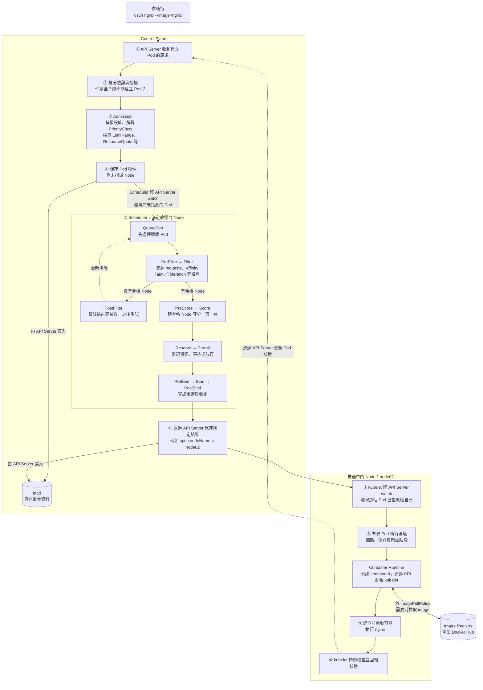
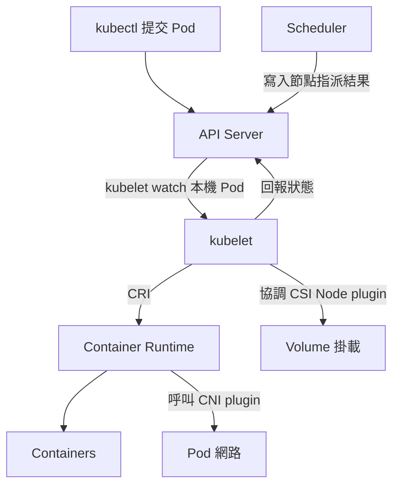

# K8s kubelet 與 Pod 執行流程

## Big Picture：從 k run 到容器執行

**先提交 Pod → Scheduler 選 Node → 該 Node 的 kubelet 協調 runtime 準備 image 並啟動容器。** API Server、Scheduler 都不負責下載應用程式的 image。

```bash
alias k=kubectl
k run nginx --image=nginx
```

這條指令建立的是 Pod；建立成功只表示 API Server 接受了資源，不表示容器已經啟動。



圖中箭頭表示處理關係：Scheduler 與 kubelet 主動透過 API Server watch 狀態，並不是 API Server 主動派工，也不是 Scheduler 直接把 Pod 傳給 kubelet。Bind 階段完成綁定的保存，PostBind 才做成功後的收尾；圖中為了閱讀將它們放在同一組。Node 端的網路、儲存與 image 準備是簡化呈現，不代表所有動作都嚴格依單一路徑執行。

| 元件 | 工作 |
|---|---|
| API Server／Admission | 接受請求，驗證、授權、檢查與補值，再保存 Pod 定義 |
| Scheduler | 依 Pod 需求與 Node 狀態，決定放在哪台 Node |
| kubelet | 在被選中的 Node 上協調 Pod 執行、檢查健康狀態並回報 |
| Container Runtime | 配合 kubelet 拉取映像、建立並啟動容器 |

API Server 的處理階段、Scheduler 的排程階段與 Node 上的執行階段要分開理解；元件分工見 [Kubernetes Components](https://kubernetes.io/docs/concepts/overview/components/)。

Scheduler 的詳細階段、節點選擇、PriorityClass 與多排程器設定統一見 [[K8s 排程：Scheduler、PriorityClass、Affinity、Taint 與 Toleration]]。

### image 什麼時候下載？

Scheduler 不需要先下載 image 才能排程。ImageLocality 可以利用 Node 回報的映像資訊評分；實際拉取是由選中 Node 上的 kubelet 協調 runtime 執行，是否需連到 registry 或下載內容取決於 imagePullPolicy 與本機快取。`Always` 也不代表每次都重新下載所有 layers；若對應內容已快取，可以重用。詳見 [Images](https://kubernetes.io/docs/concepts/containers/images/)。

### 用這張圖定位錯誤

| 現象 | 先看哪個階段 |
|---|---|
| Forbidden／Quota 超標，Pod 未建立 | API Server 的授權、Admission；直接建立 Pod 被拒絕時，不會有新 Pod 物件 |
| Pending，Events 有 FailedScheduling | Scheduler 找不到合適 Node |
| 已指派 Node，但 ImagePullBackOff | Node 端拉取 image 失敗，排程已完成 |
| 已指派 Node，但 FailedCreatePodSandBox／FailedMount | Node 端的 sandbox、網路或儲存準備 |
| Running，但尚未 Ready | 容器已啟動，檢查 readiness、容器狀態與應用健康 |

若提交的是 Deployment，Deployment 本身可能建立成功，但它的控制器建立 Pod 時遭 Admission 拒絕；這時也要查 Deployment／ReplicaSet 的 Events。

## Admission Controller：資源進入叢集前的關卡

[Admission Controller](https://kubernetes.io/docs/reference/access-authn-authz/admission-controllers/) 在 API Server 完成身分驗證與授權後、資源保存前，檢查或修改請求中的物件。它處理建立、修改、刪除等操作，不攔截一般 get／list／watch 讀取。

```text
提交請求 → Authentication → Authorization（例如 RBAC）
        → Mutating Admission → Validating Admission → 保存物件
```

| 階段 | 問的問題 | 例子 |
|---|---|---|
| Authentication | 你是誰？ | 依憑證或 token 識別身分 |
| Authorization | 你有權執行這個操作嗎？ | RBAC 是否允許建立 Pod |
| Mutating Admission | 要補上或修改什麼設定？ | 依 LimitRange 補預設 request／limit；Priority admission 解析優先權 |
| Validating Admission | 最後內容符合政策嗎？ | 檢查配額、資源設定範圍等 |

Admission 先 mutation、再 validation；任一階段都可能拒絕請求。LimitRange 是規則物件，LimitRanger 是執行它的 admission plugin，能補值也能驗證；ResourceQuota 的 admission plugin 則執行配額檢查。

這裡的 Controller 不代表一定有另一個獨立 Pod：內建 admission plugins 是 kube-apiserver 裡的程式碼。若使用 Admission Webhook，API Server 才會呼叫另外部署的 webhook 服務做對應檢查或修改。

> [!tip] 與 Scheduler 分清楚
> Admission 問「這份物件能不能被接受、需要補什麼」；Scheduler 問「已接受的 Pod 能排到哪台 Node」。直接建立 Pod 被 Admission 拒絕時，不會有新 Pod 物件；Scheduler 找不到位置時，Pod 已存在，通常是 Pending 並有 FailedScheduling 事件。

### ImagePolicyWebhook：映像政策驗證小抄

**ImagePolicyWebhook 屬於 Validating Admission**：API Server 將映像資訊交給外部政策後端決定允許／拒絕，本身不會自動做漏洞掃描。它不是通用的 `ValidatingAdmissionWebhook` plugin；後者通常搭配 `ValidatingWebhookConfiguration`，不能把兩種設定混用。

| 檢查點 | 要記住什麼 |
|---|---|
| 啟用 plugin | 在既有 `--enable-admission-plugins` 清單加入 `ImagePolicyWebhook`，保留原項目 |
| 載入設定 | `--admission-control-config-file` 指向 AdmissionConfiguration |
| 後端連線 | `imagePolicy.kubeConfigFile` 指向政策後端的 kubeconfig，含 HTTPS、CA 與必要憑證 |
| 檔案可見性 | 設定、kubeconfig、憑證必須都能從 API Server 容器內讀到；確認 hostPath／volumeMounts |
| 後端故障 | `defaultAllow: false` 拒絕放行；`true` 容許故障時放行，依題意設定 |

這兩個 API Server 啟動參數是最重要的辨識點：

```yaml
# kube-apiserver 的 command 片段；保留環境原有的 plugins
- --enable-admission-plugins=NodeRestriction,ImagePolicyWebhook
- --admission-control-config-file=/etc/kubernetes/imgvalidation/admission-configuration.yaml
```

在 kubeadm 常見的 static Pod 環境，修改 `/etc/kubernetes/manifests/kube-apiserver.yaml` 後，**kubelet 偵測變更並重建 API Server**。備份放在 manifests 目錄之外，避免也被當作 manifest 讀取。

```bash
kubectl get pods -n kube-system
```

這是**查詢** kube-system 中的 Pod 狀態，不是更新 namespace，也不是這條指令觸發重啟。該 namespace 包含控制平面與系統元件，所以到這裡確認 API Server 是否恢復；要驗證政策生效，仍須測試允許與禁止的映像。

API Server 起不來時，在控制平面 Node 查 runtime，不依賴 kubectl：

```bash
sudo crictl ps -a --name kube-apiserver
sudo crictl logs <剛查到的容器ID>
```

舊容器 ID 可能已被清理，要重新查。優先看 YAML／參數錯誤、掛載路徑與憑證；若 API 已回應 `Unauthorized`，轉查用戶端身分與 `--client-ca-file`，不能把它直接當成映像政策拒絕。`--client-ca-file` 用於驗證連進 API Server 的用戶端憑證，與 image policy 後端 kubeconfig 裡的 CA 用途不同。

參考：[ImagePolicyWebhook 設定](https://kubernetes.io/docs/reference/access-authn-authz/admission-controllers/#imagepolicywebhook)、[crictl 排錯](https://kubernetes.io/docs/tasks/debug/debug-cluster/crictl/)。

## kubelet 的位置與責任

kubelet 是每個 Node 上的節點代理程式。Node 是執行工作負載的實體機或虛擬機，以及 Kubernetes 中對應的資源物件；kubelet 是其上的程式，兩者不是同義詞。

Scheduler 決定 Pod 要放在哪台 Node；kubelet 持續協調已指派到本機的 Pod，透過 CRI 呼叫 containerd、CRI-O 等 runtime 建立 Pod sandbox、啟動及停止容器，並回報狀態。



這是一般由 API Server 管理的 Pod 流程；static Pod 可由 kubelet 讀取本機 manifest 管理。

| 功能 | 主要責任 |
|---|---|
| Pod 排程 | kube-scheduler |
| 容器生命週期 | kubelet 透過 CRI 請 runtime 執行 |
| 健康檢查 | kubelet 管理 startup、liveness、readiness probes |
| Pod 網路設定 | Linux 上通常由 CRI runtime 呼叫 CNI plugin |
| Volume 掛載 | kubelet 協調 CSI Node plugin 與 runtime |
| Service 轉送 | kube-proxy，或具備替代能力的網路實作 |

readiness 失敗會影響 Pod 是否作為 Service 的就緒後端；liveness 失敗可能觸發容器重啟；startup probe 成功前會延後其他兩類探測。

元件責任參考 [Kubernetes Components](https://kubernetes.io/docs/concepts/overview/components/)。容器層延伸至 [[K8s Container Runtime 與 dockershim 遷移]]，網路與儲存分別見 [[K8s CNI 比較：Cilium、Calico 與 Flannel]]、[[K8s CSI、PV、PVC 與雲端儲存]]。

## API 與應用設定

「No hidden internal APIs」可以理解為核心元件透過 API Server 存取 Kubernetes 資源，外部工具也能在授權範圍內使用這些 API。這不代表所有元件的所有通訊都經 API Server，例如 kubelet 與 runtime 使用 CRI。

「Meet users where they are」是配合既有應用的使用方式。應用可以從環境變數或掛載檔案讀取 ConfigMap、Secret，不必為此自行呼叫 Kubernetes API。Secret 的 base64 編碼本身不是加密。

## 檢查方向

```bash
alias k=kubectl
k get nodes -o wide
k get po -A -o wide
k describe po <pod-name> -n <namespace>
```

先區分 Pending 是排程問題，還是已分配 Node 後卡在 image pull、sandbox/network、volume mount 等階段。Node 上的 kubelet 服務名稱依安裝方式不同，不把一般 systemd 的服務名稱直接套用到 MicroK8s。
