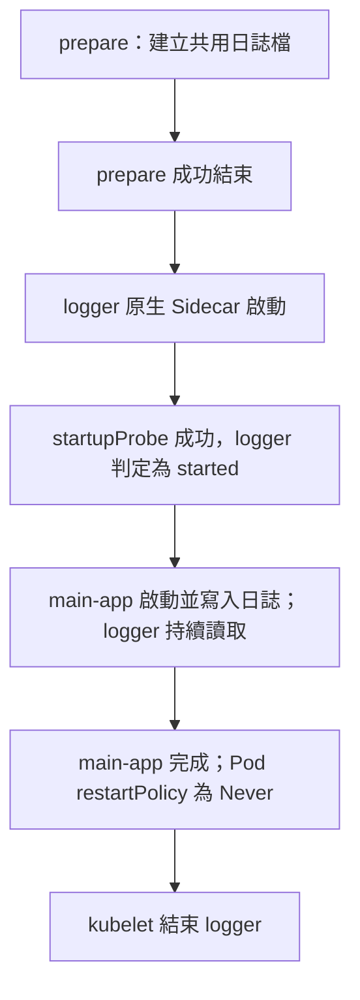
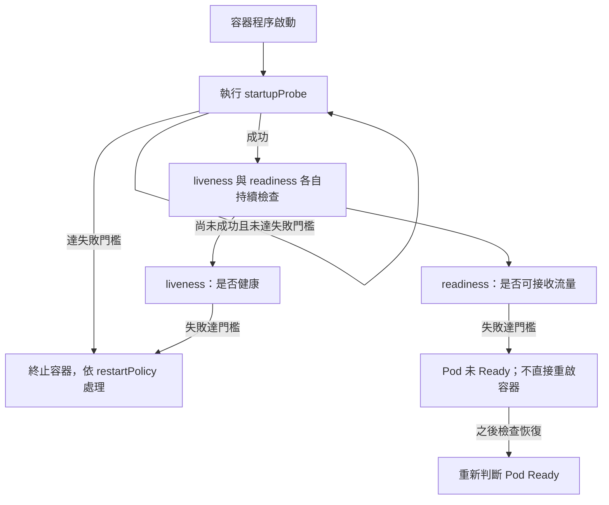

## Pod 是什麼

Pod 是可以在 K8s 創建和管理的最小單位。  
一個 Pod 是一個群組，裡面可以有一個或是多個 containers, 共享 storage 和 resource 和怎麼運行這個 Pod 的相關 specification (規格，設定)，Pod 內的容器在同一個節點被調度和運行，，形成一個應用程序的「邏輯主機」，類似於在非雲端環境下同一實體機或虛擬機中的應用。  
  

- Pod 可以包含以下幾種容器：
    1. Application Containers：執行主要的應用程式邏輯。
    2. Init Containers：先執行初始化工作，成功結束後才繼續。
    3. Native Sidecar Containers：以可重啟的 Init Container 形式宣告，持續協助主要容器。
    4. Ephemeral Containers：用於排查問題。


---

## Multi-container、Init Container 與 Native Sidecar

**Multi-container 是一個 Pod 有多個容器；Init Container 負責先做完準備；Sidecar 負責在主容器運作時持續協助。** 它們不是三個互斥的 Pod 類型，同一個 Pod 可以同時包含這些角色。

| 概念 | YAML 位置 | 啟動與結束行為 | 常見用途 |
|---|---|---|---|
| 多個一般容器 | `spec.containers[]` | 通過初始化階段後啟動，彼此沒有由清單順序保證的啟動先後 | 緊密合作的應用與輔助程式；傳統 Sidecar 也常放這裡 |
| 一般 Init Container | `spec.initContainers[]` | 依序執行，上一個成功結束才執行下一個；全部完成後才啟動一般容器 | 產生設定檔、準備資料、等待外部依賴 |
| Native Sidecar | `spec.initContainers[]`，該項設定 `restartPolicy: Always` | 依初始化順序先啟動，被判定 started 後可繼續下一步；持續陪伴主容器；Pod 終止時在主容器停止後關閉 | 日誌收集、代理、持續同步檔案 |

同 Pod 的容器位於同一 Node，共用 Pod 網路，可透過 `localhost` 通訊；要共享檔案，需明確掛載共同 volume，不是自動共用所有容器檔案系統。

### Native 是什麼？

**Native 是「Kubernetes 原生支援 Sidecar 的生命週期」**，不必自行用 entrypoint 等方式協調啟動與關閉。此功能在 v1.33 成為 stable，v1.29 起預設啟用，並非 v1.33 才首次出現。

Native Sidecar 放在 `initContainers`，但**不需要先結束**才能啟動主容器。若有多個原生 Sidecar，Pod 終止時會在主容器停止後，依宣告的相反順序停止 Sidecar；Job 也不會因這些 Sidecar 持續執行而無法完成。

### 完整例子：先準備檔案，再啟動 logger 與主容器

```yaml
apiVersion: v1
kind: Pod
metadata:
  name: sidecar-demo
spec:
  restartPolicy: Never
  initContainers:
  - name: prepare
    image: busybox:1.36
    command: ["sh", "-c", "touch /shared/app.log"]
    volumeMounts:
    - name: logs
      mountPath: /shared
  - name: logger
    image: busybox:1.36
    restartPolicy: Always
    command: ["sh", "-c", "tail -F /shared/app.log"]
    startupProbe:
      exec:
        command: ["sh", "-c", "test -f /shared/app.log"]
      periodSeconds: 1
      failureThreshold: 30
    volumeMounts:
    - name: logs
      mountPath: /shared
  containers:
  - name: main-app
    image: busybox:1.36
    command: ["sh", "-c", "echo 'Main app started' >> /shared/app.log; sleep 60"]
    volumeMounts:
    - name: logs
      mountPath: /shared
  volumes:
  - name: logs
    emptyDir: {}
```



此 `startupProbe` 只是示範檔案檢查；實際代理／服務應檢查它真正完成啟動所需的條件。

### restartPolicy 與 Probe：執行／重啟策略和健康檢查

**Sidecar 是做事的容器，Probe 是檢查機制；Probe 不能取代日誌收集或代理程式。`restartPolicy: Always` 也不會檢查程式是否卡住。**

| 設定 | 決定什麼 | 失敗／退出時的行為 |
|---|---|---|
| `spec.restartPolicy` | Pod 層級的容器重啟預設策略 | `Always`、`OnFailure`、`Never` 控制容器退出後如何處理，不是重新建立整個 Pod |
| `initContainers[].restartPolicy: Always` | 將這個 Init Container 設成 Native Sidecar | 容器退出時獨立重啟，不論 Pod 層級策略；Pod 終止階段仍會停止 |
| `startupProbe` | 是否完成啟動 | 達失敗門檻會終止該容器，後續依重啟策略處理；成功前不執行它的 liveness／readiness 檢查 |
| `livenessProbe` | 運作中是否健康，例如程序卡住 | 達失敗門檻會終止該容器，後續依重啟策略處理 |
| `readinessProbe` | 是否可接收流量 | 失敗影響 Pod Ready，Service 通常不再把新流量送給它；不直接重啟容器 |

本例 Pod 設 `Never`，但 logger 設 `Always`：主容器完成後不重跑；logger 若在 Pod 運作期間退出則可重啟，直到 Pod 結束。

**Native Sidecar 的 `started` 不等於 `Ready`。** 沒有 startupProbe 時，容器程序開始執行即可判定 started；有 startupProbe 時，需等該檢查成功才繼續下一個初始化步驟。Sidecar 的 readinessProbe 會影響 Pod Ready，不能把它當成主容器啟動前的等待條件。

一般 Init Container 不支援 startup／liveness／readiness Probe；它以是否成功執行完畢作為完成條件。Native Sidecar 支援這些 Probe。

### 重要指令與官方關鍵詞

```bash
kubectl explain pod.spec.initContainers
kubectl explain pod.spec.initContainers.restartPolicy
kubectl explain pod.spec.containers.startupProbe
kubectl apply --dry-run=server -f sidecar-demo.yaml
kubectl describe pod sidecar-demo
kubectl logs sidecar-demo -c prepare
kubectl logs sidecar-demo -c logger
kubectl logs sidecar-demo -c main-app
```

- [Init Containers](https://kubernetes.io/docs/concepts/workloads/pods/init-containers/)：`init containers`、`run to completion`。
- [Sidecar Containers](https://kubernetes.io/docs/concepts/workloads/pods/sidecar-containers/)：`restartPolicy Always`、`started`、`SidecarContainers`。
- [Liveness, Readiness, and Startup Probes](https://kubernetes.io/docs/concepts/workloads/pods/probes/)：`startupProbe`、`readinessProbe`、`livenessProbe`。

---

## Probe 實作：HTTP、TCP、exec 與重要參數

**先決定「檢查用途」，再決定「怎麼檢查」。startup／liveness／readiness 是用途，HTTP／TCP／exec 是檢查方式，不是固定配對。** Probe 寫在個別 container 裡，與 `image`、`command` 同層，由 kubelet 執行檢查。

### 三種用途：失敗後做什麼？

| Probe | 檢查什麼 | 失敗達門檻後 | 成功後 |
|---|---|---|---|
| `startupProbe` | 是否完成啟動 | 終止該容器，依 restartPolicy 處理 | 本次容器啟動不再執行 startupProbe，開始 liveness／readiness 檢查 |
| `livenessProbe` | 運作中是否健康、是否卡住 | 終止該容器，依 restartPolicy 處理 | 繼續定期檢查 |
| `readinessProbe` | 是否可接收請求 | 標記未就緒，Service 通常不再送新流量；不直接終止容器 | 符合恢復門檻後可重新就緒 |

- startupProbe 成功前，不執行**同一個容器**的 liveness／readiness；不是所有 Pod 容器一起暫停。
- liveness 與 readiness 各自檢查，不是 readiness 成功後才執行 liveness。
- 沒設定 readinessProbe，不代表 Kubernetes 懂你的業務健康狀態。

### 三種方式：成功條件不同

| 方式 | YAML 欄位 | 成功條件 | 注意事項 |
|---|---|---|---|
| HTTP | `httpGet` | 回應碼 200～399 | path／port 必須是應用實際提供的；通常由 kubelet 連 Pod IP |
| TCP | `tcpSocket` | 指定 port 能建立 TCP 連線 | 只證明可連線，不代表業務功能正常 |
| exec | `exec.command` | 容器內指令 exit code 為 0 | 工具必須存在；不會自動使用 shell，需條件／管線時明寫 `sh -c` |

每個 Probe 只選一個檢查方式，不要同時放 httpGet 和 exec。Kubernetes 也支援 gRPC health probe；這裡先整理最常用的 HTTP／TCP／exec。

### 範例一：HTTP startup／readiness，加上 TCP liveness

儲存為 `probe-web.yaml`。此例 NGINX 實際提供 `/` 與 TCP 80；真實應用可改用實作好的 `/startupz`、`/livez`、`/readyz` 等端點，不能只改 YAML 就期待程式自動產生它們。

```yaml
apiVersion: v1
kind: Pod
metadata:
  name: probe-web
  namespace: default
spec:
  restartPolicy: Always
  containers:
  - name: web
    image: nginx:stable
    ports:
    - name: http
      containerPort: 80
    startupProbe:
      httpGet:
        path: /
        port: http
      periodSeconds: 2
      timeoutSeconds: 1
      failureThreshold: 30
    livenessProbe:
      tcpSocket:
        port: http
      periodSeconds: 10
      timeoutSeconds: 1
      failureThreshold: 3
    readinessProbe:
      httpGet:
        path: /
        port: http
      periodSeconds: 5
      timeoutSeconds: 1
      failureThreshold: 3
      successThreshold: 1
```

| 本例設定 | 解讀 |
|---|---|
| startup：每 2 秒、連續失敗 30 次 | 約 60 秒的啟動容忍範圍；不是固定等 60 秒才啟動其他 Probe |
| startup 提早成功 | 立刻完成本次 startup 檢查階段，再依設定開始其他 Probe |
| liveness：TCP 80、失敗門檻 3 | 連不上且達連續失敗門檻，終止並依 Always 重啟 web 容器 |
| readiness：HTTP `/`、失敗門檻 3 | 未就緒時不直接重啟；此處只示範 HTTP 檢查，不是完整業務驗證 |
| `port: http` | 引用同 container 內宣告的命名 port，也可直接填 80 |

Probe 的 port 是應用監聽的容器 port，不是 Service port 或 NodePort。`containerPort` 宣告不會讓程式自動開啟監聽。

### 範例二：exec 檢查檔案，觀察 liveness 重啟

儲存為 `probe-exec.yaml`：

```yaml
apiVersion: v1
kind: Pod
metadata:
  name: probe-exec
  namespace: default
spec:
  restartPolicy: Always
  containers:
  - name: app
    image: busybox:1.36
    command: ["sh", "-c", "touch /tmp/healthy; sleep 3600"]
    livenessProbe:
      exec:
        command: ["cat", "/tmp/healthy"]
      initialDelaySeconds: 5
      periodSeconds: 5
      timeoutSeconds: 1
      failureThreshold: 3
```

- 檔案存在：cat 回傳 0，檢查成功。
- 檔案不存在：cat 回傳非 0；連續失敗 3 次後終止容器，依 Always 重啟。
- 重啟後 command 再次建立檔案；這是容器重啟，不是建立新 Pod。

在 lab 可這樣觀察（僅刪範例容器的檢查檔）：

```bash
kubectl apply -f probe-exec.yaml
kubectl wait --for=condition=Ready pod/probe-exec --timeout=60s
kubectl exec probe-exec -c app -- rm /tmp/healthy
kubectl get pod probe-exec -w
```

等 RESTARTS 增加後，按 Ctrl+C 離開 watch，再看 Events：

```bash
kubectl describe pod probe-exec
kubectl logs probe-exec -c app --previous
```

前一次 logs 可能沒有輸出，因為此例只有 touch／sleep；失敗 Probe 訊息看 Events，而非期待程式一定印出錯誤。

### 重要參數：預設值與記法

| 參數 | 預設 | 用途／易錯處 |
|---|---|---|
| `initialDelaySeconds` | 0 秒 | 開始該 Probe 前等待；有 startupProbe 時，liveness／readiness 的等待在 startup 成功後才開始 |
| `periodSeconds` | 10 秒 | 檢查週期；未 Ready 時 readiness 可能更頻繁執行 |
| `timeoutSeconds` | 1 秒 | 每次檢查最多等多久 |
| `failureThreshold` | 3 次 | 連續失敗幾次，才判定該檢查整體失敗 |
| `successThreshold` | 1 次 | 失敗後要連續成功幾次才算恢復；startup／liveness 必須為 1，readiness 可調高 |

- `failureThreshold × periodSeconds` 用來估算啟動／失敗容忍時間，不是精準的重啟倒數；還有檢查耗時、初始延遲及終止寬限等因素。
- liveness 不宜因資料庫等外部依賴短暫失效就判定主程式死亡，避免大量無效重啟；需依應用設計區分「不健康」與「暫時不能服務」。

### 執行順序



此圖假設有設定 startupProbe；沒有時，其他 Probe 直接依各自參數開始，不會多出一個必要的 startup 階段。

### 查欄位與排錯

```bash
kubectl explain pod.spec.containers.livenessProbe
kubectl explain pod.spec.containers.readinessProbe.httpGet
kubectl explain pod.spec.containers.startupProbe
kubectl apply --dry-run=server -f probe-web.yaml
kubectl apply -f probe-web.yaml
kubectl describe pod probe-web
kubectl get pod probe-web -w
```

| 現象 | 查什麼 |
|---|---|
| YAML unknown field | Probe 是否放在 container 裡；httpGet／tcpSocket／exec 名稱與縮排 |
| HTTP 404 | path 是否真的存在；404 是檢查失敗 |
| connection refused／timeout | 程式是否監聽正確 IP／port、啟動時間與網路可達性 |
| Ready=0，但 RESTARTS 沒增加 | readiness 失敗可能正是預期行為 |
| 反覆重啟 | describe Events 查 startup／liveness；也查程式自行退出與前一次 logs |

更新既有 Deployment 時，把 Probe 放在 `spec.template.spec.containers[]`，會觸發 rollout。不要假設既有一般 Pod 的 Probe 欄位能直接原地修改，也不要用 `replace --force` 當作預設解法。

官方：[Configure Liveness, Readiness and Startup Probes](https://kubernetes.io/docs/tasks/configure-pod-container/configure-liveness-readiness-startup-probes/)、[Probe 設定欄位與預設值](https://kubernetes.io/docs/concepts/workloads/pods/probes/#configuration-fields)。搜尋關鍵詞：`httpGet`、`tcpSocket`、`exec`、`failureThreshold`、`startupProbe`。

---

## Pod theory

The atomic unit of scheduling on Kubernetes is the Pod. This is just a fancy way of saying apps deployed to  
Kubernetes always run inside Pods.  
Some quick examples… If you deploy an app, you deploy it in a Pod. If you terminate an app, you terminate its  
Pod. If you scale an app up or down, you add or remove Pods.  
  
在 K8s 中，排程的最小單位是 Pod。意指所有部署到 K8s 中的 Application，都必須在 Pod 中運行。  
  
1. 當需要部署一個 Application 時，實際上是將其部署到 Pod 中。  
2. 當終止一個 Application 時，實際上也是中指他所在的 Pod。  
3. 當你調整應用程式的規模時，無論是擴展還是縮減，都是透過新增或移除 Pod 來實現。  

---

## Pod lifecycle

### Pod phase

首先 Pod 會有自己的生命週期，Pod 會遵循這些狀態創建、刪除、執行等等...  
  

- 相關重點
    - Binding：如果一個 Pod 被分配到特定的節點，我們稱之為綁定 (binding)。
    - Scheduling：選擇使用哪個節點的過程稱為調度 (scheduling)。
    - 調度限制：Pod 的調度 (scheduling) 只會進行一次，並且該 Pod 將持續運行於此節點，直到被停止或終止 (terminated)。
- Pod 的主要狀態
    - Peding : Pod 已經創但是尚未啟動，此街段包括 Pod 被 scheduling 或是下載 Image。
    - Running : Pod 正在運行，至少有一個 container 在執行中，或著處於啟動或是重新啟動狀態。
    - Succeded : 所有的 containers 都成功 terminated，且不會再次重新啟動。
    - Failed : Pod 中的所有 containers 都已經 terminated，並且至少有一個 container 失敗 * terminated，且為設定自動重新啟動。
    - Unknown : 無法獲取 Pod 的狀態。
- 常見狀態說明
    - CrazhLoopBackOff：如果 Pod 反覆重啟失敗，kubectl 的 Status 欄位會顯示此狀態，表示容器正在嘗試啟動但持續失敗。
    - Terminating：當刪除 Pod 時，Status 欄位可能顯示 Terminating，表示 Pod 正在關閉中。
- Pod 終止時間
    - 當 Pod 被終止時，會有一個默認為 30 秒的優雅關閉時間，用於清理資源並完成關閉過程。
    - 如果需要強制終止 Pod，可以使用 --force 標誌來繞過優雅關閉時間。

### Pod status

- Waiting：container 正在完成他啟動時需要的動作，例如：從某個 registry 取得 image，或者 container 正在取得 Secret 資料等等
- Running：這個狀態表示 container 執行中並沒有發生什麼問題。
- Terminated：這個狀態表示 container 在執行後，因為某些原因導致失敗所產生的狀態，或是正常關閉的狀態。

---

## **從程式碼到 Pod**

1. 寫程式碼
2. 打包你的 container image
3. 打吧你的 container image 到 Pod
4. 把 Pod 跑在 K8s 上

- 那為什麼不直接跑 container 在 K8s 上，以下有幾個比較短的理由
    - Pods 增強了 containers
        - 可以在 Pods 上加上 Labels 和 annotations
        - Pods 重啟的一些政策
        - Probes(探針)，startup probes、readiness prbes、liveness probes，和更多。
        - Affinity 和 anti-affinity （親和性和反親和信）
    - Pods 可以被調度 (scheduling)
    - Pods 可以開啟資源共享

---

## SecurityContext：執行身分與 Linux 權限

**UID 決定「你是誰」；Capabilities 決定「你額外能做什麼」；`securityContext` 把安全設定放在一起。**

| 設定 | 用途 | 可設定層級 |
|---|---|---|
| `runAsUser` | 指定 Linux UID；`0` 是 root | Pod、container |
| `runAsGroup` | 指定主要 GID | Pod、container |
| `runAsNonRoot: true` | 要求不能以 root 執行，不會自動選 UID | Pod、container |
| `capabilities.add`／`drop` | 增加／移除 Linux 特殊權限 | 只能 container |
| `privileged: true` | 啟用特權容器，大幅放寬隔離與權限限制 | 只能 container |
| `readOnlyRootFilesystem: true` | 容器根檔案系統唯讀 | 只能 container |

非 root UID 通常較安全，但映像與掛載目錄必須支援該 UID。需要特殊權限時才增加必要的 Capability。

### Pod 與 container 同時設定：重複欄位以 container 為準

```yaml
apiVersion: v1
kind: Pod
metadata:
  name: ubuntu-sleeper
spec:
  securityContext:             # Pod 層級：提供容器共用的預設值
    runAsUser: 1000
    runAsGroup: 3000
  containers:
  - name: ubuntu
    image: ubuntu
    command: ["sleep", "4800"]
    securityContext:           # 與這個 container 的 name、image、command 同層
      runAsUser: 2000
      capabilities:
        add: ["SYS_TIME"]      # 示範特殊權限；僅在需求明確時授予
```

這個 container 最後使用 **UID 2000、GID 3000**。是重複欄位個別覆蓋，不是整份 Pod `securityContext` 被取代。Deployment 的 Pod 設定則放在 `spec.template.spec`。

### Capabilities 與 privileged

| Linux 名稱 | K8s `add` 寫法 | 用途 |
|---|---|---|
| `CAP_NET_ADMIN` | `NET_ADMIN` | 修改網路介面、IP、路由、iptables 等網路設定 |
| `CAP_SYS_TIME` | `SYS_TIME` | 修改系統時鐘；可能影響主機，謹慎授予 |
| `CAP_SYS_ADMIN` | `SYS_ADMIN` | 包含掛載／卸載檔案系統、部分 namespace 操作等，權限非常廣 |

實際操作仍受 namespace 與其他安全限制影響。`NET_ADMIN` 通常管理容器所在的網路 namespace，不會自動取得主機網路的控制權。

Docker 對照：

```bash
docker run --user 1000 ubuntu id
docker run --cap-add=NET_ADMIN -it ubuntu bash
docker run --privileged -it ubuntu bash
```

`--privileged` 會授予所有 Linux Capabilities、主機裝置存取並放寬多項安全限制；不只是以 root 執行。K8s 對應 container 的 `securityContext.privileged: true`。若只需特定能力，使用 `capabilities.add`；也可先 `drop: ["ALL"]` 再加入必要能力。

Linux 上若已安裝標頭檔，可查看定義清單；這不代表目前程序擁有這些權限：

```bash
grep '^#define CAP_' /usr/include/linux/capability.h
man 7 capabilities
```

### 常見錯誤：capabilities 放錯層級或 YAML 縮排錯誤

> [!important] `capabilities` 只能放在個別 container 裡
> 正確：`spec.containers[].securityContext.capabilities`。
> 錯誤：`spec.securityContext.capabilities`，會收到 `unknown field "spec.securityContext.capabilities"`。
> `containers:` 是清單，`securityContext` 必須放進 `- name: ...` 那個項目裡，與該 container 的 `image`、`command` 同層；不能放在清單項目的 `-` 外面。

重要查詢與驗證指令：

```bash
kubectl explain pod.spec.securityContext
kubectl explain pod.spec.containers.securityContext.capabilities
kubectl apply --dry-run=server -f pod.yaml
kubectl apply -f pod.yaml
kubectl exec ubuntu-sleeper -- id
```

`id` 確認 UID／GID，不會列出 Capabilities。`--dry-run=server` 可先檢查 API 欄位與 admission，但不會真的啟動容器。

`kubectl replace --force` 會先刪除舊 Pod，再建立新的；若新檔案有錯，舊 Pod 已不存在。先修正與驗證檔案，再重新建立，不要反覆強制刪除。

官方範例：[Configure a Security Context for a Pod or Container](https://kubernetes.io/docs/tasks/configure-pod-container/security-context/)。搜尋關鍵詞：`security context`、`set capabilities container`；頁內找 `Set the security context for a Container`、`Set capabilities for a Container`。

參考：[Linux capabilities](https://man7.org/linux/man-pages/man7/capabilities.7.html)、[Docker runtime privilege and Linux capabilities](https://docs.docker.com/engine/containers/run/#runtime-privilege-and-linux-capabilities)。

---

## Pod 的資源管理和限制資源

### ResourceQuota 與 LimitRange：總量和個別範圍

| 機制 | 作用範圍 | 用途 |
|---|---|---|
| ResourceQuota | 整個 Namespace，亦可設定 scope 篩選適用物件 | 限制資源配額總量，例如 requests／limits 加總、PVC 儲存請求或物件數量 |
| LimitRange | Namespace 內的個別 Container、Pod、PVC，依資源類型支援的欄位而定 | 限制最小值、最大值或 limit/request 比例；可為 Container 提供預設 requests／limits |

ResourceQuota 的 CPU／Memory 配額計算的是宣告的 requests／limits，不是即時使用量；配額也不代表叢集已替這個 Namespace 預留實體容量。LimitRange 的 `default` 是預設 limit，`defaultRequest` 是預設 request。

兩者主要在 API admission 時檢查或補值：新增／更新超出配額或範圍的資源會被拒絕。修改 LimitRange 不會回頭重寫已執行 Pod 的設定。

來源：[Resource Quotas](https://kubernetes.io/docs/concepts/policy/resource-quotas/)、[Limit Ranges](https://kubernetes.io/docs/concepts/policy/limit-range/)。

### Requests 與 Limits：排程需求和執行上限

| 設定 | 意義 | 超過數值時 |
|---|---|---|
| `requests` | 資源需求與排程容量判斷依據；CPU request 也影響競爭時的分配權重 | 資源可用且未受 limit 等限制時，可以使用更多；超過 request 本身不會直接觸發 OOM kill |
| `limits.cpu` | CPU 使用上限 | 受 CPU throttling 限制，不會單純因為碰到 CPU limit 而被終止 |
| `limits.memory` | Memory 使用上限 | 可能觸發 OOM kill，容器狀態可能顯示 `OOMKilled` |

`requests.memory` 不是「啟動時必須實際占用的最小記憶體」，也不是使用上限；Scheduler 主要依 requests 與 Node 可分配容量判斷能否排入，而不是看當下空閒量。排程其他限制見 [[K8s 排程：Scheduler、PriorityClass、Affinity、Taint 與 Toleration]]。

若只設定某項資源的 limit，沒有 request，且 admission 沒有提供該項預設 request，Kubernetes 會把 limit 複製為 request。因此要看建立後的實際物件，而不能只看手寫的 YAML。

來源：[Resource Management for Pods and Containers](https://kubernetes.io/docs/concepts/configuration/manage-resources-containers/)。

### QoS 三種等級

以下先以一般在 Container 層設定 CPU／Memory 的 Pod 為例，依 admission 補值後的實際設定判斷：

| QoS | Requests／Limits 條件 | 記憶體壓力下的驅逐傾向 |
|---|---|---|
| Guaranteed | 每個 Container 的 CPU、Memory request 與 limit 都有設定、皆大於 0，且同一資源 request = limit | 通常較不容易被驅逐，但不是絕對不會 |
| Burstable | 不符合 Guaranteed，且至少一個 Container 有 CPU 或 Memory request／limit | 取決於是否超過 request、Pod Priority 與相對使用量 |
| BestEffort | 所有 Container 都沒有 CPU、Memory requests／limits | 通常較容易被驅逐 |

若使用支援的 Pod-level resources（`spec.resources`），Pod 層 CPU／Memory 設定也參與 QoS 判斷：Pod 層兩項資源的 request 與 limit 相等可符合 Guaranteed；完全沒設定 CPU／Memory 才可能是 BestEffort。以上表格的逐 Container 規則不能直接套用到所有 Pod-level 設定情況。

> [!important] QoS 是判斷傾向，不是固定排序
> Node-pressure eviction 並非單純照 BestEffort → Burstable → Guaranteed 排序。kubelet 會考慮相關資源使用是否超過 requests、Pod Priority、使用量相對 requests 的程度。QoS 對記憶體壓力的傾向較有參考性，不能直接套用到 DiskPressure 等所有情境。

`OOMKilled` 和 `Evicted` 也要分開：前者是容器內的程序遭 OOM kill，可能依 restart policy 重啟容器；後者是 kubelet 因節點壓力等原因終止整個 Pod，若由 Deployment 管理，控制器會另外補建 Pod。

來源：[Pod Quality of Service Classes](https://kubernetes.io/docs/concepts/workloads/pods/pod-qos/)、[Node-pressure Eviction](https://kubernetes.io/docs/concepts/scheduling-eviction/node-pressure-eviction/)。

### 實作：產生模板，再設定 requests／limits

```bash
alias k=kubectl
k run nginx-pod --image=nginx:latest --dry-run=client -o yaml > nginx-pod.yaml
```

產生的模板會有 `resources: {}`。編輯為以下設定；這裡省略不必要的空白欄位：

```yaml
apiVersion: v1
kind: Pod
metadata:
  labels:
    run: nginx-pod
  name: nginx-pod
spec:
  containers:
    - image: nginx:latest
      name: nginx-pod
      resources:
        requests:
          memory: "64Mi"
          cpu: "250m"
        limits:
          memory: "256Mi"
          cpu: "1"
  dnsPolicy: ClusterFirst
  restartPolicy: Always
```

`64Mi` 是 64 Mebibytes 的記憶體 request；`250m` 是 0.25 CPU core 的 request，CPU limit `1` 則是 1 core。這個 Pod 的 request 與 limit 不相等，因此是 Burstable。

```bash
k apply -f nginx-pod.yaml

# lab 換成實際 namespace；quota、limits 分別是 ResourceQuota、LimitRange 的資源短名
k get quota,limits -n lab
k describe quota -n lab
k describe limits -n lab

# 查看補值後的 resources、QoS Class，以及 OOMKilled／Evicted 線索
k get po nginx-pod -o yaml
k describe po nginx-pod

# 忘記欄位時當場查
k explain po.spec.containers.resources
k explain quota.spec.hard
k explain limits.spec.limits
```

下方保留先前在 OrbStack 執行的歷史輸出，供對照；當下結果以實際查詢為準。更多常用操作見 [[K8s kubectl 常用指令]]。

- 查看該 Pod 的狀態
    
    ```Shell
    kubectl describe pod nginx-pod
    ```
    
    ```Plain
    Name:             nginx-pod
    Namespace:        default
    Priority:         0
    Service Account:  default
    Node:             orbstack/198.19.249.2
    Start Time:       Fri, 29 Nov 2024 13:57:14 +0800
    Labels:           run=nginx-pod
    Annotations:      <none>
    Status:           Running
    IP:               192.168.194.9
    IPs:
    IP:  192.168.194.9
    IP:  fd07:b51a:cc66:a::9
    Containers:
    nginx-pod:
        Container ID:   docker://53e5a5cb01fa37f074d782ca3299e2410f6e736133f03bce44a9e9d2dbd4ea72
        Image:          nginx:latest
        Image ID:       docker-pullable://nginx@sha256:0c86dddac19f2ce4fd716ac58c0fd87bf69bfd4edabfd6971fb885bafd12a00b
        Port:           <none>
        Host Port:      <none>
        State:          Running
        Started:      Fri, 29 Nov 2024 13:57:26 +0800
        Ready:          True
        Restart Count:  0
        Limits:
        cpu:     1
        memory:  256Mi
        Requests:
        cpu:        250m
        memory:     64Mi
        Environment:  <none>
        Mounts:
        /var/run/secrets/kubernetes.io/serviceaccount from kube-api-access-cjgr8 (ro)
    Conditions:
    Type                        Status
    PodReadyToStartContainers   True
    Initialized                 True
    Ready                       True
    ContainersReady             True
    PodScheduled                True
    Volumes:
    kube-api-access-cjgr8:
        Type:                    Projected (a volume that contains injected data from multiple sources)
        TokenExpirationSeconds:  3607
        ConfigMapName:           kube-root-ca.crt
        ConfigMapOptional:       <nil>
        DownwardAPI:             true
    QoS Class:                   Burstable
    Node-Selectors:              <none>
    Tolerations:                 node.kubernetes.io/not-ready:NoExecute op=Exists for 300s
                                node.kubernetes.io/unreachable:NoExecute op=Exists for 300s
    Events:
    Type    Reason     Age   From               Message
    ----    ------     ----  ----               -------
    Normal  Scheduled  18m   default-scheduler  Successfully assigned default/nginx-pod to orbstack
    Normal  Pulling    18m   kubelet            Pulling image "nginx:latest"
    Normal  Pulled     18m   kubelet            Successfully pulled image "nginx:latest" in 11.338s (11.338s including waiting)
    Normal  Created    18m   kubelet            Created container nginx-pod
    Normal  Started    18m   kubelet            Started container nginx-pod
    ```
    

---

## **Pod 相關指令**

- 需要查看 Pod 的相關 logs
    
    ```Shell
    kubectl logs <pod-name>
    ```
    
- 這個指令可以查尋 Pod 的相關屬性
    
    ```Shell
    kubectl explain pods --recursive | less
    ```
    
    ```Plain
    KIND:       Pod
    VERSION:    v1
    
    DESCRIPTION:
        Pod is a collection of containers that can run on a host. This resource is
        created by clients and scheduled onto hosts.
    
    FIELDS:
    apiVersion    <string>
    kind  <string>
    metadata      <ObjectMeta>
        annotations <map[string]string>
        creationTimestamp   <string>
        deletionGracePeriodSeconds  <integer>
        deletionTimestamp   <string>
        finalizers  <[]string>
        generateName        <string>
        generation  <integer>
        labels      <map[string]string>
        managedFields       <[]ManagedFieldsEntry>
    ...
    ```
    
- 預設會從 default namespace 取得 pods 相關資訊
    
    ```Shell
    kubectl get pods
    
    NAME    READY   STATUS    RESTARTS   AGE
    nginx   1/1     Running   0          8m7s
    ```
    
    - 如果要找到更多相關資訊
        
        ```Shell
        kubectl get pods -o wide
        NAME    READY   STATUS    RESTARTS   AGE   IP              NODE       NOMINATED NODE   READINESS GATES
        nginx   1/1     Running   0          12m   192.168.194.8   orbstack   <none>           <none>
        ```
        
    - 以下指令可以取得所有 namespace 底下的 pods
        
        ```Shell
        kubectl get pods --all-namespaces
        
        NAMESPACE     NAME                                      READY   STATUS    RESTARTS   AGE
        kube-system   local-path-provisioner-6c86858495-m5x7g   1/1     Running   0          148d
        kube-system   coredns-66cc6945cb-hswrk                  1/1     Running   0          148d
        default       nginx
        ```