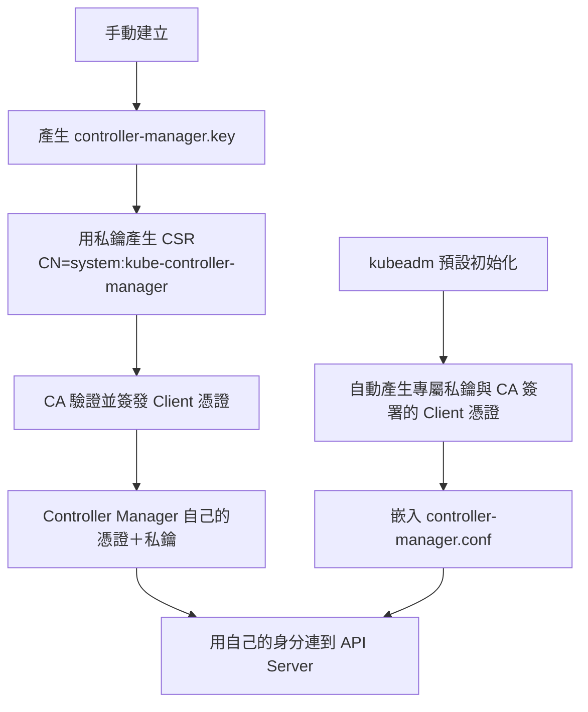
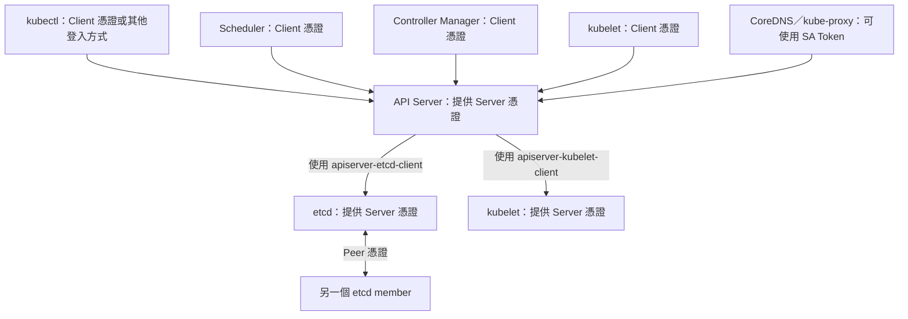
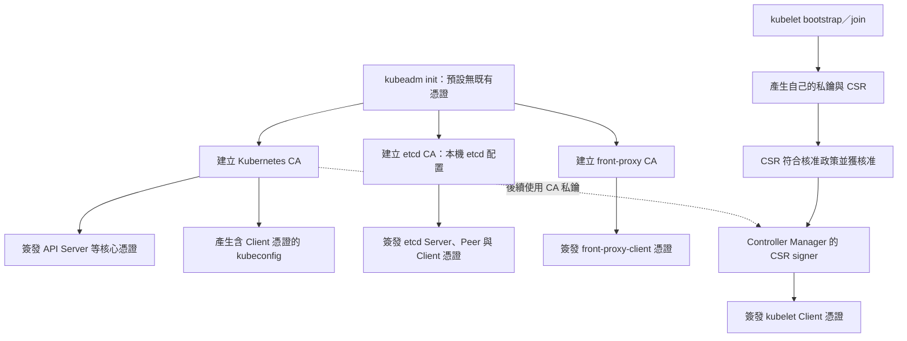
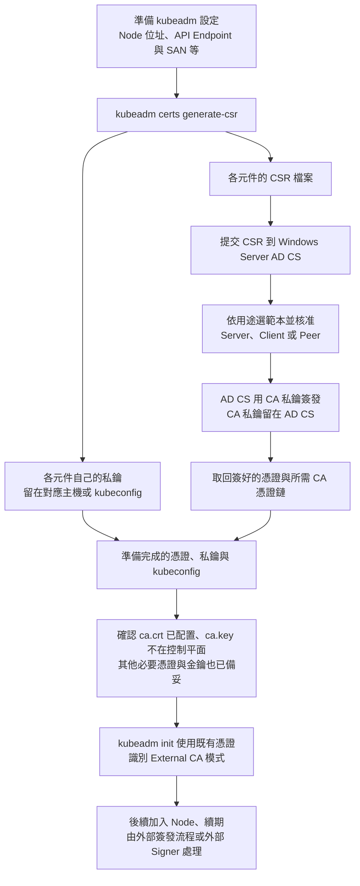

# K8s 的 Certificate

> [!tip] 先記住這句
> **Controller Manager、Scheduler 等使用憑證驗證的元件，各自有自己的憑證與私鑰。kubeadm 幫你自動產生／配置，並沒有把它們變成共用同一組。**
> **獨立 `.crt`／`.key` 檔，或嵌在各自的 kubeconfig 裡，只是存法不同；憑證與私鑰仍然存在。**

再按連線方向分：**接受連線的一方使用 Server Certificate；主動連線的一方使用 Client Certificate 證明身分。** 同一個元件在不同連線上，可以同時扮演 Server 與 Client。下表先看憑證式驗證，Token 的例外放在後面。

## 手動建立與 kubeadm：身分相同，建立方式不同

以 Controller Manager 的 **Client 憑證**為例：



- **手動**：私鑰 → CSR → CA 簽發 Client 憑證 → 配置到 Controller Manager。
- **kubeadm**：代為產生金鑰、簽發並配置憑證；初始化可直接用 CA 私鑰簽發，不一定留下 `.csr` 檔。
- **Scheduler 另外有自己的一組**，身分是 `system:kube-scheduler`，存入自己的 `scheduler.conf`。管理者則使用管理者的那組，不是每個元件都拿 Admin 憑證。
- **可以信任同一個 CA，但不代表共用同一組憑證與私鑰。**

手動產生 Controller Manager 私鑰與 CSR 的重要指令：

```bash
openssl genrsa -out controller-manager.key 2048
openssl req -new -key controller-manager.key \
  -subj "/CN=system:kube-controller-manager" \
  -out controller-manager.csr
```

再由受信任的 Client CA 簽成具有適當 Client Authentication 用途的憑證。**產生 CSR 不是完成簽發，也不是自簽憑證就能登入 API Server。** CA 簽發步驟見 [[Linux OpenSSL 憑證管理完整指南#3. 簽署憑證|OpenSSL 簽署 CSR]]；實際簽署時需依 Client 用途設定擴展。

TLS 原理見 [[PKI (Public key infrastructure)公鑰基礎設施#SSL/TLS 建立過程|TLS 完整流程與金鑰分工]]；元件職責見 [[K8s 各 Component 說明]]。

## 到底幾組：按持有者與用途數

**一組＝一張憑證＋一把對應私鑰。不是整個叢集共用一組，也不是每個元件一定只有一組。**

先只數這三個連 API Server 的身分：

| 身分 | Client 憑證＋私鑰 | 組數 |
|---|---|---|
| Admin | 管理者自己的一組 | 1 |
| Scheduler | Scheduler 自己的一組 | 1 |
| Controller Manager | Controller Manager 自己的一組 | 1 |
| **這三個身分合計** | **3 張 Client 憑證＋3 把私鑰** | **3** |

手動部署時，可以分別命名為 `admin.crt/key`、`scheduler.crt/key`、`controller-manager.crt/key`。**kubeadm 則通常嵌在 `admin.conf`、`scheduler.conf`、`controller-manager.conf`，仍然是三組不同的憑證與私鑰。**

再單獨看 API Server，常見 kubeadm 配置有這三組不同用途：

| API Server 持有哪組 | 類型 | 用途 |
|---|---|---|
| `apiserver.crt`＋`apiserver.key` | **Server** | 接受 Scheduler、kubectl 等連線 |
| `apiserver-etcd-client.crt`＋`.key` | **Client** | 連到 etcd |
| `apiserver-kubelet-client.crt`＋`.key` | **Client** | 連到 kubelet |

**只計上面這份清單，就是 6 組＝6 張憑證＋6 把私鑰。這是 Admin、Scheduler、Controller Manager 與 API Server 的小計，不是整個叢集總數。** CA、etcd、每台 Node 的 kubelet 等要另外加；因此不能把「整個 K8s」固定背成某個總數。

## Server Certificate：先記 API Server、etcd、kubelet

以下以常見 kubeadm 叢集的主要通訊路徑為例：

| 提供 TLS 服務的元件 | 誰會連進來 | Server 憑證與私鑰 |
|---|---|---|
| **kube-apiserver** | kubectl、Scheduler、Controller Manager、kubelet 等 | 自己的 `apiserver.crt`＋`apiserver.key` |
| **etcd** | kube-apiserver | 自己的 `etcd/server.crt`＋`etcd/server.key` |
| **kubelet** | kube-apiserver，例如處理 `logs`、`exec` | 每個 Node 自己的 Serving 憑證＋私鑰；簽發與驗證方式依設定 |

**記法：誰開 TLS 服務讓別人連，誰就使用 Server Certificate。** 這三個是主要路徑，不是叢集只能有這三種 Server 憑證；Webhook、Metrics API、Ingress 等服務也可能有自己的憑證。Scheduler／Controller Manager 的 HTTPS 健康或 metrics 端點亦需依設定看待。

## Client Certificate：誰主動連到服務

| 主動連線的元件／使用者 | 連到誰 | 常見 Client 憑證／身分驗證 |
|---|---|---|
| Scheduler | API Server | **Scheduler 自己的 Client 憑證＋私鑰**，kubeadm 嵌在 `scheduler.conf` |
| Controller Manager | API Server | **Controller Manager 自己的 Client 憑證＋私鑰**，kubeadm 嵌在 `controller-manager.conf` |
| kubelet | API Server | **每台 Node 自己的 Client 憑證＋私鑰**，由 `kubelet.conf` 引用或包含 |
| API Server | etcd | 專用的 `apiserver-etcd-client.crt`＋`.key` |
| API Server | kubelet | 專用的 `apiserver-kubelet-client.crt`＋`.key` |
| kubectl 管理者 | API Server | **管理者自己的 Client 憑證＋私鑰**，kubeadm 嵌在 `admin.conf`；其他登入方式另論 |

**API Server 的 Server 憑證、連 etcd 的 Client 憑證、連 kubelet 的 Client 憑證，是不同用途的憑證。** kubelet 也有「提供服務的 Server 憑證」與「連 API Server 的 Client 憑證」兩種角色。

### 例外：有自己的身分，不一定使用 Client 憑證

CoreDNS 與常見 kubeadm 部署的 kube-proxy 可以使用 **ServiceAccount Token** 連 API Server，不必各有一張 Client 憑證；它們仍需驗證 API Server 的 Server 憑證。其他部署方式也可能讓 kube-proxy 使用 Client 憑證，應以實際 kubeconfig 為準。

### API Server 為什麼同時有 Server 與 Client 憑證

| 連線 | API Server 角色 | API Server 使用哪組 |
|---|---|---|
| Scheduler → API Server | **Server** | `apiserver.crt`＋`apiserver.key` |
| API Server → etcd | **Client** | `apiserver-etcd-client.crt`＋`.key` |
| API Server → kubelet | **Client** | `apiserver-kubelet-client.crt`＋`.key` |

**因此不是「每個元件固定只有一組」；同一個元件也可能因不同連線用途持有多組。**

## Peer Certificate：etcd 成員彼此通訊

**etcd Peer 憑證用於 etcd member 之間的通訊**，例如 Raft 日誌複寫；常見檔名為 `etcd/peer.crt`。

- API Server → etcd：API Server 出示 Client 憑證，etcd 出示 Server 憑證。
- etcd member ↔ etcd member：使用 Peer 憑證，在不同連線中可能同時扮演 Server／Client。
- Peer Certificate 是用途名稱，不是 TLS 另外多出一種握手協定。

## 一張圖看連線角色

箭頭表示主動建立連線的方向；每條連線的接收端提供 Server 憑證。圖中的 Client 身分以常見憑證式配置為例。



### mTLS：雙方都出示憑證

以 Scheduler 連 API Server 為例：

1. API Server 出示 Server 憑證，Scheduler 驗證服務身分。
2. Scheduler 出示 Client 憑證，並證明持有對應私鑰；API Server 驗證其身分。
3. **TLS 負責加密與身分驗證；能做什麼仍由 RBAC 等授權規則決定。**

雙方都以憑證驗證就是 **mTLS（雙向 TLS）**。使用 Token 的 HTTPS 連線則不等於 Client 憑證式 mTLS。TLS 會協商、衍生對稱金鑰保護資料，不是拿這些憑證的公鑰直接加密所有 API 請求。

## 誰簽發：kubeadm 會自動建立嗎

手動指令對照見 [[Linux OpenSSL 憑證管理完整指南#先記兩條路：CA 簽發與 Self-sign|Private key → CSR → CA 簽發／Self-sign]]。

**會。預設執行 `kubeadm init` 時，若沒有提供既有憑證，kubeadm 會建立叢集自用的 CA 金鑰／自簽根憑證，並用對應 CA 私鑰簽發核心元件憑證。** 不需要向公開網際網路 CA 申請，也不需要另外架一台一直運行的 CA Server。

以下以 kubeadm 管理本機 etcd 的一般配置為例：

| 簽發者 | CA 常見檔案（`/etc/kubernetes/pki/` 下） | 簽哪些憑證 |
|---|---|---|
| **Kubernetes CA** | `ca.crt`／`ca.key` | API Server Server 憑證、Scheduler／Controller Manager／管理者 Client 憑證、API Server 連 kubelet 的 Client 憑證等；kubelet Client 憑證也由此信任體系簽發 |
| **etcd CA** | `etcd/ca.crt`／`etcd/ca.key` | etcd Server／Peer／healthcheck-client、API Server 連 etcd 的 Client 憑證 |
| **front-proxy CA** | `front-proxy-ca.crt`／`front-proxy-ca.key` | `front-proxy-client`，用於 API aggregation 代理驗證；不是 kube-proxy 的憑證 |



**分清楚「誰執行簽發」與「憑證的簽發者」**：初始化可由 kubeadm 讀取 CA 私鑰直接簽發；後續 kubelet CSR 可由 Controller Manager 的 signer 使用 CA 私鑰簽發。Issuer 是 CA 的身分，不是「kubeadm」這個指令名稱。

- `kubeadm join` 的 kubelet 通常先用 bootstrap token 取得有限身分，再申請自己的 Client 憑證；後續可自動輪替。
- **kubelet Server／Serving 憑證是例外**：預設可能自簽；若啟用 serving bootstrap，仍需合適的 CSR 核准機制，不能說 kubeadm 預設會替它完成 CA 簽發與自動核准。
- **External CA／既有憑證**：可改用管理者提供的 CA 或憑證；External etcd 的憑證也需依外部 etcd 的管理方式準備。
- **Ingress 的網站憑證、Webhook 等外掛憑證**不會因此全部自動取得；可能另由 cert-manager、公開 CA 或私有 CA 管理。
- CA 的 `.crt` 是可分發的信任憑證；`.key` 是簽發用私鑰，不能分發給所有 Node。元件驗證憑證只需要信任 CA 公鑰，不需要 CA 私鑰。

參考：[kubeadm 憑證管理](https://kubernetes.io/docs/tasks/administer-cluster/kubeadm/kubeadm-certs/)、[kubeadm 憑證與 kubeconfig 建立細節](https://kubernetes.io/docs/reference/setup-tools/kubeadm/implementation-details/)。

### kubeadm 預設 CA 與 External CA：差在哪

**預設：kubeadm 建立 CA 並簽發。External CA：先在外部簽好，kubeadm 再使用。兩種方式下，每個元件仍有自己的憑證與私鑰。**

| 比較 | kubeadm 預設 CA | External CA，例如 Windows Server AD CS |
|---|---|---|
| CA 由誰管理 | kubeadm 初始化建立，管理者後續維護 | 外部 CA 管理者 |
| Kubernetes CA 私鑰 | 一般位於控制平面的 `pki/ca.key` | 留在 AD CS／外部簽發端，不放控制平面 |
| 初始元件憑證 | kubeadm 使用 CA 私鑰簽發 | kubeadm 產生私鑰與 CSR，外部 CA 簽發，再部署回來 |
| 元件自己的私鑰 | 留在使用端或其 kubeconfig | 同樣留在使用端或其 kubeconfig，不隨 CSR 送給 AD CS |
| 後續 kubelet CSR | 內建 Signer 可使用 CA 私鑰簽發 | 要安排外部 Signer 或手動外部簽發 |
| 續期 | kubeadm 管理其支援的元件憑證；CA 本身另行管理 | 外部 CA／整合工具負責，不是 `renew all` 就能處理 |

**使用外部簽好的憑證，與把 CA 私鑰複製給 kubeadm 簽發，是不同做法。** 本節的 External CA 範例採「AD CS 保留 CA 私鑰」。Kubernetes CA、etcd CA、front-proxy CA 的管理方式需各自決定，不能把它們當成同一組。

### AD CS 簽發流程：先簽好，再初始化

以下是**新建叢集**的概念流程，不是把既有叢集直接換 CA 的操作步驟。



AD CS 的憑證範本必須符合 K8s 元件需求：Server 要有正確 SAN 與用途；Client 要保留預期的主體身分與 Client Authentication 用途；Peer 也須符合其雙向使用需求。**不是把所有 CSR 都套普通 Web Server 範本就完成。**

### 重要指令與檔案放回位置

**1. 在待安裝的主機，依已準備好的設定產生私鑰與 CSR：**

```bash
sudo kubeadm certs generate-csr --config kubeadm.yaml
```

這不是向正在運行的 API Server 建立 CSR 物件；它先產生本機檔案，並建立含私鑰、尚待填入簽發憑證的 kubeconfig。設定需先包含正確的叢集／主機資訊。

**2. 將 CSR 交給 AD CS；Windows 提交指令示意：**

```powershell
# ADCS主機、CA名稱、K8sClient 都是示意值，需換成實際設定
certreq -submit -config "ADCS主機\CA名稱" -attrib "CertificateTemplate:K8sClient" controller-manager.csr controller-manager.cer
```

範本名稱、Read／Enroll 權限與核准政策由 AD CS 管理者設定。若申請進入 Pending，需先核准並領取結果，不代表提交後立即有憑證。`.cer` 不保證是文字格式，交給 kubeadm 前需確認是 PEM，並正確配置所需憑證鏈。

**3. 將簽好的憑證放回對應位置：**

| 產物 | 放回哪裡 |
|---|---|
| 元件憑證，例如 API Server | 在對應私鑰旁放置 PEM 格式 `.crt`，例如 `pki/apiserver.crt` |
| kubeconfig 對應的 Client 憑證 | Base64 編碼 PEM 憑證，填入對應 `.conf` 的 `users[].user.client-certificate-data` |
| 私鑰 | 保留原本那把；kubeconfig 的 `client-key-data` 不改成別人的金鑰 |
| 外部 CA 的公開信任憑證 | 配置在適當 CA 檔／信任鏈位置；Kubernetes CA 常見是 `pki/ca.crt` |

etcd／front-proxy 的必要憑證、信任 CA 與 ServiceAccount 簽章金鑰也要備妥，不能只放 Kubernetes 的 `ca.crt` 就初始化。其他控制平面與 Worker 也需要各自的元件身分，按節點角色準備。

**4. 所需憑證與 kubeconfig 全部備妥後，再初始化：**

```bash
sudo kubeadm init --config kubeadm.yaml
```

**External CA 不是一定要另寫 `externalCA: true`。** kubeadm 在 CA 憑證存在、對應 Kubernetes CA 私鑰不在本機，且其他必要憑證與 kubeconfig 已備妥的條件下識別此模式。

**5. 後續檢查期限：**

```bash
sudo kubeadm certs check-expiration
```

這是查看，不是外部 CA 自動續期。**沒有本機 CA 私鑰，Controller Manager 內建 Signer 就不能自行簽發該 CA 的憑證**；K8s CSR API 也不會自動轉送給 AD CS。kubelet 加入與輪替需先安排外部 Signer，或手動簽發／更新 kubeconfig；只核准 CSR 不保證取得憑證。

參考：[kubeadm External CA mode](https://kubernetes.io/docs/tasks/administer-cluster/kubeadm/kubeadm-certs/#external-ca-mode)、[kubeadm certs generate-csr](https://kubernetes.io/docs/reference/setup-tools/kubeadm/kubeadm-certs/#kubeadm-certs-generate-csr)、[Microsoft certreq](https://learn.microsoft.com/en-us/windows-server/administration/windows-commands/certreq_1)。搜尋詞：`kubeadm external CA generate-csr`、`AD CS certreq submit CertificateTemplate`。

## 重要查看指令

常見 kubeadm 路徑是 `/etc/kubernetes/pki/`；Scheduler／Controller Manager 的 Client 憑證可能嵌在 `/etc/kubernetes/*.conf`，不是全部都獨立放在 pki 目錄。

```bash
# 查看 API Server 憑證：簽發者、期限、SAN、用途等
openssl x509 -in /etc/kubernetes/pki/apiserver.crt -noout -text

# kubeadm 管理的憑證到期資訊；不涵蓋所有外掛與 kubelet 自動輪替憑證
sudo kubeadm certs check-expiration
```

憑證與私鑰如何透過 `users` 配置、Context 如何選擇身分與叢集，見 [[K8s kubeconfig、Context 與多叢集管理]]。

憑證／Token 證明身分後，如何用角色授予權限，見 [[K8s RBAC 與 ServiceAccount]]。

## 官方參考與查找關鍵詞

> [!important] Client CSR 完整實作範例
> [Issue a Certificate for a Kubernetes API Client Using a CertificateSigningRequest](https://kubernetes.io/docs/tasks/tls/certificate-issue-client-csr/)
> 流程：產生私鑰與 CSR → 建立 K8s CSR 物件 → 核准 → 領取憑證 → 配置 kubeconfig 與 RBAC。這是 **Client 憑證**的範例。
>
> **搜尋關鍵詞：`issue certificate client CSR`**。已實際測試 `site:kubernetes.io issue certificate client CSR`，可找到此官方頁面。
> 在 Kubernetes 文件站內可搜尋 `certificate client csr`；進入頁面後用下列關鍵詞定位：
> - `Create a CertificateSigningRequest`：CSR YAML、Base64 request、signerName、usages。
> - `Approve`：核准 CSR。
> - `Get the certificate`／`status.certificate`：取得並匯出憑證。
> - `Configure the certificate into kubeconfig`：設定憑證與私鑰。
> - `RoleBinding`：授權；取得憑證不代表自動有操作權限。


- [PKI certificates and requirements](https://kubernetes.io/docs/setup/best-practices/certificates/)：找各元件的憑證用途與常見檔名；搜尋詞 `Kubernetes PKI certificates requirements`。
- [TLS bootstrapping](https://kubernetes.io/docs/reference/access-authn-authz/kubelet-tls-bootstrapping/)：找 kubelet Client／Serving 憑證與 CSR；搜尋詞 `kubelet TLS bootstrapping serving certificate`。
- [X.509 Client Certificates](https://kubernetes.io/docs/reference/access-authn-authz/authentication/#x509-client-certificates)：找 CN／O 對應身分。
- [Certificate Management with kubeadm](https://kubernetes.io/docs/tasks/administer-cluster/kubeadm/kubeadm-certs/)：找 `check-expiration` 與 kubeadm 憑證管理。
