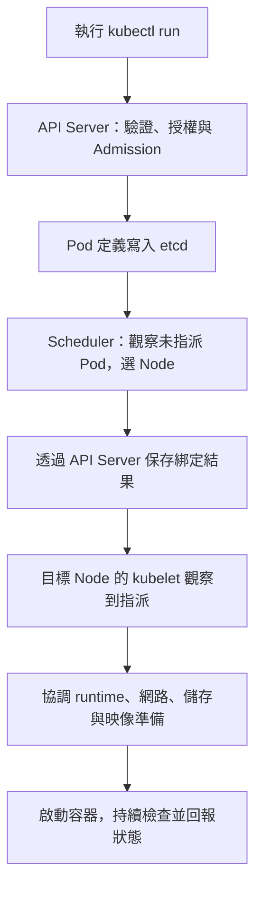

# K8s 考前快速總覽：易混淆觀念與重要指令

## TL;DR

| 遇到什麼 | 先做什麼 |
|---|---|
| 開始操作 | 確認 Context、Namespace、資源名稱 |
| 不記得 kind／API Group | `kubectl api-resources` |
| 不記得 YAML 欄位 | `kubectl explain <資源>.<欄位>` |
| 不記得子命令參數 | `kubectl <子命令> --help` |
| 寫完 YAML | `kubectl apply --dry-run=server -f file.yaml` |
| Pod 有問題 | `describe` 看 Events，`logs` 看程式訊息 |
| 修改完成 | 查實際狀態、測流量／資料，不只看 configured |

- 以下以現有筆記整理實作與易錯重點；考試版本與範圍以 [CNCF 官方課綱](https://github.com/cncf/curriculum)為準。
- 指令中的 `app`、`web-app`、`dev` 等是範例名稱，依題目替換；每組指令不一定要連續執行。

## 1. kubectl、Context 與 API Group

| 易混淆項目 | 正確記法 |
|---|---|
| Cluster／User／Context | 目標叢集／驗證身分／Cluster＋User＋預設 Namespace 的組合 |
| kubeconfig 優先序 | `--kubeconfig` → `KUBECONFIG` → `~/.kube/config` |
| `api-resources`／`api-versions` | 查資源種類／查 API Group 與版本；不是列出已建立的物件 |
| Core API Group | 群組名稱為空；`apiVersion: v1`，RBAC 的 `apiGroups: [""]` |
| 具名 API Group | 例如 Deployment：`apps/v1`，RBAC 填 `apps`，不填版本 |
| `--namespaced=true`／`false` | 屬於某 Namespace／屬於 Cluster；Namespace 物件本身也是 cluster-scoped |
| `explain`／annotation | explain 查 API 欄位；Controller 專屬 annotation 查該實作文件 |
| client／server dry-run | 本機產生／初步檢查；交給 API Server 驗證但不儲存，皆不會真的啟動 Pod |
| `curl -k` | 略過伺服器憑證驗證，不會自動取得 API 權限 |

```bash
kubectl config current-context
kubectl config get-contexts
kubectl config use-context dev
kubectl api-resources --namespaced=false
kubectl explain deployment.spec.template.spec
kubectl create deployment web-app --image=nginx --dry-run=client -o yaml > app.yaml
```

詳見 [K8s kubectl 常用指令](https://blog.walle4561.com/articles/posts/k8s-kubectl-common-commands/)、[K8s kubeconfig、Context 與多叢集管理](https://blog.walle4561.com/articles/posts/k8s-kubeconfig-context-multicluster/)。

### 操作目標與 API 查詢補充

| 操作／觀念 | 快速記法／指令 |
|---|---|
| 單次指定 Context | `kubectl --context dev get pods`；不修改目前預設 Context |
| 改目前 Context 的預設 Namespace | `kubectl config set-context --current --namespace=dev`；不是 RBAC 限制 |
| 檢查目前設定組合 | `kubectl config view --minify` |
| 快速切換工具 | `kubectx dev` 切 Context；`kubens dev` 切 Namespace，皆需另裝 |
| 跨 Session 使用指定 kubeconfig | 將 `export KUBECONFIG=/root/my-kube-config` 寫入實際 Shell 設定檔，再載入 |
| 多份 kubeconfig | Linux／macOS 的 `KUBECONFIG` 用 `:` 分隔；避免 Cluster、User、Context 同名衝突 |
| Core／具名 API 路徑 | `/api/v1`／`/apis/apps/v1`；`curl -k https://控制平面:6443/apis` 仍需適當身分與授權 |
| `-A` 的範圍 | 目前 Context 所指叢集的所有 Namespace，不是所有叢集 |


### JSONPath：先找欄位，簡單表格用 custom-columns

| 需求／語法 | 快速記法 |
|---|---|
| 不知道路徑 | 先 `kubectl get node node01 -o yaml`，沿 status → nodeInfo → kubeletVersion 找 |
| 單一 Node | `-o jsonpath='{.status.nodeInfo.kubeletVersion}'`，不用 items |
| 全部 Nodes | `.items[*]` 表示清單的每個物件；`.items[0]` 是第一個，不保證固定名稱 |
| 一台一行 | `{range .items[*]}` 逐筆 → 輸出欄位與 `{"\n"}` → `{end}` |
| Tab／換行 | `{"\t"}`／`{"\n"}` |
| 陣列條件 | `.status.addresses[?(@.type=="InternalIP")].address`，不猜 addresses[0] |
| JSONPath／custom-columns | 自訂擷取、迴圈、篩選／直接列多欄表格；custom-columns 每欄寫單一物件路徑，不加 items |
| 幾百／幾千個 Node | 先用 `-l` 等伺服器端篩選縮小範圍；JSONPath 本身只是本機處理輸出 |
| JSONPath／JSON Pointer | `.spec.replicas` 查詢輸出／`/spec/replicas` 指定 Patch 路徑 |

簡單表格先用這條：

```bash
kubectl get nodes -o custom-columns='NAME:.metadata.name,CPU:.status.allocatable.cpu,VERSION:.status.nodeInfo.kubeletVersion'
```

完整短例：[JSONPath 與 custom-columns：大量資源只取需要的欄位](https://blog.walle4561.com/articles/posts/k8s-kubectl-common-commands/#jsonpath-與-custom-columns大量資源只取需要的欄位)。

## 2. 控制平面、kubelet 與排錯位置

| 元件 | 主要工作 | 不要混成 |
|---|---|---|
| API Server | 資源 API、驗證、授權、Admission、與 datastore 互動 | 不負責直接執行容器 |
| Scheduler | 替尚未綁定的 Pod 選 Node | 不負責拉 image |
| Controller | 比較期望／現況並調整 | 不只是監控、發通知 |
| kubelet | Node 上管理 Pod 執行，協調 runtime／volume | kubelet 不是 API Server |
| containerd | 容器 runtime，透過 CRI 接收 kubelet 操作 | 不等於 CNI |
| CNI | 設定 Pod 網路 | 不等於 Service 轉送功能 |
| kube-proxy／替代實作 | Service 流量轉送 | 不負責 DNS 名稱解析 |

### kubectl run：從指令到容器啟動

```bash
kubectl run nginx --image=nginx
# 設定 alias k=kubectl 後，也可以寫 k run nginx --image=nginx
```

**先建立 Pod 物件 → Scheduler 選 Node → 該 Node 的 kubelet 協調 runtime 準備環境並啟動容器 → 持續回報狀態。** `kubectl run` 建立的是單一 Pod，不是 Deployment，也不會自動建立 Service。

| 階段 | 誰做什麼 |
|---|---|
| 1. 提交 | kubectl 讀取 kubeconfig，向 API Server 送出建立 Pod 的請求 |
| 2. 檢查並保存 | API Server 完成驗證、授權與 Admission，通過後將 Pod 定義寫入 etcd；此時不代表容器已啟動 |
| 3. 選 Node | Scheduler 經 API Server 發現尚未指派的 Pod，依 requests、Affinity、Taint 等篩選，再評分選 Node |
| 4. 記錄指派 | Scheduler 透過 API Server 完成綁定，保存選定 Node；不是直接叫 Node 執行 |
| 5. 準備與啟動 | 目標 Node 的 kubelet 發現指派，協調 runtime、CNI 與儲存元件；依 imagePullPolicy 與快取處理映像，啟動容器 |
| 6. 持續管理 | kubelet 管理適用的 Probe 與重啟，經 API Server 回報狀態；Running 不等於 Ready |



- Scheduler、kubelet 主動透過 API Server **watch**，圖中是理解順序，不是 API Server 主動逐一派工；Node 端準備動作也不全是嚴格串行。
- **Scheduler 不拉 image**；映像由目標 Node 的 kubelet 協調 runtime 處理。`Always` 也不代表每次重新下載所有快取 layers。
- 單獨用 run 建立的 Pod 沒有 Deployment／ReplicaSet 幫忙補建；容器重啟與整個 Pod 刪除後重建是兩件事。

詳細流程與排錯：[Big Picture：從 k run 到容器執行](https://blog.walle4561.com/articles/posts/k8s-kubelet-pod-execution/#big-picture從-k-run-到容器執行)。

| 現象 | 優先查哪裡 |
|---|---|
| Forbidden／Quota 超標、物件未建立 | 驗證、授權、Admission；Deployment 已建立也可能是其 Pod 被拒絕 |
| Pending＋FailedScheduling | 資源、taint、affinity、PVC 等排程條件 |
| 已指派 Node＋ImagePullBackOff | image 路徑、Registry credentials、網路／TLS |
| FailedCreatePodSandBox／FailedMount | runtime、CNI、volume；看 Events |
| CrashLoopBackOff | 容器錯誤、啟動設定、Probe；看前一次 logs |
| Running 但未 Ready | readinessProbe、容器狀態、應用是否就緒 |
| kubectl 無法連 API | API Server／etcd／網路；Node 上用 journalctl、crictl 查 |

```bash
kubectl describe pod app
kubectl logs app -c app --previous
kubectl get events -n default --sort-by=.metadata.creationTimestamp
sudo crictl ps -a
sudo journalctl -u kubelet -n 80 --no-pager
```

詳見 [K8s 各 Component 說明](https://blog.walle4561.com/articles/posts/k8s-components/)、[K8s kubelet 與 Pod 執行流程](https://blog.walle4561.com/articles/posts/k8s-kubelet-pod-execution/)、[K8s Container Runtime 與 dockershim 遷移](https://blog.walle4561.com/articles/posts/k8s-container-runtime-dockershim/)。

### Admission、Static Pod 與 Runtime

| 易混淆項目 | 正確記法 |
|---|---|
| Mutating／Validating Admission | 修改或補值／判斷是否接受物件；一般 get／list／watch 不經 Admission |
| ImagePolicyWebhook | 映像政策的 Validating Admission；不是自動漏洞掃描，也不等於通用 ValidatingAdmissionWebhook |
| ImagePolicyWebhook 啟用 | `--enable-admission-plugins` 加入項目；`--admission-control-config-file` 指向設定，容器內要能讀到掛載檔案 |
| Static Pod manifest 變更 | kubeadm 常見由 kubelet 偵測 `/etc/kubernetes/manifests/` 變更並重建；備份放目錄外 |
| `kubectl get pods -n kube-system` | 查詢狀態，不會更新 namespace 或觸發重啟 |
| dockershim 移除 | v1.24 移除 Kubernetes 內建橋接層；不代表 Docker 建置的映像不能使用 |
| CRI／containerd／runc | kubelet 與 runtime 的介面／容器生命週期管理／低階 OCI runtime |
| kubectl／crictl | 經 API 管 Kubernetes 物件／Node 上直接查 CRI runtime；API 壞掉時可用後者排錯 |
| `docker pull` 與 runtime 映像 | image store／namespace 不一定相同，不能假設 Kubernetes 一定看得到 |

政策設定與排錯：[ImagePolicyWebhook：映像政策驗證小抄](https://blog.walle4561.com/articles/posts/k8s-kubelet-pod-execution/#imagepolicywebhook映像政策驗證小抄)；Runtime 細節：[K8s Container Runtime 與 dockershim 遷移](https://blog.walle4561.com/articles/posts/k8s-container-runtime-dockershim/)。

## 3. 容器啟動、Init Container、Sidecar 與 Probe

| 概念 | 正確記法 |
|---|---|
| Docker ENTRYPOINT／CMD | 主程式／預設命令或參數；須依有無 ENTRYPOINT 判斷 |
| K8s command／args | 對應覆寫 ENTRYPOINT／CMD；需要 shell 時明確寫 `sh -c` |
| Multi-container | 同 Pod 多容器，共用網路；共享檔案要掛共同 volume |
| 一般 Init Container | 依序執行，成功結束才繼續下一個 |
| Native Sidecar | `initContainers[].restartPolicy: Always`；先啟動、持續輔助，Pod 終止時較晚停止 |
| Sidecar 的 started／Ready | 有 startupProbe 時等它成功才繼續；readinessProbe 不用來阻擋主容器啟動 |
| restartPolicy | 容器退出後是否重啟，不代表健康檢查，也不是重建整個 Pod |
| startupProbe | 是否完成啟動；成功前不執行該容器的 liveness／readiness |
| livenessProbe | 是否健康；失敗達門檻會終止容器，後續依重啟策略處理 |
| readinessProbe | 是否能接收流量；失敗不直接重啟容器，會影響 Pod Ready |

詳見 [K8s 中的 Pod 是什麼](https://blog.walle4561.com/articles/posts/k8s-introduction-pods/)、[Docker ENTRYPOINT、CMD 與 K8s command、args](https://blog.walle4561.com/articles/posts/docker-entrypoint-cmd-k8s-command-args/)。

| Probe 實作 | 快速記法 |
|---|---|
| HTTP／TCP／exec | HTTP 200～399／能建立 TCP 連線／命令 exit code 0 |
| initialDelaySeconds／periodSeconds | 第一次檢查前等待／檢查間隔 |
| timeoutSeconds／failureThreshold | 單次逾時／連續失敗門檻 |
| successThreshold | 連續成功門檻；startup、liveness 必須為 1 |

詳細 YAML：[Probe 實作：HTTP、TCP、exec 與重要參數](https://blog.walle4561.com/articles/posts/k8s-introduction-pods/#probe-實作httptcpexec-與重要參數)。

## 4. SecurityContext、排程與 Node 維護

| 設定 | 正確記法 |
|---|---|
| `runAsUser` | 程序用哪個 UID，0 是 root；非 root UID 仍需映像／檔案權限支援 |
| Pod／container securityContext | 共同欄位以 container 值優先，不是整份設定被替換 |
| capabilities／privileged | 只能放 container 層級；不是 `spec.securityContext.capabilities` |
| NET_ADMIN／SYS_ADMIN | 網路管理能力／廣泛系統管理能力；不要不分需求全部授予 |
| requests／limits | 排程需求與資源分配／使用上限；不是實際用量 |
| nodeSelector／required affinity | 硬性選 Node 條件；preferred affinity 是偏好，不保證 |
| Taint／Toleration | Node 排斥／Pod 容忍；容忍不代表一定被排到該 Node |
| NoSchedule／PreferNoSchedule／NoExecute | 不接受新排程／盡量避開／也可驅逐既有不容忍的 Pod |
| PriorityClass | 優先權與可能的搶占，不會讓 Pod 忽略所有排程限制 |
| cordon／drain／uncordon | **封住／排空／解封**；cordon 保留既有 Pod，uncordon 才恢復一般新排程 |
| Quota／LimitRange | Namespace 總配額／個別資源範圍及部分預設值 |

```bash
kubectl describe node node-1
kubectl get priorityclasses
kubectl cordon node-1
kubectl drain node-1 --ignore-daemonsets
kubectl uncordon node-1
```

- **hr-app 不能移除，但 node01 不接新 Pod：`kubectl cordon node01`；維護完成恢復：`kubectl uncordon node01`。**
- `Ready,SchedulingDisabled`＝節點健康但不可排程，不是節點壞了。
- `--ignore-daemonsets`＝保留略過；`--force`＝允許處理無控制器等 Pod，不是保證自動搬家。
- drain 受 PDB 等條件影響，不是直接把主機關機；不要把刪除 emptyDir 資料的參數當固定選項。
- Node 能排程不代表一定有足夠資源；Pod 的多種硬性條件仍需一起符合。

詳見 [K8s 排程：Scheduler、PriorityClass、Affinity、Taint 與 Toleration](https://blog.walle4561.com/articles/posts/k8s-scheduler-priority-affinity-taints/)、[K8s 中的 Pod 是什麼](https://blog.walle4561.com/articles/posts/k8s-introduction-pods/)、[Node 維護：cordon、drain、uncordon](https://blog.walle4561.com/articles/posts/k8s-kubectl-common-commands/#node-維護cordondrainuncordon)。


### 資源、QoS、Affinity 與 PriorityClass

| 資源設定 | 快速記法 |
|---|---|
| CPU request／CPU limit | 排程需求與競爭權重／使用上限，超過 limit 受 throttling，不是直接被 kill |
| Memory request／Memory limit | 排程需求，不是保證實際占用量／超出上限可能 OOMKilled |
| 只填 limit | 沒有其他 admission 預設時，該資源的 request 可能補成相同值；看建立後的實際物件 |
| LimitRange 的 default／defaultRequest | 預設 limit／預設 request；修改不會回頭重寫既有 Pod |
| ResourceQuota | 計算宣告的配額總量，不是即時 top 用量，也不是預留實體容量 |
| Guaranteed（一般 Container 層設定） | 每個容器 CPU、Memory 的 request 與 limit 皆設定、皆大於 0，且各自相等 |
| BestEffort／Burstable | 無 CPU／Memory requests、limits／不符 Guaranteed 但有相關設定 |
| QoS 與 eviction | 是傾向，不是固定驅逐順序；也看超出 requests 的情況、Priority、使用程度；Pod-level resources 另看詳細規則 |
| OOMKilled／Evicted | 容器程序遭 OOM kill／整個 Pod 因節點壓力等被終止；不能混成同一種重啟 |

| 排程邏輯 | 快速記法 |
|---|---|
| Required Node Affinity 的多個 nodeSelectorTerms | **OR：任一 Term 符合** |
| 同一 Term 的多個 matchExpressions | **AND：全部符合** |
| `In` 的多個 values | 命中任一值即可 |
| IgnoredDuringExecution | 執行後不因該 Affinity 條件改變而驅逐；不會停用 NoExecute 的獨立驅逐機制 |
| PriorityClass | Cluster-scoped；value 越大越優先，不是 CPU、Memory 或速度倍率 |
| priorityClassName／priority | Pod 指定類別名稱／Admission 解析數值，建立時不手填 priority |
| globalDefault | 未指定類別的新 Pod 使用；未設全域預設時通常是 0，不回頭修改既有 Pod |
| preemptionPolicy: Never | 不主動搶占，仍保留排程優先權，仍可能被更高優先權 Pod 搶占 |
| Pod 的 schedulerName | 對應 Scheduler profile 名稱，不是 Scheduler Pod 名稱；沒對應程序就等待，不自動轉交預設 Scheduler |
| Multi-scheduler／multi-profile／HA | 多個邏輯排程程序／同程序多 profiles／同邏輯排程器副本選 Leader |

資源與 QoS：[Pod 的資源管理和限制資源](https://blog.walle4561.com/articles/posts/k8s-introduction-pods/#pod-的資源管理和限制資源)。Affinity、PriorityClass、多排程器：[K8s 排程：Scheduler、PriorityClass、Affinity、Taint 與 Toleration](https://blog.walle4561.com/articles/posts/k8s-scheduler-priority-affinity-taints/)。

### Taint／Toleration：先排除已容忍的，再看剩下的限制

**Taint 放在 Node，表示排斥；Toleration 放在 Pod，表示可以容忍。容忍只是通過這項限制，不會指定排程目的地。**

| 配對邏輯 | 快速記法 |
|---|---|
| `operator: Equal`（預設） | key、value 要相同；指定 effect 時 effect 也要相同 |
| `operator: Exists` | 比對 key，不比對 value，且不填 value；指定 effect 時也要匹配 |
| effect 留空 | 可匹配符合 key／operator 條件的所有 effects |
| 多個 Taints | 每項分別檢查；只容忍其中一項，不會解除其他 Taints 的限制 |
| 多種排程硬條件 | requests、nodeSelector、Required Affinity、未容忍的阻擋性 Taint 等必須全部符合（AND） |

| 剩下未被容忍的 effect | 新 Pod | 已在 Node 執行的 Pod |
|---|---|---|
| `NoSchedule` | 不排入 | 不因此被驅逐 |
| `PreferNoSchedule` | 盡量避開，仍可能排入 | 不因此被驅逐 |
| `NoExecute` | 不排入 | 觸發驅逐 |

範例：Node 有 `dedicated=gpu:NoSchedule`。以下情況只比較這個 Taint，其他排程條件仍需符合：

| Pod 設定 | 結果 |
|---|---|
| 沒有匹配 Toleration | 不能排到這台 Node |
| Equal：key=dedicated、value=gpu、effect=NoSchedule | 通過這個 Taint，仍可能排到其他 Node |
| Equal：key=dedicated、value=cpu、effect=NoSchedule | value 不符，仍被擋住 |
| Exists：key=dedicated、effect=NoSchedule | 不看 value，通過這個 Taint |
| 同時有匹配 Toleration ＋ `nodeSelector: {dedicated: gpu}` | 允許通過 Taint，並把候選 Node 限定為有該 label 的節點 |

**Label 與 Taint 是兩個不同設定**；上例的 nodeSelector 需要 Node 另外具有 `dedicated=gpu` label，不是加了 Taint 就自動有 Label。

Pod `spec` 片段：

```yaml
tolerations:
  - key: dedicated
    operator: Equal
    value: gpu
    effect: NoSchedule
```

| 操作 | 指令／設定 |
|---|---|
| 看 Node Taints | `kubectl describe node node01` |
| 加 Taint | `kubectl taint nodes node01 dedicated=gpu:NoSchedule` |
| 移除 Taint | `kubectl taint nodes node01 dedicated=gpu:NoSchedule-` |
| 看 Pod 的實際容忍設定 | `kubectl get pod app -o yaml`，看 `spec.tolerations` |
| 有限期容忍 NoExecute | 匹配的 Toleration 加 `tolerationSeconds: 120`；Taint 持續存在，期限到後觸發驅逐 |

不設 `tolerationSeconds` 表示無期限容忍這個匹配的 NoExecute Taint，不代表不會因其他原因停止。

詳見 [第三層：Taint 與 Toleration 獨立檢查](https://blog.walle4561.com/articles/posts/k8s-scheduler-priority-affinity-taints/#第三層taint-與-toleration-獨立檢查)；[官方 Taints and Tolerations](https://kubernetes.io/docs/concepts/scheduling-eviction/taint-and-toleration/)。

## 5. Deployment、Rollout 與擴縮

| 操作 | 改什麼／得到什麼 |
|---|---|
| Deployment → ReplicaSet → Pod | 更新策略與期望 → 維持副本 → 執行容器 |
| Scale out／Scale in | 水平擴縮，增加／減少 replicas |
| Scale up／Scale down | 垂直擴縮，增加／減少每個實例的資源配置 |
| `scale`／修改 Pod template | 純副本數變更／觸發 rollout；通常改 Deployment，不直接改其 ReplicaSet |
| RollingUpdate／Recreate | 逐步替換／先終止舊 Pod 再建立新 Pod |
| maxSurge／maxUnavailable | 更新時可多出的 Pod／可不可用的 Pod 數或比例 |
| rollout／rollback | rollout 是推出版本；回滾用 `rollout undo` |
| rollout restart | 觸發重新建立 Pod，不等於換 image 版本 |
| HPA／VPA | 自動調整副本數／針對資源 requests 提供建議或調整 |
| Metrics Server／Prometheus | 近期資源 Metrics API／完整監控與歷史資料；不是互相取代 |

```bash
kubectl scale deployment web-app --replicas=3
kubectl edit deployment web-app
kubectl set image deployment/web-app app=nginx:stable
kubectl rollout status deployment/web-app
kubectl rollout history deployment/web-app
kubectl rollout undo deployment/web-app --to-revision=2
kubectl rollout restart deployment/web-app
kubectl top pods
```

- `resources` 在 Deployment 的 `spec.template.spec.containers[]`；修改這裡通常是 rollout 新 Pod，不是原地調整。
- 回滾 Deployment 不會回滾獨立 Secret、ConfigMap 或資料庫內容。
- HPA 若以 CPU utilization 百分比為目標，對應 CPU requests 是重要計算基準；HPA 也可能改回手動設定的副本數。

詳見 [K8s HPA 與水平、垂直擴縮](https://blog.walle4561.com/articles/posts/k8s-hpa-horizontal-vertical-scaling/)、[K8s Metrics Server、Prometheus 與 Heapster](https://blog.walle4561.com/articles/posts/k8s-metrics-server-prometheus-heapster/)、[Rollout 與回滾：不要只看 roll](https://blog.walle4561.com/articles/posts/k8s-kubectl-common-commands/#rollout-與回滾不要只看-roll)。

### 更新策略：Rolling Update、Blue-green 與 Canary

| 策略 | 新舊版本如何運作 | 流量怎麼切 | 常見實作 |
|---|---|---|---|
| Rolling Update | 在同一 Deployment 中逐步替換舊 Pod，新舊暫時並存 | 由 Service 對就緒後端轉送，不保證精確的新舊流量比例 | Deployment 的 RollingUpdate，調 maxSurge／maxUnavailable |
| Blue-green（藍綠部署） | 準備兩套版本，新版先驗證，舊版暫時保留 | 正式流量從舊版切到新版，例如 100% Blue → 100% Green | 兩個 Deployment；切換 Service selector，或由 Argo Rollouts 管理 |
| Canary（金絲雀部署） | 新舊並存，讓少量流量先使用新版並觀察結果 | 新版比例逐步增加，例如 5% → 20% → 50% → 100% | 分開新舊後端，由支援權重的 Gateway／Istio 等分流，可配合發布控制器自動化 |

| 容易混淆 | 正確記法 |
|---|---|
| Blue／Green | 常把 Blue 稱為目前正式版本、Green 稱為待上線版本；顏色是慣例，不是固定的新舊身分 |
| Deployment strategy.type | 內建是 RollingUpdate／Recreate；不能直接填 BlueGreen 或 Canary，需另外組合資源或使用發布控制器 |
| 藍綠切換 | Service selector 從 version=blue 改成 version=green；需要 Pod labels 匹配，切換傳播與既有連線不一定瞬間完成 |
| Pod 數量比例／流量比例 | 9 個舊 Pod、1 個新 Pod 不保證精確的 90%／10% 請求；連線重用與轉送方式都會影響 |
| Gateway HTTPRoute 權重 | backendRefs.weight 是相對比例，例如 90／10；需已安裝並配置支援的 Gateway Controller |
| Istio | Service Mesh，可協助版本路由與權重分流；不是部署策略，也不是 Canary 必裝元件 |
| Argo Rollouts | 發布控制器，可協調藍綠／Canary 的推進、暫停與分析；和實際轉送流量的元件分工不同 |
| 驗證與回復 | 檢查 Ready、錯誤率、延遲與業務結果再推進；切回舊版不會自動還原資料庫內容 |

官方範例：[Argo Rollouts BlueGreen](https://argoproj.github.io/argo-rollouts/features/bluegreen/)、[Gateway API 流量分配](https://gateway-api.sigs.k8s.io/guides/user-guides/traffic-splitting/)、[Istio Traffic Shifting](https://istio.io/latest/docs/tasks/traffic-management/traffic-shifting/)。

### HPA 與指標來源：哪些需要安裝？

| 項目 | 快速記法／檢查 |
|---|---|
| HPA | Kubernetes 內建；建立規則不是 Helm 安裝 HPA Controller |
| Metrics Server | 額外元件，部分平台已裝；提供近期資源 Metrics API，不保存完整歷史 |
| VPA | 另裝自訂資源定義與控制元件，提供 requests 建議或調整 |
| v1.23 | `autoscaling/v2` 成為穩定版，不是首次有 HPA |
| 自訂／外部指標 | 通常需 metrics adapter／提供者，不能只裝 Metrics Server |
| Prometheus／Heapster | 歷史監控與告警／已 EOL 的舊元件；Prometheus 不自動等於資源 Metrics API |
| Node 擴縮 | 另一層機制；HPA 增加 Pod 不代表 Node 數量自動增加 |
| 三個查詢 | `kubectl api-resources --api-group=autoscaling` 看 API；`kubectl top pods` 看資源指標；`kubectl get hpa` 看規則 |
| top 的用量 | 不是 requests／limits，也不能單憑它判定 Scheduler 應該排在哪 |

詳細比較：[K8s HPA 與水平、垂直擴縮](https://blog.walle4561.com/articles/posts/k8s-hpa-horizontal-vertical-scaling/)、[K8s Metrics Server、Prometheus 與 Heapster](https://blog.walle4561.com/articles/posts/k8s-metrics-server-prometheus-heapster/)。

## 6. Service、CNI 與 DNS

| 易混淆項目 | 正確記法 |
|---|---|
| Service 四種 type | ClusterIP、NodePort、LoadBalancer、ExternalName |
| 第五種常見用法 Headless | `clusterIP: None`，不是第五個 type |
| Service port／targetPort／nodePort | Service 接收 port／後端容器 port／Node 對外 port |
| LoadBalancer／CNI | LoadBalancer 需要相應實作；自管環境可用 MetalLB，這不是因為缺雲端 CNI |
| ExternalName | DNS CNAME 別名，不是代理、也不直接選 Pod |
| Service selector | 比對 Pod labels，不是直接比 Pod 名稱 |
| Flannel | 單獨 flanneld 不執行 NetworkPolicy；可搭額外政策控制器 |
| Calico／Cilium | 能提供政策執行；要確認實際安裝模式與設定 |
| kubectl／kubelet／CoreDNS | 管設定／準備 Pod resolver 設定／回答 DNS 查詢 |
| resolv.conf／Corefile | 程式問哪個 DNS、怎麼補名稱／CoreDNS 怎麼處理查詢 |
| CoreDNS ConfigMap／DNS Service | 通常叫 `coredns`／`kube-dns`，名稱不同很正常 |

| App 在 default，目標 Service 在 payroll | 可用名稱（標準 search、cluster.local） |
|---|---|
| 跨 Namespace | `web-service.payroll`、`web-service.payroll.svc`、`web-service.payroll.svc.cluster.local` |
| 只寫 `web-service` | 先找 App 自己 Namespace 的 Service，不會自動猜 payroll |
| App 與 Service 同 Namespace | 可直接使用 `web-service`，不只 default 有此行為 |

```bash
kubectl get svc,endpointslices -n default
kubectl get pods -n default --show-labels
kubectl get cm coredns -n kube-system -o yaml
kubectl exec app -- cat /etc/resolv.conf
kubectl exec app -- nslookup web-service.payroll
```

詳見 [K8s CoreDNS、kubelet 與 resolv.conf](https://blog.walle4561.com/articles/posts/k8s-coredns-kubelet-resolv-conf/)、[K8s CNI 比較：Cilium、Calico 與 Flannel](https://blog.walle4561.com/articles/posts/k8s-cni-cilium-calico-flannel/)、[K8s Calico 安裝與網路判讀小抄](https://blog.walle4561.com/articles/posts/k8s-calico-install-network-troubleshooting/)、[K8s Cilium 與 Containerlab 網路實驗](https://blog.walle4561.com/articles/posts/k8s-cilium-containerlab-network-lab/)、[Service](https://blog.walle4561.com/articles/posts/k8s-kubectl-common-commands/#service)。

### DNS 與 Service 連線排錯

| 情況 | 先分清楚／先查什麼 |
|---|---|
| CoreDNS ConfigMap／內容 key／檔案 | `coredns`／`data.Corefile`／通常掛載成 `/etc/coredns/Corefile`，大小寫要對 |
| Corefile 的 kubernetes／forward | 回答叢集內名稱／向上游 DNS 轉送其他查詢 |
| 兩份 resolv.conf | App Pod 的設定讓 App 找叢集 DNS；CoreDNS 容器自己的設定供 forward 找上游，不能轉回自己造成迴圈 |
| DNS 解析成功但不能連 | 解析只得到位址，還要查 Service selector、EndpointSlice、targetPort、應用監聽與 NetworkPolicy |
| Service 沒有就緒後端 | `kubectl get endpointslices -n default`，再看 Pod labels、Ready 與 selector |
| 測指定 Host 的 HTTP 入口 | curl 帶正確 Host header，避免把不匹配的路由當成應用故障 |

完整設定：[K8s CoreDNS、kubelet 與 resolv.conf](https://blog.walle4561.com/articles/posts/k8s-coredns-kubelet-resolv-conf/)；Service 排錯：[Service 有建立，但連不到：先查什麼](https://blog.walle4561.com/articles/posts/k8s-kubectl-common-commands/#service-有建立但連不到先查什麼)。

### CNI 比較：Cilium、Calico、Flannel

| 方案 | 主要特性 | 跨 Node 網路例子 | NetworkPolicy |
|---|---|---|---|
| Cilium | eBPF 資料平面，可搭配 Hubble 觀察流量 | VXLAN／Geneve 或 native routing | 支援；須啟用與正確設定政策執行 |
| Calico | L3 網路與政策；標準 Linux 資料平面常用 iptables，也有 eBPF 等選項 | 無封裝路由、VXLAN、IP-in-IP；BGP 依模式設定 | 支援；不必先改成 eBPF 才能執行 |
| Flannel | 著重 Pod 網路連通 | VXLAN、host-gw 等 backend | 單獨 flanneld 不執行；需另外的政策元件，官方 Helm Chart 可整合 |

| 容易混淆 | 正確記法 |
|---|---|
| Bridge／CNI／網路方案 | 主機內 L2 轉送／容器網路設定介面／Calico 等整體實作；不同層次 |
| eBPF／VXLAN／BGP | 核心封包處理技術／overlay 封裝／路由資訊交換；不是互斥選項 |
| Cilium 一定不用 kube-proxy？ | 需確認 kube-proxy replacement 設定，不能只看安裝了 Cilium |
| Calico 就是 BGP？ | 不是，支援多種網路與資料平面模式 |
| Flannel Pod Running 就代表政策有效？ | 不是，要確認政策執行元件並實測允許／禁止流量 |
| 安裝 CNI | 依題目版本、Pod CIDR、資料平面與順序；不可把 lab 的限制當成產品能力限制 |

快速檢查：`kubectl get pods -A -o wide` 看網路元件，`kubectl get nodes` 看 Ready；元件名稱只能提供線索，仍須檢查設定、Events 與實際連線。

詳見 [K8s CNI 比較：Cilium、Calico 與 Flannel](https://blog.walle4561.com/articles/posts/k8s-cni-cilium-calico-flannel/)。官方：[Cilium kube-proxy replacement](https://docs.cilium.io/en/stable/network/kubernetes/kubeproxy-free/)、[Calico eBPF 與標準資料平面](https://docs.tigera.io/calico/latest/about/kubernetes-training/about-ebpf)、[Flannel 與政策元件](https://github.com/flannel-io/flannel)。

## 7. NetworkPolicy：選誰、允許誰、AND／OR

| 位置／規則 | 正確記法 |
|---|---|
| 最外層 `spec.podSelector` | 選本 Namespace 裡「被這份政策管理的 Pod」 |
| `ingress[].from`／`egress[].to` | 允許哪些來源連入／允許連到哪些目的地，不覆蓋外層 selector |
| 同一個 matchLabels 的多個條件 | AND，全部符合才選中；額外 labels 不影響 |
| 同一個 peer 內 namespaceSelector＋podSelector | AND：指定 Namespace 裡的指定 Pod |
| 不同 `from`／`to` 清單項目 | OR，例如 backend Pod 或指定 ipBlock |
| `to`／`from` 直接寫 matchLabels | 錯；中間要有 podSelector／namespaceSelector |
| 多份 NetworkPolicy | 允許規則合併，沒有先後覆蓋順序 |
| backend → db | backend Egress 與 db Ingress 都需允許；未隔離的方向預設允許 |
| 回應流量 | 已允許連線的回應隱含放行，不用另寫反向規則 |
| 隔離 Egress | 留意 DNS UDP／TCP 53，不能只放行業務 port |

```bash
kubectl get netpol -A
kubectl describe netpol internal-policy -n default
kubectl get pods -n default -l name=internal
```

- `podSelector: {}`：選政策所在 Namespace 的全部 Pod。
- 設定 Ingress 隔離但沒有 allow 規則：該方向 default-deny，其他政策仍可放行。
- Policy 建立成功不等於真的執行：要有支援元件，並從允許／禁止的來源實測。

詳見 [K8s NetworkPolicy 網路存取控制](https://blog.walle4561.com/articles/posts/k8s-networkpolicy-network-access-control/)。

## 8. Ingress 與 Gateway API

| 易混淆項目 | 正確記法 |
|---|---|
| Ingress／Ingress Controller | 路由設定／實際執行設定的程式 |
| ingressClassName | 選擇 IngressClass，不一定等於 Deployment 名稱 |
| `--rule` | `host/path=service:port`，右邊是 Service 名稱與 Service port |
| rewrite／redirect | 修改送給後端的路徑／要求用戶端改 URL |
| `/pay` rewrite 成 `/` | 用戶端請求 /pay，後端收到 /；不是反過來 |
| TLS termination | 入口解密 HTTPS；Ingress `spec.tls` 引用同 Namespace 的 TLS Secret |
| annotations | API Server 通常只驗證格式，未必懂 Controller 專屬語意；要查實作文件與 logs |
| GatewayClass／Gateway／Route | Controller 類別／入口 listeners／匹配條件與後端規則 |
| parentRefs／backendRefs | Route 掛到哪個 Gateway／轉到哪個後端 Service |
| allowedRoutes／ReferenceGrant | Gateway 允許哪些 Route 接入／目標 Namespace 授權特定跨 Namespace 引用 |
| HTTPRoute／GRPCRoute／TCPRoute／UDPRoute／TLSRoute | 依協定需求選擇；安裝 CRDs 與實作須支援對應版本／功能 |
| Gateway API／API Gateway | Kubernetes API 規格／產品或架構類別，名稱不能混用 |

```bash
kubectl get ingressclass
kubectl get deploy -A
kubectl create ingress web-app-ingress -n webapp --rule='app.kodekloud.local/*=web-app:80' --dry-run=client -o yaml
kubectl explain ingress.spec.tls
kubectl get gatewayclass,gateway,httproute -A
```

- ingress-nginx annotation 不是所有 Controller 都通用；是否相容要看該 Controller 的 provider 與設定。
- Ingress 標準 API 主要處理 HTTP／HTTPS；不代表實作完全不能透過擴充提供其他功能。
- 檢查 Gateway／Route 的 Accepted、Programmed、ResolvedRefs 等適用狀態，不只確認物件存在。

詳見 [K8s Ingress 與 Gateway API](https://blog.walle4561.com/articles/posts/k8s-ingress-gateway-api/)。

### Gateway 跨 Namespace 與入口檢查

| 設定／情境 | 快速記法 |
|---|---|
| allowedRoutes.namespaces.from | 預設 Same；All 允許所有 Namespace；Selector 依 Namespace labels 篩選 |
| allowedRoutes.kinds | 限定 Route 種類；All 是 Namespace 範圍，不代表 HTTP listener 可接所有協定 |
| 跨 Namespace Route → Gateway | Route 的 parentRefs 指向 Gateway；Gateway listener 的 allowedRoutes 允許接入 |
| 跨 Namespace Route → Service | backendRefs 指定目標 Namespace；通常需目標 Namespace 的 ReferenceGrant 授權 |
| API 查不到 gateway | 先查 `kubectl api-resources --api-group=gateway.networking.k8s.io`，確認 CRDs；還需支援的 Controller 才能實際轉送 |
| Controller 專屬 annotation | 不是 API 標準行為；物件能建立不代表功能有效，要查 Controller 設定與狀態 |

詳見 [Gateway 與 Route 綁定：入口與規則是獨立資源](https://blog.walle4561.com/articles/posts/k8s-ingress-gateway-api/#gateway-與-route-綁定入口與規則是獨立資源)。

## 9. RBAC 與 ServiceAccount

| 概念／組合 | 授權範圍或意義 |
|---|---|
| Authentication／Authorization／Admission | 你是誰／你能做什麼／請求內容是否允許及需否修改 |
| ABAC | Attribute-Based Access Control，不是 Access-Based |
| Role／ClusterRole | Namespace 權限清單／可描述叢集資源或可重用的權限清單 |
| Role＋RoleBinding | 綁定所在 Namespace 的權限 |
| ClusterRole＋RoleBinding | 該 Namespace 的 namespaced 資源權限，不授予 Node 等叢集資源權限 |
| ClusterRole＋ClusterRoleBinding | 叢集範圍授權，具體能力仍由 rules 決定 |
| Pod → ServiceAccount → Binding → Role | Pod 使用身分；Binding 把權限授予身分 |
| ServiceAccount default | 每個 Namespace 各有自己的 default，不是全叢集共用一個 |
| RBAC resources／apiGroups | 填 api-resources 的複數 NAME／APIVERSION 去掉版本後的群組 |
| automountServiceAccountToken: false | 停止預設掛載 API credentials；仍可明確設定 projected token |
| imagePullSecrets／SA token | Registry 拉 image 用／呼叫 Kubernetes API 用，不能互換 |

```bash
kubectl api-resources
kubectl describe role developer -n blue
kubectl describe clusterrole storage-admin
kubectl auth can-i list pods --as=system:serviceaccount:default:dashboard-sa -n default
kubectl set serviceaccount deployment/web-dashboard dashboard-sa -n default
```

- RBAC 裡 Pod 的 API Group 是 `""`；Deployment 是 `apps`；StorageClass 是 `storage.k8s.io`。
- API credentials 常見路徑：`/var/run/secrets/kubernetes.io/serviceaccount/`，包含 token、ca.crt、namespace；只投射 token 不會自動補其他檔案。

詳見 [K8s RBAC 與 ServiceAccount](https://blog.walle4561.com/articles/posts/k8s-rbac-serviceaccount/)。

### 授權、Token 與建立指令補充

| 概念 | 快速記法 |
|---|---|
| 多個 Authorizers | 依序詢問；第一個明確 Allow／Deny 就停止，全部 NoOpinion 才拒絕，不是 AND |
| RBAC 規則 | 沒有 explicit deny；有權限的規則合併，不是後面的覆蓋前面的 |
| AlwaysAllow／AlwaysDeny | 直接允許／拒絕授權；不代表跳過其他 API 處理階段 |
| Node Authorization／NodeRestriction | kubelet 專用授權／Admission 限制，是不同階段 |
| TokenRequest／projected token | 現代常用有期限且可輪替的 Token；建立 SA 不保證自動產生永久 Token Secret |
| automount=false | 停止預設掛載，不移除 RBAC 權限；明確 projected volume 仍可掛 Token |
| SA 身分字串 | `system:serviceaccount:<namespace>:<name>` |
| impersonation | `--as` 需要相應權限；不會自動複製所有群組，群組規則需另外考慮 |

| 操作 | 指令範例 |
|---|---|
| 建立 ServiceAccount | `kubectl create serviceaccount app-reader -n dev` |
| 建立讀 Pod 的 Role | `kubectl create role pod-reader --verb=get,list,watch --resource=pods -n dev` |
| 將 Role 授予 SA | `kubectl create rolebinding app-read-pods --role=pod-reader --serviceaccount=dev:app-reader -n dev` |
| 取得短期 Token | `kubectl create token app-reader -n dev --duration=10m`；實際期限依 API Server 政策 |

前提是 Namespace 已存在；建立類指令可加 `--dry-run=client -o yaml` 產生模板。完整範例：[K8s RBAC 與 ServiceAccount](https://blog.walle4561.com/articles/posts/k8s-rbac-serviceaccount/)。

## 10. ConfigMap、Secret 與兩層加密

| 易混淆項目 | 正確記法 |
|---|---|
| ConfigMap／Secret | 一般設定／敏感資料；Secret Base64 不是加密 |
| secret generic／docker-registry／tls | 一般 Secret／Registry 登入／TLS 憑證與私鑰 |
| `--from-file`／`-f` | 將檔案內容放進物件／讀取完整 Kubernetes 資源定義 |
| envFrom／env.valueFrom | 取整份 keys／選某個 key，可另取環境變數名稱 |
| env／一般 volume／subPath | 不自動更新／檔案稍後更新且應用需重讀／不自動接收更新 |
| Sealed Secrets | kubeseal 加密 YAML 放 Git，Controller 解密成一般 Secret |
| Encryption at Rest | API Server 加密後寫入 etcd；由 EncryptionConfiguration 控制 |
| secretbox | 儲存加密 provider，XSalsa20＋Poly1305，不是 Secret 類型 |
| encryption-config.yaml | API Server 讀取的設定檔，不能當一般資源 apply |
| 新／舊 Secret 儲存加密 | 啟用後新建／更新資料套用；舊資料需重寫 |

```bash
kubectl create configmap app-config --from-literal=APP_ENV=production --dry-run=client -o yaml
kubectl describe secret db-credentials
```

- Secret／ConfigMap／imagePullSecrets 被 Pod 引用時，注意 Namespace 與 key。
- 改 Secret／ConfigMap 不一定讓 Deployment 自動 rollout。
- `kubectl get secret -o yaml` 走 API Server 解密，不能據此判斷 etcd 原始資料是否加密。

詳見 [K8s ConfigMap、Secret 與 Sealed Secrets](https://blog.walle4561.com/articles/posts/k8s-configmap-secret-sealed-secrets/)、[Secret docker-registry：登入私有 Registry 拉取 image](https://blog.walle4561.com/articles/posts/k8s-kubectl-common-commands/#secret-docker-registry登入私有-registry-拉取-image)。

### Secret 與 Registry：設定要放在哪裡

| 設定／操作 | 快速記法 |
|---|---|
| generic Secret | `kubectl create secret generic db-credentials --from-literal=password=示意值`；不要使用示意值當正式密碼 |
| Secret data／stringData | Base64 值／讓 API Server 接受一般字串再轉存，不等於加密 |
| ConfigMap 的 from-file | `kubectl create configmap app-config --from-file=app.conf`，預設以檔名當 key |
| envFrom／valueFrom | 整份 keys 放入環境／用 configMapKeyRef 或 secretKeyRef 選定 name、key |
| 私有 Registry Secret | `kubectl create secret docker-registry`，提供 server、username、password 等參數 |
| Deployment 的 imagePullSecrets | 放在 `spec.template.spec.imagePullSecrets`，引用同 Namespace 的 Registry Secret |
| SealedSecret 的名稱／Namespace | 預設 strict scope 下參與加密範圍，不能任意改名搬 Namespace |
| 儲存加密的第一個 provider | 決定新寫入的加密方式；讀取舊資料仍需保留對應解密能力與金鑰 |

指令與欄位：[K8s ConfigMap、Secret 與 Sealed Secrets](https://blog.walle4561.com/articles/posts/k8s-configmap-secret-sealed-secrets/)、[Secret docker-registry：登入私有 Registry 拉取 image](https://blog.walle4561.com/articles/posts/k8s-kubectl-common-commands/#secret-docker-registry登入私有-registry-拉取-image)。

## 11. PV、PVC、StorageClass 與 CSI

| 概念 | 正確記法 |
|---|---|
| PV／PVC／Pod | 儲存供給（cluster scope）／儲存申請（namespaced）／引用同 Namespace 的 PVC |
| Static／Dynamic Provisioning | 管理者先準備卷與 PV／透過 StorageClass、provisioner 建立卷與 PV |
| StorageClass | 描述 provisioner 與儲存配置；gold／silver 是自訂名稱，不保證特定硬體 |
| PVC 50Gi → PV 100Gi | 一對一綁定，不會自動切出另一個 50Gi 給別人 |
| accessModes | PV 必須滿足 PVC 要求，不是所有情況都要求兩份清單完全相等 |
| RWO／RWX／RWOP | 單一 Node 讀寫／多 Node 讀寫／單一 Pod 讀寫；RWO 不是單一 Pod |
| WaitForFirstConsumer | 等使用者 Pod 的排程條件協調好，再綁定／配置卷；未使用時 Pending 可能正常 |
| 刪一般 Pod／刪 PVC | 獨立 PVC 通常留著／PV 與底層卷是否回收看 reclaimPolicy |
| Retain／Delete | 保留卷待人工處理／由支援的 provisioner 回收 PV 與底層卷 |
| hostPath／TopoLVM | Node 本機目錄／Node 本機 LVM；都不等於自動跨 Node 搬資料 |
| 雲端磁碟／NFS | 磁碟可否重掛受區域與模式限制／多節點可掛共享檔案系統，仍需配置與可達性 |
| CSI／PVC | 介面與申請機制，不保證資料複製或災難復原 |
| attach／mount | 讓卷可被 Node 使用／把檔案系統掛到路徑；本機 TopoLVM 無需外部 attach |
| PVC 擴容 | 提高 PVC requests.storage，Driver 擴大卷，再由 Node 擴大檔案系統 |
| PVC 縮容 | 不支援直接縮小；通常新建小卷並搬資料 |
| StatefulSet | 提供穩定身分與各副本對應儲存；不會自動實作資料庫複製 |

```bash
kubectl get pv
kubectl get pvc,storageclass -n default
kubectl describe pvc lab-data -n default
kubectl get csidrivers
kubectl patch pvc lab-data -p '{"spec":{"resources":{"requests":{"storage":"1Gi"}}}}'
```

- 擴容需 `allowVolumeExpansion: true`、Driver 支援及底層容量；先確認新容量大於原容量。
- 驗證擴容：檔案系統容量、payload／checksum、Pod UID 與 restartCount；RESTARTS=0 不能單獨證明沒重建過。
- reclaimPolicy 不會阻止容器對已掛載目錄執行刪檔，Retain 也不是備份。

詳見 [K8s CSI、PV、PVC 與雲端儲存](https://blog.walle4561.com/articles/posts/k8s-csi-pv-pvc-cloud-storage/)。

### StatefulSet、Deployment 與 PostgreSQL 的 PVC

| 比較／觀念 | 快速記法 |
|---|---|
| Deployment 直接掛 PVC | 可以持久化；同一 Pod template 的固定 claimName 讓全部副本引用同一份 PVC |
| StatefulSet＋volumeClaimTemplates | 固定編號身分，各成員各建立專屬 PVC；不是只改 kind 就自動分開 |
| 名稱例子 | postgres-0 → data-postgres-0；postgres-1 → data-postgres-1 |
| Pod 重建 | StatefulSet 補建同名成員並接回原 PVC；新 UID、IP、Node 仍可能不同 |
| volumeMounts.name | 對應 PVC 模板名 data；不是直接填 data-postgres-0 |
| replicas: 3 | 三個 Pod，不等於 PostgreSQL 自動建立複寫叢集 |
| PostgreSQL replication | 每個程序用自己的資料卷；Primary 傳 WAL，Standby 重播到各自資料目錄 |
| 哪個是 Primary？ | 由資料庫／HA 管理機制設定，不是編號 0 就自動當 Primary |
| RWO／RWX | 單 Node／多 Node 掛載能力，不保證資料庫並行寫入安全；RWO 同 Node 仍可多 Pod |
| 多個 PostgreSQL 共用資料目錄 | 即使 RWX 也不適合；需獨立資料目錄再做 replication |
| 直接用不同 PVC | 可以分離卷，但同一 Deployment 的副本不會自動替換 claimName；仍要核對實際後端是否獨立 |
| StatefulSet 不保證什麼 | 不自動同步資料、選主或搬移本機卷；replication 也不是備份 |

完整比較與欄位關係：[StatefulSet：穩定身分與對應的 PVC](https://blog.walle4561.com/articles/posts/k8s-csi-pv-pvc-cloud-storage/#statefulset穩定身分與對應的-pvc)。

### CSI 與儲存：誰發起、誰執行？

| 元件／設定 | 快速記法 |
|---|---|
| csi-provisioner | 監看儲存需求，呼叫建立／刪除卷 RPC |
| csi-resizer | 發現 PVC 要求擴容，呼叫 ControllerExpandVolume；不是自己直接操作磁碟 |
| csi-snapshotter | 配合快照控制器呼叫 Driver 的快照 RPC |
| Driver 實作 | 負責與實際儲存後端互動；共用 sidecar 不等於每個 Driver 的能力都相同 |
| ControllerPublishVolume／NodePublishVolume | 讓 Node 能使用卷，常對應 attach／在工作負載使用位置提供卷；不是網路服務發布 |
| ControllerExpandVolume／NodeExpandVolume | 先擴大底層卷／再完成 Node 端檔案系統等擴容 |
| FileSystemResizePending | 可能處於底層卷已擴大、檔案系統尚未完成的間隔 |
| Pod volume 名稱與 claimName | volumeMounts.name 對應 volumes.name；persistentVolumeClaim.claimName 對應 PVC 名稱 |
| volumeMounts／volumes 位置 | 前者在 container 下指定掛載路徑，後者在 Pod spec 定義來源 |
| PVC 申請小於既有 PV | 綁定整顆符合條件的 PV，不是磁碟配額；可見容量仍依底層卷與檔案系統 |
| Storage Driver／Volume Driver | image 與容器可寫層／獨立持久資料卷，不能混成同一層 |

具體 RPC、TopoLVM 與掛載 YAML：[K8s CSI、PV、PVC 與雲端儲存](https://blog.walle4561.com/articles/posts/k8s-csi-pv-pvc-cloud-storage/)。

## 12. 憑證、CA 與 kubeconfig

| 易混淆項目 | 正確記法 |
|---|---|
| private key → CSR → certificate | 自己產生私鑰，送 CSR 給 CA，取得簽發的憑證；私鑰不交給 CA |
| Server／Client Certificate | 證明服務端身分／證明主動連線端身分；同一元件可有多種角色 |
| 各 component 的 crt／key | 不同身分、用途通常各自一組；kubeconfig 可內嵌，不一定是獨立檔案 |
| kubeadm 預設 CA／External CA | 自建 CA 與簽發／由外部 CA 簽發並準備所需檔案 |
| Kubernetes CSR API | 申請、核准與簽發協作的 API；不等於可任意簽網站憑證的通用 CA |
| etcd cert-file／key-file | etcd 對客戶端提供服務用的 Server 憑證／私鑰 |
| etcd trusted-ca-file | etcd 用來驗證客戶端憑證的信任 CA |
| etcd peer-* | etcd 成員互相通訊的憑證、私鑰與信任 CA |
| 憑證到期／CA 到期 | 不要假設全部會自動更新；依管理方式與輪替機制處理 |

```bash
openssl x509 -in /etc/kubernetes/pki/apiserver.crt -noout -text
sudo kubeadm certs check-expiration
kubectl get csr
kubectl certificate approve <CSR名稱>
```

詳見 [K8s 的 Certificate](https://blog.walle4561.com/articles/posts/k8s-certificate/)、[K8s kubeconfig、Context 與多叢集管理](https://blog.walle4561.com/articles/posts/k8s-kubeconfig-context-multicluster/)。

### 憑證持有者與連線方向

| 連線／情境 | 快速記法 |
|---|---|
| kubectl、Controller Manager、Scheduler → API Server | 各自的 Client 憑證／驗證方式；不是全部共用 admin 那一組 |
| API Server → etcd／kubelet | API Server 在這些連線扮演 Client，與對外提供服務的 Server 憑證不同 |
| etcd 成員 → 其他 etcd 成員 | peer 憑證與信任 CA；不等於只配置 server.crt 就完成 |
| kubeconfig 內嵌憑證 | 各身分仍有自己的憑證與私鑰，只是存入各自 `.conf`，不必都有獨立 `.crt` 檔 |
| kubeadm External CA | 外部簽發並準備所需憑證；CA 私鑰留在外部，不是把私鑰塞進 CSR |
| AD CS | 產生 key／CSR → 依正確模板簽發 → 驗證用途與 SAN → 放回預期位置 |

詳見 [K8s 的 Certificate](https://blog.walle4561.com/articles/posts/k8s-certificate/)。

## 13. kubeadm、HA 與 etcd

| 項目 | 正確記法 |
|---|---|
| kubeadm init／join | 初始化 Control Plane／讓新 Node 加入叢集 |
| containerd config default | 輸出 runtime 設定；不是 containerd init |
| SystemdCgroup／CRI | 確認對應主版本的 runc options；disabled_plugins 不可停用 cri |
| init 完成但 Node NotReady | kubeadm 不會自動裝好所有 CNI，需看原因 |
| Stacked／External etcd | 與控制平面共置／獨立機器部署 |
| etcd Leader | 協調寫入並複寫日誌，不是只有 Leader 保存資料 |
| quorum | `floor(N/2)+1`；3 個 voter 需 2 個確認，包含 Leader 自己 |
| 3／4 個 etcd voter | 都只能容忍失去 1 個；偶數不會讓 Raft 自動產生雙 Leader 提交 |
| controller-manager 選主 | 用 Lease 協調主要控制工作；不同於 etcd 的 Raft 共識 |
| 15／10／2 秒 | 選主 lease duration／renew deadline／retry period；不是相加算切換時間 |
| MicroK8s HA | 常用 dqlite；不要直接套用 etcd 維運指令 |

```bash
containerd config default | sudo tee /etc/containerd/config.toml
sudo kubeadm token create --print-join-command
kubectl get nodes -o wide
kubectl get lease kube-controller-manager -n kube-system -o yaml
```

產生 containerd 設定會覆寫檔案；這是新節點設定例子，不要對既有 runtime 直接重置。

詳見 [K8s kubeadm 安裝：containerd、init 與 join](https://blog.walle4561.com/articles/posts/k8s-kubeadm-containerd-init-join/)、[K8s HA、Quorum 與 Split-brain](https://blog.walle4561.com/articles/posts/k8s-ha-quorum-split-brain/)、[MicroK8s 高可用安裝與設定](https://blog.walle4561.com/articles/posts/microk8s-完整部署指南-從安裝到生產級應用/)。

### 叢集交付方式

| 類型 | 快速記法 |
|---|---|
| Turnkey | 整合好交付使用，後續仍可能自己維護 |
| Hosted／Managed | 供應商代管部分或全部叢集；實際責任看服務，不包含所有應用與資料維運 |
| kubeadm | 初始化／加入叢集的工具，不包辦 OS、runtime、CNI 與完整維運 |

分類可重疊，歷史產品名稱不當作現行產品清單。詳見 [叢集部署方式：Turnkey、Hosted 與 kubeadm](https://blog.walle4561.com/articles/posts/k8s-components/#叢集部署方式turnkeyhosted-與-kubeadm)。

### 叢集升級：先 Control Plane，再逐台 Worker

| 階段 | 快速記法／重要指令 |
|---|---|
| 套件來源 | 對應目標 minor；`apt-get update` → `apt-cache madison kubeadm` |
| 升級工具 | unhold → `apt-get install kubeadm=完整版本` → hold |
| 第一台 Control Plane | `kubeadm upgrade plan` → `kubeadm upgrade apply v1.35.0` |
| 其他 Control Plane／Worker | 本機執行 `kubeadm upgrade node`；Worker 不用 apply |
| 排空目標 Node | 在管理端執行 `kubectl drain node01 --ignore-daemonsets`，在更新 kubelet 前完成 |
| 更新 kubelet | 安裝指定版本 → `systemctl daemon-reload` → `systemctl restart kubelet` |
| 驗證與恢復 | `kubectl get nodes` 確認 Ready 與版本 → `kubectl uncordon node01` |

`kubeadm` 工具、控制平面元件、`kubelet` 是不同更新步驟；`kubectl get nodes` 的 VERSION 是 kubelet。完整順序與套件指令：[K8s kubeadm 叢集升級：Control Plane 與 Worker](https://blog.walle4561.com/articles/posts/k8s-kubeadm-cluster-upgrade/)。

- **升級必查官方文件**：[切換套件來源](https://kubernetes.io/docs/tasks/administer-cluster/kubeadm/change-package-repository/) → [kubeadm 升級流程](https://kubernetes.io/docs/tasks/administer-cluster/kubeadm/kubeadm-upgrade/)。

### etcd 備份還原：save、status、restore

| 用途 | 重要指令／觀念 |
|---|---|
| 備份運作中的 etcd | `etcdctl snapshot save snapshot.db`；TLS 環境加 endpoint、CA、client cert／key |
| 檢查快照 | `etcdutl snapshot status snapshot.db -w table` |
| 還原到新目錄 | `etcdutl snapshot restore snapshot.db --data-dir=/var/lib/etcd-restored` |
| Static Pod 接回資料 | restore 不會自動切換；需按恢復流程讓 etcd 使用新目錄，核對 `etcd-data` 的 hostPath 與容器掛載 |
| 資源匯出／資料庫備份 | `kubectl get all -A -o yaml` 只匯出部分資源；不等於 etcd snapshot |
| 不包含什麼 | 快照不含 PVC 裡的實際檔案，也不代替 CA／節點設定備份 |

**備份後不必立即 restore；還原是恢復叢集的操作，需處理 API Server、etcd 與成員設定，不是只執行一條指令。**

完整 TLS 指令、還原步驟與官方文件：[etcd 備份與還原：etcdctl、etcdutl](https://blog.walle4561.com/articles/posts/k8s-ha-quorum-split-brain/#etcd-備份與還原etcdctletcdutl)。

### Version Skew Policy：元件可以差幾個版本？

**這是 Kubernetes 官方的版本偏差政策。以 API Server 的 `1.x` 為基準，比較的是 minor version（次版本），不是 patch version。** 下表假設各 API Server 都是同一個 minor version。

| 元件 | 相對於 API Server 的支援範圍 | API Server 為 1.35 時 |
|---|---|---|
| kubectl | `x−1`、`x`、`x＋1` | 1.34～1.36 |
| kubelet | `x−3` 到 `x`；不可比 API Server 新 | 1.32～1.35 |
| kube-proxy | `x−3` 到 `x`；不可比 API Server 新 | 1.32～1.35 |
| kube-controller-manager | `x−1` 或 `x`；通常應同版 | 1.34、1.35 |
| kube-scheduler | `x−1` 或 `x`；通常應同版 | 1.34、1.35 |

- **kubectl 可新一版或舊一版；表中其他元件不能比 API Server 新。** 這是相容範圍，主要支援逐步升級，不是要求刻意混裝。
- HA 叢集若有不同版本的 API Server，元件要同時符合所有會連到的 API Server 限制，取允許範圍的交集。
- 例如 API Server 同時有 1.35／1.34：kubectl 可用 1.34／1.35；kubelet／kube-proxy 可用 1.32～1.34；會連到兩者的 controller-manager／scheduler 可用 1.34。
- kube-proxy 也需符合與同 Node kubelet 的版本偏差限制。kubeadm 等部署工具可能另有更嚴格規則，升級步驟不能只靠這張表決定。
- 舊版例外：小於 1.25 的 kubelet／kube-proxy 只允許比 API Server 舊兩個 minor；不要把新政策直接套回所有歷史版本。

官方：[Version Skew Policy](https://kubernetes.io/releases/version-skew-policy/)。搜尋關鍵詞：`version skew policy`、`supported component upgrade order`。

## 14. CustomResourceDefinition、Controller 與 Operator

| 名稱 | 記法 |
|---|---|
| CustomResourceDefinition | 定義新 kind、欄位格式、API Group 與 scope |
| Custom Resource | 依該種類建立的實際物件，描述期望 |
| Controller | 觀察 → 比較 → 調整，實際執行管理邏輯 |
| Operator | 特定應用的自動管理工具，可包含一個或多個 Controller |
| Operator Framework | 開發與管理 Operator 的工具組 |
| OperatorHub.io | 找現成 Operator 的目錄 |
| 只有定義、沒有 Controller | 物件可存入 API，不代表應用會自動建立 |

- etcd Operator 的概念例子：EtcdCluster／EtcdBackup／EtcdRestore，對應叢集管理／備份／還原；舊 CoreOS 專案已封存。
- Controller 也要有 API 身分與權限，通常由 ServiceAccount＋RBAC 提供。

```bash
kubectl get crd
kubectl api-resources --api-group=example.com
```

詳見 [K8s CRD、Custom Resource 與 Controller](https://blog.walle4561.com/articles/posts/k8s-crd-custom-resource-controller/)。

## 15. Helm：套件、安裝實例與修訂版本

| 觀念／操作 | 快速記法／重要指令 |
|---|---|
| Chart／Template／Values／Release | 套件／YAML 模板／設定值／一次安裝的實例 |
| 整體流程 | Chart ＋ Values → 渲染 YAML → API Server → 建立資源並管理 Release |
| 加入／列出 Repository | `helm repo add 別名 URL`／`helm repo list` |
| 更新索引／查 Chart | `helm repo update`／`helm search repo nginx` |
| 下載 Chart，不部署 | `helm pull bitnami/nginx`；加 `--untar` 解壓縮 |
| 安裝 | `helm install amaze-surf bitnami/apache`；前者是 Release 名稱 |
| 跨 namespace 查 Releases | `helm list -A`；計算 nginx 實例看 CHART 欄，不是 NAME |
| 看預設／實際自訂 Values | `helm show values repo/chart`／`helm get values release-name` |
| 預覽／除錯 | `helm template 名稱 repo/chart`；`--debug` 不阻止部署，模擬要加 `--dry-run` |
| 更新／查歷史 | `helm upgrade 名稱 repo/chart`／`helm history 名稱` |
| 回滾 | `helm rollback nginx-release 1`：回到 revision 1 的 Chart 與設定，並新增 revision |
| 移除 | `helm uninstall 名稱`；資料是否保留另看資源與 Chart 設定 |
| Helm 2／3／4 | 2 使用 Tiller；3／4 無 Tiller，使用 kubeconfig 身分與 Kubernetes 授權 |

**Release revision、Chart 版本、應用版本是三件事；rollback 不會自動回復 PVC 裡的資料。** Release 在其他 namespace，查詢與操作時加 `-n`。

詳見 [K8s Helm：Chart、Template、Values 與 Release](https://blog.walle4561.com/articles/posts/k8s-helm-chart-template-values-release/)。

## 16. Kustomize：Base 與 Overlay

| 觀念／操作 | 快速記法／指令 |
|---|---|
| Base | 放共用 Kubernetes YAML，不綁定特定環境 |
| Overlay | 引用 Base，再透過 patch 等設定調整；不是整份取代 Base |
| 常見結構 | `base/`、`overlays/dev/`、`overlays/prod/`；名稱是慣例，引用關係看 kustomization.yaml |
| 常用欄位 | resources 引用資源；replicas 改數量；images 改映像；patches 做局部修改 |
| 預覽／部署 | `kubectl kustomize overlays/prod`／`kubectl apply -k overlays/prod` |
| 比較／驗證 | `kubectl diff -k overlays/prod`／`kubectl apply --dry-run=server -k overlays/prod` |
| `-f`／`-k` | 讀資源檔／讀 Kustomization 目錄並建置；建置不改寫原本 Base 檔案 |
| Helm／Kustomize | Chart 模板與 Values／Base YAML 與環境差異；Kustomize 本身不管理 Helm Release 歷史 |

詳見 [K8s Kustomize：Base 與 Overlay](https://blog.walle4561.com/articles/posts/k8s-kustomize-base-overlay/)，含目錄結構與 prod 將副本數從 1 改成 3 的完整範例。

### Kustomize 分層與 Common transformations

| 觀念／設定 | 快速記法 |
|---|---|
| 子目錄 | 各有 kustomization.yaml，用 resources 列 deployment.yaml、service.yaml |
| 上層組合 | resources 引用 backend、frontend 資料夾，遞迴建置各自清單；不自動掃描所有目錄 |
| 路徑與檔名 | 相對於各層設定檔所在目錄；慣用 kustomization.yaml，不是 kustomize.yml |
| 元件／環境分層 | frontend／backend 分元件；base／overlays 分共用與環境差異，可一起用 |
| Common transformations | 對這層收集的資源做共同調整，不必逐份改原 YAML |
| namePrefix／nameSuffix | 為資源名稱加前綴／後綴，例如 prod-backend |
| namespace | 改 namespaced 資源的 Namespace，不自動建立 Namespace |
| labels／commonAnnotations | 加共同標籤／註記；labels 可控制是否包含 selector 與 Pod template |
| commonLabels 注意事項 | 舊教材常見，也影響 selector；不要不經檢查就改已建立 Deployment 的 selector |
| 預覽／部署根目錄 | `kubectl kustomize .`／`kubectl apply -k .` |

目錄結構與 YAML：[分層組合：子目錄管資源，上層引用資料夾](https://blog.walle4561.com/articles/posts/k8s-kustomize-base-overlay/#分層組合子目錄管資源上層引用資料夾)；共同設定：[Common transformations：對一組資源套用共同調整](https://blog.walle4561.com/articles/posts/k8s-kustomize-base-overlay/#common-transformations對一組資源套用共同調整)。

### Base／Overlay／Component：基本款、環境、可選配件

| 類型 | 用途 | kind／引用 |
|---|---|---|
| Base | 共用基本 YAML | Kustomization，由 resources 引用 |
| Overlay | dev／prod 的組合與差異 | Kustomization，build／apply -k 指向環境目錄 |
| Component | 多個環境可選用的共用功能，可帶資源與 Patch | Component，由 components 引用；可修改父層已載入的資源 |

| 重點 | 快速記法 |
|---|---|
| 目錄例子 | base、components/logging、overlays/dev、overlays/prod |
| API 版本 | 一般 Kustomization 用 v1beta1；Component 用 kustomize.config.k8s.io/v1alpha1 |
| prod 選用、dev 不選用 | prod 的 components 引 ../../components/logging，dev 不引用 |
| 不是自動啟用服務 | 名為 logging 的 Component 若只加 annotation，不會自己安裝 logging 系統 |
| 本機建置 | 不必安裝 Component CRD；支援能力看使用的 Kustomize 版本 |

短 YAML 與目錄：[Component：多個環境可選用的共用配件](https://blog.walle4561.com/articles/posts/k8s-kustomize-base-overlay/#component多個環境可選用的共用配件)。

### Kustomize images：名稱、tag、digest

| 欄位／觀念 | 快速記法 |
|---|---|
| images 位置 | kustomization.yaml 最外層，和 resources 同層 |
| name | 匹配原始 image 名稱，不是 container name；注意 Registry 路徑 |
| newName | 換映像名稱／Registry 路徑 |
| newTag | 換 tag，例如 `"1.27"`；只改 tag 不必填 newName |
| digest | 指定實際 sha256 內容識別，輸出使用 `image@sha256:…`；不是另一個 tag |
| 短例 | name=nginx、newName=registry.example.com/team/nginx、newTag="1.27" → `registry.example.com/team/nginx:1.27` |
| 預覽限制 | `kubectl kustomize .` 可驗證產出，但不確認 Registry 中的 image 是否存在或可拉取 |

短 YAML 範例：[Images transformation：換映像名稱、tag 或 digest](https://blog.walle4561.com/articles/posts/k8s-kustomize-base-overlay/#images-transformation換映像名稱tag-或-digest)。

### Helm vs Kustomize：套件管理與 YAML 客製化

**Helm 可以類比成 Kubernetes 應用的 APT：從來源取得 Chart，安裝後用 Release 管理更新與回滾。Kustomize 則以共用 YAML 為基礎，加入各環境的差異設定。** 這是用途類比，Helm 不會像 APT 那樣安裝 Node 的作業系統套件。

| 比較 | Helm | Kustomize |
|---|---|---|
| 核心定位 | 應用套件與 Release 管理 | Kubernetes YAML 的組合與客製化 |
| 設定方式 | Chart 模板 ＋ Values | Base YAML ＋ Overlay／Patch |
| 語法 | 模板常混合 YAML 與 Go template，例：`{{ .Values.replicaCount }}` | 一般 YAML 資源與 kustomization.yaml，不必使用 Go template |
| 需要學什麼 | YAML 外，還有模板變數、條件、迴圈與函式，通常多一層語法負擔 | 資源引用、patch 目標與合併規則，也不是完全不用學新規則 |
| 管理範圍 | 一份 Chart 可包含 Deployment、Service、ConfigMap 等一組資源 | 對一組資源做環境差異調整，單獨使用時不提供 Helm Release 歷史 |
| 最終交給 Kubernetes 的內容 | 渲染完成的 Kubernetes YAML | 建置完成的 Kubernetes YAML |

**不是「Helm 不是 YAML」：values.yaml 本身是 YAML，模板可能含 Go template 語法，渲染後才是可交給 Kubernetes 的資源 YAML。**

### 環境差異：Kustomize Patch vs Helm Values

| 比較 | Kustomize | Helm |
|---|---|---|
| 環境設定放哪裡 | overlays/dev 或 overlays/prod/kustomization.yaml | values-dev.yaml／values-prod.yaml |
| 局部調整方式 | patches 可直接內嵌，指定 target 與修改路徑；也可引用獨立 patch 檔 | 改 Values，但需 Chart 模板實際使用對應 key |
| Memory 短例 | replace 路徑 `/spec/template/spec/containers/0/resources/requests/memory`，value=512Mi | `resources.requests.memory: 512Mi`，模板須對應讀取；key 依 Chart 決定 |
| 能否隨意加最外層欄位 | 不可直接寫 memory，Kustomization 沒這個欄位 | 自訂 key 不會自動對應 Kubernetes 欄位；未使用通常不生效，也可能被 schema 拒絕 |
| 特定環境／全環境 | 改 Overlay／改 Base | 改環境 Values／改共用預設值或模板 |
| 預覽 | `kubectl kustomize overlays/prod` | `helm template my-app repo/chart -f values-prod.yaml` |

| Patch 寫法／辨識 | 快速記法 |
|---|---|
| Inline／Separate file | patches 的 patch 區塊字串／path 引用獨立檔案；路徑相對於 kustomization.yaml |
| JSON 6902／Strategic Merge | op 與精確路徑／資源片段依 schema 合併 |
| Strategic Merge 未另設 target | apiVersion、kind、metadata.name 辨識目標；需要時加 metadata.namespace |
| name 改成 web-app-1 | 改找另一個物件，不是把 web-app 改名；找不到通常建置失敗 |
| 兩種 path | patches[].path 是檔案；JSON Patch 操作的 path 是物件欄位路徑 |

短例：[Separate file：Patch 可以放在獨立檔案](https://blog.walle4561.com/articles/posts/k8s-kustomize-base-overlay/#separate-filepatch-可以放在獨立檔案)。

| Patch 類型／存放方式 | Inline patch | Separate file |
|---|---|---|
| JSON 6902 | 可以，op 清單＋target | 可以，path 引檔案＋target |
| Strategic Merge | 可以，資源 YAML 片段 | 可以，path 引資源片段 |

| 替換／路徑 | 快速記法 |
|---|---|
| JSON Patch `op: replace` | 替換既有 path 的值，可替換 scalar、map 或 list |
| Strategic Merge `$patch: replace` | 指示 map／list 整塊取代，不照一般合併規則；未寫則依 schema 合併 |
| JSON Pointer／JSONPath | `/spec/replicas` 是 Patch 的 Pointer；`{.spec.replicas}` 是查詢輸出的 JSONPath |

| JSON Patch op | 用途／必要資料 |
|---|---|
| add | 新增／插入，帶 value；父路徑需存在，對既有物件 key 會替換 |
| replace | 改既有值，帶 value；路徑需存在 |
| remove | 刪除既有位置，不帶 value |
| copy | from 複製到 path，保留來源 |
| move | from 移動到 path，移除來源 |
| test | 與 value 比較，不同則失敗，不改資料 |

| 刪除／list 行為 | Strategic Merge | JSON 6902 |
|---|---|---|
| 刪一般欄位 | `nodeSelector: null` | remove 指定 `/spec/template/spec/nodeSelector`，不填 value |
| 新增容器 | containers 寫 name=logger，依內建 Deployment 的 name 合併 | add 指定 `/spec/template/spec/containers/-`，value 放完整容器 |
| 同名容器 | 合併修改該容器 | /- 直接追加，不按 name 更新，可能造成重名 |
| 其他 list | 看 schema，有些直接整份取代 | 看索引／路徑，/- 追加需既有陣列 |
| null 的不同語意 | 合併 Patch 中代表刪欄位 | value: null 是設定 null，不等於 remove |

| Index／刪除語法 | 快速記法 |
|---|---|
| index 從 0 開始 | containers/0 第一個、containers/1 第二個 |
| remove 後索引改變 | 刪 index 0 後，原 index 1 變成 0；操作依序計算 |
| JSON Patch 刪第二個容器 | `op: remove`，path=`/spec/template/spec/containers/1` |
| Strategic Merge 刪 logger | containers 清單項目寫 `name: logger` 與 `$patch: delete`；不按索引 |
| `$patch` 在 map／list | map 直接寫；list 放在對應清單項目並帶匹配 key；`-` 只是 YAML 清單符號 |
| 不可混用 | JSON Patch 沒有 op: delete；Strategic Merge 不寫 $patch: remove |

短例：[陣列 index 與刪除操作：不要混用 remove／delete](https://blog.walle4561.com/articles/posts/k8s-kustomize-base-overlay/#陣列-index-與刪除操作不要混用-removedelete)。

**YAML 的 `-` 是清單項目；JSON Pointer 的 `/-` 才是 add 追加末尾。** 短例：[刪欄位與新增 list：null、remove、/- 與依 name 合併](https://blog.walle4561.com/articles/posts/k8s-kustomize-base-overlay/#刪欄位與新增-listnullremove--與依-name-合併)。

短例：[兩種 replace：路徑替換 vs 合併指示](https://blog.walle4561.com/articles/posts/k8s-kustomize-base-overlay/#兩種-replace路徑替換-vs-合併指示)。操作依序執行；陣列移除會影響後續索引。

**不是一定要另開 Patch 檔案；Overlay 是位置，Patch 是方法。** 上例 replace 要求路徑已存在，containers/0 指第一個容器。

短 YAML：[Patches：直接寫在環境 Overlay 裡做局部修改](https://blog.walle4561.com/articles/posts/k8s-kustomize-base-overlay/#patches直接寫在環境-overlay-裡做局部修改)；模板對照：[Values 要有模板讀取才會生效](https://blog.walle4561.com/articles/posts/k8s-helm-chart-template-values-release/#values-要有模板讀取才會生效)。

## 17. Job 與 CronJob：完成工作與定時觸發

| 觀念／設定 | 快速記法 |
|---|---|
| Deployment／Job／CronJob | 持續運行／工作成功完成／按時間建立 Job，再建立 Pod |
| apiVersion／kind | Job、CronJob 都是 batch/v1；kind 用單數與正確大小寫 |
| completions | 需要成功完成幾個 Pod；失敗不算成功數 |
| parallelism | 希望同時跑幾個 Pod，不是總完成數 |
| backoffLimit | 失敗重試限制；不是總 Pod 數，也不是每個成功名額各有額度 |
| restartPolicy | Job 的 Pod 只用 Never／OnFailure；OnFailure 的容器重啟也參與失敗限制判斷 |
| Job 的容器位置 | `spec.template.spec.containers` |
| CronJob 的 Job 設定 | `spec.jobTemplate.spec`：放 completions、parallelism、backoffLimit 等 |
| CronJob 的容器位置 | `spec.jobTemplate.spec.template.spec.containers`；restartPolicy 與 containers 同層 |
| schedule | 分、時、日、月、星期；`"30 21 * * *"` 每天 21:30，星期 0 是週日 |
| timeZone | 例如 Asia/Taipei；沒指定時依 controller-manager 的本機時區 |
| 完成／刪除 | Completed 是執行結束，Pod 不會因此立刻消失 |
| ttlSecondsAfterFinished | Job 結束後等待指定秒數，再清理 Job 與其 Pod |
| concurrencyPolicy | Allow 可重疊；Forbid 避免同一 CronJob 重疊；Replace 替換前一輪 |
| 常見拼字／層級錯誤 | `CronJob`、`jobTemplate` 的 T 大寫、template 下還有 spec |

| 操作 | 指令 |
|---|---|
| 建立 Job | `kubectl create job hello --image=busybox:1.36 -- echo Hello` |
| 產生 CronJob YAML | `kubectl create cronjob hello --image=busybox:1.36 --schedule='30 21 * * *' --dry-run=client -o yaml -- echo Hello` |
| 查工作／排程 | `kubectl get jobs,cronjobs` |
| 查輸出／錯誤 | `kubectl logs job/hello`／`kubectl describe job hello` |
| 查 YAML 層級 | `kubectl explain cronjob.spec.jobTemplate.spec.template.spec` |

**不能只改 kind：Pod spec 包進 Job 的 template.spec；Job spec 再包進 CronJob 的 jobTemplate.spec。**

詳見 [K8s Job 與 CronJob：批次工作、排程與 YAML 層級](https://blog.walle4561.com/articles/posts/k8s-job-cronjob/)，含完整 Job／CronJob YAML、排程、清理與錯誤對照。

## 18. 目前還值得補成完整實作的項目

| 尚未完成的部分 | 下一步 |
|---|---|
| HPA 完整實作 | 觀念與安裝需求已收錄；仍缺可套用的 autoscaling/v2 完整 YAML 與擴縮驗證 |
| PDB | 已有 drain 阻擋的提醒與查詢；仍缺 minAvailable／maxUnavailable 設定與驅逐驗證例子 |
