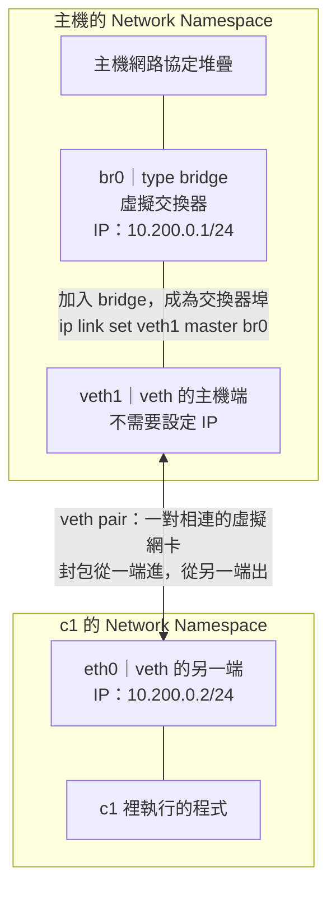

# Linux Network Namespace：netns、veth 與 Bridge

常用網路查詢見 [[Linux networking 常用指令]]，容器實驗延伸見 [[Containerlab 安裝與設定指南]]。

## netns 是什麼？

Network namespace 是獨立的網路空間，有自己的網路介面、IP、路由、鄰居表與防火牆規則。程式屬於某個 network namespace，會使用該空間的網路設定。

[`ip netns add c1`](https://man7.org/linux/man-pages/man8/ip-netns.8.html) 建立名為 c1 的網路空間，不會建立完整容器，也不會自動替它接上網路。它一開始只有尚未啟用的 loopback 介面 `lo`。

| 元件 | 可以怎麼想 | 實際作用 |
|---|---|---|
| netns c1 | 獨立房間 | 隔離網路協定堆疊 |
| [veth pair](https://man7.org/linux/man-pages/man4/veth.4.html) | 網路線的兩端插頭 | 一端送出的封包由另一端接收 |
| Linux bridge br0 | Layer 2 虛擬交換器 | 連接加入它的介面，轉送 Ethernet frames |
| IP address | 房間或主機在網段內的地址 | 設定在介面上，供 Layer 3 通訊 |

介面名稱屬於各自的 netns，因此 c1、c2 都能各有一個叫 eth0 的介面。`br0` 是介面，不是另一個 namespace。

## Bridge 模式拓撲

以下以 Linux 主機模擬一個容器的 bridge 網路；主機對外網卡未畫出。



br0 有兩個角色：對接進來的 veth 而言是 Layer 2 交換器；主機也能把 IP 設在 br0 上，透過它和 c1 通訊。此例的 veth1 只作為交換器埠，不需要 IP。

> [!tip] 記住元件關係
> **br0 是交換器；veth1 ↔ eth0 是網路線的兩端；c1 是獨立的網路空間。**

## 看懂這條建立 veth 的指令

```bash
ip link add veth1 type veth peer name eth0 netns c1
```

| 部分 | 意思 |
|---|---|
| `ip link add veth1` | 在目前的 netns 建立一端，名稱為 veth1 |
| `type veth` | 類型是 veth，成對建立 |
| `peer name eth0` | 另一端的名稱為 eth0 |
| `netns c1` | 把另一端 eth0 放進既有的 c1 |

這一行同時建立兩端，結果是「主機 veth1 ↔ c1 eth0」。此時還沒加入 br0、設定 IP 或啟用介面。

若想逐步理解，可以改成以下三行；與上面是替代寫法，不要重複執行：

```bash
ip link add veth1 type veth peer name veth-c1
ip link set veth-c1 netns c1
ip -n c1 link set veth-c1 name eth0
```

接著 `ip link set veth1 master br0`，才是把主機端接到虛擬交換器。veth1 仍留在主機 netns，只是成為 br0 管理的一個埠。

## 完整操作：建立 c1 與 br0

在 Linux 實驗 VM 中以 root shell 操作，需要 iproute2 和 ping 工具。macOS 原生無法直接執行這套 Linux namespace 指令，應進 Linux VM。下列名稱與網段須未被使用；這是手動模擬，不是操作 Docker 管理的 docker0。筆記中的指令未在實際 Linux 環境執行驗證。

```bash
# 建立容器的網路空間
ip netns add c1

# 在主機建立 bridge，設定主機在此網段的 IP
ip link add br0 type bridge
ip addr add 10.200.0.1/24 dev br0
ip link set br0 up

# 建立相連的兩端，eth0 直接放進 c1
ip link add veth1 type veth peer name eth0 netns c1

# 主機端接到 bridge，並啟用
ip link set veth1 master br0
ip link set veth1 up

# 容器端設定 IP，啟用 eth0 與 loopback
ip -n c1 addr add 10.200.0.2/24 dev eth0
ip -n c1 link set eth0 up
ip -n c1 link set lo up

# 容器的預設路由指向主機的 bridge IP
ip -n c1 route add default via 10.200.0.1
```

這裡的 IP 分配是：br0 用 `.1`、c1 的 eth0 用 `.2`；veth1 不設定 IP。br0 的 IP 作為下一跳，不代表主機已自動開啟路由轉送。

## 查詢與測試：優先記短寫法

```bash
# 主機側
ip netns list
ip -br addr
ip link show master br0

# c1 側
ip -n c1 -br addr
ip -n c1 route
ip -n c1 neigh

# 在 c1 執行其他程式
ip netns exec c1 ping -c 3 10.200.0.1
ip netns exec c1 sh
# 離開上面的 shell 時輸入 exit
```

`ip -n c1 addr` 等同於 `ip netns exec c1 ip addr` 的網路查詢效果：要執行 ip 子命令，用 `ip -n c1` 比較順手；要執行 ping、shell 等其他程式，用 `ip netns exec c1`。

`ip netns list` 列的是已命名、登記在 `/var/run/netns` 下的 namespaces，不是系統所有 network namespaces；Docker 容器的 netns 不一定會出現在這份清單。

## 封包怎麼走？預設路由何時才用到？

c1 ping `10.200.0.1` 時，因為目的地在 eth0 的直接連接網段 `10.200.0.0/24`，不需要用到預設路由。先透過 ARP 找到 `.1` 的 MAC，再傳送 ICMP：

```text
c1 程式 → eth0 → veth1 → br0 → 主機網路協定堆疊
```

若目的地不在直接連接的網段，才會使用：

```bash
ip -n c1 route add default via 10.200.0.1
```

這表示「把封包交給主機 `.1` 幫忙往外送」，不表示已完成連外。要經主機連外，還需要主機路由、IPv4 forwarding、防火牆允許轉送，以及回程路由；常見 Docker bridge 設定用 masquerade／NAT 處理對外位址轉換。DNS 也要另行設定。上面的實驗只完成 c1 與主機的本機橋接連通，不包含 NAT、Docker DNS 或 `-p` port publishing。

## 對照 Docker none、bridge、host

以 Linux Docker Engine 為模型：

| 模式 | 獨立的容器 netns | veth pair | Bridge |
|---|---|---|---|
| none | 有，通常只有啟用的 lo | 不需要 | 不需要 |
| [bridge](https://docs.docker.com/engine/network/drivers/bridge/) | 有 | 每個容器網路連線一對 | 位於主機 netns，連接各容器 |
| [host](https://docs.docker.com/engine/network/drivers/host/) | 沒有獨立的容器 netns，共用主機的 | 不需額外建立 | 不需額外建立 |

Host 模式下，程式直接使用主機的 IP、路由與 port。要模擬它的網路行為，在主機 netns 執行程式即可；不需要再用 `ip netns add` 建立另一個空間，也不是把實體網卡移進 c1。這只模擬網路行為，沒有建立完整容器的其他隔離。

## 清理本實驗

先離開 `ip netns exec c1 sh` 開啟的 shell，並結束仍留在 c1 的實驗程序，再執行：

```bash
# 刪掉 veth 一端會連同另一端一起刪除
ip link del veth1
ip netns del c1
ip link del br0
```

只刪除本實驗建立的名稱。若仍有程序使用 netns，移除其名稱不代表該網路空間已立即釋放。

## 相關影片

### Container Networking From Scratch：最貼近本篇實驗

[[Container Networking From Scratch - Kristen Jacobs, Oracle]]

- **3:44–7:48**：network namespace、veth pair、建立介面與測試；說明沒有啟動應用程式時，namespace 裡的 kernel 網路堆疊也能回應 ping。
- **8:36–12:29**：單一主機上的多個 network namespaces、br0、gateway、預設路由與同網段封包轉送，最適合搭配本篇拓撲回看。
- **12:55 起**：延伸到跨主機通訊。

[影片：從 3:44 開始](https://www.youtube.com/watch?v=6v_BDHIgOY8&t=224s) · [Bridge 段落：8:36](https://www.youtube.com/watch?v=6v_BDHIgOY8&t=516s)

### Understanding Linux user namespaces：Namespace 基礎與權限

[[Michael Kerrisk  Understanding Linux user namespaces]]

- **1:11–4:45**：namespace 的基本概念，以及 UTS、mount、network 等不同類型；一個 process 同時屬於多種類型的 namespace。
- **5:13–6:33**：用 `/proc/<PID>/ns/` 觀察程序所屬的 namespace instance。
- **45:44–46:57**：user namespace 與 network namespace、網路介面的操作權限及可見性。

這篇主題是 **user namespace**，不等於本篇的 **network namespace**。前者處理使用者／群組 ID 映射與權限邊界，後者處理網路隔離；兩者可以組合使用。

[影片：從 1:11 開始](https://www.youtube.com/watch?v=XgThPoL9mPE&t=71s)

### Understanding Kubernetes Networking in 30 Minutes：連回 Pod 網路

[[Understanding Kubernetes Networking in 30 Minutes - Ricardo Katz & James Strong]]

- **3:54–5:24**：Pod network namespace、主機的 root network namespace、veth 與 bridge。
- **6:23 起**：同一 Pod 內的容器透過 localhost 通訊，接著延伸到 Pod 間通訊與 Service。

影片中的 bridge 圖可作為入門模型；實際 Kubernetes 資料路徑依 CNI 而異，不代表每個 CNI 都必須建立同樣的 bridge。

[影片：從 3:54 開始](https://www.youtube.com/watch?v=Mj04QOqAaJ8&t=234s)
