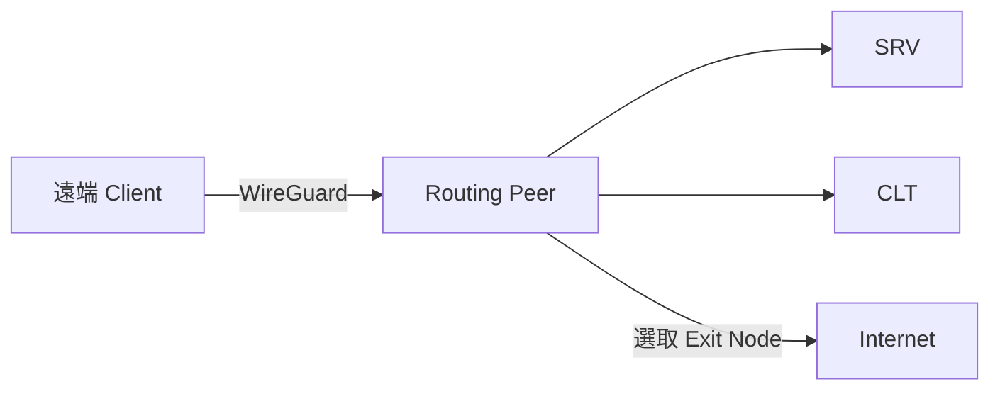

# NetBird Self-hosted and Access Policy

## Topology

**NetBird 服務入口**


**VPN 資料路徑**



## Cisco NAT

將公網 TCP 80、443 轉發到 NetBird Server：

```cisco
configure terminal
ip nat inside source static tcp netbird_server_ip 80 public_ip 80 extendable
ip nat inside source static tcp netbird_server_ip 443 public_ip 443 extendable
end
```

`netbird_server_ip` 填 Debian Server 內網 IP，`public_ip` 填公網 IP。介面需已設定 `ip nat inside`／`ip nat outside`；入站 ACL 放行 TCP 80、443。

確認 NAT：

```cisco
show ip nat translations
show ip nat statistics
```

[正式語法參考](https://www.cisco.com/c/en/us/td/docs/ios-xml/ios/ipaddr_nat/configuration/xe-3s/nat-xe-3s-book/iadnat-addr-consv.html)

## 架構與範例值

以下以 [https://netbird.example.com/](https://netbird.example.com/) 為例。

| 項目 | 範例 |
| --- | --- |
| 公開服務網域 | `netbird.example.com` |
| Routing Peer 名稱 | `routing-peer` |
| Routing Peer 內網 IP | `192.168.50.10` |
| SRV 網段 | `192.168.50.0/24` |
| CLT 網段 | `192.168.60.0/24` |
| Exit Node 名稱 | `Office Internet Exit` |

NetBird IP 由系統自動分配。

### Routing Peer

NetBird Server 管理登入、政策與連線；Routing Peer 負責把 VPN 流量轉送到 SRV／CLT，讓未安裝 NetBird 的內網設備也能被存取。Routing Peer 本身須能連到這些網段，也可作為 Full Tunnel 的 Internet 出口。

### STUN

STUN 查詢 Client 經過 NAT 後的公網 IP／Port，協助建立 WireGuard 直連；無法直連時改由 Relay 傳送加密封包。STUN 不負責內網轉送，也不能取代 Relay。

## 1. Cloudflare 設定

### DNS

進入 **DNS → Records**，新增或修改 A 紀錄：

```text
Type: A
Name: netbird
IPv4 address: public_ip
Proxy status: Proxied（橘色雲）
TTL: Auto
```

### SSL 與 gRPC

進入 **Rules → Configuration Rules**，新增規則：

```text
Name: NetBird SSL Full
Expression: (http.host eq "netbird.example.com")
SSL: Full
```

按 **Deploy**，再到 **Network → gRPC → ON**。

來源站須支援 HTTPS 與 HTTP/2。Full 不驗證來源站憑證；已有有效網域憑證時可改用 Full (strict)。

### Google STUN

在 `config.yaml → server.stuns` 填入 `stun:stun.l.google.com:19302`。Client 與 Routing Peer 放行 UDP 19302 出站，不需設定 Cisco Port Forwarding。

Google 可看到 STUN 請求的來源 IP，但不會取得 VPN 明文或 WireGuard 私鑰；VPN 資料仍由 WireGuard 加密。

[Cloudflare gRPC](https://developers.cloudflare.com/network/grpc-connections/)・[SSL Full](https://developers.cloudflare.com/ssl/origin-configuration/ssl-modes/full/)・[Google STUN 範例](https://webrtc.org/getting-started/peer-connections)

## 2. 安裝 NetBird Server

Debian 主機需先安裝 Docker 與 Docker Compose：[官方安裝步驟](https://docs.docker.com/engine/install/debian/)。

建立獨立目錄，下載官方安裝腳本：

```bash
sudo mkdir -p /opt/netbird
sudo chown "$(id -un):$(id -gn)" /opt/netbird
cd /opt/netbird
curl -fL https://github.com/netbirdio/netbird/releases/latest/download/getting-started.sh -o getting-started.sh
sudo bash getting-started.sh
```

依腳本提示輸入：

| 提示 | 輸入／選擇 |
| --- | --- |
| NetBird domain | `netbird.example.com`（不含 `https://` 或路徑） |
| Enable NetBird Proxy service | `N`：本例只做 VPN，不公開內網 Web 服務 |

安裝後會產生 `docker-compose.yml`、`config.yaml`、`dashboard.env`。

### config.yaml

修改 `config.yaml`：

```yaml
server:
  listenAddress: ":80"
  exposedAddress: "https://netbird.example.com:443"

  stuns:
    - uri: "stun:stun.l.google.com:19302"
      proto: "udp"
  stunPorts:
    - 3478

  metricsPort: 9090
  healthcheckAddress: ":9000"
  logLevel: "info"
  logFile: "console"

  authSecret: "<RELAY_AUTH_SECRET>"
  dataDir: "/var/lib/netbird"

  auth:
    issuer: "https://netbird.example.com/oauth2"
    signKeyRefreshEnabled: true
    sessionCookieEncryptionKey: "<SESSION_COOKIE_KEY_BASE64>"
    dashboardRedirectURIs:
      - "https://netbird.example.com/nb-auth"
      - "https://netbird.example.com/nb-silent-auth"
    cliRedirectURIs:
      - "http://localhost:53000/"

  reverseProxy:
    trustedHTTPProxies:
      - "172.28.0.10/32"

  store:
    engine: "sqlite"
    encryptionKey: "<STORE_ENCRYPTION_KEY_BASE64>"
```

### dashboard.env

```dotenv
NETBIRD_MGMT_API_ENDPOINT=https://netbird.example.com
NETBIRD_MGMT_GRPC_API_ENDPOINT=https://netbird.example.com

AUTH_AUDIENCE=netbird-dashboard
AUTH_CLIENT_ID=netbird-dashboard
AUTH_CLIENT_SECRET=
AUTH_AUTHORITY=https://netbird.example.com/oauth2
USE_AUTH0=false
AUTH_SUPPORTED_SCOPES=openid profile email groups

AUTH_REDIRECT_URI=/nb-auth
AUTH_SILENT_REDIRECT_URI=/nb-silent-auth

NGINX_SSL_PORT=443
LETSENCRYPT_DOMAIN=none
```

### 套用與檢查

```bash
cd /opt/netbird
sudo docker compose config --quiet
sudo docker compose up -d --force-recreate netbird-server dashboard
sudo docker compose ps
sudo docker compose logs --tail=100 netbird-server dashboard
```

`dashboard.env` 修改後要重新建立容器，不能只 restart。服務名稱以 `docker compose config --services` 為準。

依據：[NetBird 設定檔參考](https://docs.netbird.io/selfhosted/maintenance/configuration-files)、[官方安裝流程](https://docs.netbird.io/selfhosted/selfhosted-quickstart)。

### 建立管理員與使用者

1. 瀏覽器開啟 [https://netbird.example.com/](https://netbird.example.com/)。
2. 首次進入 `/setup`，填入 Email、Name、Password，按 **Create Account**。
3. 登入 Dashboard，在使用者管理頁新增／邀請其他使用者。
4. 一般使用者保留一般角色，Entra ID 登入於最後設定。

## 3. 建立群組

在 **Access Control → Groups** 建立：

| 群組 | 成員／用途 |
| --- | --- |
| `VPN-Admins` | 管理員的 Client Peers |
| `VPN-Users` | 一般使用者的 Client Peers |
| `Routing Peers` | 內網路由設備 |
| `SRV` | 伺服器網段資源 |
| `CLT` | 用戶端網段資源 |

`Routing Peers` 放路由設備；`SRV`、`CLT` 放 Network Resources。

## 4. 安裝並註冊 Routing Peer

在可連到 SRV、CLT 與 Internet 的 Linux 主機安裝 Routing Peer。

### 建立 Setup Key

進入 **Settings → Setup Keys → Create Setup Key**：

```text
Name: routing-peer-bootstrap
Type: One-off
Auto-assigned groups: Routing Peers
Ephemeral peers: OFF
```

建立後複製 Setup Key，用於註冊這台 Routing Peer。

### 安裝 Client 並加入自架 Server

在 **Routing Peer** 上執行：

```bash
curl -fsSL https://pkgs.netbird.io/install.sh -o /tmp/netbird-install.sh
sudo sh /tmp/netbird-install.sh
sudo netbird up --management-url https://netbird.example.com --setup-key '<SETUP_KEY>' --hostname routing-peer
sudo netbird status -d
```

`<SETUP_KEY>` 填剛建立的金鑰。到 **Peers** 確認 `routing-peer` 在線，Assigned Groups 包含 `Routing Peers`。

### 確認轉送與 NAT

Linux Client 通常會自動啟用 IP forwarding；先確認：

```bash
sysctl net.ipv4.ip_forward
ip route
```

若 forwarding 為 `0`，再持久化設定：

```bash
echo 'net.ipv4.ip_forward=1' | sudo tee /etc/sysctl.d/99-netbird.conf
sudo sysctl --system
```

Network 保留預設 Masquerade，內網設備看到的來源會是 Routing Peer 的 LAN IP；主機防火牆須允許轉送。

## 5. 建立內網資源與政策

### 加入 Network 與資源

1. 進入 **Networks → Add Network**，名稱填 `Office LAN`。
2. 在該 Network 按 **Add Routing Peer**，選 `routing-peer`。
3. 按 **Add Resource**，建立以下兩個資源：

   | Name | Address | Resource group |
   | --- | --- | --- |
   | `SRV subnet` | `192.168.50.0/24` | `SRV` |
   | `CLT subnet` | `192.168.60.0/24` | `CLT` |

4. 保留預設 Masquerade。

### 加入存取政策

進入 **Access Control → Policies → Add Policy**，建立以下六條單向 Allow 規則：

| Name                  | Source       | Destination     | Protocol／Ports |
| --------------------- | ------------ | --------------- | -------------- |
| Admin to SRV          | `VPN-Admins` | `SRV`           | ALL            |
| Admin to CLT          | `VPN-Admins` | `CLT`           | ALL            |
| Users to SRV          | `VPN-Users`  | `SRV`           | TCP：22、3389    |
| Users to CLT          | `VPN-Users`  | `CLT`           | ALL            |
| Admin to Routing Peer | `VPN-Admins` | `Routing Peers` | ICMP           |
| Users to Routing Peer | `VPN-Users`  | `Routing Peers` | ICMP           |

`routing-peer` 須在 `Routing Peers` 群組內。最後兩條 ICMP 規則讓 Client 可 ping Routing Peer 的 NetBird IP，管理員這條也用於後續 Exit Node。

一般使用者對 SRV 只開 TCP 22、3389，因此能連 SSH／RDP，但不能 ping。若也要開放 ping，再加一條：

```text
Source: VPN-Users
Destination: SRV
Protocol: ICMP
Action: Allow
```

目的主機防火牆也要允許 ICMP；檢查是否有 `All → All` 政策，避免它放行原本要限制的連線。

## 6. 安裝使用者 Client

### macOS

可用官方安裝包，或以 Homebrew 安裝 GUI：

```bash
brew install --cask netbirdio/tap/netbird-ui
```

開啟 NetBird 並完成系統要求的 VPN／網路權限。[macOS 安裝文件](https://docs.netbird.io/get-started/install/macos)

### Windows／Linux

Windows 下載 [官方安裝包](https://docs.netbird.io/get-started/install/windows) 後依安裝精靈操作；Linux 可使用前節的官方 Client 安裝腳本。

### 登入自架環境

1. NetBird 初次啟動選 **Self-hosted**。
2. Management URL 填 `https://netbird.example.com`。
3. 按 **Connect**，在瀏覽器完成登入。
4. 管理員回 Dashboard 的 **Peers → 該裝置 → Assigned Groups**，加入 `VPN-Admins` 或 `VPN-Users`。

Linux 也可互動登入：

```bash
sudo netbird up --management-url https://netbird.example.com
```

登入後確認 Peer 在線且群組正確。

## 7. 管理員切換 Full Tunnel

一般使用者只取用 SRV／CLT，其他流量走本地 Internet。管理員額外取得 Exit Node，平常仍可維持 Split Tunnel。

### 建立 Exit Node

在 Dashboard 選 **Peers → routing-peer → Add Exit Node**：

```text
Name: Office Internet Exit
Distribution Groups: VPN-Admins
Active: ON
Auto Apply: OFF
Masquerade: ON
```

沿用第 5 節的 `VPN-Admins → Routing Peers → ICMP`，不需重複建立。ICMP 是出口的 Peer 存取要求，不代表 Full Tunnel 只能傳送 ping。

Client 選取 **Exit Node → Office Internet Exit** 使用 Full Tunnel，取消選取回到 Split。`Auto Apply: OFF` 讓使用者手動切換；一般使用者不在 Distribution Groups，不會取得出口。

在 **DNS → Nameservers** 為管理員加入可用的 DNS，match domain 設 `ALL`；需要內部名稱解析時，使用內網 DNS。

Exit Node 的 `0.0.0.0/0` 也涵蓋內網，需嚴格隔離時使用獨立出口與防火牆。同一台 Peer 提供 SRV／CLT 時，不要啟用 Block LAN Access。[Exit Node 文件](https://docs.netbird.io/use-cases/remote-access/exit-nodes)

## 8. 驗證與排錯

### 基本檢查

```bash
netbird status -d
netbird networks ls
```

確認 Server、Routing Peer 與內網資源的連線狀態。

從一般使用者測試允許的 SRV 服務，例如：

```bash
nc -vz 192.168.50.20 22
nc -vz 192.168.50.20 3389
```

測試主機須有對應服務。另測一個正在監聽但未授權的埠，確認一般使用者無法存取。

### Exit Node 沒出現

確認 Client 在 `VPN-Admins`、Routing Peer 在線、Exit Node 已啟用，且 ICMP Policy 與 Distribution Groups 正確。

### Full Tunnel 與 DNS

選取 Exit Node 前後執行：

```bash
curl -4 https://ifconfig.me
```

選取後應顯示 Routing Peer 的公網出口，再確認 DNS 與內部服務可用。此指令只測 IPv4。

## 9. Microsoft Entra ID

從 Dashboard 新增 Entra ID 登入，`dashboard.env` 維持前面的設定。

### EntraID callback

1. 用本機管理員登入 **Settings → Identity Providers**。
2. 按 **Add Identity Provider**。
3. Type 選 **Microsoft Entra ID／Microsoft Entra**，Name 填 `Microsoft Entra`。
4. 複製畫面提供的 **Redirect URL**，先不要按 Add Provider。

callback 使用畫面提供的 Redirect URL，不是 `/nb-auth`。

### 在 Entra 註冊應用程式

1. 進入 [Microsoft Entra Admin Center](https://entra.microsoft.com/)。
2. 開啟 **App registrations → New registration**。
3. Name 填 `NetBird`；Supported account types 選 **Accounts in this organizational directory only（Single tenant）**，限制組織租戶使用。
4. 按 **Register**，記下 **Application (client) ID** 與 **Directory (tenant) ID**。
5. 進入 **Authentication → Add a platform → Web**，貼上剛從 NetBird 複製的 Redirect URL，按 **Configure**。
6. 進入 **Certificates & secrets → New client secret**，設定名稱與期限，按 **Add**。
7. 複製密鑰 **Value**，不是 Secret ID。

### 回 NetBird 填入 Provider

| 欄位 | 填入值 |
| --- | --- |
| Type | Microsoft Entra ID |
| Name | Microsoft Entra |
| Issuer URL | `https://login.microsoftonline.com/<TENANT_ID>/v2.0` |
| Client ID | Application (client) ID |
| Client Secret | 剛建立的 secret Value |

填入 `<TENANT_ID>` 後按 **Add Provider**。Client Secret 填在此處，不填入 `dashboard.env`。

### 測試登入與網路權限

用另一個瀏覽器工作階段開啟登入頁，選 **Microsoft Entra**，以組織帳號登入。若啟用使用者審核，回管理員帳號核准新使用者，再核對其 Client Peer 是否在 `VPN-Admins` 或 `VPN-Users`。

### 群組同步（選用）

Entra 的 **Token configuration → Add groups claim** 加入 groups；NetBird 的 **Settings → Groups** 啟用 JWT group sync，claim 填 `groups`。Entra 預設回傳群組 Object ID，需確認同步後的群組有套用正確政策。

來源：[NetBird 的 Microsoft Entra ID Connector 設定](https://docs.netbird.io/selfhosted/identity-providers/managed/microsoft-entra-id)。
