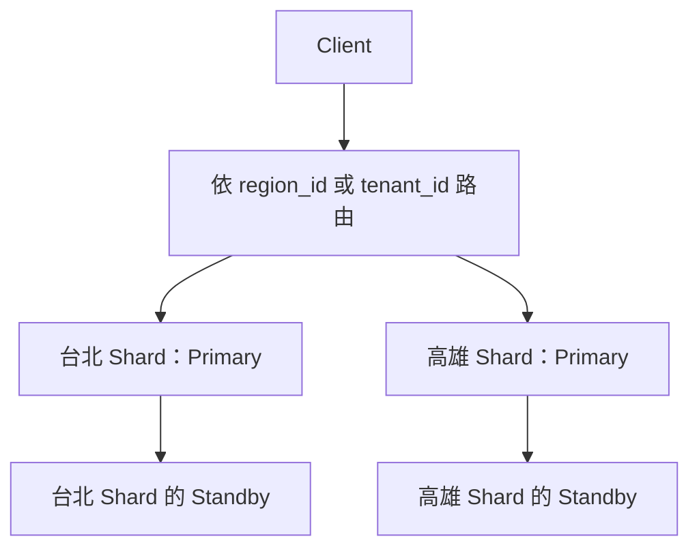

# PostgreSQL 與 CloudNativePG：複製、故障轉移與兩地部署

## PostgreSQL 故障轉移與區域資料切分案例

**兩地部署與資料寫入責任**：假設台北與高雄兩地部署相同的應用程式，並各自配置資料庫連線與區域參數。這裡要先決定的是：兩地是否在修改同一份資料？若兩地各自有可寫 Primary，並雙向複製同一份資料，才是這裡討論的 Multi-leader；若台北只負責北區資料、高雄只負責南區資料，則是 Regional Sharding，每個 Shard 內仍可採用 Single-leader Replication。

**以 Data Ownership 避免跨 Leader 衝突**：namespace 切分可以配合這個方案，但真正降低 Concurrent Writes 衝突的是「每筆資料有唯一的寫入 Owner」。例如依 `region_id` 或 `tenant_id` 將訂單分到台北與高雄，再由 Router 或應用程式把寫入送到負責的 Primary。即使使用者身在高雄，修改屬於台北的訂單仍應送到台北的寫入 Owner，不能因就近連線就直接修改高雄的副本。



圖中的兩個 Primary 分別負責不同資料，Standbys 各自複製所屬 Shard。多個 Client 仍可能同時修改同一個 Shard 內的資料，因此需要交易、鎖定或版本檢查；跨 Shard 交易、全域唯一性與彙總查詢也需要另外設計。這個方案適合資料責任能清楚劃分的情況；如果同一筆資料必須在兩地獨立接受寫入，仍需處理 Multi-leader 的衝突問題。

**每個 Shard 的 Sync／Async 選擇**：在上述設計上，可以另外評估同區域同步複製與跨區域非同步災備。這是延伸的設計選項：本地 Standby 同步確認可降低 Primary 故障時的資料遺失風險；遠端副本非同步接收 WAL 可減少跨區延遲對提交的影響，但遠端接手時可能有資料落差。若業務要求跨區也不能遺失已確認交易，就必須評估跨區同步等待的延遲與網路中斷時的可用性代價。需要先定義 RPO（可容忍的資料遺失範圍）與 RTO（可容忍的復原時間），才能選擇配置。

**Failover 與 Split Brain**：Primary 故障後，提升某個 Standby 接手寫入，仍然是 Single-leader 的角色切換。需要確認候選者的複製進度、將 Client 導向新的寫入端點，並阻止舊 Primary 繼續接受寫入。若只是網路中斷就讓兩邊各自當 Primary，可能產生 Split Brain；即使平常採用 Sync，也不能省略 Fencing 與接手協調。台北 Shard 故障時，高雄若只有自己的 Shard，並不能直接替台北接手；必須另有台北資料的可用副本與明確的責任移轉流程。[PostgreSQL Failover](https://www.postgresql.org/docs/current/warm-standby-failover.html)

**Kubernetes 作為部署方式**：在 K8s 中，可以用 `taipei` 與 `kaohsiung` namespaces 分開部署相同應用程式與各自的 PostgreSQL 資源。namespace 提供資源命名與管理範圍，搭配 RBAC、ResourceQuota 與 NetworkPolicy 做存取、配額與網路隔離；它本身不會切分資料、不會阻止兩地更新相同 Key，也不等於機房故障隔離。同一個 Kubernetes Cluster 的 namespaces 仍共用控制平面；若需要獨立的區域故障範圍，還要規劃分開的 Cluster、運算與儲存資源。[Kubernetes Namespaces](https://kubernetes.io/docs/concepts/overview/working-with-objects/namespaces/)

**CloudNativePG 與複製設定**：可以在每個區域以 CloudNativePG 管理一組 PostgreSQL Primary／Standbys，配置 Sync 或 Async 與故障轉移。CloudNativePG 1.28 文件中，未設定同步區段時預設是 Async；設定 `spec.postgresql.synchronous` 的 `method` 與 `number` 可以要求同步 Standby 確認。此處的同步 Quorum 是由 Primary 等待 Standbys 的 WAL 確認，與前面 Leaderless 的讀寫 Quorum 是不同的協調方式。[CloudNativePG 1.28 Replication](https://cloudnative-pg.io/docs/1.28/replication/)

**兩地的部署管理流程**：兩地可以使用同一份 Helm Chart，搭配 `values-taipei.yaml` 與 `values-kaohsiung.yaml` 指定區域及資料庫連線；非敏感設定留在 values，資料庫密碼等憑證由 Sealed Secrets 管理。部署由 Argo CD 管理，持續比對 Git 中的設定與 Kubernetes 的實際狀態並進行同步。這些工具負責部署與設定管理；資料的 Owner、複製方式與衝突處理，仍由資料庫及應用程式的架構決定。

> 這個案例的核心做法是：先切分資料責任，讓每個 Shard 有唯一的寫入 Owner，再為每個 Shard 設計複製與 Failover；namespace 可以承接部署上的切分，但資料一致性仍靠寫入路由、交易控制與責任移轉機制維持。

## PostgreSQL 的提交確認階段

PostgreSQL Streaming Replication 預設是 Async。啟用同步複製時，需要設定 `synchronous_standby_names`，並配合 `synchronous_commit` 決定等待到哪個階段。`synchronous_commit = on` 在有同步 Standby 的情況下，等待其 WAL 持久化；`remote_apply` 進一步等待 WAL 套用，使該交易能在參與確認的 Standby 上被查詢。只有 `synchronous_commit = on` 而沒有配置同步 Standby，並不代表已啟用遠端同步複製；Sync 也不代表所有 Replica 都已更新。[PostgreSQL WAL 與提交設定](https://www.postgresql.org/docs/current/runtime-config-wal.html#GUC-SYNCHRONOUS-COMMIT)

## CNPG 宣告式設定

**CloudNativePG（CNPG）**：透過 Kubernetes 的 `Cluster` CRD 描述 PostgreSQL 的期望狀態，再由 Operator 管理 Primary、Standbys 與故障轉移。應用程式可用 Helm 部署，資料庫的執行與角色管理則交給 CNPG。以下使用 CNPG 1.28 的設定格式，作為假設案例，尚未在實際 Cluster 部署驗證。

| 設定位置 | 用途 |
| --- | --- |
| `spec.instances` | PostgreSQL 執行個體總數；3 個通常為 1 個 Primary 與 2 個 Standbys |
| `spec.storage` | 每個執行個體的資料儲存設定 |
| `spec.bootstrap.initdb` | 初次建立資料庫、Owner 與登入憑證來源 |
| `spec.postgresql.parameters` | PostgreSQL 參數；值使用字串 |
| `spec.postgresql.synchronous` | 同步 Standby 的選擇方式、確認數量與耐久性政策 |

假設台北 namespace 為 `taipei`，資料庫 Cluster 名稱為 `pg-tp`：

```yaml
apiVersion: postgresql.cnpg.io/v1
kind: Cluster
metadata:
  name: pg-tp
  namespace: taipei
spec:
  instances: 3
  storage:
    size: 10Gi
  bootstrap:
    initdb:
      database: app
      owner: app
      secret:
        name: app-db-secret
  postgresql:
    parameters:
      max_connections: "100"
      shared_buffers: "256MB"
      synchronous_commit: "on"
    synchronous:
      method: any
      number: 1
      dataDurability: required
```

`method: any` 與 `number: 1` 要求任一符合條件的 Standby 確認；配合 `synchronous_commit: "on"`，提交會等待該 Standby 的 WAL 持久化。`dataDurability: required` 表示所需同步副本不足時，不能為了繼續提交而自動放寬要求。這不代表兩個 Standbys 都已套用交易，也不代表此 YAML 已建立跨區災備。

若採用 CNPG 預設的 Async，建立設定時省略 `synchronous` 區段即可。`synchronous_commit: "on"` 在沒有同步 Standby 時只等待本地 WAL 持久化；不需要設成 `off`，因為 `off` 連本地提交的持久化等待也會放寬。副本數與儲存容量是示例值，實際依 workload 與故障範圍規劃。

CNPG 會管理 `synchronous_standby_names` 等複製設定，應透過 CRD 的同步區段配置。其他允許自訂的參數放在 `postgresql.parameters`，由 Operator 套用到各執行個體。[CNPG PostgreSQL Configuration](https://cloudnative-pg.io/docs/1.28/postgresql_conf/)

## Secret 與應用程式連線

**Bootstrap Secret**：範例中的 `app-db-secret` 必須先存在於 `taipei` namespace，型別為 `kubernetes.io/basic-auth`，包含 `username` 與 `password`，且 `username` 必須是 `app`，與 `bootstrap.initdb.owner` 相同。可以由 Sealed Secrets 解密產生這個 Secret，再供 CNPG 初始化與應用程式連線使用。Bootstrap 是新資料庫的初始化步驟；既有資料庫的憑證輪替需另外處理角色與 Secret 的更新。[CNPG Bootstrap](https://cloudnative-pg.io/docs/1.28/bootstrap/)

**Sealed Secrets**：非敏感設定放在 Helm values；密碼等憑證加密為 SealedSecret 存入 Git，由對應 Cluster 的 Controller 解密。預設的 strict scope 綁定 Secret 名稱與 namespace，兩地要以各自 Controller 的憑證與目的 namespace 產生密文。SealedSecret 的 `spec.template.type` 可設定為 `kubernetes.io/basic-auth`，讓解密後的 Secret 符合 CNPG 的要求。[Sealed Secrets](https://github.com/bitnami/sealed-secrets)

**讀寫端點**：CNPG 提供 `<cluster-name>-rw` Service 指向 Primary，`<cluster-name>-ro` 則指向唯讀副本。應用程式使用穩定的 Service 名稱連線，不把某個 Pod 名稱當作固定 Primary；Failover 後仍需處理既有連線中斷與交易重試。[CNPG Service Management](https://cloudnative-pg.io/docs/1.28/service_management/)

```yaml
# values-taipei.yaml
region: taipei
database:
  host: pg-tp-rw.taipei.svc.cluster.local
  name: app
  existingSecret: app-db-secret
```

```yaml
# values-kaohsiung.yaml
region: kaohsiung
database:
  host: pg-kh-rw.kaohsiung.svc.cluster.local
  name: app
  existingSecret: app-db-secret
```

高雄的 CNPG Cluster 可沿用同樣結構，將名稱改為 `pg-kh`、namespace 改為 `kaohsiung`，並建立該 namespace 的 Secret。假設各區應用程式也部署在對應 namespace，可使用 `secretKeyRef` 讀取同名 Secret；不同 namespace 的 Secret 是不同資源。上述 DNS 是各自 Kubernetes Cluster 內部的端點，不能直接當作跨 Cluster 連線地址。

## Helm 與 Argo CD

**Helm**：共用 Chart，以區域 values 設定應用程式的 region、資料庫連線與 Secret 名稱。`database.existingSecret` 是此應用 Chart 自行約定的欄位，需要 templates 實際引用，並不是 Helm 或 CNPG 自動辨識的通用設定。

**Argo CD**：以 Application 管理 Git 來源與部署目的地，並選取各區域的 Helm values。Argo CD 同步應用程式與 CNPG 的宣告式資源，資料庫複製與接手角色由 CNPG／PostgreSQL 管理。[Argo CD Helm](https://argo-cd.readthedocs.io/en/stable/user-guide/helm/)

